# Technisch Ontwerp - Blikjesregistratie TVB

**Auteur:** Youri Rodenburg
**Versie:** 3.22
**Datum:** 27 oktober 2026
**Status:** frontend-demo met productieschema voor PostgreSQL

Dit document is het enige ontwerpdocument van het project. Het bevat zowel de functionele kant (aanleiding, gebruikersrollen, eisen, use cases, wireframes en acceptatiecriteria) als de technische uitwerking (architectuur, database, interfaces, beveiliging en tests). Het eerdere functioneel ontwerp is hierin opgenomen.

### Versiegeschiedenis

De versies hieronder komen uit de git-historie van dit bestand (`git log --follow -- docs/TO-BLIKJESREGISTRATIE.md`) en uit de regel "Versie" bovenaan het bestand in iedere commit. Wijzigingen zonder nieuw versienummer staan bij de versie waaronder ze zijn gedaan. Een versie 3.2 is nooit vastgelegd: na 3.1 kwam direct 3.3.

| Versie | Datum | Wijziging |
|---|---|---|
| 1.0 | 4 september 2026 | Eerste versie in de repository (commit 388e3b4), samen met een apart functioneel ontwerp (FO). Het TO beschreef de OOP-opbouw met `DataStore`, `RegistrationModel`, `RegistrationView` en `RegistrationApp`, de HTML en CSS, het datamodel, de foutafhandeling, de Excel-export, de beveiliging voor productie en een test- en acceptatieplan. |
| 2.0 | 7 september 2026 | TO herschreven (commit 76a0d82): architectuur in de browser, databasemodel, beheerschermen, export, beveiligingseisen en testscenario's. Daarna zonder nieuw versienummer bijgewerkt: registreren van meerdere producten en uitgebreider beheer (8 september). Verplaatst naar de map `Documenten/` en daarna naar `docs/`, groeperen en filteren per bedrijf en het PostgreSQL-schema (10 september). CSV-export met loonmaand in plaats van de Excel-export, en bedrijvenbeheer, consumptiepunten en voorraadbeheer (28 september). |
| 3.0 | 29 september 2026 | Licht en donker thema, objectgeoriënteerde opbouw van de JavaScript en het project opgeruimd. Daarna zonder nieuw versienummer: betere bediening en styling op de tablet (29 september) en SVG-iconen, betere foutmeldingen en lege toestanden (1 oktober). |
| 3.1 | 1 oktober 2026 | Persoonlijke begroeting, demo gezichtsherkenning en wireframes toegevoegd. Documentatie bijgewerkt. |
| 3.3 | 2 oktober 2026 | Bugs opgelost, beveiliging verbeterd, correctiedatum en werkgevernummer per registratie toegevoegd. |
| 3.4 | 6 oktober 2026 (commit 259176e) | TO volledig nagelopen: alle eisen gecontroleerd tegen de code en het databaseschema, tegenstrijdigheden opgelost (correcties, voorraad, export), FR-57 t/m FR-64 toegevoegd, MoSCoW-prioriteiten en meetbare NFR's met ID, stakeholders, scope, aannames en begrippen, ontwerpkeuzes, volledig logisch datamodel met ERD, diagrammen (context, architectuur, klassen, ERD, use cases), een traceerbaarheidsmatrix en een testverslag voor de acceptatietests. Tegelijk is de code aangepast op de punten uit deze controle, onder andere: wissen in een ander tabblad wordt overgenomen en "1 medewerker" en "1 product" staan in enkelvoud (zie `tests/to-controle.test.js`). |
| 3.5 | 9 oktober 2026 | Testplan voor de herkenningsnauwkeurigheid van de demo gezichtsherkenning (hoofdstuk 15) met acceptatiecriterium AC-83: hoe vaak iemand als een ander wordt herkend, een onbekende toch wordt herkend of een medewerker niet wordt herkend. |
| 3.6 | 9 oktober 2026 | AFAS-koppeling (ontwerp) en herkennen met de pas. Ontwerp van de koppeling met AFAS Profit voor de medewerkergegevens (hoofdstuk 11) met FR-67 en AC-87 t/m AC-89. Herkennen met een USB-NFC-pasjeslezer in de demo (class `BadgeReader`) en een pas koppelen in het beheer, met FR-65, FR-66, UC-20 en AC-84 t/m AC-86. |
| 3.7 | 9 oktober 2026 | Open punten uit de beveiligingsscan opgelost (hoofdstuk 13). Iedere beheeractie controleert in de controller zelf of er een beheerder is ingelogd (`requireAdmin`). Product-id's als `__proto__`, `constructor` of `toString` kunnen de voorraadlijst van een consumptiepunt niet meer verstoren. De camera gaat uit als de tijd voor herkennen of instellen om is. Codes en tijdstippen worden bij het laden strenger gecontroleerd. Het logboek in het databaseschema is echt alleen-toevoegen (triggers). De CI draait op Node.js 24 en de licentie van TensorFlow.js is toegevoegd. Twee bekende beperkingen erbij: registreren op naam van een ander en face-api dat niet meer wordt onderhouden. Nieuw testbestand `tests/beveiligingsscan.test.js` (534 tests in totaal). User stories US-01 t/m US-64 toegevoegd aan het eind van hoofdstuk 10. De diagrammen tonen nu ook de pasjeslezer, `BadgeReader`, UC-20 en de koppeling met AFAS. `BADGE_READER.minLength` is 4, zodat ook het kortste pasnummer dat de beheerder kan koppelen te scannen is. |
| 3.8 | 12 oktober 2026 | Correctie `−` verbeterd: de beheerder kiest in het nieuwe venster `Registratie verwijderen` welke registratie (datum en tijd, product en aantal) weg moet, in plaats van dat altijd de laatst ingevoerde registratie verdwijnt. FR-14, UC-09, W19, US-30, AC-12 en AC-78 aangepast, AC-90 en screenshot W41 toegevoegd. In het logboek staat nu ook wanneer de verwijderde registratie was geregistreerd. De open controle van de keuzelijsten in het donkere thema is uitgevoerd (zie W39): de keuzelijsten en hun opties zijn in beide thema's goed leesbaar (licht 21:1, donker 15,7:1). Daarbij bleek de placeholdertekst in het donkere thema te weinig contrast te hebben (3,4:1). Die gebruikt nu `--muted` (6,9:1). Ook de grijze uitleg- en bijschrifttekst (`--muted`) haalde in het lichte thema de norm niet (3,9:1) en is iets donkerder gemaakt in dezelfde tint (`#5a6c71`, 5,5:1). W39 is opnieuw gemaakt en de twee bekende beperkingen over deze punten zijn vervallen. 547 tests in totaal. Nieuw zijn 9 browsertests (`tests/e2e/`) die de echte pagina in headless Edge of Chrome testen, zonder npm-pakketten, en die in GitHub Actions na de unit tests draaien. De melding "… bestaat niet meer. Er is niets opgeslagen." staat in de app nu precies zoals in dit document. De controller is opgesplitst zonder gedragsverandering: `RegistrationApp` (eerst 2414 regels, toen 593) maakt en koppelt acht kleinere classes met elk één taak (`ModalManager`, `EmployeeController`, `BadgeController`, `FaceController`, `AdminController`, `CorrectionController`, `StockController` en `FormController`), en alle methodes blijven via `RegistrationApp` bereikbaar. Hoofdstuk 6 (met het klassendiagram en het architectuurdiagram), de use cases, hoofdstuk 13 en hoofdstuk 16 zijn daarop aangepast, en de bekende beperking "`RegistrationApp` is een grote klasse" is vervallen. De acht onderdelen staan in de map `assets/js/controllers/`. Bestandsnamen consequenter gemaakt: `csvExport.js` heet nu `CsvExport.js` (zoals de andere classes) en de testbestanden hebben Nederlandse namen die zeggen wat ze testen (`thema`, `welkom-en-gezichtsherkenning`, `pasjeslezer`, `codecontrole4-model`, `codecontrole4-ui` en `view-en-controller`). |
| 3.9 | 12 oktober 2026 | Hoofdstuk 9: de vijftien low-fidelity wireframes (L01 t/m L15) opnieuw gemaakt in een echte schetsstijl, met dunne zwarte lijnen op wit, een rechthoek met een kruis voor afbeeldingen, iconen en het logo, een cirkel met een kruis voor avatars en krabbellijnen in plaats van tekst. De eerdere versie leek te veel op een mid-fidelity wireframe. De uitleg over hoe ze zijn gemaakt en de legenda zijn aangepast. Twee iteraties (ontwerpvarianten) toegevoegd bij de mid-fidelity wireframes (beginpagina met een alfabetische lijst en de zoekbalk onderaan, productvenster met een aantalveld) en twee bij de high-fidelity wireframe (productvenster met tegels en registreren per tegel, beginpagina met de totalen bovenaan en een raster met avatars), elk met wat er anders is, de afweging en het besluit. De website zelf, de mid-fidelity wireframes M01 t/m M15 en de screenshots W01 t/m W41 zijn niet veranderd. |
| 3.10 | 12 oktober 2026 | AVG-toets van de demo en van het ontwerp voor productie. Drie aanpassingen in de app: (1) "welkom terug" en de keuze van de vorige keer (`Zelfde als vorige keer`) verschijnen alleen nog als de medewerker is herkend met de pas of de camera. Wie op een naam tikt, krijgt een gewone begroeting, zodat een collega niet kan zien of iemand al eens iets registreerde en wat. FR-49, FR-50, UC-02, UC-20, W07 t/m W10, US-09, US-10 en AC-41 aangepast en AC-91 toegevoegd. (2) De beheerder wordt automatisch uitgelogd als het beheer 5 minuten niet is gebruikt (`ADMIN_IDLE_LOGOUT_MS` in `config.js`), met een melding. Nieuwe eis FR-68, UC-07 pad A3, US-65 en AC-92. (3) Onder in het productvenster staat een korte uitleg dat registraties maandelijks op het loon worden ingehouden, met een verwijzing naar de privacyverklaring voor medewerkers. Nieuwe eis FR-69, US-66 en AC-93. In hoofdstuk 13 de nieuwe paragraaf [AVG-verantwoording (productie)](#avg-verantwoording-productie) met grondslag, doelbinding, dataminimalisatie, bewaartermijnen, rechten van betrokkenen, informatieplicht, datalekken, verwerkersovereenkomsten, doorgifte, instemming van de ondernemingsraad, DPIA, verwerkingsregister en functionaris gegevensbescherming. Correcties: UAVG artikel 29 volgens de tekst die geldt vanaf 1 september 2026, en een duidelijke eis voor versleuteling (versleuteling van schijf of database, geen kolomversleuteling, zie ook het commentaar bij `pgcrypto` in `DATABASE-SCHEMA.sql`). De ondernemingsraad staat bij de stakeholders, de risico's in de demo zijn aangevuld, het testplan herkenningsnauwkeurigheid vraagt uitdrukkelijke schriftelijke toestemming en de bronnen zijn uitgebreid. Nieuw testbestand `tests/avg-toets.test.js`. 565 unit tests en 9 browsertests in totaal. De screenshots W07, W08 en W10 zijn opnieuw gemaakt en tonen nu de regel over de inhouding op het loon, en W10 is gemaakt na herkenning met de pas. |
| 3.11 | 12 oktober 2026 | Fouten en afwijkingen uit drie reviews (gegevens, bediening en requirements) opgelost. **Opslag:** een lijst die er wel staat maar geen lijst is, maakt de gegevens onleesbaar (met reservekopie en melding) in plaats van stil leeg te worden. Een volle opslag geeft een eigen melding ("De opslag van de browser is vol. Er is niets opgeslagen. Vraag de beheerder om de registraties te exporteren en oude gegevens te wissen.") en de app verwijdert zelf niets. Dubbele passen worden pas na het opschonen gecontroleerd. Niet-bestaande datums zoals 31 februari zijn ongeldig. Een pasnummer in kleine letters of met `:` wordt bij het laden gelijk gemaakt. Mislukt wissen geeft "De gegevens konden niet worden gewist. Probeer het opnieuw." Een werkgevernummer als getal in een registratie wordt tekst. De demo gezichtsherkenning vergelijkt alleen nog met actieve, bestaande medewerkers. **Bediening:** een scan in het veld `Pasnummer` vervangt het oude nummer, een scan in het bedrijfsfilter laat geen pasnummer achter, een dubbelklik op `Registreren` en een ingedrukt gehouden Enter openen geen tweede productvenster, de focus blijft na opslaan, (de)activeren, verwijderen en wijzigingen uit een ander tabblad op de knop, en het datumveld van de correctie schuift na middernacht mee. Toegankelijkheid: een vaste live region voor het aantal in het productvenster, tabbladen met `role="tab"` en `aria-selected`, en een bedrijfsfilter met `aria-expanded`, opties met `aria-selected` en Escape. De cijfervelden zijn tekstvelden met een cijfertoetsenbord, zodat "12a" de melding "Gebruik alleen cijfers." geeft. **TO:** de laadmeldingen staan in de app nu zonder puntkomma zoals in dit document, FR-37, UC-01, UC-02, UC-10, UC-11, UC-12, UC-15, UC-17 t/m UC-20, AC-67 en NFR-05 en NFR-17 aangepast, AC-94 t/m AC-98 toegevoegd, het aandachtspunt over voorloopnullen in Excel (hoofdstuk 12) en twee bekende beperkingen (volle opslag en voorloopnullen) in hoofdstuk 16. Nieuw testbestand `tests/review-oktober.test.js`. 611 unit tests en 13 browsertests in totaal. |
| 3.12 | 15 oktober 2026 | Twaalf verbeteringen uit een UX-review van de medewerkerskant (zie [UX-review oktober 2026](#ux-review-oktober-2026) in hoofdstuk 9), binnen de huisstijl en zonder nieuwe kleuren of animaties. (1) Het productvenster sluit na 75 seconden zonder invoer vanzelf zonder op te slaan, met in de laatste 10 seconden "Venster sluit zo. Tik om door te gaan." (`EMPLOYEE_IDLE_CLOSE_MS` in `config.js`). (2) Een pas vervangt het open productvenster van een collega. Bij een ander open venster verschijnt "Sluit eerst het open venster om je pas te gebruiken." (3) De knopbalk met `Registreren` blijft onderaan het productvenster in beeld, met een knop over de volle breedte (54 pixels hoog, 19 pixels vet). (4) Na registreren zijn het zoekveld en het bedrijfsfilter leeg en staat de lijst bovenaan. (5) Een compactere banner en het zoekveld naast het bedrijfsfilter, zodat op een liggende tablet de eerste naam op 511 in plaats van 691 pixels staat. (6) Boven het zoekveld de hint "Houd je pas tegen de lezer, of zoek je naam". (7) Een product met een keuze heeft een lichtgroene achtergrond en een groene rand. (8) Tikdoelen van minstens 44 pixels (pijlknop bedrijfsfilter 40) en op een aanraakscherm `−` en `+` van 52 pixels. (9) Een schermlezer hoort na zoeken alleen het aantal medewerkers, en meldingen staan in twee vaste regio's (`role="status"` en `role="alert"`). (10) Meldingen met tekst van 16 pixels en kleine kopjes in `--green-dark`. (11) "Tik op je naam", "Tik om te kiezen", "Tik op + bij wat je pakt. Tik daarna op Registreren." en het voorraadlabel "Leeg" in plaats van "Op". (12) `Registreren` zonder keuze is uitgeschakeld met `aria-disabled` en de uitleg "Kies eerst een product met +", in plaats van de foutmelding "Kies eerst minimaal één product". Nieuwe eisen FR-70 en FR-71, FR-47, FR-48, FR-65, NFR-04 en NFR-05 aangepast, UC-01, UC-02 en UC-20 bijgewerkt, US-67 t/m US-70 en AC-99 t/m AC-107 toegevoegd, hoofdstuk 13 (venster sluit vanzelf, zoekveld leeg) en 14 (meldingen) aangevuld. De screenshots W01 t/m W41 in hoofdstuk 9 zijn op 15 oktober 2026 opnieuw gemaakt, zodat ze de website na deze verbeteringen tonen, en hun omschrijvingen zijn daarop aangepast. Nieuw testbestand `tests/ux-review.test.js`. Daarna zijn twee fouten opgelost die op de nieuwe screenshots zichtbaar waren: zonder producten op het consumptiepunt staan de knopbalk en de regel over de inhouding op het loon niet meer als lege strook in het productvenster (W11), en ieder venster opent bovenaan, ook het productvenster na herkenning met de camera (W14). 661 unit tests en 19 browsertests in totaal. |
| 3.13 | 16 oktober 2026 | Nieuwe [Bijlage B: Onderzoek naar een afgesloten koelkast of kast](#bijlage-b-onderzoek-naar-een-afgesloten-koelkast-of-kast): een klein onderzoek naar de wens dat de koelkast of kast alleen opengaat na registreren en dat zeker is dat iemand pakt wat hij registreert. Met hoofdvraag, deelvragen, onderzoeksmethode, beoordelingscriteria, vijf oplossingsrichtingen, een beslismatrix, het advies (een slot met weegcellen per schap en de pas als sleutel, met de voorraadtelling als controle), een ontwerpschets voor productie, risico's met maatregelen, privacy en de ondernemingsraad, en vervolgonderzoek. Er zijn geen leveranciers benaderd, geen prijzen opgevraagd en geen proef gedaan. Het idee "Slim slot" in hoofdstuk 16 verwijst naar de bijlage en hoofdstuk 17 heeft drie nieuwe bronnen. De app en `DATABASE-SCHEMA.sql` zijn niet veranderd. |
| 3.14 | 19 oktober 2026 | Het advies uit bijlage B (optie C: een slot met weegschalen per schap en de pas als sleutel) als simulatie in de demo: de slimme koelkast, uit te zetten met `SMART_FRIDGE` in `config.js`. Op de beginpagina opent de knop `Slimme koelkast (demo)` het koelkastvenster: "Houd je pas tegen de lezer om de koelkast te openen", daarna de open koelkast met de schappen, pakken met een tik en `Terugleggen`, en na `Deur dicht` het overzicht, bijvoorbeeld "Je hebt gepakt: 2× Blikje". Het gewichtsverschil per schap wordt met een tolerantie omgerekend naar aantallen en in één keer geregistreerd (met de voorraad en één logboekregel). Een onverklaarbaar verschil wordt niet geregistreerd en geeft de status "Controle nodig". Nieuwe classes `SmartFridge`, de interfaces `FridgeLock` en `ShelfScale` met de nagebootste `SimulatedLock` en `SimulatedShelfScale` (map `assets/js/fridge/`), `FridgeController` (het negende onderdeel van de controller) en `FridgeView`. In productie stuurt alleen de backend het slot en de weegschalen aan en worden alleen de nagebootste classes vervangen. In het beheer het tabblad Koelkast met de indeling van de schappen en de laatste openingen. Nieuwe gegevens `fridgeShelves` en `fridgeOpenings` met controle en migratie in `DataStore`, en registraties met `source: "fridge"`. Nieuwe eisen FR-72 t/m FR-77, UC-21, US-71 t/m US-76 en AC-108 t/m AC-115. FR-52 en de vraag bij `Alle gegevens wissen` noemen nu ook de koelkastopeningen. Hoofdstuk 6, 8, 9 (screenshots W42 t/m W44), 13, 14, 15, 16, bijlage A en bijlage B ([Simulatie in de demo (versie 3.14)](#simulatie-in-de-demo-versie-314)) bijgewerkt, net als het klassendiagram, het architectuurdiagram en het use-casediagram. Nieuw testbestand `tests/slimme-koelkast.test.js`. Na het uitbrengen van deze versie faalden de browsertests in GitHub Actions. Oorzaak: de testcode mat de plek van een knop voordat een overgang (met prefers-reduced-motion 0,01 ms) klaar was. Die is pas bij het volgende beeld klaar, het koelkastvenster schoof dan nog op en de klik viel naast de knop. De browsertests klikken nu pas als het element stilstaat, wachten ruimer en geven bij een fout het scenario, de toestand van de pagina, de laatste meldingen uit de console en een schermafdruk (in GitHub Actions bewaard als artifact). Verder gebruikt `BadgeReader` het tijdstip waarop een toets binnenkwam (`event.timeStamp`), zodat een scan op een trage tablet niet meer als typen wordt gezien. 717 unit tests en 21 browsertests in totaal. |
| 3.15 | 20 oktober 2026 | Proefplan voor één weegschap toegevoegd aan bijlage B ([Proefplan: één weegschap](#proefplan-één-weegschap)): onderzoeksvragen, opstelling met standaardonderdelen, voorwaarden, acht metingen, voorgestelde criteria voor slagen en het vervolg. De proef is nog niet uitgevoerd. |
| 3.16 | 20 oktober 2026 | Fouten uit vijf rollenspeltests en een FMEA opgelost. (1) Sluiten van het productvenster zonder registreren (kruisje, achtergrond of Escape) maakt het zoekveld en het bedrijfsfilter ook leeg (FR-70, UC-01, UC-02). (2) Een dubbeltik op `Deur dicht` sluit het overzicht van de koelkast niet meer: een klik op de achtergrond, het kruisje of `Klaar` binnen 500 ms na een nieuwe stap telt niet. (3) De open koelkast zegt "Alles wat je nu pakt, staat op naam van …", de waarschuwing na 60 seconden noemt die naam ook, en de pas van een collega terwijl de deur open is geeft de opening de status "Controle nodig" (FR-75, FR-77, UC-21, bijlage B). (4) Twee tabbladen: `DataStore.save` schrijft niet meer over een opslag heen die een ander tabblad intussen heeft gewijzigd. `persist` laadt dan eerst de nieuwe gegevens en voert de wijziging opnieuw uit (NFR-08, FR-60, UC-19). (5) De koelkast rekent met het gemeten gemiddelde gewicht van één stuk (`SMART_FRIDGE.measuredWeightRange`), zodat bijvoorbeeld 6 eieren van klasse L niet meer als 7 worden geteld (FR-73, bijlage B). (6) Een telling zet de verwachte voorraad, de getelde voorraad en het verschil in het logboek (FR-39, UC-14). (7) Een gewijzigde prijs, looncode, personeelsnummer of werkgevernummer staat met de oude en de nieuwe waarde in het logboek, het pasnummer niet (FR-27). (8) De demokeuze in de koelkast begint met "Kies een medewerker" en `Openen (demo)` staat pas aan na een keuze (FR-72). (9) `Zelfde als vorige keer` is minstens 44 pixels hoog. (10) Hover-stijlen van medewerkerrijen, `+`, `−` en de schappen gelden alleen met een muis of pen (`@media (hover:hover)`). (11) Registreren bij voorraad 0 mag volgens hoofdstuk 8 en geeft de status "Leeg": niets veranderd. (12) De CSV-export zet geen apostrof meer voor een negatief getal in de kolommen Jaar, Maand, Totaal en Prijs. (13) `DATABASE-SCHEMA.sql` bepaalt de maand in `monthly_employee_consumption` in de tijdzone Europe/Amsterdam, en `stock_alerts` zegt "Leeg" in plaats van "Op". (14) Hoofdstuk 13 noemt bij een volle opslag de juiste melding, hoofdstuk 15 zegt per CI-job welke tijdzone geldt, en de grootte van een registratie is opnieuw gemeten (243 tekens met en 219 zonder werkgevernummer). Nieuwe acceptatiecriteria AC-116 t/m AC-124. Nieuw testbestand `tests/rollenspel-oktober.test.js` en vijf nieuwe browsertests. 759 unit tests en 26 browsertests in totaal. De screenshots W33 en W42 t/m W44 zijn op 21 oktober 2026 opnieuw gemaakt, zodat ze de nieuwe logboekregels, de lege demokeuze en de regel met de naam in de open koelkast tonen. In het logboek mag de kolom Details nu afbreken, zodat de tabel in het beheervenster past en de kolom Datum & tijd zichtbaar blijft (760 unit tests). |
| 3.17 | 21 oktober 2026 | Standby, tik om te scannen en de vraag over gezichtsherkenning na een passcan (demo), naar een idee uit de organisatie. (1) Na 2 minuten zonder gebruik dimt de tablet met "Tik op het scherm om te beginnen" (`STANDBY` in `config.js`). Eén tik wekt de tablet zonder een knop eronder in te drukken, en een passcan in standby werkt meteen (FR-78). (2) Na de tik start, als er een camera is en iemand een gezicht heeft ingesteld, een scan van hooguit 10 seconden in het venster "Even kijken wie je bent". De camera gaat alleen na een tik aan, scant nooit constant en gaat na de scan altijd uit (FR-79). (3) Na herkennen met de camera of de pas opent standaard de slimme koelkast voor de medewerker, met een knop naar het productvenster voor brood en beleg (`RECOGNITION_TARGET` in `config.js`, FR-80). Een passcan op de beginpagina opent dus direct de koelkast. (4) Wie met de pas wordt herkend en nog geen gezichtsherkenning heeft, krijgt de vraag "Gezichtsherkenning nog niet ingesteld. Wil je dit?" met `Ja, instellen` en `Nee`. `Nee` wordt onthouden (FR-81). (5) Een gezichtsinstelling heeft een datum en verloopt na 365 dagen. Daarvoor worden de kenmerken (128 getallen, geen foto) nu in de opslag bewaard, met controle en migratie in `DataStore`, en gewist bij uitzetten, verlopen, (de)activeren, verwijderen en `Alle gegevens wissen`. Ze staan niet in de export of het logboek (FR-82). Dat is een bewuste afwijking van "alleen in het geheugen" (hoofdstuk 8 en 13). Nieuwe classes `StandbyController` en `RecognitionController` (het tiende en elfde onderdeel van de controller). FR-51, FR-65, FR-71, FR-72 en NFR-11 aangepast, nieuwe eisen FR-78 t/m FR-82, UC-03, UC-04, UC-05, UC-20 en UC-21 bijgewerkt, nieuwe UC-22, US-77 t/m US-82 en AC-125 t/m AC-132. Nieuwe screenshots W45 t/m W47 en W12 opnieuw gemaakt (nieuwe tekst bij het toestemmingsvinkje). In bijlage B de paragraaf [Gezichtsherkenning met tik-om-te-scannen](#gezichtsherkenning-met-tik-om-te-scannen-versie-317) met de afweging tussen constant scannen, tikken en een aanwezigheidssensor, wat er juridisch en technisch blijft, en een kort verslag van de besluitvorming ([Afweging, advies en besluiten](#afweging-advies-en-besluiten)). Het advies voor productie blijft de pas. Hoofdstuk 6, 8, 9, 13, 14, 15, 16, 17, bijlage A en het klassendiagram, het architectuurdiagram en het use-casediagram bijgewerkt. Nieuw testbestand `tests/standby-en-gezicht.test.js` en vier nieuwe browsertests. 802 unit tests en 30 browsertests in totaal. |
| 3.18 | 21 oktober 2026 | In bijlage B de paragraaf [Aanschaf of zelfbouw van de weegschappen en het slot](#aanschaf-of-zelfbouw-van-de-weegschappen-en-het-slot). Kopen: wat er te koop is, zoektermen, soorten leveranciers, eerst intern vragen binnen TVB en veertien vragen aan een leverancier (V1 tot en met V14). Zelf bouwen: een stuklijst per schap en per koelkast, de opbouw met de verbinding naar de backend en de koppeling met `FridgeLock` en `ShelfScale`, een stappenplan, veiligheid en regels, wie het bouwt en een vergelijking tussen kopen en zelf bouwen met een advies. Er zijn geen leveranciers benaderd en geen prijzen opgevraagd. Punt 2 van het vervolgonderzoek verwijst naar de nieuwe paragraaf en de bronnen bij bijlage B zijn aangevuld. De app is niet veranderd. |
| 3.19 | 23 oktober 2026 | Fouten uit een generale repetitie van de demo opgelost. De demo is doorgelopen zoals hij wordt gepresenteerd, op een laptop (1366×768 en 1920×1080) en een tablet (810×1080 en 1080×810), licht en donker, met lege opslag, zonder camera en zonder pasjeslezer (het demovak in de koelkast), met de timers (standby, productvenster, koelkast en beheer), via localhost, via Live Server en als los bestand. Er gingen geen verzoeken naar buiten. (1) Een pas die tegen de lezer werd gehouden terwijl de focus in een ander tekstveld stond (het e-mailadres bij het inloggen, een zoekveld in het beheer, de naam in het medewerkersformulier), liet het pasnummer in dat veld staan, bijvoorbeeld "04A1B2C3admin@tvb.nl". Nu krijgt dat veld na de scan zijn oude inhoud terug, net als het zoekveld en het bedrijfsfilter (`BadgeController.restoreOtherFieldAfterScan`, FR-71). (2) Startte de camera niet, dan stond er altijd "Geen toegang tot de camera. Geef toestemming in de browser, of kies je naam in de lijst.", ook zonder camera of als de camera al in een videogesprek zit. Nu zegt het cameravenster "Geen camera gevonden. Kies je naam in de lijst." of "De camera wordt al door een ander programma gebruikt. Sluit dat programma, of kies je naam in de lijst." (`FaceController.cameraErrorMessage`). (3) In het tabblad Voorraad was op een tablet "Aantal" in het leveringsveld afgekapt ("Aanta"): de regel `.modal input` gaf de velden 12 pixels binnenruimte in plaats van 8. (4) `index.html` heeft een leeg pictogram voor het tabblad (`<link rel="icon" href="data:,">`), zodat de browser via Live Server niet meer om `/favicon.ico` vraagt en er geen 404-melding in de console staat. Wel blijft via Live Server de melding staan dat de Content-Security-Policy het script voor automatisch herladen tegenhoudt dat Live Server in de pagina zet. Dat script hoort niet bij de app en wordt bewust niet toegestaan, de app werkt gewoon. Daarnaast faalde de unit test "verlopen: de standby-timer wist verlopen instellingen eens per minuut" vanaf 22 oktober 2026, omdat hij de echte datum met de nep-klok mengde. Die rekent nu met de nep-klok. Nieuw testbestand `tests/generale-repetitie.test.js` en één nieuwe browsertest. 811 unit tests en 31 browsertests in totaal. De browsertests in de CI staan vast op Ubuntu 24.04, omdat ze op het nieuwe `ubuntu-latest` (Ubuntu 26) faalden, ook bij een commit die alleen het TO veranderde. |
| 3.20 | 26 oktober 2026 | De vormgeving staat niet meer in één groot bestand (`styles.css`, 2706 regels), maar in achttien stylesheets per onderdeel in `assets/css/`, zoals `base.css` (lettertypes, kleuren en reset), `home.css` (beginpagina), `product-window.css` (productvenster), `fridge.css` (slimme koelkast) en `responsive.css` (mediaqueries). `index.html` laadt ze met losse `<link>`-regels in een vaste volgorde, want die volgorde is de cascade (zie [Opbouw van de CSS](#opbouw-van-de-css) in hoofdstuk 6). Het bestand is geknipt in aaneengesloten stukken in de oorspronkelijke volgorde, zonder één regel te verplaatsen of te wijzigen. Ieder bestand kreeg alleen een korte uitleg bovenaan. Achter elkaar gezet en zonder die uitleg zijn de bestanden teken voor teken gelijk aan het oude `styles.css`. Het uiterlijk is niet veranderd: 48 schermafdrukken (beginpagina, productvenster met een keuze, koelkast dicht en open, standby, inloggen en de tabbladen Registraties, Voorraad, Logboek en Medewerkers met het medewerkerformulier, op 810×1080 en 1366×768, licht en donker, met een vaste datum en tijd en dezelfde demogegevens) zijn voor en na pixel voor pixel gelijk. De tests die de CSS controleren, lezen de bestanden nu via `readAllCss()` in `tests/helpers.js` in de volgorde van `index.html`. Eén nieuwe test controleert dat iedere stylesheet in `assets/css/` precies één keer wordt geladen, van de eigen server en zonder `@import`. 812 unit tests en 31 browsertests in totaal. |
| 3.21 | 26 oktober 2026 | Het startscherm en automatisch scannen met een intentie-drempel (demo), op verzoek van de opdrachtgever, die bijna niet meer wil tikken. (1) De website opent op een zwart startscherm, ook in het lichte thema, met bovenaan klein het TVB-logo en "Consumptieregistratie", in het midden een ovaal voor het gezicht, daaronder een korte tekst en de knop `Handmatig zoeken` (FR-78, FR-83). Er zijn drie manieren om te beginnen: de pas (werkt altijd, ook op het startscherm), het gezicht en `Handmatig zoeken` (de lijst, het zoekveld en het bedrijfsfilter). Het startscherm komt terug na 2 minuten zonder invoer, na afloop van een registratie of koelkastopening en als een venster dat na herkennen opende vanzelf of zonder registreren sluit (FR-85). Het vervangt het gedimde standby-scherm van versie 3.17. (2) Met `FACE_DEMO.scanMode = "auto"` (standaard) kijkt de camera zolang het startscherm in beeld is en herkent wie stil in het ovaal kijkt, zonder tik (FR-84). De camera zoekt drie keer per seconde alleen naar gezichten (waar en hoe groot), zonder kenmerken. De kenmerken worden pas berekend boven een intentie-drempel: precies één gezicht dichtbij (minstens 45 procent van de breedte van het ovaal), met het midden in het ovaal, dat een seconde stil staat. Een gezicht op afstand of buiten het ovaal krijgt nooit kenmerken. Herkend: "Goedemorgen Lotte." in het groene ovaal en daarna de koelkast of het productvenster (FR-80). Niet herkend na drie pogingen: "Je bent niet herkend. Houd je pas tegen de lezer of zoek handmatig." en vijf seconden pauze. (3) De camera staat alleen aan op het startscherm, in 320 × 240 pixels, en is uit bij `Handmatig zoeken`, ieder venster, het beheer, een verborgen tabblad, zonder camera of toestemming, met de demo uit en als niemand een gezicht heeft ingesteld (FR-85). (4) Met `scanMode = "tap"` werkt het zoals in versie 3.17: de camera blijft uit tot een tik op het ovaal (FR-79). Dit draait het besluit uit versie 3.17 om ("de camera scant nooit constant"). De afweging staat in bijlage B, punt 7 van [Afweging, advies en besluiten](#afweging-advies-en-besluiten), en het advies voor productie blijft de pas. Nieuwe classes `AutoScanController` (het twaalfde onderdeel van de controller) en `FaceIntent` (de drempel), `StandbyController` beheert nu het startscherm, en `standby.css` is vervangen door `start-screen.css` op dezelfde plek in de volgorde (nog steeds achttien stylesheets) met de nieuwe kleuren `--start-screen-*` in `base.css`. FR-78, FR-79, FR-80 en NFR-11 aangepast, nieuwe eisen FR-83 tot en met FR-86, UC-22 herschreven ("Startscherm en herkend worden"), UC-04 en UC-20 bijgewerkt, US-77 en US-78 aangepast, US-83 tot en met US-86 en AC-133 tot en met AC-140 toegevoegd, AC-125 tot en met AC-128 aangepast. Hoofdstuk 6, 9 (screenshots W48 tot en met W51), 13, 14, 15, 16, bijlage A en bijlage B ([Automatisch scannen met een intentie-drempel](#automatisch-scannen-met-een-intentie-drempel-versie-321)) bijgewerkt, net als het klassendiagram, het architectuurdiagram en het use-casediagram. Nieuw testbestand `tests/startscherm.test.js` (34 tests). De browsertests beginnen na het openen met `Handmatig zoeken` en vier nieuwe browsertests vervangen de twee van de standby. 846 unit tests en 33 browsertests in totaal. Ook bij `Herken mij` en het instellen worden alleen nog de kenmerken van het grootste gezicht berekend (`FaceRecognitionDemo.readFace` zoekt eerst alleen gezichten en gebruikt daarna `describeFace`). |
| 3.22 | 27 oktober 2026 | Gezichtsherkenning veilig instellen (demo, besluit optie C). Tot en met versie 3.21 stond de link `Gezichtsherkenning instellen (demo)` in ieder productvenster, ook na een tik op de naam van een collega. Zo kon iemand zijn eigen gezicht onder de naam van een collega instellen, waarna de koelkast voor hem opende als die collega en alles op het loon van die collega kwam. (1) Zelf instellen kan alleen na herkenning met de pas: via de vraag na een passcan, of via de link in het productvenster als dat venster opende na de pas. Na kiezen op naam staat er geen link, maar "Gezichtsherkenning instellen? Houd je pas tegen de lezer of vraag het de beheerder.", en weigert de controller het instellen ook als de methode toch wordt aangeroepen (FR-87). (2) Zelf `Uitzetten` kan alleen na herkenning met de pas of de camera, niet na kiezen op naam (FR-87). (3) De beheerder kan in het tabblad `Medewerkers` per actieve medewerker `Gezichtsherkenning instellen` en `Uitzetten`, met "Gezichtsherkenning ingesteld tot 27-10-2027" in de lijst. Hij ziet wie er voor de camera staat, de medewerker zet zelf het toestemmingsvinkje. Logboekregels "Gezichtsherkenning ingesteld door beheerder" en "Gezichtsherkenning uitgezet door beheerder" met de naam, zonder kenmerken. Zonder camera is de knop uitgeschakeld met "Geen camera gevonden. Instellen kan alleen met een camera." (FR-88, nieuwe UC-23). (4) Na een jaar verloopt een instelling (zoals sinds 3.17). Opnieuw instellen kan alleen na de pas of via de beheerder, altijd met een nieuw vinkje. Bij iedere instelling staat nu het moment van toestemming (`consentAt`, gecontroleerd bij het laden, oudere instellingen krijgen `enrolledAt`), en het logboek zegt dan "Gezichtsherkenning opnieuw ingesteld" (FR-82). FR-51, FR-81, FR-82 en UC-03, UC-04, UC-05, UC-10, UC-22 bijgewerkt, nieuwe eisen FR-87 en FR-88, UC-23, US-87 tot en met US-89 en AC-141 tot en met AC-147. Hoofdstuk 3, 8, 9 (notities bij W07, W12, W14, W35, W47 en W21), 13, 14, 15, 16, bijlage A en bijlage B (punt 8 van [Afweging, advies en besluiten](#afweging-advies-en-besluiten)) bijgewerkt. Nieuw testbestand `tests/gezicht-instellen-veilig.test.js` (28 tests) en een nieuwe browsertest. 874 unit tests en 34 browsertests in totaal. Op 27 oktober 2026 zijn de screenshots W07, W08, W11, W12, W21 tot en met W24, W35 en W38 opnieuw gemaakt, zodat ze de nieuwe regel in het productvenster, de knop `Gezichtsherkenning instellen` in het beheer en het instellen na de pas laten zien, en staat UC-23 in het use-casediagram. |

## Inhoudsopgave

- [1. Inleiding](#1-inleiding)
- [2. Huidige en gewenste situatie](#2-huidige-en-gewenste-situatie)
- [3. Gebruikersrollen en autorisatie](#3-gebruikersrollen-en-autorisatie)
- [4. Functionele eisen (FR)](#4-functionele-eisen-fr)
- [5. Niet-functionele eisen (NFR)](#5-niet-functionele-eisen-nfr)
- [6. Systeemarchitectuur](#6-systeemarchitectuur)
- [7. Technologiestack](#7-technologiestack)
- [8. Databaseontwerp](#8-databaseontwerp)
- [9. Schermontwerpen en wireframes](#9-schermontwerpen-en-wireframes)
- [10. Use cases en procesbeschrijvingen](#10-use-cases-en-procesbeschrijvingen)
- [11. Interfaces](#11-interfaces)
- [12. Exportontwerp](#12-exportontwerp)
- [13. Beveiliging](#13-beveiliging)
- [14. Foutafhandeling](#14-foutafhandeling)
- [15. Acceptatiecriteria en testscenario's](#15-acceptatiecriteria-en-testscenarios)
- [16. Onderhoud en toekomst](#16-onderhoud-en-toekomst)
- [17. Bronnen](#17-bronnen)
- [Bijlage A: Traceerbaarheidsmatrix](#bijlage-a-traceerbaarheidsmatrix)
- [Bijlage B: Onderzoek naar een afgesloten koelkast of kast](#bijlage-b-onderzoek-naar-een-afgesloten-koelkast-of-kast)


## 1. Inleiding

### Doel van het systeem

Met dit systeem registreren medewerkers wat ze eten en drinken, zoals blikjes en cateringproducten. De beheerder beheert registraties, medewerkers, producten, bedrijven, consumptiepunten en voorraad, en maakt een vaste CSV-export voor de loonadministratie. Het CSV-bestand kan in Excel worden geopend.

### Aanleiding van het project

Eerst werden de blikjes op papier bijgehouden. Dat kostte tijd. Ook konden formulieren onduidelijk zijn of verkeerd worden overgenomen. Daarom is een digitale oplossing gemaakt.

### Stakeholders

| Stakeholder | Belang | Rol in het systeem |
|---|---|---|
| Medewerkers | Snel en zonder gedoe registreren wat ze nemen. Geen persoonlijke gegevens zichtbaar voor collega's. | Gebruiken het medewerkersscherm op de tablet (rol Medewerker, hoofdstuk 3). |
| Beheerder (office) | Fouten herstellen, medewerkers, producten, bedrijven, punten en voorraad bijhouden, en elke maand de export maken. | Gebruikt het beheerscherm (rol Beheerder, hoofdstuk 3). |
| Loonadministratie | Een bestand dat zonder bewerken kan worden ingelezen: vaste kolommen, de juiste loonmaand en een bedrag dat achteraf niet verandert. | Ontvangt het CSV-bestand (hoofdstuk 11 en 12). Gebruikt het systeem zelf niet. |
| IT / systeembeheer | Een veilige, onderhoudbare oplossing die past bij de IT-omgeving van TVB. | Kiest en beheert in productie de server, database, back-ups en accounts (rol Systeembeheerder, hoofdstuk 3). |
| Privacyfunctionaris | Persoonsgegevens alleen verwerken als dat nodig is, met een bewaartermijn. Biometrie (gezichtsherkenning) alleen na een zorgvuldige afweging. | Beoordeelt de verwerking vóór gebruik met echte medewerkers (hoofdstuk 13), ook de gegevens die in productie uit AFAS komen. |
| Ondernemingsraad (OR) | Een regeling voor het verwerken van personeelsgegevens die past bij de afspraken in het bedrijf, en geen systeem dat ongemerkt wordt gebruikt om aanwezigheid, gedrag of prestaties van medewerkers te controleren. | Alleen in productie: heeft instemmingsrecht op de regeling voor de verwerking van persoonsgegevens van medewerkers (WOR artikel 27 lid 1 sub k) en mogelijk op een personeelsvolgsysteem (sub l). Zie [AVG-verantwoording (productie)](#avg-verantwoording-productie) in hoofdstuk 13. |
| AFAS-beheerder | Alleen de gegevens uit AFAS beschikbaar stellen die echt nodig zijn, met een veilig beheerd token. | Alleen in productie: maakt de connector en het token voor de [koppeling met AFAS Profit](#koppeling-met-afas-profit-ontwerp) en bepaalt welke velden en omgevingen worden gebruikt (hoofdstuk 11). |
| Stagebegeleider | Een werkend prototype en een volledig, controleerbaar ontwerp. | Beoordeelt de demo en dit document. |

### Hoe de eisen zijn verkregen

De eisen zijn afgeleid uit de bestaande papieren werkwijze (hoofdstuk 2): wat er op het weekformulier stond, wat de administratie daarna handmatig moest overnemen en welke fouten daarbij ontstonden. De kolommen en de volgorde van de CSV-export zijn afgesproken met de loonadministratie (FR-28). In latere versies zijn eisen toegevoegd (zie de versiegeschiedenis), zoals bedrijven, consumptiepunten en voorraad, het thema, de correctiedatum en het werkgevernummer per registratie. Iedere eis is in deze versie nagelopen tegen de code.

### Scope van het project

In deze demo zitten de volgende onderdelen:

- medewerkers bekijken, zoeken en per bedrijf filteren.
- producten kiezen met `+`- en `−`-knoppen (of, na herkenning met de pas of de camera, met "Zelfde als vorige keer") en in één keer registreren.
- de demo gezichtsherkenning, vrijwillig en uit te zetten.
- herkennen met de pas: een USB-NFC-pasjeslezer die zich als toetsenbord gedraagt, en een pas koppelen in het beheer (uit te zetten).
- de slimme koelkast als simulatie (sinds versie 3.14, uit te zetten): openen met de pas, pakken en terugleggen, en automatisch registreren op basis van het gewicht per schap. Het slot en de weegschalen zijn nagebootst.
- datum en tijd automatisch opslaan.
- inloggen als beheerder (demo-login, zonder echte controle).
- registraties corrigeren.
- medewerkers toevoegen, wijzigen en actief of inactief zetten.
- producten en prijzen beheren.
- bedrijven en consumptiepunten beheren en per punt het aanbod instellen.
- voorraad per consumptiepunt bijhouden en zien wat bijbesteld moet worden.
- wijzigingen bijhouden in een logboek.
- registraties filteren.
- gegevens exporteren naar CSV voor de loonadministratie.
- gegevens opslaan in de browser met `localStorage`.
- alle gegevens op de tablet wissen (knop `Alle gegevens wissen` in het beheer).

De demo heeft nog geen echte gedeelde database en geen echte beveiligde login. Het volledige referentieschema voor productie staat in [`DATABASE-SCHEMA.sql`](./DATABASE-SCHEMA.sql). Een backend/API moet de browseropslag vervangen, en beheerders moeten met gehashte wachtwoorden worden opgeslagen.

### Buiten scope

Deze onderdelen horen niet bij deze opdracht. Ze worden wel beschreven, zodat duidelijk is wat er vóór productie nog nodig is (zie hoofdstuk 13 en 16):

- **Echte authenticatie:** accounts, gehashte wachtwoorden, blokkeren na mislukte pogingen en tweestapsverificatie. De demo accepteert ieder ingevuld e-mailadres en wachtwoord.
- **Gedeelde database en backend/API:** de demo bewaart alles in de browser van één apparaat. Het PostgreSQL-schema is alleen een ontwerp. Er draait geen server.
- **Koppeling met AFAS of een ander loonpakket:** de export is een CSV-bestand dat de beheerder zelf doorstuurt. De koppeling met AFAS Profit voor de medewerkergegevens is wel ontworpen (zie [Koppeling met AFAS Profit (ontwerp)](#koppeling-met-afas-profit-ontwerp) in hoofdstuk 11), maar niet gebouwd.
- **Testen op Safari en iPad (iPadOS):** de demo is daar niet getest.
- **Gezichtsherkenning in productie:** de gezichtsherkenning is alleen een demo. Voor de echte toepassing is een QR-code of medewerkerspas het advies (hoofdstuk 16). Herkennen met de pas zit sinds versie 3.6 in de demo (FR-65).

### Aannames en randvoorwaarden

- Eén tablet per consumptiepunt, met een recente versie van Edge, Chrome of Firefox (getest is alleen Edge, zie NFR-03). De tablet staat dag en nacht aan.
- De website wordt geopend via een webserver (`http://localhost` of een netwerkadres), niet als los bestand: ES-modules werken niet via `file://`. Voor de camera van de demo gezichtsherkenning is `https` of `localhost` nodig.
- In de demo zijn de gegevens alleen in die ene browser op dat ene apparaat bewaard. Wie de browsergegevens wist, wist ook de registraties.
- Iedere medewerker heeft een unieke looncode en een uniek personeelsnummer van de loonadministratie. Ieder bedrijf heeft een eigen werkgevernummer.
- Consumpties van een maand worden verwerkt in de loonadministratie van de maand erna (de loonmaand).
- De beheerder maakt de export pas als de consumptiemaand voorbij is. Een correctie in een al verwerkte maand kan, maar het systeem vraagt dan eerst om bevestiging (FR-54, FR-56).
- In productie kiest TVB samen met de IT-afdeling de backend en de hosting. De database is PostgreSQL (hoofdstuk 7).

### Begrippen

| Begrip | Betekenis |
|---|---|
| Aanbod | De producten die een consumptiepunt aanbiedt (per product aan of uit). Een medewerker ziet alleen het aanbod van het eigen punt. |
| AFAS Profit | Het HR- en salarispakket van AFAS Software. In productie kunnen de medewerkergegevens daaruit komen (hoofdstuk 11). |
| Consumptiemaand | De kalendermaand waarin een product is geregistreerd. Het maandfilter in het beheer werkt op de consumptiemaand. |
| Consumptiepunt | Een plek waar producten staan, bijvoorbeeld een kantine. Een punt hoort bij één bedrijf en heeft een eigen voorraad. |
| Correctie | Een wijziging door de beheerder: `+` voegt één registratie toe (met een te kiezen datum), `−` verwijdert één registratie van dat product, die de beheerder zelf kiest in het venster `Registratie verwijderen`. |
| CSP | Content-Security-Policy: een regel in `index.html` die de browser alleen bestanden van de eigen server laat laden. |
| CSV | Comma-separated values: een tekstbestand met één regel per medewerker, loonmaand en werkgevernummer (FR-20). De demo gebruikt puntkomma's, zoals een Nederlandse Excel verwacht. |
| Connector | Een vaste ingang van AFAS Profit om gegevens op te halen (GetConnector) of te wijzigen (UpdateConnector) via de REST API. |
| Demogegevens | De voorbeeldgegevens waarmee de demo start: 8 medewerkers, 13 bedrijven, 8 producten en het punt Hoofdkantoor bij TVB (FR-64). |
| Logboek | De lijst met administratieve wijzigingen door de beheerder (in de code `auditLog`, in productie de tabel `audit_log`). |
| Looncode | Code van de medewerker in de loonadministratie. Komt in de export. |
| Loonmaand | De maand waarin de loonadministratie een consumptie verwerkt: de consumptiemaand plus één. September 2026 wordt loonmaand oktober 2026. |
| Pasjeslezer | Een USB-NFC-lezer die zich als toetsenbord gedraagt ("keyboard wedge"): bij het aanbieden van een pas typt de lezer razendsnel het pasnummer, meestal gevolgd door Enter. |
| Pasnummer | Het vaste nummer (UID) van de chip in een pas, bijvoorbeeld `04A1B2C3`. Het pasnummer is niet geheim. In de code `badgeId`. |
| Personeelsnummer | Uniek nummer van de medewerker. Komt in de export. |
| Opening (koelkast) | Eén keer openen en weer sluiten van de slimme koelkast door één medewerker, met het gewicht per schap voor en na. In de code `fridgeOpenings`. |
| Slimme koelkast | Een koelkast met een slot en een weegschaal per schap, met de pas als sleutel (optie C uit bijlage B). In de demo nagebootst (`SmartFridge`). |
| Reservekopie | Een kopie van de opgeslagen gegevens die de demo maakt als die bij het laden (deels) beschadigd blijken (hooguit twee). |
| Tolerantie | Hoeveel het gewichtsverschil van een schap mag afwijken van een heel aantal producten (standaard 15 procent van het gewicht van één product). |
| Telling | De beheerder vult de getelde voorraad in. Het tijdstip van de telling wordt bewaard (`countedAt`). |
| Werkgevernummer | Nummer van het bedrijf (de werkgever) in de loonadministratie. Een medewerker kan een afwijkend nummer hebben. Iedere registratie bewaart het nummer van dat moment. |

## 2. Huidige en gewenste situatie

### Huidige situatie

- De registratie gebeurt op papier.
- Elke week wordt een nieuw formulier gebruikt.
- De administratie moet alles handmatig verwerken.
- Dit kost extra tijd.
- Handgeschreven tekst kan moeilijk te lezen zijn.
- Er kunnen fouten ontstaan bij het overnemen.
- Oude gegevens zijn niet makkelijk terug te vinden.
- Er is geen overzicht van de voorraad per consumptiepunt.

### Gewenste situatie

- Medewerkers registreren hun consumpties op de website.
- Met de zoekbalk en het bedrijfsfilter vinden zij snel hun naam.
- Een medewerker ziet alleen de producten van het eigen consumptiepunt.
- De registratie wordt meteen opgeslagen.
- Een beheerder kan fouten herstellen.
- De beheerder ziet per consumptiepunt wat er bijbesteld moet worden.
- De gegevens kunnen naar een CSV-bestand voor de loonadministratie worden geëxporteerd.
- Ook cateringproducten zoals een glas melk, beleg en een sneetje brood kunnen worden geregistreerd.

## 3. Gebruikersrollen en autorisatie

### Medewerker

Een medewerker kan:

- de lijst met actieve medewerkers bekijken, gegroepeerd per bedrijf.
- zoeken op voornaam en achternaam en filteren op bedrijf.
- de eigen medewerkerkaart openen en producten kiezen met `+`- en `−`-knoppen, of (na herkenning met de pas of de camera) met `Zelfde als vorige keer`.
- de gekozen producten met één knop registreren.
- vrijwillig de demo gezichtsherkenning aanzetten (alleen na herkenning met de eigen pas, of via de beheerder) en zich daarna met de camera laten herkennen. Uitzetten kan na herkenning met de pas of de camera.
- de eigen pas tegen de pasjeslezer houden, zodat het eigen productvenster opent (als de beheerder de pas heeft gekoppeld).

Een medewerker ziet alleen de producten van het eigen consumptiepunt, ziet geen persoonlijke aantallen of kosten, en kan zelf geen registratie verwijderen. Wie op een naam in de lijst tikt, ziet ook niet of die medewerker al eens iets heeft geregistreerd of wat hij de vorige keer nam: "welkom terug" en de keuze van de vorige keer verschijnen alleen na herkenning met de pas of de camera (FR-49, FR-50).

### Beheerder

Een beheerder kan:

- inloggen en uitloggen.
- alle registraties bekijken en filteren op medewerker en maand.
- registraties corrigeren.
- medewerkers toevoegen, wijzigen, actief of inactief zetten en (als ze inactief zijn en geen registraties hebben) verwijderen.
- een pas aan een medewerker koppelen of de koppeling weghalen.
- de demo gezichtsherkenning van een actieve medewerker instellen (met de medewerker zelf voor de camera, die zelf het toestemmingsvinkje zet) of uitzetten.
- productsoorten en prijzen beheren.
- bedrijven en consumptiepunten beheren en per punt het aanbod instellen.
- de voorraad per consumptiepunt bijhouden en zien wat bijbesteld moet worden.
- een logboek van wijzigingen bekijken.
- een CSV-bestand maken.
- alle gegevens op de tablet wissen en de demogegevens terugzetten.

**Inloggen in de demo.** De demo heeft geen accounts. Ieder ingevuld (niet-leeg) e-mailadres en wachtwoord wordt geaccepteerd. Het e-mailadres `admin@tvb.nl` staat al ingevuld en onder het formulier staat "Demo: elk ingevuld wachtwoord werkt." Is een van de twee velden leeg, dan verschijnt "Vul een e-mailadres en wachtwoord in." Wie het beheervenster sluit (sluitknop, klik naast het venster of Escape), is meteen uitgelogd, zodat de volgende gebruiker van de gedeelde tablet niet zonder wachtwoord in het beheer komt. Wordt het beheer 5 minuten niet gebruikt (geen muis, toets, aanraking of scroll), dan logt de app de beheerder vanzelf uit, sluit het beheervenster en toont "Je bent automatisch uitgelogd omdat het beheer 5 minuten niet is gebruikt." (FR-68). Of iemand is ingelogd, staat alleen in het geheugen van de pagina: na herladen is de beheerder uitgelogd. De CSV-export en `Alle gegevens wissen` doen alleen iets als de beheerder is ingelogd. Dit is geen echte beveiliging (zie hoofdstuk 13). In productie controleert de server de login en de rechten.

In het productieschema heeft een beheerder de rol `admin`.

### Systeembeheerder (productie)

In productie beheert een systeembeheerder de rollen en instellingen. Deze rol bestaat nog niet in de demo. In het productieschema heet deze rol `system_admin`. Andere rollen zijn er niet: het schema staat alleen `admin` en `system_admin` toe.

## 4. Functionele eisen (FR)

De eisen zijn per onderwerp gegroepeerd. De nummers zijn niet veranderd, zodat verwijzingen in de rest van het document (use cases, acceptatiecriteria, tests) blijven kloppen. Welke use cases, acceptatiecriteria en code bij iedere eis horen, staat in [Bijlage A: Traceerbaarheidsmatrix](#bijlage-a-traceerbaarheidsmatrix).

**Prioriteit (MoSCoW):**

- **Must:** zonder deze eis werkt het systeem niet voor de loonadministratie of is het niet betrouwbaar (registreren, export, correcties, gegevensbehoud).
- **Should:** belangrijk en in de demo gebouwd, maar het systeem werkt in een eerste versie ook zonder (bijvoorbeeld voorraad en filters).
- **Could:** maakt het gebruik prettiger, maar is niet nodig (thema, begroeting, statistieken).
- **Won't (voor productie):** wordt in de echte toepassing niet gebouwd. Dit geldt voor de gezichtsherkenning (FR-51): die is wel als demo gemaakt om de mogelijkheid te laten zien, maar een gezicht is een biometrisch gegeven (AVG artikel 9. Europese Unie, 2016). Voor productie is een QR-code of medewerkerspas het advies (hoofdstuk 13 en 16). Herkennen met de pas zit sinds versie 3.6 in de demo (FR-65 en FR-66).

### Registreren

| ID | Eis | Prioriteit |
|---|---|---|
| FR-01 | Het systeem toont alle actieve medewerkers. | Must |
| FR-02 | De gebruiker kan zoeken op voornaam en achternaam. | Must |
| FR-03 | De gebruiker kiest producten met `+`-knoppen. Iedere gekozen eenheid wordt één registratie. | Must |
| FR-04 | Een medewerker kan zelf geen registratie verlagen. | Must |
| FR-05 | Een nieuwe registratie wordt meteen opgeslagen. | Must |
| FR-07 | De datum wordt automatisch opgeslagen. | Must |
| FR-08 | Het tijdstip wordt automatisch opgeslagen. | Must |
| FR-29 | Medewerkers zien geen persoonlijk aantal of persoonlijk totaalbedrag. | Must |
| FR-31 | Het systeem groepeert medewerkers per bedrijf en biedt een filter om één bedrijf te bekijken. | Should |
| FR-32 | Een medewerker kan op de eigen medewerkerkaart klikken en een product kiezen. | Must |
| FR-47 | In het productvenster kan de gebruiker per product met `−` en `+` het aantal kiezen. `−` gaat niet onder 0. Een product met een keuze heeft een lichtgroene achtergrond, een groene rand en een vet aantal. De knop `Registreren` toont het totaal aantal gekozen producten en staat in een knopbalk die onderaan het venster in beeld blijft, ook als de productlijst scrolt. Zolang er niets is gekozen, is de knop uitgeschakeld met `aria-disabled="true"` (bereikbaar met Tab) en staat erboven "Kies eerst een product met +". Een tik op de knop in die toestand slaat niets op en geeft geen foutmelding, maar maakt die regel vet en rood. | Must |
| FR-48 | Na het registreren toont het systeem een melding met de naam van de medewerker en de geregistreerde producten, bijvoorbeeld "Lotte van Dijk: 2× Blikje, 1× Ei geregistreerd", met een vinkje. Daarna zijn het zoekveld en het bedrijfsfilter leeg ("Alle bedrijven") en staat de medewerkerlijst weer bovenaan in beeld. | Should |
| FR-50 | Is de medewerker herkend met de pas (FR-65) of de camera (FR-51), dan toont het systeem wat de medewerker de vorige keer koos ("Vorige keer koos je 1× Blikje en 1× Ei.") en zet het met de knop `Zelfde als vorige keer` dezelfde keuze klaar. De medewerker bevestigt zelf met `Registreren`. Is het productvenster geopend door op de naam te tikken, dan staan de keuze van de vorige keer en de knop er niet, omdat iedereen op de naam van een collega kan tikken (privacy, zie hoofdstuk 13). "De vorige keer" is de laatste eigen registratie van de medewerker plus alle eigen registraties binnen 1 minuut daarvoor (één keer `Registreren` kan meerdere producten bevatten). Alleen producten die het consumptiepunt van de medewerker nu aanbiedt, tellen mee, en correcties van de beheerder tellen niet mee. | Could |
| FR-69 | Onder in het productvenster staat in de kleine grijze uitlegtekst (`--muted`) "Wat je registreert, wordt maandelijks ingehouden op je loon. Meer informatie staat in de privacyverklaring voor medewerkers." De tekst heeft geen link, omdat de privacyverklaring voor medewerkers nog door TVB moet worden vastgesteld (informatieplicht, AVG artikel 13, zie hoofdstuk 13). | Should |
| FR-70 | Wordt het productvenster 75 seconden niet gebruikt (geen tik, klik, toets, aanraking of scroll in het venster), dan sluit het systeem het venster zonder iets op te slaan en maakt het het zoekveld en het bedrijfsfilter leeg. In de laatste 10 seconden staat boven de knop `Registreren` "Venster sluit zo. Tik om door te gaan." Iedere invoer in het venster laat die regel verdwijnen en begint de 75 seconden opnieuw. Dit geldt ook voor een venster dat na herkenning met de pas of de camera is geopend. Staat het cameravenster boven het productvenster, dan loopt de tijd niet. De tijden staan in `config.js` (`EMPLOYEE_IDLE_CLOSE_MS` en `EMPLOYEE_IDLE_WARNING_MS`). Het systeem controleert iedere seconde. Sluit de medewerker het venster zelf zonder te registreren (kruisje, achtergrond of Escape), dan maakt het systeem het zoekveld en het bedrijfsfilter ook leeg (sinds versie 3.16). | Should |
| FR-62 | De beginpagina toont twee tegels: "Vandaag geregistreerd" met het aantal producten dat vandaag is geregistreerd, en "Deze maand" met het aantal producten in de huidige kalendermaand ("producten totaal"). Correcties van de beheerder met een datum op die dag of in die maand tellen mee. | Could |

### Beheerder: inloggen en overzicht

| ID | Eis | Prioriteit |
|---|---|---|
| FR-06 | De beheerder ziet per medewerker het aantal registraties en het totaalbedrag. | Should |
| FR-09 | Een beheerder kan inloggen en uitloggen. In de demo wordt ieder ingevuld (niet-leeg) e-mailadres en wachtwoord geaccepteerd. `admin@tvb.nl` staat al ingevuld. Sluiten van het beheervenster logt de beheerder uit, en na herladen van de pagina is de beheerder niet meer ingelogd. Alle beheeracties (formulieren, verwijderen, correcties, voorraad, de CSV-export en `Alle gegevens wissen`) werken alleen na inloggen. De controller controleert dat zelf (`requireAdmin`). Zie ook FR-68 (automatisch uitloggen). | Must |
| FR-68 | Wordt het beheer 5 minuten niet gebruikt (geen muisbeweging, klik, toets, aanraking of scroll), dan logt het systeem de beheerder automatisch uit. Open beheerformulieren (medewerker, product, bedrijf, consumptiepunt) en het venster `Registratie verwijderen` sluiten zonder op te slaan, het beheervenster sluit en er verschijnt "Je bent automatisch uitgelogd omdat het beheer 5 minuten niet is gebruikt." De tijd staat in `config.js` (`ADMIN_IDLE_LOGOUT_MS`). Het systeem controleert iedere 10 seconden, dus het uitloggen gebeurt hooguit 10 seconden na de 5 minuten. | Must |
| FR-10 | Een beheerder kan alle registraties bekijken. | Must |
| FR-11 | Een beheerder kan filteren op medewerker. | Should |
| FR-12 | Een beheerder kan filteren op maand. Het filter werkt op de consumptiemaand (de maand van registreren) en toont de bijbehorende loonmaand erbij, bijvoorbeeld "september 2026 (loonmaand oktober 2026)". De CSV-export gebruikt hetzelfde filter. Jaar en Maand in het bestand zijn de loonmaand (consumptiemaand + 1, zie FR-30). | Must |

### Beheer medewerkers

| ID | Eis | Prioriteit |
|---|---|---|
| FR-15 | Een beheerder kan een medewerker toevoegen. | Must |
| FR-16 | Een beheerder kan een inactieve medewerker zonder registraties definitief verwijderen. Heeft de medewerker registraties, dan wordt verwijderen geweigerd en is deactiveren voldoende. Deze regel wordt op drie plekken gecontroleerd: de view toont de knop alleen bij een inactieve medewerker zonder registraties, en de controller en het model weigeren het verwijderen van een actieve medewerker of een medewerker met registraties. | Must |
| FR-23 | De beheerder kan looncode, personeelsnummer en een eventueel afwijkend werkgevernummer per medewerker, en het standaard werkgevernummer per bedrijf beheren. | Must |
| FR-41 | Het werkgevernummer staat standaard bij het bedrijf. Bij een medewerker kan een afwijkend werkgevernummer worden ingevuld (bijvoorbeeld per teamleider). Dat gaat in de CSV-export voor op het nummer van het bedrijf. | Must |
| FR-67 | Medewerkergegevens komen uit AFAS (productie). Een backend haalt iedere nacht, en als de beheerder op `Nu synchroniseren` klikt, de medewerkers op uit AFAS Profit en voegt nieuwe medewerkers toe, werkt gewijzigde gegevens bij en zet medewerkers die uit dienst zijn of niet meer in AFAS staan op inactief. Er wordt nooit een medewerker verwijderd. Is AFAS niet bereikbaar of komt er een lege lijst terug, dan verandert er niets. De demo doet dit niet. Zie [Koppeling met AFAS Profit (ontwerp)](#koppeling-met-afas-profit-ontwerp). | Could |

### Producten

| ID | Eis | Prioriteit |
|---|---|---|
| FR-22 | De prijs per blikje is standaard €0,65. | Should |
| FR-24 | De beheerder kan productsoorten en prijzen beheren. | Must |
| FR-25 | De standaardproducten zijn blikje, sneetje brood, boter, zoet beleg, glas melk, beleg, ei en yoghurt. | Should |
| FR-26 | Sneetje brood en boter kosten €0,10, zoet beleg en glas melk kosten €0,20, beleg, ei en yoghurt kosten €0,50. | Should |
| FR-36 | Een nieuw product staat bij alle consumptiepunten uit, totdat de beheerder het aanzet. | Should |

### Bedrijven en punten

| ID | Eis | Prioriteit |
|---|---|---|
| FR-33 | De beheerder kan bedrijven toevoegen en de naam en het werkgevernummer wijzigen. Standaard zijn de 13 bedrijven van TVB aanwezig. | Must |
| FR-34 | Een bedrijf kan geen, één of meerdere consumptiepunten hebben. De beheerder kan consumptiepunten toevoegen, wijzigen en verwijderen. | Should |
| FR-35 | De beheerder stelt per consumptiepunt in welke producten worden aangeboden (aan/uit per product). | Should |
| FR-37 | Iedere medewerker is gekoppeld aan een bedrijf en een vast consumptiepunt (als het bedrijf consumptiepunten heeft), en ziet alleen de producten die dat punt aanbiedt. | Must |
| FR-57 | Verwijderen kan alleen als er niets meer aan hangt, en altijd pas na een bevestiging (`window.confirm`): een product alleen als het nog nooit is geregistreerd. Een consumptiepunt alleen als er geen medewerkers aan gekoppeld zijn (de voorraad van dat punt verdwijnt dan mee. Oude registraties blijven bestaan). Een bedrijf alleen als het geen medewerkers en geen consumptiepunten meer heeft. | Must |
| FR-58 | Een consumptiepunt kan naar een ander bedrijf worden verplaatst (bedrijf kiezen in het formulier van het punt). De medewerkers van dat punt verhuizen mee: hun bedrijf verandert, de rest van hun gegevens blijft staan. Nieuwe registraties krijgen daarna het werkgevernummer van het nieuwe bedrijf (tenzij de medewerker een afwijkend nummer heeft). Oude registraties houden hun nummer (FR-55). | Could |

### Voorraad

| ID | Eis | Prioriteit |
|---|---|---|
| FR-38 | Het systeem houdt per consumptiepunt de voorraad per product bij. Een registratie verlaagt de voorraad van het punt van de medewerker met 1, maar alleen als dat punt het product aanbiedt én de registratie niet vóór de laatste telling van dat product ligt. Dat laatste kan alleen bij een correctie `+` met een eerdere datum: zo'n product zat al niet meer in de getelde hoeveelheid. Bij een correctie `−` geldt hetzelfde omgekeerd: het product gaat terug naar het punt waar de registratie bij hoort (ook als de medewerker inmiddels bij een ander punt hoort), maar alleen als de registratie niet vóór de laatste telling ligt. | Should |
| FR-39 | De beheerder kan leveringen boeken, de getelde voorraad invullen en per product een minimum instellen. Getelde voorraad en minimum zijn hele getallen van 0 tot en met 100.000. Een levering is een heel getal van 1 tot en met 100.000. Bij een telling komen de verwachte voorraad (wat het systeem had), de getelde voorraad en het verschil in het logboek, bijvoorbeeld "Blikje op TVB · Hoofdkantoor: verwacht 20, geteld 18, verschil -2" (sinds versie 3.16). | Should |
| FR-40 | Het systeem toont een bijbestellijst met alle aangeboden producten die op zijn of op of onder het minimum zitten. | Should |

### Export

| ID | Eis | Prioriteit |
|---|---|---|
| FR-18 | Een beheerder kan een `.csv`-bestand exporteren dat in Excel kan worden geopend. | Must |
| FR-19 | De export bevat per regel de medewerker, het aantal producten (kolom Totaal), het totaalbedrag in euro's (kolom Prijs) en de loonmaand (kolommen Jaar en Maand). | Must |
| FR-20 | De export telt de registraties op per medewerker, per loonmaand en per werkgevernummer. Is het werkgevernummer binnen één maand gewisseld (de medewerker ging bijvoorbeeld naar een ander bedrijf), dan krijgt die medewerker voor die maand twee regels: één per nummer. | Must |
| FR-21 | De export bevat geen totaalregel, zodat iedere regel een medewerker is en de loonadministratie het bestand direct kan inlezen. | Must |
| FR-28 | De CSV-export gebruikt de kolomvolgorde Jaar, Maand, Looncode, Personeelsnummer, Werkgevernummer, Naam, Totaal en Prijs. | Must |
| FR-30 | Consumpties worden verwerkt in de loonadministratie van de daaropvolgende maand. Jaar en Maand in de export zijn daarom de loonmaand: consumpties uit september staan bij oktober, consumpties uit december bij januari van het volgende jaar. | Must |
| FR-55 | Iedere registratie bewaart het werkgevernummer van dat moment. Een oude loonmaand in de CSV-export verandert daardoor niet als de medewerker later naar een ander bedrijf gaat of het nummer van het bedrijf wijzigt. | Must |

### Logboek en correcties

| ID | Eis | Prioriteit |
|---|---|---|
| FR-13 | Een beheerder kan een registratie toevoegen. | Must |
| FR-14 | Een beheerder kan een registratie van een product bij een medewerker verwijderen. Na een klik op `−` kiest de beheerder in een venster welke registratie weg moet. Per registratie staan daar de datum en tijd, het product en het aantal, met de nieuwste datum bovenaan. Het venster verschijnt ook als er maar één registratie is, zodat de beheerder altijd ziet welke registratie verdwijnt. | Must |
| FR-17 | Registraties verdwijnen niet als een medewerker, product of consumptiepunt wordt gedeactiveerd of verwijderd, en ze houden de prijs en het werkgevernummer van het moment van registreren. Zo verandert een oude maand in de CSV-export niet. Alleen een correctie `−` van de beheerder verwijdert een registratie (en die komt in het logboek). Daarnaast wist `Alle gegevens wissen` alles (FR-52). | Must |
| FR-27 | Het systeem houdt een logboek bij van administratieve wijzigingen. Wijzigt de beheerder de prijs van een product, of de looncode, het personeelsnummer of het werkgevernummer van een medewerker of bedrijf, dan staan de oude en de nieuwe waarde in de regel, bijvoorbeeld "Blikje: prijs van € 0,65 naar € 0,70" (sinds versie 3.16). Het pasnummer komt nooit in het logboek. | Must |
| FR-54 | Verwijdert de beheerder met `−` een registratie uit een andere maand dan de huidige, dan vraagt het systeem eerst om bevestiging, omdat die loonmaand mogelijk al is verwerkt. | Must |
| FR-56 | Bij een correctie met `+` kiest de beheerder de datum (standaard vandaag, niet later dan vandaag en niet vóór het jaar 2000. Een andere datum wordt geweigerd met "Kies een geldige datum, niet later dan vandaag."). Is het vandaag, dan krijgt de registratie het huidige tijdstip. Een eerdere dag krijgt 12:00 uur, zodat de registratie zeker in die dag en maand valt. Valt de datum in een eerdere maand, dan vraagt het systeem eerst om bevestiging, omdat die loonmaand mogelijk al is verwerkt. | Must |
| FR-63 | Het logboek toont 20 regels per keer, de nieuwste bovenaan. Zijn er meer, dan toont de knop `Meer laden` er telkens 20 bij. | Could |

### Thema en welkom

| ID | Eis | Prioriteit |
|---|---|---|
| FR-42 | De website heeft een licht en een donker thema. In het donkere thema blijven de huiskleuren behouden. De achtergrond wordt donker en de tekst krijgt de groene huiskleur. | Could |
| FR-43 | Standaard volgt het thema de instelling van het apparaat ("Systeem"). | Could |
| FR-44 | Met een slider in de bovenbalk kan de gebruiker zelf licht of donker kiezen. | Could |
| FR-45 | Met de keuze "Auto" is het thema overdag licht en na zonsondergang donker, volgens de tijden van zonsopkomst en zonsondergang in Nederland per maand. | Could |
| FR-46 | De gekozen thema-instelling wordt per browser onthouden. | Could |
| FR-49 | Het productvenster begroet de medewerker persoonlijk en passend bij het tijdstip: vóór 12:00 uur "Goedemorgen", van 12:00 tot 18:00 uur "Goedemiddag" en vanaf 18:00 uur "Goedenavond", bijvoorbeeld "Goedemorgen Lotte, welkom terug." "Welkom terug" staat er alleen als de medewerker is herkend met de pas of de camera én zelf al eens iets heeft geregistreerd. Correcties van de beheerder tellen niet mee. Na een tik op de naam staat er alleen de gewone begroeting, bijvoorbeeld "Goedemorgen Lotte.", zodat een collega niet kan zien of iemand al eens iets heeft geregistreerd. | Could |

### Gezichtsherkenning

| ID | Eis | Prioriteit |
|---|---|---|
| FR-51 | Demo gezichtsherkenning (uit te schakelen): een medewerker kan vrijwillig het eigen gezicht instellen (sinds versie 3.22 alleen na herkenning met de pas, of via de beheerder, FR-87 en FR-88) en daarna met de camera van de tablet of laptop worden herkend, waarna de koelkast of het eigen productvenster opent (FR-80). Er worden geen foto's gemaakt en er wordt niets verstuurd. Sinds versie 3.17 worden alleen de kenmerken van het gezicht (128 getallen) met de datum van instellen op de tablet bewaard, zodat de instelling na herladen blijft werken en na een jaar verloopt (FR-82, zie 13, Privacy). | Won't (productie). Alleen als demo |
| FR-78 | Startscherm als rustscherm (sinds versie 3.21, uit te zetten met `STANDBY.enabled`): de website opent op het startscherm, en wordt de beginpagina `STANDBY.idleMs` (2 minuten) niet gebruikt terwijl er geen venster open is, dan komt het startscherm terug. Het zoekveld en het bedrijfsfilter worden dan leeggemaakt. Het startscherm vervangt het gedimde standby-scherm "Tik op het scherm om te beginnen" van versie 3.17 tot en met 3.20. Een passcan op het startscherm wordt meteen verwerkt (FR-65): het startscherm verdwijnt zodra het venster van de medewerker opent. Een gewone toets doet op het startscherm niets. Met `STANDBY.enabled = false` opent de website op de lijst met medewerkers en komt het startscherm niet terug. | Could (demo) |
| FR-79 | Tik om te scannen (demo, sinds versie 3.21 alleen met `FACE_DEMO.scanMode = "tap"`): de camera blijft op het startscherm uit en het ovaal is een knop met "Tik op het ovaal om je gezicht te laten scannen" en onderaan "Na de tik kijkt de camera hooguit 10 seconden. Alles blijft op deze tablet." Na een tik op het ovaal verdwijnt het startscherm en start een korte scan met de bestaande herkenning in het venster "Even kijken wie je bent", met het camerabeeld, de knop `Stoppen` en de tekst "Kijk in de camera. Na hooguit 10 seconden gaat de camera weer uit. Alles blijft op deze tablet." Dat gebeurt alleen als de demo gezichtsherkenning aan staat, de tablet een camera heeft en minstens één actieve medewerker een geldige gezichtsinstelling heeft. Na de scan (`FACE_DEMO.wakeScanMs`, 10 seconden), na herkenning en na `Stoppen` gaat de camera direct uit. Niet herkend: het venster sluit en de beginpagina toont "Je bent niet herkend. Kies je naam in de lijst of houd je pas tegen de lezer." Zo kan TVB met één instelling terug naar de werkwijze van versie 3.17 (tikken in plaats van automatisch scannen, FR-84). | Won't (productie). Alleen als demo |
| FR-80 | Wat er opent na herkennen met de pas of de camera, staat in één instelling (`RECOGNITION_TARGET` in `config.js`). Met "fridge" (standaard) gaat de slimme koelkast meteen open voor de medewerker als `SMART_FRIDGE.enabled` aan staat en zijn consumptiepunt een schapindeling met producten heeft (dezelfde stappen als FR-72 en FR-73), met de begroeting "Goedemorgen Lotte. Je bent herkend met de camera." of "… Je bent herkend met je pas." Anders, of met "products", opent het productvenster zoals voorheen. Zolang de medewerker niets in zijn hand heeft, staat in de open koelkast de knop "Liever brood of beleg? Open het productvenster". Die sluit de deur zonder te registreren en opent het productvenster van dezelfde medewerker. Alleen actieve medewerkers worden herkend, met de camera pas na twee keer achter elkaar dezelfde medewerker. Na herkennen met de camera op het startscherm (FR-84) staat eerst ongeveer een seconde (`FACE_DEMO.autoScan.greetingMs`, 1,2 seconden) de begroeting "Goedemorgen Lotte." in het groene ovaal. | Could (demo) |
| FR-81 | Vraag na een passcan (demo, uit te zetten met `FACE_DEMO.offerAfterBadge`): wordt een actieve medewerker met de pas herkend, heeft hij geen geldige gezichtsinstelling en heeft hij niet eerder `Nee` gezegd, dan vraagt de tablet eerst "Gezichtsherkenning nog niet ingesteld. Wil je dit?" met "Het is vrijwillig, alleen kenmerken van je gezicht (geen foto) worden op deze tablet bewaard en na een jaar vanzelf gewist, en je pas blijft altijd werken." en de knoppen `Nee` (met de focus) en `Ja, instellen`. `Nee` wordt onthouden: de vraag komt niet meer, tot de medewerker het zelf instelt via `Gezichtsherkenning instellen (demo)` in een productvenster dat opende na zijn pas, of de beheerder het instelt (FR-87, FR-88). `Ja, instellen` opent het instelvenster met het toestemmingsvinkje (UC-03). Na instellen, `Nee`, `Annuleren` of het kruisje gaat de oorspronkelijke flow verder (FR-80). Het kruisje, de achtergrond en Escape onthouden niets. Zonder antwoord sluit de vraag na 60 seconden (`FACE_DEMO.offerIdleCloseMs`) zonder iets te onthouden of te openen. De vraag verschijnt niet als de demo uit staat of de tablet geen camera heeft. | Won't (productie). Alleen als demo |
| FR-82 | Een gezichtsinstelling heeft een datum (`enrolledAt`) en verloopt na `FACE_DEMO.validityDays` (365 dagen). Een verlopen instelling wordt niet meer gebruikt voor herkenning en wordt gewist, met de logboekregel "Gezichtsherkenning verlopen" ("Lotte van Dijk: na een jaar gewist"). Bij de volgende passcan is de vraag "Je gezichtsherkenning is verlopen. Opnieuw instellen?" Opnieuw instellen kan alleen via die vraag na de pas, via de link in een productvenster dat opende na de pas, of via de beheerder (FR-87, FR-88), nooit na kiezen op naam. Het toestemmingsvinkje staat bij opnieuw instellen altijd uit en de medewerker zet het zelf opnieuw. `Nee` na verlopen wordt onthouden zoals bij de eerste vraag. Sinds versie 3.22 staat bij iedere instelling ook het moment van toestemming (`consentAt`). Vastleggen kan alleen terwijl het vinkje staat, dus `consentAt` is gelijk aan `enrolledAt`. Bij het laden moet `consentAt` een geldige datum zijn die niet na `enrolledAt` ligt, anders valt de instelling af. Instellingen van vóór 3.22 krijgen bij het laden `consentAt` gelijk aan `enrolledAt` (toen kon vastleggen ook alleen met het vinkje). De kenmerken worden bewaard in de opslag (alleen 128 getallen per medewerker, gecontroleerd bij het laden) en gewist bij `Uitzetten`, bij verlopen, bij (de)activeren en verwijderen van de medewerker en bij `Alle gegevens wissen`. Ze staan niet in de CSV-export en niet in het logboek, net als `consentAt`. Het logboek zegt alleen "Gezichtsherkenning ingesteld", "Gezichtsherkenning opnieuw ingesteld" (na verlopen) of "Gezichtsherkenning uitgezet" met de naam, en bij de beheerder met "door beheerder" erachter (FR-88). `Nee` op de vraag komt niet in het logboek. | Won't (productie). Alleen als demo |
| FR-83 | Startscherm (sinds versie 3.21): het startscherm is altijd donker (bijna zwart, `--start-screen-bg` #050d0f, ook in het lichte thema), met bovenaan klein het TVB-logo en "Consumptieregistratie", in het midden een staand ovaal (3 bij 4), daaronder een korte tekst en de knop `Handmatig zoeken` (minstens 44 pixels hoog, op het startscherm 56). De tekst hangt af van wat er kan: met automatisch scannen "Kijk in het ovaal" met daaronder "Of houd je pas tegen de lezer." en onderaan met een slotje "De camera zoekt alleen een gezicht dichtbij in het ovaal. Er worden geen beelden bewaard of verstuurd.", met tikken "Tik op het ovaal om je gezicht te laten scannen" (FR-79), en zonder gezichtsherkenning "Houd je pas tegen de lezer" (met een pas in het ovaal) of zonder pasjeslezer "Tik op Handmatig zoeken om je naam te kiezen". Kan iemand gezichtsherkenning instellen terwijl nog niemand dat heeft gedaan, dan staat eronder "Gezichtsherkenning stel je in na een passcan of via de beheerder." (tot en met versie 3.21 "… of in je productvenster.") `Handmatig zoeken` toont de beginpagina met de lijst, het zoekveld, het bedrijfsfilter en de knop `Admin login` in de bovenbalk. Het beheer staat bewust niet op het startscherm. | Could (demo) |
| FR-84 | Automatisch scannen met een intentie-drempel (demo, `FACE_DEMO.scanMode = "auto"`, standaard sinds versie 3.21): zolang het startscherm in beeld is, de demo aan staat, er een camera is en minstens één actieve medewerker een geldige gezichtsinstelling heeft, zoekt de camera `autoScan.detectIntervalMs` (333 ms, drie keer per seconde) alleen naar gezichten, zonder kenmerken. De kenmerken (128 getallen) worden alleen berekend als er precies één gezicht dichtbij is (minstens `autoScan.minFaceWidth`, 45 procent, van de breedte van het ovaal), het midden van dat gezicht binnen het ovaal valt en het `autoScan.stillMs` (1 seconde) stil staat (het midden verschuift niet meer dan `autoScan.maxMovement`, 12 procent van de breedte van het ovaal). Alleen van dat ene gezicht, uitgesneden uit het beeld. Een gezicht op afstand of buiten het ovaal krijgt nooit kenmerken. Staat iemand goed, dan wordt de rand van het ovaal groen met "Even stil blijven…" (zonder animatie bij "minder beweging"). Twee gezichten dichtbij geven "Graag één persoon tegelijk" en geen kenmerken. Herkend (FR-80): de camera gaat meteen uit. Na `autoScan.attempts` (3) vergelijkingen zonder resultaat terwijl het gezicht in het ovaal blijft: een oranje rand met "Je bent niet herkend. Houd je pas tegen de lezer of zoek handmatig." (zonder pasjeslezer "Je bent niet herkend. Zoek je naam met Handmatig zoeken.") en een pauze van `autoScan.retryPauseMs` (5 seconden) zonder te kijken. Daarna probeert hij het opnieuw. Wie wegloopt, begint opnieuw met tellen. Alle drempels staan met uitleg in `config.js`. | Won't (productie). Alleen als demo |
| FR-85 | Camera alleen op het startscherm en terug naar het startscherm (sinds versie 3.21): de camera van het automatisch scannen staat alleen aan als het startscherm in beeld is, in een lage resolutie (`autoScan.videoWidth` en `videoHeight`, 320 × 240 pixels). Hij gaat uit bij `Handmatig zoeken`, bij ieder venster (koelkast, productvenster, de vraag na een passcan, beheer), als het tabblad verborgen is (`visibilitychange`), tijdens de begroeting, en weer aan als het startscherm terugkomt. Zonder camera, zonder toestemming, met de demo uit of als niemand een gezicht heeft ingesteld, gaat de camera niet aan en toont het startscherm alleen de pas en `Handmatig zoeken`, zonder foutmelding in beeld of in de console. Na een mislukte start wordt de camera tot het herladen van de pagina niet opnieuw geprobeerd. Er worden geen beelden bewaard of verstuurd. Het startscherm komt terug na een registratie (met de bevestiging erboven), na het sluiten van het koelkastvenster, als het productvenster vanzelf sluit (FR-70), als de vraag na een passcan vanzelf sluit, en na sluiten zonder registreren van een productvenster dat na herkennen met de pas of de camera opende. Na sluiten zonder registreren van een naam uit de lijst blijft de lijst staan, en de knop naar het productvenster in de koelkast opent het productvenster zonder startscherm ertussen. | Could (demo) |
| FR-86 | Toegankelijkheid van het startscherm (sinds versie 3.21): het startscherm is een venster (`role="dialog"`, `aria-modal`) met de titel "Consumptieregistratie" en een beschrijving voor een schermlezer, bijvoorbeeld "Startscherm. Begin zo: houd je pas tegen de lezer, kijk in het ovaal om herkend te worden met de camera of kies Handmatig zoeken om je naam in de lijst te zoeken." De pagina eronder is `inert`. De focus staat op `Handmatig zoeken`, dat met Enter en spatie werkt. Met het toetsenbord gaat de focus daarna naar het zoekveld, na een tik niet (anders schuift op een tablet het schermtoetsenbord over de lijst). De tekst onder het ovaal staat in een live region (`role="status"`) en verandert alleen als de toestand verandert, zodat een schermlezer hem één keer voorleest. Een klik die de browser binnen 500 ms na `Handmatig zoeken` naar de pagina eronder stuurt, wordt tegengehouden. | Could (demo) |
| FR-87 | Wie mag zelf instellen en uitzetten (sinds versie 3.22): een medewerker kan het eigen gezicht alleen zelf instellen na herkenning met de pas. Dat kan via de vraag na een passcan (FR-81) of via de link `Gezichtsherkenning instellen (demo)` in een productvenster dat opende na de pas (`recognizedBy` is "badge"), ook als hij de pas houdt terwijl het venster na kiezen op naam al open stond. Na kiezen op naam (`Handmatig zoeken` en een tik op een naam) staat er geen link en geen `Uitzetten`, maar "Gezichtsherkenning instellen? Houd je pas tegen de lezer of vraag het de beheerder." (zonder pasjeslezer "Gezichtsherkenning instellen? Vraag het de beheerder."). Die regel staat er ook als de medewerker al een gezicht heeft ingesteld, zodat niet te zien is welke collega gezichtsherkenning gebruikt. Wordt het instellen toch aangeroepen (`startFaceEnrollment` of `startFaceEnrollmentFor` zonder pas), dan gaat de camera niet aan, wordt er niets bewaard en verschijnt "Gezichtsherkenning instellen kan alleen na herkenning met je pas, of via de beheerder." Na herkenning met de camera is instellen niet nodig (er is al een gezicht) en staat er "Gezichtsherkenning staat aan (demo)" met `Uitzetten`. `Uitzetten` kan alleen na herkenning met de pas of de camera. Na kiezen op naam verandert er niets en verschijnt "Uitzetten kan alleen na herkenning met je pas of de camera, of via de beheerder." Zonder camera staat er geen link en geen uitleg. In het koelkastvenster staat geen link om in te stellen. | Won't (productie). Alleen als demo |
| FR-88 | Instellen en uitzetten door de beheerder (sinds versie 3.22): in het tabblad `Medewerkers` staat bij iedere actieve medewerker zonder gezichtsinstelling de knop `Gezichtsherkenning instellen` en bij een medewerker met een instelling "Gezichtsherkenning ingesteld tot 27-10-2027" (de vervaldatum, 365 dagen na instellen) met de knop `Uitzetten`. Alleen een ingelogde beheerder kan ze gebruiken (`requireAdmin`, anders "Log eerst in als beheerder."). Instellen opent het cameravenster boven het beheer met "Laat Lotte van Dijk zelf in de camera kijken en het vinkje zetten. Klik daarna op Gezicht vastleggen." Verder werkt het als UC-03: het vinkje staat uit en de medewerker zet het zelf, vijf pogingen, de camera gaat na 20 seconden zonder vastleggen uit. Logboekregels "Gezichtsherkenning ingesteld door beheerder" (na verlopen "Gezichtsherkenning opnieuw ingesteld door beheerder") en "Gezichtsherkenning uitgezet door beheerder" met de naam, zonder kenmerken. Wordt de beheerder uitgelogd (ook automatisch na 5 minuten, FR-68), dan sluit het cameravenster, gaat de camera uit en wordt er niets bewaard. Staat de demo uit, dan zijn er geen knoppen. Is er geen camera, dan is `Gezichtsherkenning instellen` uitgeschakeld (`aria-disabled`) met "Geen camera gevonden. Instellen kan alleen met een camera." eronder, en een tik geeft "Geen camera gevonden op deze tablet. Instellen kan alleen met een camera." `Uitzetten` werkt ook zonder camera. | Won't (productie). Alleen als demo |

### Herkennen met de pas

| ID | Eis | Prioriteit |
|---|---|---|
| FR-65 | Een medewerker kan zich herkennen met de eigen pas. Een USB-NFC-pasjeslezer die zich als toetsenbord gedraagt, typt het pasnummer. Als er geen venster open is, opent dan voor de actieve medewerker met dat pasnummer de koelkast of het productvenster (FR-80, sinds versie 3.17 standaard de koelkast), met de tekst "Je bent herkend met je pas." Daarvóór kan de vraag over gezichtsherkenning komen (FR-81). Ook op het startscherm werkt een passcan meteen (FR-78). Bij een onbekende pas of een pas van een inactieve medewerker verschijnt één en dezelfde melding. Boven het zoekveld staat "Houd je pas tegen de lezer, of zoek je naam". Er is geen bibliotheek, driver of licentie nodig. De functie (met de hint) is uit te zetten met `BADGE_READER.enabled` in `config.js`. | Should |
| FR-71 | Wordt er een pas gescand terwijl het productvenster open is, dan geldt: is het venster van een andere medewerker, dan sluit het systeem dat venster zonder op te slaan, maakt het zoekveld en het bedrijfsfilter leeg en opent voor de gescande pas de koelkast of het productvenster (FR-80). Is het venster van dezelfde medewerker, dan blijft het open met de keuze. Staat een ander venster open (beheer, een formulier, het cameravenster, de vraag over gezichtsherkenning of `Registratie verwijderen`), dan opent er niets en verschijnt "Sluit eerst het open venster om je pas te gebruiken." In het veld `Pasnummer` van het medewerkersformulier komt het gescande pasnummer te staan, zonder melding (FR-66). Stond de focus in een ander tekstveld (bijvoorbeeld het e-mailadres bij het inloggen of een zoekveld in het beheer), dan krijgt dat veld na de scan zijn oude inhoud terug. | Should |
| FR-66 | De beheerder kan in het medewerkersformulier een pas aan een medewerker koppelen (optioneel veld "Pasnummer"). Het pasnummer wordt gelijk gemaakt (zonder spaties, `:` en `-`, in hoofdletters), mag alleen letters en cijfers bevatten (4 tot en met 64 tekens) en hoort bij hooguit één medewerker. Het pasnummer komt niet in de CSV-export en niet in het logboek. | Should |

### Slimme koelkast (demo)

Deze eisen horen bij de simulatie van optie C uit [Bijlage B](#bijlage-b-onderzoek-naar-een-afgesloten-koelkast-of-kast) (sinds versie 3.14). Het slot en de weegschalen zijn nagebootst. De simulatie is uit te zetten met `SMART_FRIDGE.enabled` in `config.js`. Het registreren met `+` en `−` blijft daarnaast gewoon werken.

| ID | Eis | Prioriteit |
|---|---|---|
| FR-72 | Op de beginpagina staat de knop `Slimme koelkast (demo)`. Die opent het koelkastvenster met een gesloten koelkast ("Op slot") en de tekst "Houd je pas tegen de lezer om de koelkast te openen". Een scan gaat dan naar de koelkast en niet naar het productvenster. Hoort de pas bij een actieve medewerker, dan gaat het slot open. Bij een onbekende pas en een pas van een inactieve medewerker blijft het slot dicht met de melding "Deze pas is niet gekoppeld aan een medewerker. De koelkast blijft dicht." Voor de demo kan in een apart, als demo gemarkeerd vak ("Demo zonder pasjeslezer") een actieve medewerker worden gekozen die de koelkast opent alsof hij zijn pas toont. De keuzelijst begint met "Kies een medewerker" en `Openen (demo)` staat pas aan na een keuze. Sinds versie 3.17 opent het koelkastvenster ook vanzelf na herkenning op de beginpagina met de pas of de camera, met de koelkast meteen open (FR-80). | Could (demo) |
| FR-73 | Met de deur open ziet de medewerker per schap het product en hoeveel er liggen. Een tik op een schap pakt één product, `Terugleggen` zet het terug. Na `Deur dicht` gaat het slot dicht en rekent het systeem per schap het gewichtsverschil om naar een aantal: verschil gedeeld door het gewicht van één product, afgerond als het binnen de tolerantie valt (`SMART_FRIDGE.toleranceRatio`, standaard 15 procent van één product). Als gewicht van één product geldt het gemeten gemiddelde van het schap (het gewicht bij de beginmeting gedeeld door het aantal producten op het schap), zolang dat niet meer dan 25 procent afwijkt van het ingestelde gewicht (`SMART_FRIDGE.measuredWeightRange`). Anders geldt het ingestelde gewicht. Wat netto is gepakt, wordt in één keer opgeslagen als gewone registraties (met de voorraad) met één logboekregel "Koelkast geopend" voor de opening. Met de deur open staat onder de begroeting "Alles wat je nu pakt, staat op naam van Lotte van Dijk." Het overzicht toont bijvoorbeeld "Je hebt gepakt: 2× Blikje" en "Dit is geregistreerd op naam van Lotte van Dijk. De koelkast is weer op slot." Is er niets gepakt, dan wordt er niets geregistreerd en staat er "Je hebt niets gepakt. Er is niets geregistreerd." Er wordt niets gekozen met `+` en `−`. | Could (demo) |
| FR-74 | Past het gewichtsverschil van een schap niet bij een heel aantal producten, is er gewicht bij gekomen of is het gewicht van een leeg schap veranderd, dan wordt dat schap niet geregistreerd en krijgt de opening de status "Controle nodig". De andere schappen worden wel geregistreerd. Het overzicht meldt bijvoorbeeld "Bij schap 1 klopt het gewicht niet. Dat schap is niet geregistreerd. De beheerder kijkt ernaar." en het logboek krijgt de regel "Koelkast: controle nodig" met de reden. | Could (demo) |
| FR-75 | Bewaking van de opening: een tweede scan terwijl de deur open is, opent niets. Met dezelfde pas (of een onbekende pas) verschijnt "De koelkast is al open. Sluit eerst de deur." Met de pas van een andere actieve medewerker verschijnt "De koelkast is al open op naam van Lotte van Dijk. Sluit eerst de deur en open dan met je eigen pas. De beheerder kijkt naar deze opening." en krijgt de opening de status "Controle nodig" met de reden "pas van een collega gescand terwijl de deur open stond". Staat de deur langer dan 60 seconden open (`doorWarningMs`), dan verschijnt "De deur staat al lang open. Sluit de deur. Wat er nu wordt gepakt, staat op naam van Lotte van Dijk." Langer dan 5 minuten (`doorAlertMs`) geeft de status "Controle nodig". Gaat de deur na het openen van het slot niet binnen 10 seconden open (`autoLockMs`), dan gaat het slot vanzelf weer dicht. Met de deur dicht sluit het venster na 60 seconden zonder invoer (`idleCloseMs`). Wordt de pagina herladen terwijl de deur open is, dan is er niets opgeslagen: de opening is afgebroken zonder halve registratie. Escape sluit de deur (met iets in de hand verschijnt het overzicht, zonder iets in de hand sluit het venster met een korte melding). Een klik op de achtergrond, het kruisje of `Klaar` binnen 500 ms na een nieuwe stap in het venster (of de tweede klik van een dubbelklik) telt niet, zodat een dubbeltik op `Deur dicht` het overzicht niet meteen sluit. | Could (demo) |
| FR-76 | In het beheer staat het tabblad Koelkast met de indeling per consumptiepunt: per schap een product (alleen producten die het punt aanbiedt) of een leeg schap, met het gewicht van één stuk (1 tot en met 5000 gram). Opslaan geeft de logboekregel "Koelkastindeling gewijzigd". Daaronder staan de laatste 10 openingen met datum en tijd, medewerker, wat er is gepakt en de status (Geregistreerd, Niets gepakt of Controle nodig, met de reden). | Could (demo) |
| FR-77 | Van iedere opening wordt alleen vastgelegd: de medewerker, het consumptiepunt, het tijdstip van openen en sluiten, per schap het gewicht voor en na met het berekende aantal en een eventuele markering, de status en of er een andere pas is gescand terwijl de deur open was (`otherBadge`, alleen dát en niet van wie). Er worden geen beelden gemaakt. Een registratie van de koelkast is herkenbaar (`source: "fridge"`, in de registratietabel het label `Koelkast`) en telt mee in de totalen en de CSV-export. `Alle gegevens wissen` wist ook de openingen en de indeling. | Could (demo) |

### Robuustheid

| ID | Eis | Prioriteit |
|---|---|---|
| FR-52 | De beheerder kan met de knop `Alle gegevens wissen` (tabblad Logboek) alle medewerkers, registraties, producten, voorraad, koelkastopeningen, het logboek, de reservekopieën en de ingestelde gezichten op de tablet wissen. Het systeem vraagt twee keer om bevestiging, logt de beheerder daarna uit en zet de demogegevens terug. | Must |
| FR-53 | De datum bovenaan en de totalen van vandaag en deze maand worden na middernacht vanzelf bijgewerkt, ook als de pagina dag en nacht openstaat. | Should |
| FR-59 | Invoerregels: het personeelsnummer is uniek (in het formulier is het verplicht. De lege nummers van de demogegevens tellen niet als dubbel). De productnaam en de bedrijfsnaam zijn uniek. De naam van een consumptiepunt is uniek binnen het bedrijf (bij alle namen tellen hoofdletters niet). Het werkgevernummer van een bedrijf is uniek (als het is ingevuld). Looncode, personeelsnummer en werkgevernummer bevatten alleen cijfers. Een prijs heeft hooguit twee decimalen en ligt van 0 tot en met 1000 euro. Naamvelden zijn hooguit 100 tekens. Bij een fout staat de melding bij het veld en wordt er niets opgeslagen. | Must |
| FR-60 | Staat de website in twee tabbladen (of vensters) van dezelfde browser open, dan neemt het ene tabblad de wijzigingen van het andere over. Een open formulier van een gegeven dat in het andere tabblad is gewijzigd of verwijderd, sluit met een melding. Wist de beheerder in het andere tabblad alle gegevens met `Alle gegevens wissen`, dan wist dit tabblad zijn gegevens in het geheugen ook, vergeet de ingestelde gezichten, sluit alle vensters en formulieren, logt de beheerder uit, toont "De gegevens zijn in een ander venster gewist." en laadt de nieuwe demogegevens van het andere tabblad. De opslag zelf laat dit tabblad met rust. Is de opslag op een andere manier leeggemaakt (bijvoorbeeld met `localStorage.clear()` in de ontwikkelaarstools), dan gebeurt hetzelfde, maar begint dit tabblad zelf met de demogegevens. Die worden pas bij de volgende wijziging opgeslagen. Slaat een tabblad op terwijl het de laatste opslag van het andere tabblad nog niet heeft geladen, dan schrijft het niet over die opslag heen: het laadt eerst de nieuwe gegevens en voert de wijziging daarop opnieuw uit (sinds versie 3.16). | Should |
| FR-61 | Een wijziging en de bijbehorende logboekregel worden in één keer opgeslagen. Mislukt het opslaan, dan worden beide teruggedraaid en krijgt de gebruiker de melding "Opslaan mislukt. Probeer het opnieuw." | Must |
| FR-64 | Bij de eerste start en na `Alle gegevens wissen` staan er demogegevens klaar: 8 medewerkers, de 13 bedrijven, de 8 standaardproducten en één consumptiepunt "Hoofdkantoor" bij TVB dat alle producten aanbiedt, met per product voorraad 24 en minimum 6. Alle medewerkers horen bij dat punt. Er zijn nog geen registraties en het logboek is leeg. | Should |

## 5. Niet-functionele eisen (NFR)

Iedere eis heeft een meetbaar doel. De kolommen Demo en Productie zeggen of de eis in die omgeving geldt en hoe ver de demo is. "Hoe getoetst" zegt hoe je controleert of de eis gehaald wordt.

| ID | Eis | Meetbaar doel | Demo | Productie | Hoe getoetst |
|---|---|---|---|---|---|
| NFR-01 | Gebruiksgemak | Een medewerker registreert één product zonder uitleg in hooguit 5 seconden en 3 tikken (naam, `+`, `Registreren`) als de naam op het scherm staat. | Geldt | Geldt | Handmatige test met een nieuwe gebruiker en een stopwatch. |
| NFR-02 | Snelheid | De beginpagina is binnen 2 seconden te gebruiken op de tablet via het lokale netwerk. De bibliotheek voor gezichtsherkenning (ongeveer 8 MB) telt niet mee: die wordt pas geladen als iemand de demo gebruikt. | Geldt | Geldt | Ontwikkelaarstools van de browser (tabblad Netwerk), met lege cache. |
| NFR-03 | Browsers | Alle functies werken in een recente versie van Microsoft Edge. Dat is de enige browser waarin de demo is getest. Chrome gebruikt dezelfde basis (Chromium) en Firefox ondersteunt alle gebruikte browserfuncties (hoofdstuk 7). Voor die twee is werking **verwacht, maar niet getest**. Safari en iPadOS zijn niet getest. Daarover wordt niets beloofd. | Getest in Edge. Chrome en Firefox verwacht, niet getest | Chrome, Firefox en (als TVB iPads gebruikt) Safari/iPad eerst testen | Handmatige test van de use cases (hoofdstuk 10) in iedere browser. |
| NFR-04 | Responsive | Geen horizontaal scrollen en alle knoppen bereikbaar van telefoonbreedte (360 pixels) tot een groot scherm. De indeling past zich aan bij 520, 720, 900 en 1100 pixels breed (`@media`-regels in `assets/css/responsive.css`. De regel voor 900 pixels geldt tussen 721 en 900 pixels breed) en bij schermen tot 900 pixels hoog (compacte banner). De knop `Registreren` staat in het productvenster altijd helemaal in beeld, ook op een liggende tablet (1080 × 810), een telefoon (390 × 844) en bij 200% zoom. Op een liggende tablet staan minstens vier medewerkers helemaal in beeld. | Geldt | Geldt | Ontwikkelaarstools (apparaatweergave) en de tablet zelf, staand en liggend (AC-104). Browsertest UX 3 in `tests/e2e/app.e2e.test.js`. |
| NFR-05 | Toegankelijkheid | 100% van de knoppen, velden en vensters is met het toetsenbord te bedienen en heeft een duidelijke naam of label. Ieder veld heeft een zichtbare focus. Een venster zet bij openen de focus in het venster en heeft de naam van de zichtbare kop. Escape sluit het bovenste venster en Tab blijft binnen een open venster. Na het sluiten gaat de focus terug naar de knop of rij waarmee het venster werd geopend, ook als de lijst intussen opnieuw is getekend. Tabbladen, de keuzelijst van het bedrijfsfilter en het aantal in het productvenster zijn voor een schermlezer te volgen (`role="tab"`, `aria-selected`, `aria-expanded` en een vaste live region). Na zoeken hoort een schermlezer alleen het aantal gevonden medewerkers, en meldingen staan in twee vaste regio's (`role="status"` en `role="alert"`), zodat ze worden voorgelezen. Tekst heeft een contrast van minstens 4,5:1, grote tekst (zoals `Registreren`, 19 pixels vet) minstens 3:1. Uitgeschakelde knoppen zijn daarvan uitgezonderd, zoals WCAG 1.4.3 toestaat. Aanraakvlakken op de beginpagina, in het productvenster en de correctieknoppen in het beheer zijn minstens 44 pixels hoog (de pijlknop van het bedrijfsfilter 40 × 40). | Geldt | Geldt | Handmatige test met alleen het toetsenbord en een schermlezer (AC-97, AC-105) en meten in de ontwikkelaarstools (AC-106). Unit tests voor focus, vensters, meldingen en contrast (`tests/view-en-controller.test.js`, `tests/controller.test.js`, `tests/review-oktober.test.js`, `tests/ux-review.test.js`) en browsertests voor de focus na opslaan. |
| NFR-06 | Foutmeldingen | Bij iedere mislukte opslag en iedere ongeldige invoer krijgt de gebruiker een melding in gewone taal. Er gaan geen gegevens stil verloren. | Geldt | Geldt | Unit tests met een opslag die faalt (`tests/controller-robuustheid.test.js`). Handmatige test (hoofdstuk 14). |
| NFR-07 | Gegevensintegriteit | Beschadigde of aangepaste gegevens in de opslag maken de pagina nooit kapot en voeren nooit code uit. Iedere regel wordt bij het laden gecontroleerd. Een ongeldige regel wordt overgeslagen, met een reservekopie en een melding (hoofdstuk 8). | Geldt | De database bewaakt dit met constraints en de backend met controles. De backend controleert bij ieder verzoek ook zelf de invoerregels van FR-59 (prijs van 0 tot en met 1000 euro met hooguit twee decimalen, alleen cijfers in looncode, personeelsnummer en werkgevernummer, naamvelden hooguit 100 tekens, unieke namen en nummers), omdat een controle in de browser te omzeilen is en het schema niet al deze regels afdwingt (zie hoofdstuk 8) | Unit tests met beschadigde gegevens (`tests/datastore.test.js`, `tests/opslag-model-export.test.js`). |
| NFR-08 | Consistentie tussen tabbladen | Een wijziging in het ene tabblad staat binnen een seconde in het andere tabblad van dezelfde browser, en een tabblad schrijft nooit oude gegevens over nieuwere heen. | Geldt (zelfde browser). Het `storage`-event zorgt voor het overnemen. Komt dat event te laat, dan vergelijkt `DataStore.save` vóór het schrijven de opgeslagen tekst met wat dit tabblad het laatst las of schreef. Is die intussen veranderd, dan wordt er niet geschreven en voert `persist` de wijziging opnieuw uit op de nieuwe gegevens (sinds versie 3.16). | Vervalt: de server is de enige bron | Unit tests (`tests/gegevens-en-tabbladen.test.js`, `tests/rollenspel-oktober.test.js` met twee modellen op één opslag) en een browsertest. Handmatig met twee tabbladen. |
| NFR-09 | 24/7 op een tablet | De pagina kan weken achter elkaar openstaan. Na middernacht worden datum en totalen binnen een minuut bijgewerkt (FR-53), en het thema "Auto" schakelt binnen een minuut om. | Geldt | Geldt | Unit tests met een nagebootste klok (dagwissel en thema). Handmatig door de klok van het apparaat te verzetten. |
| NFR-10 | CSV-injectie | Geen enkel veld in de export kan in Excel als formule worden uitgevoerd. Een veld dat (na spaties, tabs of enters) met `=`, `+`, `-` of `@` begint, of dat met een tab, `\r` of `\n` begint, krijgt een `'` ervoor (zie CSV-injectie bij OWASP Foundation, z.d.-a). | Geldt | Geldt | Unit tests (`tests/csv-export.test.js`). |
| NFR-11 | Privacy (AVG) | Er gaan 0 verzoeken naar servers van derden (ook het camerabeeld van het startscherm blijft op de tablet en wordt niet bewaard, sinds versie 3.21): lettertypes en face-api staan in het project zelf en de CSP staat alleen de eigen server toe. Persoonsgegevens op de tablet zijn volledig te wissen (FR-52). Van een gezicht worden alleen de kenmerken (128 getallen, geen foto) op de tablet bewaard, alleen na toestemming, en na een jaar vanzelf gewist (FR-82, sinds versie 3.17. Daarvoor alleen in het geheugen). In productie geldt een bewaartermijn (bijvoorbeeld 7 jaar, de fiscale bewaarplicht. Belastingdienst, z.d.) met verwijderen of anonimiseren daarna. | Geldt (zonder bewaartermijn) | Geldt, plus bewaartermijnen, verwerkersovereenkomsten, een DPIA en de andere punten uit [AVG-verantwoording (productie)](#avg-verantwoording-productie), en een akkoord van de privacyfunctionaris | Netwerktabblad van de browser (geen externe verzoeken). Test van de CSP-hashes (`tests/beveiliging-config.test.js`). Beoordeling door de privacyfunctionaris. |
| NFR-12 | Gegevensbehoud | Oude registraties blijven bestaan na vertrek, deactiveren of verwijderen van een medewerker, product of punt (FR-17). | Geldt (zolang de browsergegevens niet worden gewist) | Geldt | Unit tests (`tests/model.test.js`). |
| NFR-13 | Beschikbaarheid | De website werkt tijdens werktijd. | Niet van toepassing (één apparaat) | 99% tijdens werktijd | Monitoring van de server. |
| NFR-14 | Beveiliging | Alleen ingelogde beheerders kunnen beheren. | Alleen een controle in de browser (geen echte beveiliging, zie hoofdstuk 13) | Controle op de server bij ieder verzoek | Securitytest van de backend vóór livegang. |
| NFR-15 | Onderhoudbaarheid | Iedere class heeft één taak en een commentaarblok met wat hij doet en waarmee hij samenhangt. Alle unit tests slagen bij iedere push (GitHub Actions). | Geldt | Geldt | `npm test` en de CI-workflow. |
| NFR-16 | Herstelbaarheid | Gegevens kunnen worden teruggezet. In productie gaat bij een storing hooguit 24 uur aan gegevens verloren (RPO) en werkt het systeem binnen 4 uur weer (RTO). Dit zijn **streefwaarden**: TVB en de IT-afdeling moeten ze nog vaststellen. | Alleen reservekopieën bij beschadigde gegevens (hooguit twee). Geen RPO of RTO | Dagelijkse back-ups van de database (past bij een RPO van 24 uur), met een geteste manier om ze binnen 4 uur terug te zetten | Hersteltest van een back-up: de tijd van terugzetten meten en controleren dat de gegevens van de laatste back-up er weer zijn. |
| NFR-17 | Capaciteit | De demo bewaart alles in `localStorage`. Die heeft per website een grens van ongeveer 5 MB, ruwweg 5 miljoen tekens (de precieze grens verschilt per browser). Eén registratie zoals in het JSON-voorbeeld in hoofdstuk 8, met UUID's als id's en een werkgevernummer, is opgeslagen 243 tekens lang (gemeten met `JSON.stringify`, zoals `DataStore.save` het opslaat). Zonder werkgevernummer, zoals in de demogegevens, is dat 219 tekens. Daar komt per registratie 1 komma bij. Dit wordt gemeten in `tests/rollenspel-oktober.test.js`. Een logboekregel ongeveer 160 tekens. Daarmee passen er naar schatting zo'n 20.000 registraties in de opslag (5.000.000 / 244 ≈ 20.500, minus de ruimte voor medewerkers, producten, punten en het logboek). Rekenvoorbeeld (een aanname, niet gemeten): 50 medewerkers die op 220 werkdagen per jaar ieder 2 producten registreren, geven 22.000 registraties per jaar. De opslag is dan binnen ongeveer een jaar vol. | Geldt als grens: de demo is niet geschikt voor jarenlang gebruik. Er is geen archivering en geen waarschuwing vooraf, en de app verwijdert zelf geen oude gegevens (de bewaartermijn is een besluit van TVB). Bij een volle opslag lukt opslaan niet meer. De app herkent dat en meldt "De opslag van de browser is vol. Er is niets opgeslagen. Vraag de beheerder om de registraties te exporteren en oude gegevens te wissen." De reservekopieën tellen mee voor de grens. | Vervalt: de database heeft geen praktische grens voor deze hoeveelheden. Oude registraties worden na de bewaartermijn gearchiveerd of verwijderd. | Berekening hierboven. In de ontwikkelaarstools de lengte van de opgeslagen tekst bekijken (`localStorage.getItem("tvb-blikjesregistratie").length`). |

In de demo blijven gegevens alleen in dezelfde browser bewaard.

## 6. Systeemarchitectuur

### Systeemcontext

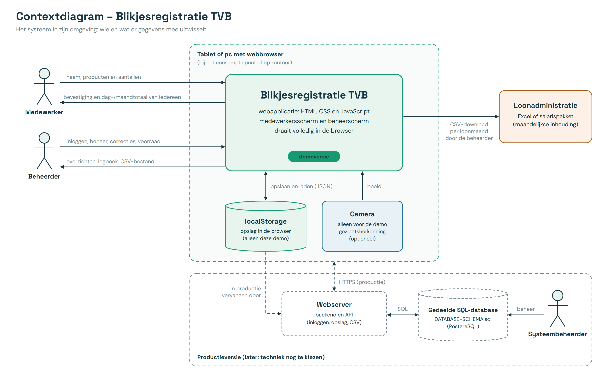

*Figuur: contextdiagram. Het systeem met de medewerker, de beheerder, de tablet met browser, de opslag in `localStorage`, de camera en de pasjeslezer (allebei optioneel), het CSV-bestand voor de loonadministratie en (in productie) de server met database en de koppeling met AFAS Profit.*

Medewerkers en de beheerder gebruiken het systeem in de browser van de tablet. In de demo staan alle gegevens in `localStorage` van die browser. De beheerder maakt een CSV-bestand en stuurt dat naar de loonadministratie. Er is geen directe koppeling met het loonpakket. In productie komen er een server (backend/API) en een PostgreSQL-database tussen.

### Huidige demo

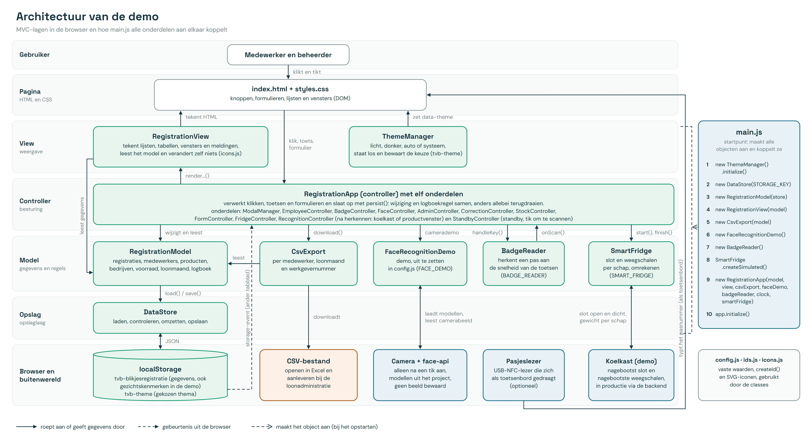

*Figuur: architectuur van de demo. View, controller (`RegistrationApp` met zijn onderdelen, sinds versie 3.21 twaalf) en model in de browser. `DataStore` is de enige class die de gegevens in `localStorage` leest en schrijft (`ThemeManager` bewaart daar alleen de thema-instelling). `CsvExport`, `ThemeManager`, `FaceRecognitionDemo`, `BadgeReader` en `SmartFridge` staan ernaast. De pasjeslezer typt het pasnummer als een toetsenbord in de pagina. Het slot en de weegschalen van de slimme koelkast zijn in de demo nagebootst (sinds versie 3.14). Sinds versie 3.17 bewaart `DataStore` ook de kenmerken van ingestelde gezichten, en `StandbyController` en `RecognitionController` regelen de standby en wat er opent na herkennen. Sinds versie 3.21 beheert `StandbyController` het startscherm en scant `AutoScanController` met `FaceIntent` op het startscherm automatisch, met de camera alleen op het startscherm.*

De hele demo draait in de browser. Er is geen server nodig behalve een eenvoudige webserver die de bestanden levert. De gegevens gaan zo door de lagen:

- `DataStore` leest bij het starten de gegevens uit `localStorage`, controleert ze en geeft ze aan `RegistrationModel`.
- `RegistrationModel` houdt alle gegevens in het geheugen en bevat de regels.
- `RegistrationView` tekent het scherm uit het model. De controller (`RegistrationApp` met zijn onderdelen) verwerkt wat de gebruiker doet, laat het model iets wijzigen en laat daarna `DataStore` alles opslaan.
- `CsvExport` maakt de export uit het model in het geheugen, niet uit `localStorage`. Het bestand gaat via de downloadfunctie van de browser naar de computer van de beheerder.

### Mogelijke productieversie

```text
Browser (HTML, CSS en JavaScript: view en controller)
    ↓  https
Backend en API (login, rechten, regels, transacties, CSV-export)
    ↓  geparametriseerde queries
PostgreSQL-database (DATABASE-SCHEMA.sql)

Backend  →  https met token (alleen de server)  →  AFAS Profit (GetConnector met medewerkergegevens)
```

In productie vervangt de backend de class `DataStore`: de browser vraagt gegevens op en stuurt wijzigingen naar de API, en de server controleert de login, de rechten en de regels. De CSV-export kan dan ook op de server worden gemaakt.

De medewerkergegevens kunnen in productie uit AFAS Profit komen. Alleen de backend praat met AFAS, nooit de browser, omdat het token toegang geeft tot personeelsgegevens. Hoe de synchronisatie werkt, staat in [Koppeling met AFAS Profit (ontwerp)](#koppeling-met-afas-profit-ontwerp) in hoofdstuk 11.

### Opbouw van de JavaScript

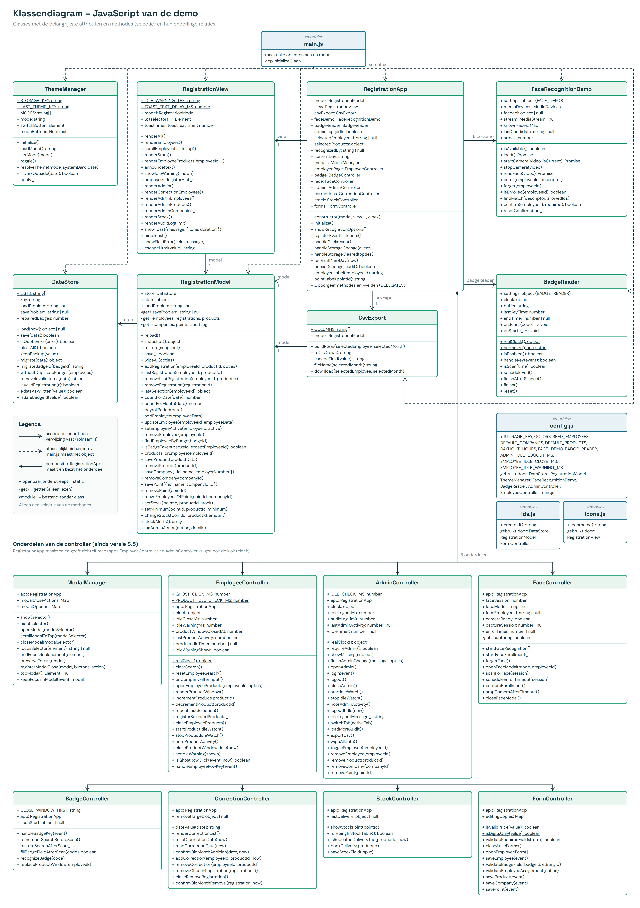

*Figuur: klassendiagram van de JavaScript met de belangrijkste attributen, methodes en relaties, inclusief de class `BadgeReader` (sinds versie 3.6), de onderdelen van de controller (sinds versie 3.8), het automatisch uitloggen van de beheerder en het automatisch sluiten van het productvenster in `AdminController` en `EmployeeController` (sinds versie 3.12) en de slimme koelkast met `FridgeController`, `FridgeView`, `SmartFridge` en de hardware-abstractie (sinds versie 3.14), en de standby en tik om te scannen met `StandbyController` en `RecognitionController` (sinds versie 3.17). Sinds versie 3.21 toont het ook het startscherm in `StandbyController`, het automatisch scannen in `AutoScanController` (het twaalfde onderdeel) en de intentie-drempel in `FaceIntent`, met `detectFaces` en `describeFace` in `FaceRecognitionDemo`.*

De JavaScript is objectgeoriënteerd opgebouwd volgens het MVC-patroon. Er zijn zevenentwintig classes, ieder in een eigen bestand. Twaalf daarvan vormen samen de controller (zie hieronder). Zes horen bij de slimme koelkast (zie [De slimme koelkast (demo)](#de-slimme-koelkast-demo)). De andere negen zijn:

- `DataStore` (opslag, `DataStore.js`) regelt het opslaan en ophalen van gegevens in `localStorage`, controleert de gegevens bij het laden, zet oude gegevens om en maakt reservekopieën.
- `RegistrationModel` (model, `RegistrationModel.js`) bevat de gegevens en de regels van de applicatie, inclusief voorraad, loonmaand, verwijderregels en het logboek. Met `snapshot()` en `restore()` kan een wijziging worden teruggedraaid.
- `RegistrationView` (view, `RegistrationView.js`) zet de gegevens op het scherm en verandert zelf niets. Tekst uit de gegevens wordt met `escapeHtml` veilig gemaakt voordat die in de HTML komt, of met `textContent` gezet.
- `RegistrationApp` (controller, `RegistrationApp.js`) verwerkt klikken, formulieren en andere acties, controleert de invoer en stuurt het model, de view, de export, de demo gezichtsherkenning, de pasjeslezer en de slimme koelkast aan. De class maakt daarvoor twaalf kleinere onderdelen (zie [De controller en zijn onderdelen](#de-controller-en-zijn-onderdelen)). Het opslaan (`persist`), de synchronisatie tussen tabbladen en de dagwissel zitten in `RegistrationApp` zelf.
- `CsvExport` (`CsvExport.js`) telt de registraties op per medewerker, loonmaand en werkgevernummer, maakt de CSV-tekst veilig voor Excel en laat het bestand downloaden.
- `ThemeManager` (`ThemeManager.js`) regelt het lichte en donkere thema (Systeem, Auto, licht en donker) en onthoudt de keuze in de browser. Die class staat los van de andere classes, omdat het thema een weergave-instelling per browser is en geen gegeven van de registratie.
- `FaceRecognitionDemo` (`FaceRecognitionDemo.js`) is de uitschakelbare demo gezichtsherkenning: nagaan of er een camera is zonder die aan te zetten (`detectCamera`), camera starten en stoppen, een gezicht omzetten naar een reeks getallen en die vergelijken met de geldige opgeslagen gezichten (`loadFaces`). Sinds versie 3.21 kan de class ook alleen gezichten zoeken zonder kenmerken (`detectFaces`, voor het startscherm) en de kenmerken van precies één uitgesneden gezicht berekenen (`describeFace`). De controller krijgt deze class mee in de constructor. De bibliotheek face-api wordt alleen geladen als iemand de demo gebruikt, en komt dan uit het project zelf (`assets/vendor/face-api/`).
- `FaceIntent` (`FaceIntent.js`, sinds versie 3.21) is de intentie-drempel van het automatisch scannen. De class krijgt per camerabeeld alleen de rechthoeken van de gevonden gezichten (geen beeld en geen kenmerken) en zegt of er precies één gezicht dichtbij is, met het midden in het ovaal, dat lang genoeg stil staat (`update` geeft "none", "far", "multiple", "outside", "settling" of "ready"). Alleen bij "ready" mogen de kenmerken worden berekend. Ze kent de camera, de pagina en face-api niet, zodat de drempel zonder browser te testen is.
- `BadgeReader` (`BadgeReader.js`) herkent een pas die tegen een USB-NFC-pasjeslezer wordt gehouden. De lezer gedraagt zich als een toetsenbord. `BadgeReader` krijgt van de controller iedere toetsaanslag door, ook als er een venster open is, ziet aan de snelheid of het een lezer is en geeft het gelijkgemaakte pasnummer door aan de controller. De Enter of Tab waarmee een scan eindigt, houdt `BadgeReader` altijd tegen. Een medewerker herkennen gebeurt alleen op de beginpagina, zonder open venster (`BadgeController.recognizeBadge`). De controller krijgt deze class mee in de constructor. Het pasnummer koppelen gebeurt gewoon in het medewerkersformulier (FR-66).

Daarnaast zijn er vier bestanden zonder class:

- `main.js` is het startpunt: het maakt de objecten één keer aan, koppelt ze aan elkaar en start eerst het thema.
- `config.js` bevat vaste waarden: de naam van de opslag (`STORAGE_KEY`), de standaardproducten, de bedrijven, de voorbeeldmedewerkers, de kleuren, de tijden van zonsopkomst en zonsondergang, de instellingen van de demo gezichtsherkenning (`FACE_DEMO`), de instellingen van de pasjeslezer (`BADGE_READER`), de tijd tot het automatisch uitloggen van de beheerder (`ADMIN_IDLE_LOGOUT_MS`), de tijden voor het automatisch sluiten van het productvenster (`EMPLOYEE_IDLE_CLOSE_MS` en `EMPLOYEE_IDLE_WARNING_MS`), de instellingen van de slimme koelkast (`SMART_FRIDGE`), wat er opent na herkennen (`RECOGNITION_TARGET`), het startscherm (`STANDBY`) en sinds versie 3.21 hoe de camera op het startscherm begint (`FACE_DEMO.scanMode`) met de drempels van het automatisch scannen (`FACE_DEMO.autoScan`).
- `icons.js` bevat de SVG-iconen en een hulpfunctie om ze in de pagina te zetten.
- `ids.js` bevat de functie `createId()` voor unieke id's (UUID's). Die gebruikt `crypto.randomUUID()` en anders `crypto.getRandomValues()`, zodat het ook werkt als de website via een netwerkadres zonder https wordt geopend.

#### De controller en zijn onderdelen

Tot en met versie 3.7 stond alle besturing in één class van 2414 regels (de bekende beperking "`RegistrationApp` is een grote klasse" in hoofdstuk 16). In versie 3.8 is die class opgesplitst, zonder dat er iets aan het gedrag is veranderd. `RegistrationApp` maakte in de constructor acht onderdelen. Sinds versie 3.14 is `FridgeController` het negende onderdeel, en sinds versie 3.17 zijn `RecognitionController` en `StandbyController` het tiende en elfde. Sinds versie 3.21 is `AutoScanController` het twaalfde. `RegistrationApp` geeft zichzelf aan ieder onderdeel mee. Ieder onderdeel heeft één taak en staat in een eigen bestand:

| Class | Bestand | Taak | Regels |
|---|---|---|---|
| `RegistrationApp` | `RegistrationApp.js` | Maakt en koppelt de onderdelen, start de app, dagwissel, synchronisatie tussen tabbladen, opslaan met terugdraaien (`persist`), labels voor het logboek, alle event listeners en de algemene kliklistener (`handleClick`) | 860 |
| `ModalManager` | `controllers/ModalManager.js` | Vensters openen en sluiten, de focus terugzetten op het element waarmee een venster werd geopend (of op de nieuwe knop met dezelfde id als de lijst opnieuw is getekend, `preserveFocus`), Escape en Tab binnen het bovenste venster, een venster altijd bovenaan openen (`scrollModalToTop`) | 217 |
| `EmployeeController` | `controllers/EmployeeController.js` | De beginpagina: zoeken en bedrijfsfilter (en die leegmaken na gebruik, `resetEmployeeSearch`), het productvenster (`+`, `−`, `Zelfde als vorige keer` na herkenning met pas of camera) en registreren, met bescherming tegen een dubbelklik op `Registreren`, en het productvenster automatisch sluiten na 75 seconden zonder invoer (`closeProductWindowIfIdle`) | 481 |
| `BadgeController` | `controllers/BadgeController.js` | Herkennen met de pas: geeft de toetsen door aan `BadgeReader`, zet het zoekveld en het bedrijfsfilter terug, vervangt bij een scan in het veld `Pasnummer` het oude nummer, geeft na een scan de medewerker door aan `RecognitionController` en vervangt een open productvenster van een collega (`replaceProductWindow`). Staat het koelkastvenster open, dan gaat de scan naar `FridgeController` | 231 |
| `FaceController` | `controllers/FaceController.js` | Het cameravenster van de demo gezichtsherkenning: herkennen met `Herken mij`, de korte scan na een tik op het ovaal van het startscherm (`startWakeScan`, met `scanMode` "tap"), een gezicht instellen (opgeslagen met datum en toestemmingsmoment via `persist`) of uitzetten, sinds versie 3.22 alleen na de pas (`canSelfEnroll`), uitzetten na de pas of de camera (`canSelfForget`) en door de beheerder (`startAdminFaceEnrollment`, `adminForgetFace`), camera uit na de tijdslimiet, de opgeslagen gezichten in het geheugen zetten (`loadSavedFaces`) en verlopen gezichten wissen (`expireFaces`) | 644 |
| `AdminController` | `controllers/AdminController.js` | Inloggen en uitloggen, automatisch uitloggen na 5 minuten zonder invoer (`logoutIfIdle`), dashboard en tabbladen, logboek, export, `Alle gegevens wissen`, (de)activeren en verwijderen, en `requireAdmin` voor iedere beheeractie | 538 |
| `CorrectionController` | `controllers/CorrectionController.js` | Correcties `+` (met datum) en `−` (venster `Registratie verwijderen`) | 249 |
| `StockController` | `controllers/StockController.js` | Het tabblad Voorraad: leveringen, tellingen en minimum | 168 |
| `FormController` | `controllers/FormController.js` | De formulieren voor medewerker, product, bedrijf en consumptiepunt: openen, invoer controleren, opslaan en sluiten als het gegeven in een ander tabblad is gewijzigd | 720 |
| `FridgeController` | `controllers/FridgeController.js` | De slimme koelkast (demo): het koelkastvenster (wachten op de pas, deur open, overzicht), de pas controleren, pakken en terugleggen nabootsen, de deur sluiten en het resultaat opslaan, de waarschuwing bij een deur die te lang open staat, de koelkast openen na herkenning op de beginpagina (`openFridgeFor`) met de knop naar het productvenster (`switchFridgeToProducts`), en in het beheer het tabblad Koelkast | 661 |
| `RecognitionController` | `controllers/RecognitionController.js` | Wat er opent na herkennen met de pas of de camera (`RECOGNITION_TARGET`: de koelkast of het productvenster) en de vraag "Gezichtsherkenning nog niet ingesteld. Wil je dit?" na een passcan met `Ja, instellen` en `Nee` (sinds versie 3.17) | 204 |
| `StandbyController` | `controllers/StandbyController.js` | Het startscherm (sinds versie 3.21, eerder de standby): tonen bij het openen, na 2 minuten zonder invoer en na afloop van een registratie of koelkastopening (`returnToStartScreen`), de teksten naar wat er kan (`startScreenTexts`), `Handmatig zoeken` (`handleManualSearch`), een tik op het ovaal met `scanMode` "tap" (`handleStandbyTap`), geen klik-door, en één timer die ook de vraag na een passcan sluit en verlopen gezichten wist. In de code heet de toestand nog "standby": `standbyActive` betekent dat het startscherm in beeld is | 270 |
| `AutoScanController` | `controllers/AutoScanController.js` | Het automatisch scannen op het startscherm (sinds versie 3.21): de camera aan of uit (`updateAutoScan`, alleen op het startscherm), drie keer per seconde gezichten zoeken (`scanTick`), de intentie-drempel via `FaceIntent`, pas daarna de kenmerken van dat ene gezicht (`recognizeFace`), de begroeting (`greet`) en na herkennen `RecognitionController.continueAfterRecognition`, en na drie pogingen "Je bent niet herkend." met een pauze (`pauseAfterUnknown`) | 303 |

De onderdelen werken zo samen:

- Ieder onderdeel gebruikt het model, de view, `persist` en de methodes van de andere onderdelen via `RegistrationApp` (`this.app`). Zo kennen de onderdelen elkaar niet rechtstreeks en is er één plek waar alles samenkomt.
- Toestand die meerdere onderdelen gebruiken, staat in `RegistrationApp`: of de beheerder is ingelogd (`adminLoggedIn`), welke medewerker en producten in het productvenster zijn gekozen (`selectedEmployeeId`, `selectedProducts`) en hoe die medewerker is herkend (`recognizedBy`). Toestand van één onderdeel staat in dat onderdeel, zoals het sessienummer van het cameravenster (`FaceController.faceSession`) of het venster `Registratie verwijderen` dat open is (`CorrectionController.removalTarget`).
- Onderaan `RegistrationApp.js` staat een lijst (`DELEGATES`) van de methodes en velden van de onderdelen die ook op `RegistrationApp` bestaan. `app.handleBadgeKey(event)` roept zo `BadgeController.handleBadgeKey` aan, en `app.faceSession` leest en wijzigt het veld van `FaceController`. Daardoor werkten `main.js`, de aanroep van de constructor en alle 547 unit tests en 9 browsertests van versie 3.8 zonder aanpassing. Er is geen kopie van een waarde die uit de pas kan lopen.
- Iedere beheeractie begint nog steeds met `requireAdmin`, ook in `CorrectionController`, `StockController` en `FormController`.

In de use cases en in hoofdstuk 13 staat bij een methode de class waarin die staat, bijvoorbeeld `AdminController.exportCsv`. Via `RegistrationApp` is dezelfde methode ook als `app.exportCsv` aan te roepen. De grootste class is nu `FormController` (vier formulieren met hun controles). Wordt die later te groot, dan kan ieder formulier een eigen class krijgen.

Toegepaste OOP-principes: encapsulatie (gegevens alleen via getters en methodes van het model), één verantwoordelijkheid per class (ook binnen de controller), compositie (de controller krijgt model, view, export, de demo gezichtsherkenning, de pasjeslezer en de klok voor het automatisch uitloggen en het automatisch sluiten van het productvenster mee in de constructor, en maakt zelf zijn onderdelen) en losse koppeling (de view kent de controller niet. De opslag is vervangbaar). Bovenaan ieder bestand staat in een comment waarvoor de class is en met welke classes hij verbonden is.

Door deze verdeling blijft de code overzichtelijk. Later kan bijvoorbeeld `localStorage` worden vervangen door een database zonder alles opnieuw te maken.

#### De slimme koelkast (demo)

Sinds versie 3.14 zit optie C uit [Bijlage B](#bijlage-b-onderzoek-naar-een-afgesloten-koelkast-of-kast) als simulatie in de demo: een koelkast met een slot en een weegschaal per schap, met de pas als sleutel. De simulatie staat aan met `SMART_FRIDGE.enabled` in `config.js` en verandert niets aan het registreren met `+` en `−`. De hardware zit achter twee afspraken (interfaces), zodat alleen de nagebootste classes hoeven te worden vervangen als er echte hardware komt:

| Class | Bestand | Taak | Regels |
|---|---|---|---|
| `FridgeLock` | `fridge/FridgeLock.js` | Interface voor het slot: `unlock()`, `lock()`, `cancelAutoLock()`, `isLocked()` en de callback `onAutoLock`. Doet zelf niets | 50 |
| `SimulatedLock` | `fridge/SimulatedLock.js` | Het nagebootste slot: onthoudt open of dicht en gaat na `SMART_FRIDGE.autoLockMs` (10 seconden) vanzelf weer dicht als de deur niet is geopend | 75 |
| `ShelfScale` | `fridge/ShelfScale.js` | Interface voor de weegschaal onder één schap: `read()` geeft het gewicht in hele grammen | 30 |
| `SimulatedShelfScale` | `fridge/SimulatedShelfScale.js` | De nagebootste weegschaal: een lijst met het gewicht van ieder product (ieder product wijkt tot 2 procent af), pakken, terugleggen en iets anders op het schap leggen | 75 |
| `SmartFridge` | `fridge/SmartFridge.js` | De koelkast: beginmeting en slot open (`start`), deur open (`openDoor`), slot dicht en eindmeting (`finish`). Rekent per schap het gewichtsverschil om naar een aantal (`countShelf`), met een tolerantie, en bepaalt de status van de opening | 279 |
| `FridgeView` | `FridgeView.js` | Deel van de view: tekent het koelkastvenster en het tabblad Koelkast. `RegistrationView` maakt deze class en geeft de methodes door | 317 |

Belangrijk voor productie: de browser mag het echte slot nooit zelf openen. Een opdracht uit de browser is na te maken door iedereen die bij de tablet kan. In productie controleert de backend de pas en stuurt alleen de backend via de kastcontroller het slot en de weegschalen aan (zie [Ontwerpschets voor productie](#ontwerpschets-voor-productie) in bijlage B). Dan komen er classes met dezelfde methodes als `FridgeLock` en `ShelfScale` die de backend aanroepen, en vervallen `SimulatedLock` en `SimulatedShelfScale`. Het omrekenen van gewicht naar aantallen hoort dan ook in de backend. `SmartFridge.countShelf` is daarvoor het voorbeeld.

### Opbouw van de CSS

Sinds versie 3.20 staat de vormgeving in achttien stylesheets in `assets/css/`, één per onderdeel van het scherm. Tot en met versie 3.19 stond alles in één bestand (`styles.css`). `index.html` laadt de stylesheets met losse `<link rel="stylesheet">`-regels, niet met `@import`, omdat de browser losse links tegelijk ophaalt en `@import` pas begint als het vorige bestand binnen is. De Content-Security-Policy staat ze toe via `style-src 'self'`.

De volgorde in `index.html` is de volgorde van de cascade: hebben twee regels dezelfde sterkte, dan wint de regel die later komt. Daarom is het oude bestand geknipt in aaneengesloten stukken, in de oorspronkelijke volgorde. Een bestand verplaatsen in `index.html` kan het uiterlijk veranderen. Ieder bestand begint met een korte uitleg van wat erin staat en na welk bestand het laadt.

| Volgorde | Bestand | Inhoud | Regels |
|---|---|---|---|
| 1 | `base.css` | Lettertypes (`@font-face` uit `assets/fonts/`), de kleurvariabelen voor licht (`:root`) en donker (`:root[data-theme="dark"]`), de reset en de pagina-opbouw | 172 |
| 2 | `topbar.css` | Bovenbalk: logo, thema-schakelaar, statusmelding en de knop `Admin login` | 144 |
| 3 | `home.css` | Beginpagina: banner, medewerkerlijst, zoekveld, bedrijfsfilter, totalen, tip, `.hidden`, `.visually-hidden` en de footer | 463 |
| 4 | `modal.css` | Vensters: achtergrond, venster, sluitknop, velden en de knoppen `.primary-button` en `.secondary-button` | 129 |
| 5 | `admin.css` | Beheer: kop, tabbladen, filters, de tabellen (registraties en logboek) | 105 |
| 6 | `product-window.css` | Productvenster: `−` en `+`, een gekozen product, de knopbalk met `Registreren` en de uitleg over de inhouding | 191 |
| 7 | `admin-forms.css` | Beheer: medewerkerformulier, beheerlijsten, bedrijven en consumptiepunten, assortiment en voorraad | 257 |
| 8 | `toast.css` | De melding bij openen als los bestand en de tijdelijke meldingen | 53 |
| 9 | `admin-corrections.css` | Beheer: correcties `+` en `−` en het venster `Registratie verwijderen` | 129 |
| 10 | `motion.css` | Overgangen, animaties en `prefers-reduced-motion` | 70 |
| 11 | `icons.css` | SVG-iconen en de aanpassingen voor een aanraakscherm | 74 |
| 12 | `feedback.css` | Iconen in meldingen, foutmelding onder een veld, lege toestand en de lijsten in het beheer | 106 |
| 13 | `suggestion.css` | Begroeting en `Vorige keer koos je ...` in het productvenster | 35 |
| 14 | `directory-tools.css` | De regel met pashint en demoknoppen, `Tik op je naam` en zoekveld en bedrijfsfilter naast elkaar | 76 |
| 15 | `face.css` | Demo gezichtsherkenning: cameravenster, toestemming, de vraag na een passcan en (sinds versie 3.22) de uitleg na kiezen op naam | 107 |
| 16 | `start-screen.css` | Het startscherm (sinds versie 3.21, op de plek van `standby.css`): altijd donker, het ovaal met het camerabeeld (gespiegeld) en de toestanden `steady`, `recognized`, `unknown` en `multiple`, de tekst eronder, `Handmatig zoeken` en de privacyregel. De kleuren `--start-screen-*` staan in `base.css` en gelden in beide thema's | 181 |
| 17 | `fridge.css` | Slimme koelkast: knop, venster, schappen, overzicht en het tabblad Koelkast | 399 |
| 18 | `responsive.css` | Mediaqueries voor telefoon en tablet en grotere kleine teksten. Staat als laatste | 236 |

Een nieuwe regel komt in het bestand van het onderdeel. Moet een regel een andere regel overschrijven, dan moet hij in hetzelfde of een later bestand staan (of sterker zijn). De unit tests lezen de CSS met `readAllCss()` uit `tests/helpers.js`, in dezelfde volgorde als `index.html`. Een nieuw bestand moet ook in `index.html` worden gelinkt, anders faalt `tests/beveiliging-config.test.js`. Die test controleert sinds versie 3.21 ook de volledige volgorde van de achttien bestanden.

### Opslaan als één geheel (transactie)

Iedere wijziging door een gebruiker (registreren, correcties en alle beheerwijzigingen) loopt in de controller via de methode `persist`. Alleen `Alle gegevens wissen` slaat de nieuwe demogegevens rechtstreeks op, omdat er dan niets terug te draaien valt.

1. Het model maakt een `snapshot()` van de huidige gegevens.
2. De wijziging wordt uitgevoerd. Meldt het model dat er niets kon worden gewijzigd (bijvoorbeeld omdat een ander tabblad het gegeven intussen heeft verwijderd), dan wordt de snapshot teruggezet en verschijnt "Er is niets gewijzigd: de gegevens zijn intussen veranderd."
3. Bij een wijziging van de beheerder wordt de logboekregel toegevoegd. Registreert een medewerker zelf, dan komt er geen logboekregel (`persist` krijgt dan geen logboekregel mee). Het logboek is alleen voor wijzigingen van de beheerder.
4. Alles wordt in één keer opgeslagen. Mislukt dat, dan zet `restore()` de snapshot terug en verschijnt "Opslaan mislukt. Probeer het opnieuw." Is de opslag van de browser vol (`DataStore.saveProblem = "full"`), dan helpt opnieuw proberen niet. Dan verschijnt "De opslag van de browser is vol. Er is niets opgeslagen. Vraag de beheerder om de registraties te exporteren en oude gegevens te wissen." (zie hoofdstuk 14).

Zo ontstaat er nooit een wijziging van de beheerder zonder logboekregel of andersom (FR-61). Dit werkt omdat het model bij iedere wijziging nieuwe lijsten en objecten maakt in plaats van bestaande aan te passen. Een ondiepe kopie is dan genoeg als snapshot. In productie doet een databasetransactie hetzelfde.

### Synchronisatie tussen tabbladen

Staat de website in twee tabbladen van dezelfde browser open, dan delen ze dezelfde `localStorage`. Zonder extra maatregel zou het ene tabblad bij de volgende wijziging zijn oude gegevens terugschrijven en de wijzigingen van het andere tabblad wissen. Daarom luistert de controller naar het `storage`-event van de browser (MDN Web Docs, z.d.), dat afgaat als een ander tabblad iets opslaat (FR-60):

- het model laadt de gegevens opnieuw (met dezelfde controle als bij het starten) en alles wordt opnieuw getekend. Had een knop in een lijst de focus, dan krijgt de nieuwe knop met dezelfde id die focus terug (`ModalManager.preserveFocus`).
- de gezichten in het geheugen (demo) worden opnieuw gelijkgezet met de opgeslagen gezichtsinstellingen (`FaceController.loadSavedFaces`): een gezicht dat in het andere tabblad is ingesteld, doet mee, en een gezicht dat daar is uitgezet, of van een medewerker die daar is gedeactiveerd of verwijderd, wordt vergeten. Staat de vraag over gezichtsherkenning open voor een medewerker die niet meer actief is, dan sluit die.
- een open formulier van een gegeven dat in het andere tabblad is verwijderd of gewijzigd, sluit met een melding ("Wat je aan het wijzigen was, is in een ander venster verwijderd. Het formulier is gesloten." of "... gewijzigd. Open het opnieuw om verder te gaan.").
- een open productvenster sluit als de medewerker intussen is verwijderd of gedeactiveerd.
- typt de beheerder op dat moment in de voorraadtabel, dan blijft die tabel staan, zodat het half ingetypte getal niet verdwijnt.
- heeft het andere tabblad alle gegevens gewist, dan wist dit tabblad ook alles (`handleStorageCleared`): het maakt de gegevens in het geheugen leeg, vergeet de ingestelde gezichten van de demo, sluit het cameravenster, het productvenster, open formulieren en het beheervenster (de beheerder is dan uitgelogd), tekent alles opnieuw en toont "De gegevens zijn in een ander venster gewist."

Hoe dit tabblad (B) op het wissen reageert, hangt af van de manier waarop in het andere tabblad (A) is gewist:

| Gewist in tabblad A met | Wat tabblad B ziet | Wat tabblad B doet met de opslag |
|---|---|---|
| De knop `Alle gegevens wissen` | `DataStore.clearAll` verwijdert de gegevenssleutel. B krijgt een `storage`-event voor die sleutel met `newValue === null`. | Niets: `handleStorageCleared({ keepStore: true })` laat `RegistrationModel.wipeAll({ clearStore: false })` alleen het geheugen leegmaken. Daarna laadt B de opslag opnieuw. A slaat direct de nieuwe demogegevens op. Staan die er al, dan laadt B ze meteen, anders bij het volgende `storage`-event. Zo wist B niet per ongeluk de nieuwe demogegevens van A. |
| `localStorage.clear()` (bijvoorbeeld in de ontwikkelaarstools of door het wissen van de websitegegevens) | Een `storage`-event zonder sleutel (`event.key === null`). Opnieuw laden levert niets op en er is geen beschadiging gemeld. | B wist zelf de opslag nog eens (`wipeAll()` met `DataStore.clearAll`) en begint met de demogegevens in het geheugen. Die worden pas opgeslagen bij de volgende wijziging. |

**Opslaan voordat het event binnen is (sinds versie 3.16).** Het `storage`-event komt pas na een korte tijd binnen. Slaat tabblad B in die tijd zelf iets op, dan zou het zijn oude gegevens over de nieuwe gegevens van A heen schrijven. De FMEA van oktober 2026 liet met twee modellen op één opslag zien dat de registratie van A dan stil verdween. Daarom onthoudt `DataStore` de opgeslagen tekst die het tabblad het laatst heeft gelezen of geschreven (`lastSeen`). `DataStore.save` vergelijkt die vóór het schrijven met wat er nu staat. Is het anders, dan schrijft `save` niets en geeft het `saveProblem = "conflict"`. `RegistrationApp.persist` laadt dan de nieuwe gegevens (`RegistrationModel.reload`), voert dezelfde wijziging met dezelfde logboekregel daarop nog één keer uit en slaat op. Past de wijziging na het laden niet meer (bijvoorbeeld omdat A het product heeft verwijderd), dan verschijnt "Er is niets gewijzigd: de gegevens zijn intussen veranderd." Het scherm wordt opnieuw getekend zodra het event van A binnenkomt. Een vergelijking van de hele tekst kost bij een volle opslag een paar milliseconden, net als het `JSON.stringify` dat `save` al deed. Een volgnummer in de gegevens zou ook kunnen, maar vraagt een extra veld met controle en migratie, terwijl de vergelijking ook wijzigingen buiten de app (in de ontwikkelaarstools) opmerkt.

Bij een event zonder sleutel wist B alleen als het opnieuw laden niets opleverde **en** er geen probleem bij het laden was. Was de opslag niet te lezen of beschadigd (`loadProblem` is dan gezet), dan krijgt de gebruiker de waarschuwing uit hoofdstuk 14 en blijven de gegevens in het geheugen staan.

Dit werkt alleen tussen tabbladen in dezelfde browser op hetzelfde apparaat. Tussen apparaten is een gedeelde database nodig.

### Dagwissel

De tablet staat dag en nacht aan. Iedere minuut controleert de controller of de kalenderdag is veranderd. Zo ja, dan worden de datum bovenaan, de totalen en de hoogste toegestane correctiedatum bijgewerkt (FR-53). Stond het datumveld van de correctie nog op de oude laatste datum (de standaard: de dag van gisteren), dan gaat het ook naar vandaag. Een datum die de beheerder zelf heeft gekozen, blijft staan. `ThemeManager` kijkt ook iedere minuut of het thema "Auto" moet omschakelen.

### Ontwerpkeuzes

| Keuze | Alternatieven | Reden |
|---|---|---|
| Gewone JavaScript (ES-modules) zonder framework | React, Vue of Angular | De demo is klein en moet zonder buildstap op iedere webserver draaien. Zonder framework zijn er geen npm-pakketten die bijgewerkt moeten worden, en de code is goed te lezen voor wie alleen HTML, CSS en JavaScript kent. Nadeel: de view tekent zelf HTML, dus het ontsnappen van tekst (`escapeHtml`) moet overal zorgvuldig gebeuren. |
| `localStorage` als opslag in de demo | IndexedDB, een eigen server met database | Er is geen server beschikbaar voor de demo. `localStorage` is eenvoudig, synchroon en ruim genoeg voor deze gegevens. Nadeel: alleen op één apparaat, aan te passen via de ontwikkelaarstools en zonder echte beveiliging. Daarom zit alle opslag in één class (`DataStore`), die in productie door een backend wordt vervangen. |
| Eén registratie per eenheid (aantal altijd 1) | Eén registratie met een aantal | Iedere registratie heeft zo een eigen tijdstip, prijs, werkgevernummer en consumptiepunt. Een correctie `−` haalt precies één eenheid weg, en de voorraad gaat per stuk omhoog of omlaag. De database heeft wel een kolom `amount`, zodat een backend later meer per regel kan opslaan. |
| MVC met classes | Losse functies in één bestand | Iedere class heeft één taak, is apart te testen (met een nep-opslag en een nep-view) en de opslag is te vervangen zonder de rest te veranderen. |
| PostgreSQL voor productie | SQL Server, MySQL | Het schema gebruikt onderdelen van PostgreSQL: `uuid` met `gen_random_uuid()` (pgcrypto), `timestamptz`, `jsonb`, gedeeltelijke unieke indexen en triggers in PL/pgSQL. PostgreSQL is gratis en open source. Een andere database kiezen betekent het schema aanpassen. |
| Alles zelf gehost | Lettertypes van Google Fonts, face-api van een CDN | Er gaan geen gegevens (zoals het IP-adres van de tablet) naar derden, de CSP kan alles behalve de eigen server blokkeren, en de pagina werkt ook als internet even wegvalt, zolang de eigen webserver bereikbaar is. |
| Pasjeslezer als toetsenbord ("keyboard wedge") | Web NFC (`NDEFReader`), WebHID of WebUSB met een eigen driver | Een lezer die zich als toetsenbord gedraagt, werkt in iedere browser en op ieder besturingssysteem zonder bibliotheek, driver of licentie. Web NFC werkt alleen in Chrome op Android (MDN Web Docs, z.d.) en past dus niet bij een tablet met Edge. Nadeel: de website kan een lezer niet onderscheiden van iemand die heel snel typt (zie hoofdstuk 13). |
| Slimme koelkast als simulatie achter interfaces (`FridgeLock`, `ShelfScale`) | Geen demo (alleen bijlage B), of de simulatie direct in de controller | Met een werkende simulatie kunnen TVB en de ondernemingsraad de werking van optie C zien en beoordelen voordat er hardware wordt gekocht. Door de interfaces is in de code te zien welk deel later via de backend werkt, en blijft de rest (omrekenen, registreren, beheer) hetzelfde. Nadeel: in de demo opent de browser zelf een nagebootst slot. Dat mag in productie nooit (zie hoofdstuk 13). |
| Tik om te scannen: de camera start pas na een tik op het standby-scherm (versie 3.17 tot en met 3.20, sinds 3.21 met `scanMode = "tap"`) | De camera scant constant tot er iemand voor staat, of een aanwezigheidssensor zonder camera | Een tik is een bewuste handeling: alleen wie iets wil, wordt gescand, en voorbijgangers niet. De camera is hooguit 10 seconden aan. Constant scannen is afgewezen (zie [Gezichtsherkenning met tik-om-te-scannen](#gezichtsherkenning-met-tik-om-te-scannen-versie-317) in bijlage B). Nadeel: het kost één tik extra. |
| Automatisch scannen met een intentie-drempel op het startscherm (sinds versie 3.21, `scanMode = "auto"`) | Tikken blijven gebruiken (`scanMode = "tap"`), of alleen de pas | De opdrachtgever wil bijna niet tikken. De drempel (één gezicht dichtbij, in het ovaal en stil) vervangt de tik als teken van intentie, en kenmerken worden alleen dan berekend. Nadeel: de camera kijkt de hele tijd op het startscherm en ziet voorbijgangers, en het AVG-bezwaar wordt groter (bijlage B, punt 7). Daarom is het met één instelling terug te zetten. |
| Het beheer niet op het startscherm (sinds versie 3.21) | Een kleine knop `Admin login` op het startscherm | Het startscherm blijft rustig met één knop voor medewerkers. Het beheer is zeldzaam en staat één tik verder: na `Handmatig zoeken` in de bovenbalk. Dan is ook de camera al uit. |
| Gezichtskenmerken bewaren in `localStorage` met een datum (sinds versie 3.17) | Alleen in het geheugen, zoals tot en met versie 3.16 | Zonder bewaren is de instelling na herladen weg en kan ze niet na een jaar verlopen. Het is een bewuste afwijking voor de demo, met grenzen (alleen getallen, toestemming, wissen bij uitzetten, verlopen, (de)activeren, verwijderen en `Alle gegevens wissen`). Nadeel: een biometrisch gegeven staat nu op de tablet (zie hoofdstuk 13). |
| Eén instelling voor wat er opent na herkennen (`RECOGNITION_TARGET`) (sinds versie 3.17) | Een aparte instelling voor de pas en voor de camera | Met één instelling laat de demo beide varianten op dezelfde manier zien: pas naar de koelkast (het advies voor productie) en tik, gezicht en koelkast (alleen demo). |

## 7. Technologiestack

### Gebruikte technieken in de demo

- **HTML5:** voor de structuur van de pagina.
- **CSS3:** voor kleuren, layout en responsive design. Verdeeld over achttien stylesheets per onderdeel in `assets/css/` (sinds versie 3.20, zie [Opbouw van de CSS](#opbouw-van-de-css) in hoofdstuk 6).
- **JavaScript (ES-modules):** voor de werking van de website. Er is geen buildstap en er zijn geen npm-afhankelijkheden: de browser laadt de bestanden zoals ze in het project staan.
- **OOP:** de JavaScript is verdeeld in classes.
- **Lokale webserver nodig:** browsers blokkeren ES-modules via `file://`. Wie `index.html` als los bestand opent, krijgt de melding "Deze pagina werkt niet als los bestand. Open de map in VS Code en start hem met Live Server (of een andere lokale webserver)."
- **localStorage:** tijdelijke opslag in de browser.
- **CSV-export:** gemaakt met eigen JavaScript, zonder externe bibliotheek.
- **Lettertypes DM Sans en Space Grotesk:** zelf gehost in `assets/fonts/` (woff2, SIL Open Font License 1.1. SIL International, 2007. Zie `assets/fonts/LICENSE.txt`). De lettertypes komen oorspronkelijk van Google Fonts (z.d.), maar er wordt tijdens gebruik niets van Google Fonts geladen.
- **face-api (@vladmandic/face-api 1.7.15. Mandic, z.d.):** alleen voor de demo gezichtsherkenning. De bibliotheek en de drie modellen (gezicht vinden, gezichtspunten en herkenning) staan in `assets/vendor/face-api/` (MIT-licentie, samen ongeveer 8 MB, waarvan 6,4 MB het herkenningsmodel). Er wordt tijdens gebruik niets van een CDN geladen. In de bibliotheek zit TensorFlow.js 4.22.0 van Google (Apache-licentie 2.0, zie `assets/vendor/face-api/LICENSE-TENSORFLOWJS`). De repository van face-api is gearchiveerd: 1.7.15 is de laatste versie en er komen geen beveiligingsupdates meer (zie hoofdstuk 13).
- **Content-Security-Policy:** een `<meta>`-tag in `index.html` die de browser alleen bestanden van de eigen server laat laden (zie hoofdstuk 13).
- **Node.js test runner (`node:test`. Node.js, z.d.):** voor de unit tests, met Node.js 22 of hoger (`"engines": { "node": ">=22" }` in `package.json`). De tests draaien automatisch via GitHub Actions (Node.js 24, een LTS-versie die nog wordt onderhouden. Node.js 20 is sinds 30 april 2026 end-of-life) bij iedere push en pull request naar `main` en `development`. De workflow heeft alleen leesrechten (`permissions: contents: read`), bewaart het GitHub-token niet (`persist-credentials: false`) en gebruikt actions die vastgezet zijn op een commit-SHA.
- **Browsertests zonder extra pakketten:** de end-to-end-tests in `tests/e2e/` gebruiken ook `node:test`. Ze starten Edge of Chrome zonder venster (`--headless=new`) en sturen die aan via het Chrome DevTools Protocol (Google, z.d.), met de `WebSocket` die in Node.js 22 en hoger zit. Er is dus geen Playwright of Puppeteer nodig en het project houdt geen npm-afhankelijkheden. In GitHub Actions draaien ze in een aparte job, na de unit tests, met Google Chrome dat al op de runner staat.

**Gebruikte browserfuncties:**

| Functie | Waarvoor |
|---|---|
| `localStorage` en het `storage`-event | Gegevens en thema-instelling bewaren. Wijzigingen uit andere tabbladen opmerken. |
| `crypto.randomUUID()` / `crypto.getRandomValues()` | Unieke id's maken (`ids.js`). |
| `matchMedia("(prefers-color-scheme: dark)")` | Het thema "Systeem" volgt de instelling van het apparaat. |
| `Intl.DateTimeFormat("nl-NL")` | Datums en maandnamen in het Nederlands. |
| `Blob` en `URL.createObjectURL` | Het CSV-bestand laten downloaden. |
| `navigator.mediaDevices.getUserMedia` | De camera voor de demo gezichtsherkenning. Werkt alleen op een veilige pagina (`https` of `localhost`). Anders verschijnt de knop "Herken mij" niet. |
| Het `keydown`-event op `document` | De tekens van de pasjeslezer opvangen (`BadgeReader`). Werkt ook zonder https. |

### Technieken voor productie

De database voor productie is **PostgreSQL** (versie 15 of hoger): het schema in [`DATABASE-SCHEMA.sql`](./DATABASE-SCHEMA.sql) is daarvoor geschreven (zie de ontwerpkeuzes in hoofdstuk 6). De backend en de hosting zijn nog niet gekozen. Mogelijke keuzes zijn:

- PHP, .NET of Node.js voor de backend.
- een interne server of Azure voor de hosting.

De definitieve keuze moet samen met de IT-afdeling van TVB worden gemaakt.

## 8. Databaseontwerp

### Opslag in de huidige demo

De demo bewaart één JSON-object in `localStorage` (MDN Web Docs, z.d.) onder de sleutel `tvb-blikjesregistratie`:

```js
{
  employees: [
    {
      id: "unieke-id",
      name: "Lotte van Dijk",            // volledige naam: voornaam + achternaam
      firstName: "Lotte",
      lastName: "van Dijk",
      payrollCode: "1234",               // looncode (alleen cijfers)
      personnelNumber: "5678",           // personeelsnummer (uniek, alleen cijfers)
      employerNumber: "",                // afwijkend werkgevernummer; leeg = dat van het bedrijf
      active: true,
      companyId: "id-van-bedrijf",
      pointId: "id-van-consumptiepunt",
      color: "#d8f1e8",                  // achtergrondkleur van de avatar
      badgeId: "04A1B2C3"                // pasnummer (alleen A-Z en 0-9, hooguit 64 tekens); "" = geen pas
    }
  ],
  registrations: [
    {
      id: "unieke-id",
      employeeId: "id-van-medewerker",
      productId: "blikje",
      price: 0.65,                       // prijs op het moment van registreren
      employerNumber: "4711",            // werkgevernummer op het moment van registreren (alleen als dat bekend was)
      pointId: "id-van-consumptiepunt",  // punt dat het product aanbood; null als het punt het product niet aanbood
      createdAt: "2026-09-07T08:00:00.000Z"
    },
    {
      id: "unieke-id",
      employeeId: "id-van-medewerker",
      productId: "ei",
      price: 0.5,
      pointId: "id-van-consumptiepunt",
      createdAt: "2026-09-15T10:00:00.000Z", // correctie "+" op een eerdere dag: 12:00 uur Nederlandse tijd
      correction: true                   // alleen bij een correctie "+" van de beheerder
    },
    {
      id: "unieke-id",
      employeeId: "id-van-medewerker",
      productId: "blikje",
      price: 0.65,
      pointId: "id-van-consumptiepunt",
      createdAt: "2026-10-19T10:00:20.000Z", // het moment waarop de koelkastdeur dichtging
      source: "fridge",                  // alleen bij een registratie van de slimme koelkast (demo)
      openingId: "id-van-opening"        // de opening waarbij het product is gepakt
    }
  ],
  products: [
    { id: "blikje", name: "Blikje", price: 0.65 },  // standaardproduct (vaste id)
    { id: "unieke-id", name: "Soep", price: 1.25 }  // door de beheerder toegevoegd
  ],
  companies: [
    { id: "unieke-id", name: "IT Supervision", employerNumber: "1234" }
  ],
  points: [
    {
      id: "unieke-id",
      name: "Kantine begane grond",
      companyId: "id-van-bedrijf",
      products: {
        blikje: { offered: true, stock: 24, minimum: 6, countedAt: "2026-10-01T07:30:00.000Z" }, // countedAt: tijdstip van de laatste telling
        ei: { offered: false, stock: 0, minimum: 0 } // nog nooit geteld: geen countedAt
      }
    }
  ],
  auditLog: [
    {
      id: "unieke-id",
      action: "Registratie verwijderd",
      details: "Blikje van Lotte van Dijk",
      createdAt: "2026-10-02T09:15:00.000Z"
    }
  ],
  fridgeShelves: [                       // slimme koelkast (demo): indeling per consumptiepunt
    { id: "unieke-id", pointId: "id-van-consumptiepunt", shelf: 1, productId: "blikje", unitWeight: 350 },
    { id: "unieke-id", pointId: "id-van-consumptiepunt", shelf: 2, productId: null, unitWeight: null } // leeg schap
  ],
  fridgeOpenings: [                      // slimme koelkast (demo): iedere afgeronde opening
    {
      id: "id-van-opening",
      employeeId: "id-van-medewerker",
      pointId: "id-van-consumptiepunt",
      openedAt: "2026-10-19T10:00:00.000Z",
      closedAt: "2026-10-19T10:00:20.000Z",
      status: "check",                   // "registered", "nothing" of "check" (controle nodig, hier door schap 2)
      longOpen: false,                   // stond de deur langer open dan SMART_FRIDGE.doorAlertMs?
      // otherBadge: true                  // alleen als een collega zijn pas scande terwijl de deur open was (sinds 3.16)
      shelves: [
        { shelf: 1, productId: "blikje", unitWeight: 350, before: 8400, after: 7700, count: 2, flag: null },
        { shelf: 2, productId: "yoghurt", unitWeight: 150, before: 3600, after: 3720, count: 0, flag: "mismatch" }
      ]
    }
  ],
  faceEnrollments: [                     // demo gezichtsherkenning (sinds 3.17): één per actieve medewerker
    {
      id: "unieke-id",
      employeeId: "id-van-medewerker",
      descriptor: [-0.0712, 0.1034, /* … */ 0.0458], // precies 128 getallen tussen -10 en 10, geen foto
      enrolledAt: "2026-10-21T08:15:00.000Z",         // datum van instellen, verloopt na FACE_DEMO.validityDays (365)
      consentAt: "2026-10-21T08:15:00.000Z"           // sinds 3.22: moment van toestemming (het vinkje), niet na enrolledAt
    }
  ],
  faceOffers: [                          // demo gezichtsherkenning (sinds 3.17): antwoord op de vraag na een passcan
    { id: "unieke-id", employeeId: "id-van-medewerker", answer: "declined", answeredAt: "2026-10-21T08:16:00.000Z" }
    // answer: "declined" (Nee gezegd) of "expired" (instelling verlopen en gewist)
  ]
}
```

**Demo gezichtsherkenning (sinds versie 3.17).** Tot en met versie 3.16 stonden de kenmerken van een gezicht alleen in het geheugen. Om de instelling na herladen te laten werken en na een jaar te laten verlopen (FR-82), staan ze nu in `faceEnrollments`: per medewerker de descriptor (128 getallen die face-api van het gezicht maakt, geen beeld) en de datum van instellen (`enrolledAt`), en sinds versie 3.22 het moment van toestemming (`consentAt`, gelijk aan `enrolledAt` omdat vastleggen alleen kan terwijl het vinkje staat). Zo is per instelling aantoonbaar wanneer de medewerker toestemming gaf. Dit is een bewuste afwijking voor de demo, met de gevolgen voor de AVG in hoofdstuk 13. `RegistrationModel.saveFaceEnrollment` slaat alleen een descriptor van precies 128 eindige getallen op, en alleen voor een actieve medewerker. Een oude instelling wordt vervangen en een eerder antwoord vervalt. Een instelling verloopt na `FACE_DEMO.validityDays` dagen (`RegistrationModel.isFaceEnrollmentExpired`). `FaceController.expireFaces` wist verlopen instellingen bij het starten, bij een passcan, bij `Herken mij`, bij de scan na een tik en eens per minuut (via de timer van `StandbyController`), en zet in `faceOffers` het antwoord `expired`. Ook als het wissen niet zou lukken, telt een verlopen instelling niet mee bij herkennen (`RegistrationModel.validFaceEnrollments`). `faceOffers` onthoudt per medewerker `Nee` (`declined`) of dat de instelling is verlopen (`expired`). Gewist worden de kenmerken bij `Uitzetten` (`removeFaceEnrollment`), bij verlopen, bij (de)activeren (`setEmployeeActive`) en verwijderen (`removeEmployee`, ook het antwoord) van de medewerker en bij `Alle gegevens wissen` (`wipeAll`). De kenmerken komen niet in de CSV-export (die leest alleen registraties) en niet in het logboek (alleen "Gezichtsherkenning ingesteld", "Gezichtsherkenning opnieuw ingesteld", "Gezichtsherkenning uitgezet" en "Gezichtsherkenning verlopen" met de naam, bij de beheerder met "door beheerder" erachter). `DATABASE-SCHEMA.sql` heeft hiervoor bewust geen tabel: voor productie is het advies de pas (hoofdstuk 13 en bijlage B).

**Slimme koelkast (demo, sinds versie 3.14).** `fridgeShelves` bevat alleen de indelingen die de beheerder zelf heeft opgeslagen. Heeft een consumptiepunt geen eigen indeling, dan geldt `SMART_FRIDGE.defaultShelves` uit `config.js` (schap 1 Blikje 350 gram, schap 2 Yoghurt 150 gram, schap 3 Ei 60 gram). Een product dat het punt niet aanbiedt, telt als leeg schap (`RegistrationModel.fridgeLayout`). `fridgeOpenings` bewaart per opening alleen wat bijlage B onder dataminimalisatie noemt: wie, welk consumptiepunt, wanneer de deur open- en dichtging, per schap het gewicht voor en na, het berekende aantal en een eventuele markering, de status en (sinds versie 3.16) of er een andere pas is gescand terwijl de deur open was (`otherBadge: true`, zonder te bewaren van wie). Er worden geen beelden of andere gegevens vastgelegd. Een opening wordt pas opgeslagen als de deur dicht is, in één keer met de registraties en de logboekregel. Een registratie van de koelkast heeft `source: "fridge"` en `openingId` en telt verder mee zoals iedere andere registratie (totalen, export, voorraad). De velden volgen het datamodelvoorstel uit bijlage B (`cabinet_shelves`, `cabinet_openings`, `cabinet_shelf_readings` en `registrations.opening_id`). `DATABASE-SCHEMA.sql` is niet aangepast.

Elke gekozen eenheid wordt één registratie. Daarom is het aantal in de demo altijd `1`. Iedere registratie bewaart de prijs van dat moment (`price`). Oude registraties zonder prijs gebruiken de huidige prijs van het product. Op dezelfde manier bewaart iedere registratie het werkgevernummer van dat moment (`employerNumber`, zie `RegistrationModel.registrationEmployerNumber`). Was er toen nog geen nummer ingevuld, of is de registratie van vóór deze regel, dan gebruikt de export het huidige nummer. Id's worden gemaakt met `createId()` uit `assets/js/ids.js`.

De demo heeft geen accounts, dus er wordt niet vastgelegd welke beheerder de wijziging deed. De namen van de betrokken medewerker of het product staan als tekst in `details`. Sinds versie 3.16 staan daar bij een telling ook de verwachte voorraad, de getelde voorraad en het verschil ("verwacht 20, geteld 18, verschil -2"), en bij een gewijzigde prijs, looncode, personeelsnummer of werkgevernummer de oude en de nieuwe waarde. `details` is hooguit 500 tekens (`MAX_AUDIT_DETAILS`). Een langere tekst wordt ingekort met "…", zodat de regel bij het laden niet als beschadigd wordt overgeslagen.

**localStorage-sleutels**

| Sleutel | Inhoud | Gebruikt door |
|---|---|---|
| `tvb-blikjesregistratie` | Alle gegevens (het JSON-object hierboven). | `DataStore` (`STORAGE_KEY` in `config.js`) |
| `tvb-blikjesregistratie-backup` | De eerste reservekopie van beschadigde gegevens. Wordt nooit overschreven. | `DataStore.keepBackup` |
| `tvb-blikjesregistratie-backup-laatste` | De nieuwste andere reservekopie. Wordt steeds vervangen. | `DataStore.keepBackup` |
| `tvb-blikjesregistratie-backup-<tijdstempel>` | Oude reservekopieën uit een eerdere versie. Worden niet meer gemaakt, alleen nog gewist door `Alle gegevens wissen`. | `DataStore.clearAll` |
| `tvb-theme` | De thema-instelling: `system`, `auto`, `light` of `dark`. | `ThemeManager`, script in `<head>` van `index.html` |
| `tvb-theme-last` | Het thema dat het laatst zichtbaar was (`light` of `dark`), zodat de pagina bij "Auto" niet eerst licht oplicht. | `ThemeManager`, script in `<head>` van `index.html` |

`Alle gegevens wissen` wist de gegevens (ook de indeling en de openingen van de slimme koelkast) en alle reservekopieën, maar niet de twee thema-sleutels: die bevatten geen persoonsgegevens.

### Controle bij het laden

`DataStore` controleert de opgeslagen gegevens bij iedere keer laden: bij het starten van de pagina en als een ander tabblad iets heeft opgeslagen. Wie de gegevens via de ontwikkelaarstools aanpast, kan zo de pagina niet kapotmaken of eigen HTML of code op de pagina zetten. De uitkomst staat in `loadProblem`. De controller toont dan een melding.

**Helemaal onleesbaar of niet beschikbaar**

| Situatie | Gevolg | Melding |
|---|---|---|
| De browseropslag kan niet worden gelezen (bijvoorbeeld geblokkeerd) | `loadProblem = "unavailable"`. De demo start met demogegevens. Het is niet bekend of er gegevens zijn, dus niets wordt als "leeg" behandeld (ook niet bij het samenwerken met andere tabbladen). | "De opslag van de browser kon niet worden gelezen. De demo start met voorbeeldgegevens. Wijzigingen worden mogelijk niet bewaard." |
| De tekst is geen geldige JSON of geen object, of een van de lijsten (`employees`, `registrations`, `products`, `companies`, `points`, `auditLog`, `fridgeShelves`, `fridgeOpenings`, `faceEnrollments` of `faceOffers`) staat er wel maar is geen lijst (bijvoorbeeld een object of `null`) | `loadProblem = "unreadable"`. Er komt een reservekopie en de demo start opnieuw met demogegevens. Een beschadigde lijst telt als onleesbaar, omdat die anders stil leeg zou worden (of de standaardproducten zou krijgen) en de volgende keer opslaan alle oorspronkelijke gegevens zou overschrijven. Alleen een lijst die helemaal ontbreekt (gegevens uit een oudere versie) krijgt een standaardwaarde (zie migratie hieronder). | "De opgeslagen gegevens waren onleesbaar. De demo is opnieuw gestart. Er staat een reservekopie in de browser." |

**Losse regels.** Een regel die niet aan de controle voldoet, wordt overgeslagen. De rest wordt gewoon geladen. Dan is `loadProblem = "skipped"`, komt er een reservekopie en verschijnt "Een deel van de opgeslagen gegevens was beschadigd en is overgeslagen. Er staat een reservekopie in de browser." Gecontroleerd wordt:

- **Id's en verwijzingen** (naar medewerker, product, bedrijf en punt) passen bij `^[A-Za-z0-9_-]{1,64}$` (letters, cijfers, `-` en `_`) en zijn niet `__proto__`, `constructor` of `prototype`. Die drie namen hebben in JavaScript een speciale betekenis en zouden de voorraadlijst van een punt kunnen verstoren.
- **Dubbele id's** binnen een lijst (ook in het logboek): alleen de eerste regel met die id blijft, de rest wordt overgeslagen. Anders zou bijvoorbeeld `Wijzigen` of `Verwijderen` op de ene regel ook de andere raken.
- **Tekstlengtes:** namen van producten, bedrijven en punten en de voor- en achternaam hooguit 200 tekens. De volledige naam van een medewerker hooguit 401 tekens (twee keer 200 plus een spatie) en niet leeg. Actie en details in het logboek hooguit 500 tekens. Dit zijn alleen veiligheidsgrenzen tegen aangepaste gegevens, geen bedrijfsregel: de formulieren laten 100 tekens toe (FR-59).
- **Codes** (looncode, personeelsnummer en werkgevernummer bij een medewerker, bedrijf of registratie) zijn tekst van hooguit 64 tekens zonder stuurtekens zoals tab of enter. Leeg mag. Een object, een lijst of een andere soort waarde is ongeldig, omdat die in de export als vreemde tekst of als formule terecht zou komen. Een heel getal uit oude gegevens (bijvoorbeeld `4411`) wordt eerst omgezet naar tekst (`"4411"`). Letters blijven toegestaan, omdat oude gegevens codes als `LC01` kunnen bevatten. Alleen de formulieren eisen cijfers (FR-59).
- **Tijdstippen** (`createdAt` van registraties en logboekregels, en `countedAt`) staan in ISO-vorm, zoals `2026-10-09T08:30:00.000Z`. Seconden, milliseconden en de tijdzone mogen ontbreken. Andere vormen, zoals `"1"` of `10/9/2026`, worden door de browser heel verschillend gelezen en zijn daarom ongeldig. De datum en de tijd moeten ook echt bestaan: de browser schuift `2026-02-31` door naar 3 maart en `T24:00` naar middernacht van de volgende dag. Daarom moeten jaar, maand, dag, uur, minuut en seconde na het omrekenen gelijk blijven (`DataStore.existsAsWritten`), net als bij de correctiedatum. Een tijdstip vóór 1 januari 2000 is ook ongeldig. Dat is dezelfde ondergrens als bij een correctie `+` (zie hoofdstuk 14).
- **Prijzen** zijn een getal van 0 tot en met 1000. Een product zonder prijs (`null` of leeg) telt als ongeldig en wordt dus niet gratis. Bij een registratie is de prijs optioneel (oude registraties hebben er geen), maar als die er staat, moet hij geldig zijn.
- **Registraties** hebben een geldig tijdstip (`createdAt`, zie hierboven) dat niet meer dan 1 dag na het moment van laden ligt (een kleine afwijking van de klok van de tablet mag). Een registratie ver in de toekomst is vrijwel zeker geknoeid en zou in een verkeerde loonmaand in de export komen. Een `employerNumber` is optioneel, maar als het er staat, is het tekst van hooguit 64 tekens. Een heel getal wordt eerst tekst (`DataStore.migrateRegistration`, zie Codes hierboven).
- **Medewerkers** hebben een status (`active`) en een kleur in de vorm `#rrggbb`. De status wordt vóór de controle al omgezet (`migrateEmployee`): alleen de waarde `false` wordt inactief, iedere andere waarde (ook een ontbrekende) wordt actief. De controle op een boolean slaat daardoor in de praktijk nooit een medewerker over. Een medewerker met een ongeldige kleur blijft bewaard en krijgt een standaardkleur. Het pasnummer (`badgeId`) is optioneel. Staat het er, dan wordt het eerst gelijkgemaakt zoals de pasjeslezer dat doet (spaties, `:` en `-` weg en alles in hoofdletters, `DataStore.migrateBadgeId`), zodat `04a1b2c3` gewoon `04A1B2C3` wordt. Daarna moet het tekst zijn met alleen hoofdletters en cijfers (`^[A-Z0-9]{0,64}$`). Een pasnummer dat dan nog ongeldig is (bijvoorbeeld een getal, `` of meer dan 64 tekens), wordt leeggemaakt (`""`, geen pas) en telt als overgeslagen: er komt een reservekopie en de melding hierboven. De medewerker blijft bewaard.
- **Consumptiepunten** hebben een bedrijfs-id in de juiste vorm (zie id's hierboven) en een voorraadlijst. Of dat bedrijf ook bestaat, wordt bij het laden niet gecontroleerd. De voorraadlijst is een gewoon object met een product-id als sleutel, en iedere sleutel moet een veilige id zijn (`isValidPoint`, `hasSafeStockKeys`).
- **Logboekregels** hebben een actie, details en een geldig tijdstip (zie hierboven) dat niet meer dan 1 dag na het moment van laden ligt, net als bij registraties. De id is optioneel (heel oude regels hebben er geen).
- **Slimme koelkast (demo).** Bij een registratie is `source` leeg of precies `"fridge"`, en `openingId` leeg of een veilige id. Een schap van de indeling (`isValidFridgeShelf`) heeft een veilige id en een consumptiepunt, een schapnummer van 1 tot en met 20 en een product met een gewicht per stuk van 1 tot en met 5000 gram, of een leeg schap (product en gewicht allebei `null`). Een opening (`isValidFridgeOpening`) heeft een veilige id en medewerker, geldige tijdstippen (sluiten niet vóór openen en niet meer dan 1 dag na het moment van laden), een bekende status (`registered`, `nothing` of `check`) en per schap hele getallen voor het gewicht voor en na (0 tot en met 1.000.000 gram) en het aantal (0 tot en met 1000), met als markering alleen `null`, `added`, `mismatch` of `unknown`.
- **Demo gezichtsherkenning (sinds versie 3.17).** Een gezichtsinstelling (`isValidFaceEnrollment`) heeft een veilige id en medewerker, een descriptor die een lijst is van precies 128 eindige getallen tussen -10 en 10 (geen tekst, geen `NaN`), een geldige `enrolledAt` die niet meer dan 1 dag na het moment van laden ligt, sinds versie 3.22 een geldige `consentAt` (het moment van toestemming) die niet na `enrolledAt` ligt, en geen andere velden (een extra veld zoals een foto maakt de regel ongeldig). Ze hoort bij een bestaande, actieve medewerker, en per medewerker telt alleen de eerste regel. Een antwoord (`isValidFaceOffer`) heeft een veilige id, een bestaande medewerker, `declined` of `expired` en een geldige `answeredAt`. Een verlopen instelling is bij het laden nog geldig: het model wist die daarna en zet het antwoord op `expired`. Een instelling van vóór 3.22 zonder `consentAt` krijgt bij het omzetten `consentAt` gelijk aan `enrolledAt` (`DataStore.migrateFaceEnrollment`), omdat vastleggen toen ook alleen met het vinkje kon.

**Waarden die worden rechtgezet (zonder melding)**

- Een `countedAt` (tijdstip van de laatste telling) die geen geldig tijdstip is (zie hierboven) of in de toekomst ligt, wordt weggelaten. Het product telt dan als "niet geteld", zodat de voorraad niet geblokkeerd raakt: anders zou geen enkele registratie de voorraad nog verlagen.
- Voorraad en minimum worden altijd getallen (een getal als tekst, zoals `"5"`, zou bij optellen anders `"51"` worden). Een ongeldige waarde wordt 0. Een negatief minimum wordt 0. Een negatieve voorraad mag (er is dan meer geregistreerd dan geteld).
- Ieder consumptiepunt krijgt een voorraadregel voor ieder geldig product. Ontbrekende producten staan uit. Sleutels in de opgeslagen voorraadlijst die geen veilige id zijn (zoals `__proto__`, `constructor` of `kapot id`) worden overgeslagen, net als regels van een product dat zelf ongeldig is. Zo kan een geknoeide sleutel de voorraadlijst niet veranderen en komt er via een sleutel als `__proto__` geen voorraad binnen. Het model zoekt een voorraadregel alleen op als eigen sleutel van de lijst (`Object.hasOwn` in `RegistrationModel.pointProduct`), zodat een product-id als `toString` niets van het object zelf vindt.
- Komt hetzelfde pasnummer bij meer medewerkers voor, dan houdt de eerste medewerker de pas en wordt het pasnummer bij de anderen leeggemaakt. Anders weet de pasjeslezer niet wie er staat. Deze controle gebeurt pas nadat ongeldige medewerkers en tweede regels met dezelfde id zijn overgeslagen. Zo kan een regel die toch afvalt de pas niet "claimen" en verliest een geldige medewerker zijn pas niet.

**Oude gegevens omzetten (migratie)**

- Oude product-id's (`melk`, `brood`) worden `glas-melk` en `sneetje-brood`, in de registraties, de productlijst en de voorraad van de punten. Een registratie zonder product wordt een blikje.
- Gegevens zonder productlijst (het veld ontbreekt) krijgen de standaardproducten, gegevens zonder logboek een leeg logboek, en gegevens van vóór versie 3.14 zonder `fridgeShelves` en `fridgeOpenings` twee lege lijsten (zonder melding). De koelkast gebruikt dan de standaardindeling. Gegevens van vóór versie 3.17 zonder `faceEnrollments` en `faceOffers` krijgen ook twee lege lijsten (zonder melding). Gezichten uit die versies stonden alleen in het geheugen en zijn na herladen al weg. Een lege lijst blijft leeg (dan heeft de beheerder alle producten zelf verwijderd). Staat er iets anders dan een lijst, dan zijn de gegevens onleesbaar (zie de tabel hierboven).
- Een oude naam als "Anna van der Berg" wordt opgesplitst in voornaam "Anna van der" en achternaam "Berg". Ontbrekende velden van een medewerker krijgen een standaardwaarde. Oude gegevens zonder pasnummer krijgen `badgeId: ""` (geen pas).
- Gegevens zonder bedrijven (oude vrije tekstvelden voor bedrijfsnaam en werkgevernummer) krijgen de 13 bedrijven, plus per bedrijf met medewerkers één consumptiepunt dat alle producten aanbiedt. Het eerste werkgevernummer wordt de standaard van het bedrijf. Een afwijkend nummer blijft bij de medewerker staan, zodat de export niet verandert.

**Reservekopieën.** Er zijn hooguit twee reservekopieën, zodat de opslag niet volloopt: de eerste (`-backup`) wordt nooit overschreven, de tweede (`-backup-laatste`) wordt steeds vervangen door de nieuwste andere kopie. Is er geen ruimte voor een kopie, dan blijft alleen de waarschuwing in de console. De reservekopieën tellen mee voor de grens van ongeveer 5 MB die de browser voor `localStorage` hanteert (zie [Opslag en gegevens](#opslag-en-gegevens) in hoofdstuk 14 en de bekende beperkingen in hoofdstuk 16).

### Bedrijven, consumptiepunten en voorraad

- Een **bedrijf** heeft een naam en een standaard werkgevernummer. Een medewerker kan een afwijkend werkgevernummer hebben (bijvoorbeeld per teamleider). `employerNumberFor` gebruikt dat nummer als het is ingevuld, en anders dat van het bedrijf.
- Een bedrijf heeft geen, één of meerdere **consumptiepunten**. Per punt staat per product of het wordt aangeboden (`offered`), de voorraad (`stock`), het minimum (`minimum`) en, als de voorraad is geteld, het tijdstip van de laatste telling (`countedAt`).
- Een **medewerker** is gekoppeld aan een bedrijf en een vast consumptiepunt, en ziet alleen de producten die dat punt aanbiedt.
- Een **registratie** onthoudt het consumptiepunt dat het product aanbood (`pointId`). Biedt het punt van de medewerker het product niet aan, dan is `pointId` leeg (`null`) en verandert er geen voorraad. Biedt het punt het product wel aan, dan gaat er 1 van de voorraad af, behalve als de registratie vóór de laatste telling ligt (alleen mogelijk bij een correctie `+` met een eerdere datum): dan zat het product al niet meer in de getelde hoeveelheid. `pointId` wordt in dat geval wel ingevuld.
- Bij een correctie `−` gaat het product naar het punt uit `pointId` terug, ook als de medewerker inmiddels bij een ander punt hoort. Dat gebeurt alleen als de registratie niet vóór de laatste telling ligt: is de voorraad daarna geteld, dan zat het product al niet meer in de getelde hoeveelheid en blijft de telling staan.
- De getelde voorraad en het minimum zijn hele getallen van 0 tot en met 100.000. Door registraties kan de voorraad wel onder 0 komen (er is dan meer geregistreerd dan er volgens de telling was). Dat is zo bedoeld. Een negatieve telling wordt geweigerd.
- Een registratie die de beheerder met `+` toevoegt, krijgt `correction: true`. Zo'n correctie telt niet mee als "Vorige keer koos je …" en niet voor "welkom terug" in het productvenster, omdat de medewerker die keuze niet zelf heeft gemaakt.
- Een nieuw product krijgt bij ieder punt `offered: false`. Een verwijderd product (alleen mogelijk als het nooit is geregistreerd) verdwijnt uit alle voorraadlijsten. Een verwijderd consumptiepunt neemt zijn voorraad mee. De registraties blijven bestaan.
- Status per product: `Leeg` bij voorraad 0 of lager (tot versie 3.12 `Op`), `Bijbestellen` bij voorraad op of onder het minimum, anders `Op voorraad`.

### Logisch datamodel

Het logische datamodel hieronder geldt voor de productieversie. De kolom "In SQL" noemt de kolom in [`DATABASE-SCHEMA.sql`](./DATABASE-SCHEMA.sql). Waar de demo een ander veld gebruikt, staat dat in de uitleg. Alle id's zijn in productie UUID's. PK = primaire sleutel, FK = vreemde sleutel.

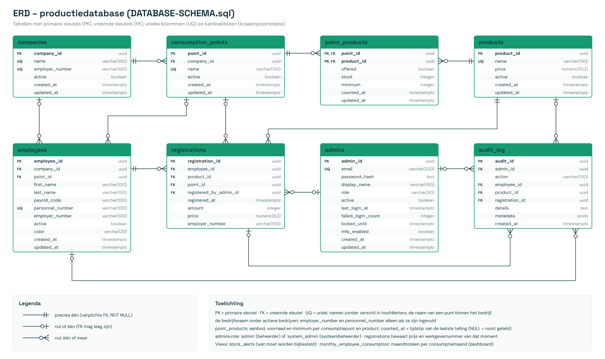

*Figuur: ERD van het productieschema (`DATABASE-SCHEMA.sql`) met primaire en vreemde sleutels en kardinaliteiten. `audit_log` is alleen-toevoegen en heeft bewust geen vreemde sleutels, daarom staan er geen relatielijnen bij die tabel.*

De relaties in het kort: een bedrijf heeft nul of meer consumptiepunten en nul of meer medewerkers. Een medewerker hoort bij hooguit één bedrijf en één consumptiepunt. Per consumptiepunt en product is er één regel aanbod en voorraad. Een registratie hoort bij precies één medewerker en één product, en bij hooguit één consumptiepunt en één beheerder (bij een correctie). Een logboekregel hoort bij hooguit één beheerder, medewerker, product en registratie.

#### Tabel Bedrijven

| Veld | In SQL | Type | Sleutel | Uitleg |
|---|---|---|---|---|
| `BedrijfID` | `company_id` | UUID | PK | Uniek nummer van het bedrijf (demo: `id`) |
| `Naam` | `name` | Tekst (150) | Uniek (zonder hoofdletters, bij actieve bedrijven) | Naam van het bedrijf |
| `Werkgevernummer` | `employer_number` | Tekst (100) | Uniek (alleen ingevulde nummers) | Standaard werkgevernummer voor de export. Mag leeg zijn (NULL). Een `UNIQUE`-constraint laat meerdere NULL-waarden toe, maar geen dubbele lege tekst `''` |
| `Actief` | `active` | Boolean | | Bedrijf in gebruik (bestaat niet in de demo) |

#### Tabel Consumptiepunten

| Veld | In SQL | Type | Sleutel | Uitleg |
|---|---|---|---|---|
| `ConsumptiepuntID` | `point_id` | UUID | PK | Uniek nummer van het punt (demo: `id`) |
| `BedrijfID` | `company_id` | UUID | FK → Bedrijven, verplicht | Bedrijf waar het punt bij hoort |
| `Naam` | `name` | Tekst (150) | Uniek per bedrijf (zonder hoofdletters) | Bijvoorbeeld "Hoofdkantoor" |
| `Actief` | `active` | Boolean | | Punt in gebruik (bestaat niet in de demo) |

#### Tabel Medewerkers

| Veld | In SQL | Type | Sleutel | Uitleg |
|---|---|---|---|---|
| `MedewerkerID` | `employee_id` | UUID | PK | Uniek nummer van de medewerker |
| `Voornaam` | `first_name` | Tekst (100) | | Voornaam van de medewerker. Verplicht en niet leeg (`NOT NULL` en een `CHECK`) |
| `Achternaam` | `last_name` | Tekst (150) | | Achternaam van de medewerker. Verplicht en niet leeg (`NOT NULL` en een `CHECK`). Let op: in de demo kan de achternaam leeg zijn (zie hieronder) |
| `Actief` | `active` | Boolean | | Geeft aan of de medewerker nog actief is |
| `Looncode` | `payroll_code` | Tekst (100) | | Looncode voor de CSV-export |
| `Personeelsnummer` | `personnel_number` | Tekst (100) | Uniek (alleen ingevulde nummers) | Nummer van de medewerker. Leeg = NULL |
| `BedrijfID` | `company_id` | UUID | FK → Bedrijven | Bedrijf waar de medewerker werkt (het standaard werkgevernummer staat bij het bedrijf) |
| `Werkgevernummer` | `employer_number` | Tekst (100) | | Optioneel afwijkend werkgevernummer. Leeg = dat van het bedrijf |
| `ConsumptiepuntID` | `point_id` | UUID | FK → Consumptiepunten | Vast consumptiepunt van de medewerker |
| `Kleur` | `color` | Tekst (20) | | Achtergrondkleur van de avatar |
| `Pasnummer` | `badge_id` (voorstel, nog niet in het schema) | Tekst (64) | Uniek (alleen ingevulde nummers) | Pasnummer (UID) van de pas, alleen hoofdletters en cijfers, 4 tot en met 64 tekens. Leeg = NULL (geen pas). Demo: `badgeId`, met `""` voor geen pas |

#### Tabel Producten

| Veld | In SQL | Type | Sleutel | Uitleg |
|---|---|---|---|---|
| `ProductID` | `product_id` | UUID | PK | Uniek nummer van het product (demo: vaste id zoals `blikje` voor standaardproducten) |
| `Naam` | `name` | Tekst (150) | Uniek (zonder hoofdletters) | Bijvoorbeeld Blikje, Glas melk, Beleg of Sneetje brood |
| `Prijs` | `price` | Decimaal (10,2) | | Huidige prijs per stuk, 0 of hoger |
| `Actief` | `active` | Boolean | | Product in gebruik (bestaat niet in de demo) |

De standaardprijzen zijn: blikje €0,65, sneetje brood €0,10, boter €0,10, zoet beleg €0,20, glas melk €0,20, beleg €0,50, ei €0,50 en yoghurt €0,50.

#### Tabel Aanbod en voorraad (PuntProduct)

| Veld | In SQL | Type | Sleutel | Uitleg |
|---|---|---|---|---|
| `ConsumptiepuntID` | `point_id` | UUID | PK, FK → Consumptiepunten | Het punt |
| `ProductID` | `product_id` | UUID | PK, FK → Producten | Het product |
| `Aangeboden` | `offered` | Boolean | | Biedt het punt dit product aan (demo: `offered`) |
| `Voorraad` | `stock` | Integer | | Huidige voorraad. Mag negatief worden (demo: `stock`) |
| `Minimum` | `minimum` | Integer | | Op of onder dit aantal bijbestellen. 0 of hoger (demo: `minimum`) |
| `LaatstGeteld` | `counted_at` | DatumTijd | | Tijdstip van de laatste telling. Leeg = nooit geteld (demo: `countedAt`) |

De primaire sleutel bestaat uit twee kolommen: per punt en product is er precies één regel. In de demo staat deze tabel als object `products` in ieder consumptiepunt.

#### Tabel Registraties

| Veld | In SQL | Type | Sleutel | Uitleg |
|---|---|---|---|---|
| `RegistratieID` | `registration_id` | UUID | PK | Uniek nummer van de registratie |
| `MedewerkerID` | `employee_id` | UUID | FK → Medewerkers, verplicht | Koppeling met de medewerker |
| `ProductID` | `product_id` | UUID | FK → Producten, verplicht | Geregistreerd product |
| `ConsumptiepuntID` | `point_id` | UUID | FK → Consumptiepunten | Punt dat het product aanbood. Leeg als het punt het product niet aanbood (demo: `pointId`) |
| `DatumTijd` | `registered_at` | DatumTijd | | Datum en tijd van de registratie (demo: `createdAt`) |
| `Aantal` | `amount` | Integer | | Aantal, standaard `1`. In de demo altijd `1` |
| `Prijs` | `price` | Decimaal (8,2) | | Prijs per stuk op het moment van registreren. Een latere prijswijziging verandert oude registraties niet |
| `Werkgevernummer` | `employer_number` | Tekst (100) | | Werkgevernummer op het moment van registreren. Een latere wijziging verandert oude registraties niet |
| `Correctie` | `registered_by_admin_id` | UUID | FK → Beheerders | Ingevuld = door een beheerder toegevoegd (correctie). De demo heeft geen beheerders en gebruikt `correction: true`. |

Een medewerker of product met registraties kan in de database niet worden verwijderd (`ON DELETE RESTRICT`). Deactiveren kan wel. Wordt een consumptiepunt verwijderd, dan blijft de registratie bestaan en wordt `point_id` leeg (`ON DELETE SET NULL`).

#### Tabel Beheerders

Deze tabel bestaat alleen in productie. De demo heeft geen accounts.

| Veld | In SQL | Type | Sleutel | Uitleg |
|---|---|---|---|---|
| `BeheerderID` | `admin_id` | UUID | PK | Uniek nummer van de beheerder |
| `Email` | `email` | Tekst (320) | Uniek (zonder hoofdletters) | Inlognaam |
| `WachtwoordHash` | `password_hash` | Tekst | | Alleen de hash (Argon2id of bcrypt), nooit het wachtwoord zelf |
| `Naam` | `display_name` | Tekst (150) | | Naam op het scherm |
| `Rol` | `role` | Tekst (30) | | `admin` (beheerder) of `system_admin` (systeembeheerder) |
| `Actief` | `active` | Boolean | | Mag deze beheerder inloggen |
| `LaatsteLogin` | `last_login_at` | DatumTijd | | Moment van de laatste geslaagde login |
| `MisluktePogingen` | `failed_login_count` | Integer | | Aantal mislukte inlogpogingen na elkaar |
| `GeblokkeerdTot` | `locked_until` | DatumTijd | | Account geblokkeerd tot dit tijdstip. Leeg = niet geblokkeerd |
| `Tweestaps` | `mfa_enabled` | Boolean | | Staat tweestapsverificatie aan |

#### Tabel Logboek (`audit_log`)

| Veld | In SQL | Type | Sleutel | Uitleg |
|---|---|---|---|---|
| `LogID` | `audit_id` | UUID | PK | Uniek nummer van de logregel (demo: `id`) |
| `BeheerderID` | `admin_id` | UUID | Verwijst naar Beheerders (geen FK) | Wie de wijziging deed (niet in de demo) |
| `Actie` | `action` | Tekst (100) | | Bijvoorbeeld "Registratie verwijderd" (demo: `action`) |
| `MedewerkerID` | `employee_id` | UUID | Verwijst naar Medewerkers (geen FK) | Betrokken medewerker (niet in de demo) |
| `ProductID` | `product_id` | UUID | Verwijst naar Producten (geen FK) | Betrokken product (niet in de demo) |
| `RegistratieID` | `registration_id` | UUID | Verwijst naar Registraties (geen FK) | Betrokken registratie (niet in de demo) |
| `Details` | `details` | Tekst | | Uitleg over de actie (demo: `details`) |
| `Metadata` | `metadata` | JSON (`jsonb`) | | Extra gegevens, bijvoorbeeld oude en nieuwe waarde (niet in de demo) |
| `DatumTijd` | `created_at` | DatumTijd | | Moment van de actie (demo: `createdAt`) |

In de demo bestaat een logregel alleen uit `id`, `action`, `details` en `createdAt`. Het logboek is alleen-toevoegen (append-only): een regel wordt nooit gewijzigd of verwijderd. Twee triggers (`audit_log_no_update_or_delete` en `audit_log_no_truncate`) weigeren `UPDATE`, `DELETE` en `TRUNCATE`, ook als een rol daar wel rechten voor heeft. Alleen de eigenaar van de tabel kan de triggers bewust uitzetten. Daarom hebben de verwijzingen in het logboek bewust geen vreemde sleutel. Met `ON DELETE SET NULL` zou de database bij het verwijderen van een medewerker of product de logregels zelf aanpassen, en dan is het spoor weg. Nu blijft de id staan, ook als het gegeven later wordt verwijderd. De naam van dat moment kan in `metadata` worden bewaard. Opschonen na de bewaartermijn doet alleen de eigenaar van de tabel in een gepland onderhoudsscript, dat de triggers daarvoor tijdelijk uitzet en dat zelf vastlegt.

### Productieschema

Het volledige PostgreSQL-schema staat in [`DATABASE-SCHEMA.sql`](./DATABASE-SCHEMA.sql). Het schema bevat:

- `companies` voor bedrijven en werkgevernummers (het werkgevernummer is uniek, FR-59).
- `consumption_points` voor de consumptiepunten per bedrijf.
- `point_products` voor aanbod, voorraad, minimum en het tijdstip van de laatste telling (`counted_at`) per consumptiepunt per product.
- `stock_alerts` als databaseview voor alles wat bijbesteld moet worden, met de status "Leeg" of "Bijbestellen" (sinds versie 3.16 dezelfde woorden als de demo, eerder "Op").
- `employees` voor actieve en inactieve medewerkers, met bedrijf en vast consumptiepunt (de kolom `badge_id` voor het pasnummer is een voorstel, zie hieronder).
- `products` voor producten en prijzen.
- `admins` voor beheerders en rollen (`admin` en `system_admin`), met het aantal mislukte inlogpogingen (`failed_login_count`), een blokkade tot een tijdstip (`locked_until`) en of tweestapsverificatie aan staat (`mfa_enabled`).
- `registrations` voor iedere consumptieregistratie met datum, tijd, aantal, prijs en werkgevernummer van dat moment.
- `audit_log` voor administratieve wijzigingen.
- `monthly_employee_consumption` als databaseview met maandtotalen per medewerker (aantal en bedrag) voor het beheerdashboard. Deze view groepeert op de **consumptiemaand** en de medewerker. De maand wordt sinds versie 3.16 in Nederlandse tijd bepaald (`date_trunc('month', registered_at AT TIME ZONE 'Europe/Amsterdam')`). Zonder die stap rekent PostgreSQL in de tijdzone van de databasesessie. Draait de server in UTC, dan kwam een registratie op de 1e van de maand tussen 0:00 en 1:00 (wintertijd) of 2:00 (zomertijd) in de vorige maand en dus in de verkeerde loonmaand. De backend bepaalt iedere maand of loonmaand op dezelfde manier. De view groepeert niet op loonmaand en niet op werkgevernummer. De view is dus **niet** geschikt voor de loonexport: die telt op per medewerker, loonmaand en werkgevernummer (FR-20, FR-30) en moet door de backend apart worden gemaakt, zoals `CsvExport` dat nu in de browser doet.

**Verschillen tussen de demo en het schema.** Wie gegevens uit de demo naar de database overzet, moet rekening houden met deze verschillen:

- De demo bewaart "geen nummer" als lege tekst `""` (werkgevernummer van een bedrijf of medewerker, personeelsnummer, looncode). In de database moet dat `NULL` worden (`''` → `NULL`). Anders botsen bijvoorbeeld twee bedrijven zonder werkgevernummer op de `UNIQUE`-constraint, want `UNIQUE` laat wel meerdere `NULL`-waarden toe, maar geen twee keer `''`. "Uniek" geldt dus alleen voor ingevulde nummers.
- `employees.last_name` is `NOT NULL` en mag niet leeg zijn (`CHECK`). In de demo maakt het formulier de achternaam verplicht, maar het omzetten van oude gegevens kan een lege achternaam opleveren (een oude naam van één woord, zoals "Anna", wordt alleen een voornaam). Zo'n medewerker moet vóór het overzetten een achternaam krijgen.
- Een aantal invoerregels van FR-59 staat niet in het schema: de prijsgrens van 1000 euro en hooguit twee decimalen (het schema controleert alleen `price >= 0`), alleen cijfers in looncode, personeelsnummer en werkgevernummer, en de grens van 100 tekens voor namen (het schema staat 150 tekens toe voor een achternaam en namen van producten, bedrijven en punten). Deze regels moet de backend controleren (NFR-07).
- Productnamen en namen van consumptiepunten zijn in het schema uniek zonder op hoofdletters te letten (`lower(name)`), net als in de demo. Een bedrijfsnaam is in het schema alleen uniek bij actieve bedrijven. De demo kent geen inactieve bedrijven.
- Het pasnummer (`badgeId` in de demo, FR-66) staat nog niet in `DATABASE-SCHEMA.sql`. In productie komt er in `employees` een kolom `badge_id` bij. Dit is een voorstel, het schemabestand is in deze versie bewust niet aangepast:

```sql
-- Voorstel: pasnummer per medewerker (NULL = geen pas).
ALTER TABLE employees ADD COLUMN badge_id varchar(64);
ALTER TABLE employees ADD CONSTRAINT employees_badge_id_format
    CHECK (badge_id ~ '^[A-Z0-9]{4,64}$');
ALTER TABLE employees ADD CONSTRAINT employees_badge_id_unique UNIQUE (badge_id);
```

Net als bij de andere nummers wordt een leeg pasnummer `""` uit de demo in de database `NULL`. Komt het pasnummer in productie uit AFAS of uit het toegangssysteem van TVB, dan vult de synchronisatie deze kolom (zie [Koppeling met AFAS Profit (ontwerp)](#koppeling-met-afas-profit-ontwerp)).

Registraties verdwijnen niet als een medewerker, bedrijf, consumptiepunt of product wordt gedeactiveerd: daarvoor heeft iedere tabel de kolom `active`, en de vreemde sleutels voorkomen dat een medewerker of product met registraties wordt verwijderd. Alleen een correctie `−` van een beheerder verwijdert een registratie. De backend doet dat in één transactie samen met een regel in `audit_log`, net als `persist` in de demo.

Gebruik voor `password_hash` een sterk wachtwoordalgoritme zoals Argon2id (of anders bcrypt), met een eigen salt per gebruiker (OWASP Foundation, z.d.-b). Sla nooit een wachtwoord zelf op. Gebruik in de backend parameterized queries, transacties rond correcties en een databasegebruiker met alleen de benodigde rechten.

Onderaan het schema staan als voorbeeld (in commentaar):

- **Rollen met zo weinig rechten als nodig:** de applicatie logt in met een eigen rol (`blikjes_app`) die geen tabellen mag aanmaken of verwijderen, en er is een aparte rol met alleen leesrechten voor rapportages.
- **Logboek alleen-toevoegen:** de applicatie krijgt op `audit_log` alleen het recht om regels te lezen en toe te voegen. Dit deel staat niet in commentaar, maar wordt echt uitgevoerd: de triggers bij de tabel `audit_log` weigeren wijzigen, verwijderen en leegmaken, ook voor een rol die daar per ongeluk rechten voor heeft gekregen, en `REVOKE UPDATE, DELETE, TRUNCATE ON audit_log FROM PUBLIC` haalt die rechten weg bij alle rollen die ze via `PUBLIC` zouden krijgen.
- **Bewaartermijn en anonimiseren:** registraties niet langer bewaren dan nodig (bijvoorbeeld de fiscale bewaarplicht van 7 jaar. Belastingdienst, z.d.) en daarna verwijderen of anonimiseren. Bij uit dienst na de bewaartermijn naam, looncode en personeelsnummer anonimiseren.
- **Queries:** alleen geparametriseerde queries, nooit invoer van gebruikers in de SQL-tekst.

## 9. Schermontwerpen en wireframes

### Medewerkersscherm

Sinds versie 3.21 opent de website op het **startscherm** (W48 tot en met W51, FR-83): zwart, met het TVB-logo, een ovaal voor het gezicht, een korte tekst en de knop `Handmatig zoeken`. Een medewerker begint met zijn pas, met zijn gezicht in het ovaal (FR-84) of met `Handmatig zoeken`. Die knop toont de beginpagina hieronder. Na afloop komt het startscherm terug (FR-85).

Op dit scherm staan:

- in de kop van de kaart één keer "Tik op je naam" naast het aantal medewerkers.
- de hint "Houd je pas tegen de lezer, of zoek je naam" (alleen als de pasjeslezer aan staat) met daarnaast de demoknoppen `Herken mij met de camera (demo)` en `Slimme koelkast (demo)` (sinds versie 3.14). Passen ze niet op één regel, dan staan de demoknoppen samen rechts op de regel eronder.
- een zoekveld (sneltoets Ctrl K) en een bedrijfsfilter, op een tablet en groter naast elkaar.
- de actieve medewerkers, gegroepeerd per bedrijf, met naam, avatar en "Tik om te kiezen".
- het totaal van vandaag en van deze maand (voor alle medewerkers samen).
- na een tik op een medewerker: een productvenster met een begroeting, de uitleg "Tik op + bij wat je pakt. Tik daarna op Registreren.", alleen de producten van het eigen consumptiepunt, per product een `−`- en `+`-knop (44 × 44 pixels, op een aanraakscherm 52 × 52 pixels) en onderaan een knopbalk met de knop `Registreren (aantal)` over de volle breedte. Een product met een keuze krijgt een lichtgroene achtergrond en een groene rand.
- zolang er niets is gekozen, is `Registreren` uitgeschakeld en staat erboven "Kies eerst een product met +" (FR-47).
- bij een medewerker die met de pas of de camera is herkend en eerder zelf heeft geregistreerd: "welkom terug" en een voorstel `Zelfde als vorige keer`. Na een tik op de naam staan die er niet (FR-49, FR-50).
- onder in het productvenster de uitleg "Wat je registreert, wordt maandelijks ingehouden op je loon. Meer informatie staat in de privacyverklaring voor medewerkers." (FR-69).
- een melding na het opslaan. Daarna zijn het zoekveld en het bedrijfsfilter weer leeg en staat de lijst bovenaan in beeld (FR-48).

Het productvenster sluit vanzelf als het 75 seconden niet wordt gebruikt. In de laatste 10 seconden staat boven de knop "Venster sluit zo. Tik om door te gaan." (FR-70).

Voor de pasjeslezer is geen knop nodig. Houdt een medewerker de pas tegen de lezer terwijl er geen venster open is, dan opent het eigen productvenster met "Je bent herkend met je pas." achter de begroeting (FR-65, UC-20). Staat het productvenster van een collega nog open, dan vervangt de pas dat venster (FR-71).

De knop `Slimme koelkast (demo)` opent het koelkastvenster (FR-72 tot en met FR-75, UC-21): eerst de gesloten koelkast met "Houd je pas tegen de lezer om de koelkast te openen" (W42), na de pas de open koelkast met de schappen, "In je hand" en de knop `Deur dicht` (W43), en na het sluiten het overzicht "Je hebt gepakt: …" met `Klaar` (W44).

Een medewerker ziet geen persoonlijke aantallen of kosten. De `−`-knop in het productvenster verlaagt alleen de keuze die nog niet is opgeslagen. Een opgeslagen registratie verlagen kan alleen de beheerder.

### Admin-login

Het loginvenster bevat:

- een e-mailadres.
- een wachtwoord.
- een knop om in te loggen.
- een melding bij lege invoer.
- een sluitknop.

In de demo werkt ieder ingevuld wachtwoord. Dit is alleen voor demonstratie en is niet veilig voor productie. Wordt het beheervenster gesloten (kruisje, klik naast het venster of Escape), dan is de beheerder ook uitgelogd, zodat op een gedeelde tablet de volgende persoon niet zonder wachtwoord in het beheer komt. Hetzelfde gebeurt vanzelf als het beheer 5 minuten niet is gebruikt (FR-68). Daarna verschijnt onderaan de melding "Je bent automatisch uitgelogd omdat het beheer 5 minuten niet is gebruikt."

### Beheerscherm

Het beheerscherm heeft zes tabbladen, en als de slimme koelkast aan staat zeven:

- **Registraties:** alle registraties bekijken, filteren op medewerker en maand, correcties met `+` en `−`, en CSV exporteren.
- **Medewerkers:** medewerkers toevoegen, wijzigen, aan een bedrijf, consumptiepunt en pas koppelen, activeren, deactiveren en (zonder registraties) verwijderen. Sinds versie 3.22 ook de demo gezichtsherkenning van een actieve medewerker instellen (met de medewerker zelf voor de camera) of uitzetten, met de vervaldatum in de lijst (FR-88, UC-23).
- **Producten:** producten en prijzen beheren.
- **Bedrijven:** bedrijven en consumptiepunten beheren en per punt het aanbod aan- of uitzetten.
- **Voorraad:** de bijbestellijst, de voorraad per consumptiepunt, leveringen boeken en minimums instellen.
- **Koelkast (demo, sinds versie 3.14):** per consumptiepunt welk product op welk schap ligt en het gewicht van één stuk (`Indeling opslaan`), en de laatste 10 openingen met datum en tijd, medewerker, wat er is gepakt en de status (FR-76). Registraties van de koelkast hebben in de registratietabel het label `Koelkast`.
- **Logboek:** alle administratieve wijzigingen, en daaronder de knop `Alle gegevens wissen`.

### Licht en donker thema

Rechtsboven in de bovenbalk staat een slider (met een zon- en een maanicoon) met daarnaast de knoppen `Systeem` en `Auto`:

- `Systeem` (standaard) volgt de instelling van het apparaat.
- de slider kiest vast licht of donker.
- `Auto` is overdag licht en na zonsondergang donker.

Technisch: alle kleuren staan als CSS-variabelen in `:root` (licht) en `:root[data-theme="dark"]` (donker). De class `ThemeManager` zet `data-theme` op het `<html>`-element en bewaart de keuze in `localStorage` onder `tvb-theme`. De tijden van zonsopkomst en zonsondergang staan per maand in `config.js` (`DAYLIGHT_HOURS`), een benadering voor Nederland. Iedere minuut wordt gecontroleerd of het thema moet wisselen. Een klein script in de `<head>` zet het donkere thema al vóór het tekenen, zodat de pagina niet eerst wit oplicht. Bij `Auto` gebruikt dat script het thema van het vorige bezoek, dat `ThemeManager` bewaart onder `tvb-theme-last`. Daarna past `ThemeManager` het thema zo nodig aan. In het donkere thema blijven de huiskleuren behouden en krijgt de tekst een iets lichtere tint van het huisgroen (`#1fbf8c`), zodat hij goed leesbaar is.

### Mobiele weergave

Op een klein scherm komen de onderdelen onder elkaar te staan. Hierdoor blijven de knoppen en teksten goed leesbaar op een telefoon. In de bovenbalk vervallen dan de statustekst, de icoontjes naast de slider en (op telefoons) de naam naast het logo, zodat de thema-knoppen en de admin-knop blijven passen.

De pagina is altijd minstens schermhoog, met de footer onderaan. Staat er weinig op het scherm (bijvoorbeeld op een staande tablet bij het consumptiepunt, of na zoeken op één naam), dan rekt de medewerkerskaart mee tot boven de footer in plaats van dat er onder de footer een leeg vlak ontstaat. Staat er meer op dan past, dan scrollt de pagina zoals normaal.

Bovenbalk, inhoud en footer gebruiken dezelfde paginabreedte en zijmarge (CSS-variabelen `--page-width` en `--gutter`), zodat de randen op ieder scherm gelijk lopen. Op tablets en telefoons (tot 1100 pixels breed) zijn de kleine teksten groter gemaakt, zodat ze op armlengte leesbaar zijn. Op een groot scherm blijven de oorspronkelijke maten staan.

Op een staande tablet en op schermen met weinig hoogte (tot 900 pixels hoog, zoals een liggende tablet van 1080 × 810) is de banner compacter, zodat de medewerkerlijst hoger begint. In het productvenster blijft de knopbalk met `Registreren` onderaan in beeld als de productlijst scrolt (`position: sticky`), ook op een telefoon en bij 200% zoom. Het bedrijfsfilter en zijn opties, de knop `Herken mij met de camera (demo)`, de knoppen `Systeem` en `Auto`, de knop `Admin login`, de link `Gezichtsherkenning instellen (demo)` en de correctieknoppen `+` en `−` in het beheer zijn minstens 44 pixels hoog. Alleen de pijlknop in het bedrijfsfilter is 40 × 40 pixels, omdat die binnen het veld van 44 pixels staat (het hele veld opent de keuzelijst ook).

Knoppen en medewerkerrijen reageren kort bij indrukken (ze worden heel even iets kleiner), vensters openen met een zachte fade en tabbladen faden in. Alle effecten duren hooguit een kwart seconde. Wie op het apparaat "minder beweging" heeft ingesteld, krijgt geen animaties.

### Van schets naar website: drie niveaus

Een wireframe kan op drie niveaus worden uitgewerkt:

| Niveau | Wat het laat zien | Waar in dit document |
|---|---|---|
| Low-fidelity | Alleen de indeling, als schets: dunne zwarte lijnen op wit, kaders voor vlakken, knoppen en velden, een kader met een kruis voor afbeeldingen en iconen en krabbellijnen waar tekst komt. Geen kleuren en bijna geen echte tekst. | [Low-fidelity wireframes](#low-fidelity-wireframes) |
| Mid-fidelity | De indeling met de echte teksten, labels en volgorde, in grijstinten en met één lettertype. Nog zonder huisstijl. Met twee iteraties (ontwerpvarianten). | [Mid-fidelity wireframes](#mid-fidelity-wireframes) |
| High-fidelity | Het eindontwerp met de kleuren, lettertypes, iconen en afbeeldingen van TVB. Met twee iteraties (ontwerpvarianten). | [High-fidelity wireframe](#high-fidelity-wireframe) en [Wireframes](#wireframes) (de screenshots van de website) |

**Hoe de low- en mid-fidelity wireframes zijn gemaakt.** Aan het begin van het project zijn de twee schetsen hieronder gemaakt ("Eerste schets" en "Eerste uitwerking"). De website is daarna flink veranderd, dus die schetsen laten niet meer zien hoe de website nu is. Daarom zijn de low- en mid-fidelity wireframes in dit hoofdstuk opnieuw gemaakt **vanuit de huidige website**, zodat ze precies overeenkomen met de echte schermen. Dat is gedaan met Microsoft Edge zonder venster (headless), met dezelfde demogegevens als de high-fidelity screenshots (ingevoerd via de website zelf).

- **Mid-fidelity:** de meeste zijn gemaakt op 1 oktober 2026. Een paar zijn later op dezelfde manier en met dezelfde stappen opnieuw gemaakt, omdat de website op die plek was veranderd: M07 (Registraties) en M15 (Logboek) op 2 oktober 2026, omdat het datumveld `Datum bij toevoegen (+)` en de knop `Alle gegevens wissen` zijn bijgekomen, en M12 (Bedrijven) op 6 oktober 2026, omdat er nu "1 medewerker" staat in plaats van "1 medewerkers".
- **Low-fidelity:** alle vijftien zijn op 12 oktober 2026 opnieuw gemaakt in een echte schetsstijl. De eerdere versie (van 1, 2 en 6 oktober) had zwarte kaders met grijze balken en de meeste echte teksten, en leek daardoor te veel op een mid-fidelity wireframe. De schermen, de indeling en de afmetingen zijn gelijk gebleven.

Een klein script verandert alleen de weergave van de pagina. De indeling, de plaats en de grootte van alles blijven gelijk. Dit script en de hulpscripts voor de screenshots staan niet in de repository. De afbeeldingen zijn dus niet met één opdracht opnieuw te maken. Het script werkt per niveau zo:

- **Low-fidelity:** het script meet in de echte pagina de plaats en grootte van ieder vlak, iedere knop, ieder veld, ieder icoon en ieder woord. Daarna tekent het de hele pagina opnieuw als schets (in SVG) over de pagina heen, met dunne zwarte lijnen op wit en zonder kleuren of schaduwen. De lijnen zijn met opzet een klein beetje ongelijk, zodat het eruitziet als een schets en niet als een af scherm. Lopende tekst, namen, labels en details zijn krabbellijnen: golvende lijnen met de lengte van het woord (een dikkere lijn is een grotere of vette tekst, zoals een kop). Alleen korte koppen, tabbladen, knopteksten en getallen staan er als echte tekst in, in een handschriftachtig lettertype (Segoe Print), omdat het scherm zonder die woorden niet te begrijpen is. Ieder plaatje, icoon en logo (ook het TVB-logo) is een rechthoek met een kruis van hoek tot hoek, een avatar is een cirkel met een kruis. Alleen de tekens `+`, `−` en `×` op de ronde knoppen en de sluitknop en de pijl van een keuzelijst zijn getekend, omdat die knoppen zonder hun teken geen betekenis hebben.
- **Mid-fidelity:** de pagina staat in grijstinten, alles gebruikt één lettertype (Arial) en schaduwen en kleurverlopen zijn weg. De banner is een grijs vlak. De lichte cirkels die als versiering in de banner staan, blijven zichtbaar. Alle echte teksten staan erin. Het camerabeeld is een grijs vlak met de tekst "Camerabeeld" en het ovale kader.

Bij schermen met een venster (zoals het productvenster of het beheer) is de pagina erachter ook te zien, net als op de website. In de low-fidelity wireframes is die pagina met lichtgrijze lijnen getekend, in de mid-fidelity wireframes is hij gedimd.

| Teken in de low-fidelity wireframe | Betekenis |
|---|---|
| Dun zwart kader | Vlak, kaart, knop, invoerveld of keuzelijst (een keuzelijst heeft rechts een pijltje) |
| Dikker kader | De hoofdknop van het scherm, zoals `Registreren (3)` |
| Gestippelde cirkel met een licht teken | Uitgeschakelde knop, zoals de `−` bij een product dat nog op 0 staat |
| Krabbellijn (golvende lijn) | Tekst zoals namen, uitleg, labels en details. De lengte van de lijn is de lengte van het woord, een dikkere lijn is een grotere of vette tekst |
| Woord in handschrift | Korte kop, tabblad, knoptekst of getal die nodig is om het scherm te begrijpen |
| Rechthoek met een kruis | Afbeelding, icoon, logo of camerabeeld |
| Cirkel met een kruis | Avatar van een medewerker of van de beheerder |
| Vierkantje, met of zonder vinkje | Vinkje (aan of uit) |
| Gestippeld ovaal | Kader voor het gezicht bij de gezichtsherkenning |
| Lichtgrijze lijnen | De pagina achter een open venster |

### Low-fidelity wireframes

#### Eerste schets (begin van het project)

```text
+------------------------------------------------------+
| TVB Blikjesregistratie                 [Admin login] |
+------------------------------------------------------+
| Vandaag: [datum]                                     |
| Wie heeft er vandaag een blikje gepakt?              |
|------------------------------------------------------|
| Medewerkers                         | Statistieken  |
| [ Zoek medewerker................ ] | Vandaag:  12  |
| [Naam medewerker................ +] | Deze maand: 30|
+------------------------------------------------------+
```

Bij deze eerste schets ging het vooral om de grote indeling van het scherm: een lijst met medewerkers links en de totalen rechts. In die tijd ging het alleen om blikjes en had iedere medewerker een eigen `+`-knop in de lijst.

#### L01 – Beginpagina op een tablet

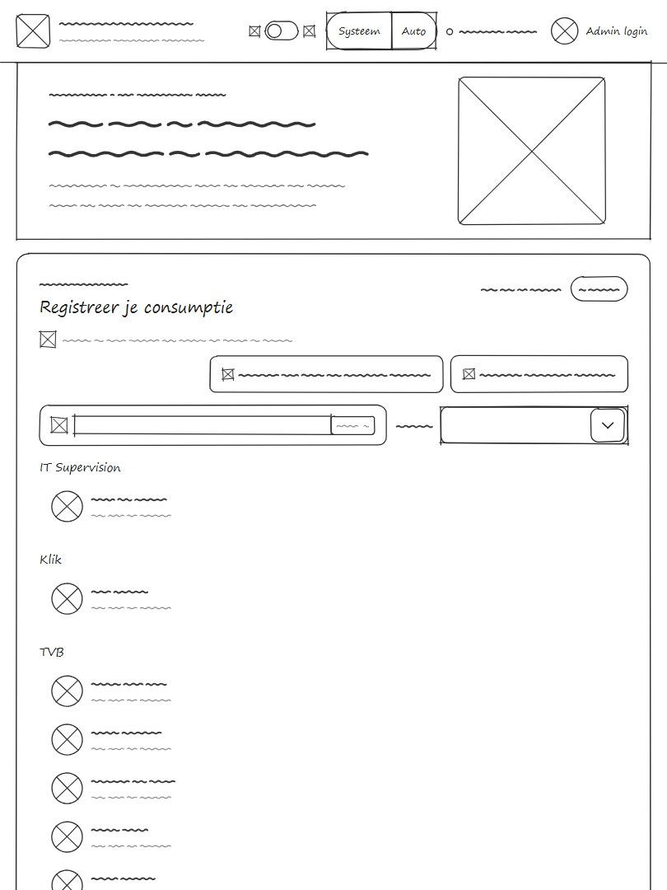

Bovenaan de bovenbalk met links het logo (rechthoek met kruis) en de naam, en rechts de themakeuze (slider en twee knoppen), de status en de admin-knop. Daaronder de banner met de vraag als grote kop (dikke krabbellijnen) en rechts een afbeelding. Daaronder één grote kaart met een kop, een teller, een brede knop voor de camera, het zoekveld, het bedrijfsfilter en de lijst met medewerkers onder een bedrijfsnaam: per medewerker een avatar (cirkel met kruis) met twee regels tekst. Uitgewerkt in [W01](#w01--beginpagina-op-een-tablet).

#### L02 – Beginpagina op een groot scherm

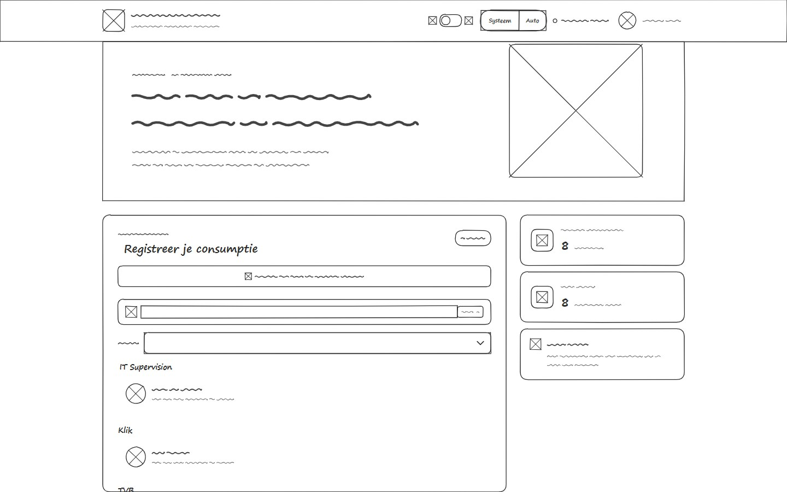

Dezelfde onderdelen in twee kolommen: links de kaart met medewerkers (nu onder drie bedrijfsnamen), rechts drie kleinere kaarten onder elkaar: twee voor de totalen (icoon, label en getal) en één tipkaart. Uitgewerkt in [W02](#w02--beginpagina-op-een-groot-scherm).

#### L03 – Beginpagina op een telefoon

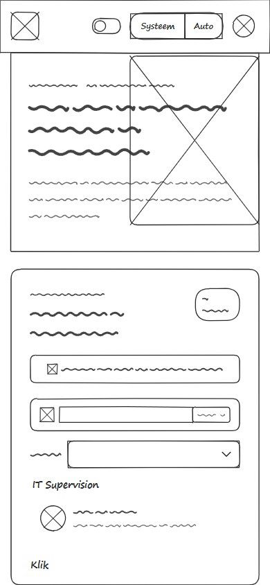

Alles staat in één kolom. In de bovenbalk blijven alleen het logo, de themakeuze en de admin-knop over. De afbeelding in de banner schuift achter de kop. Uitgewerkt in [W03](#w03--beginpagina-op-een-telefoon).

#### L04 – Productvenster

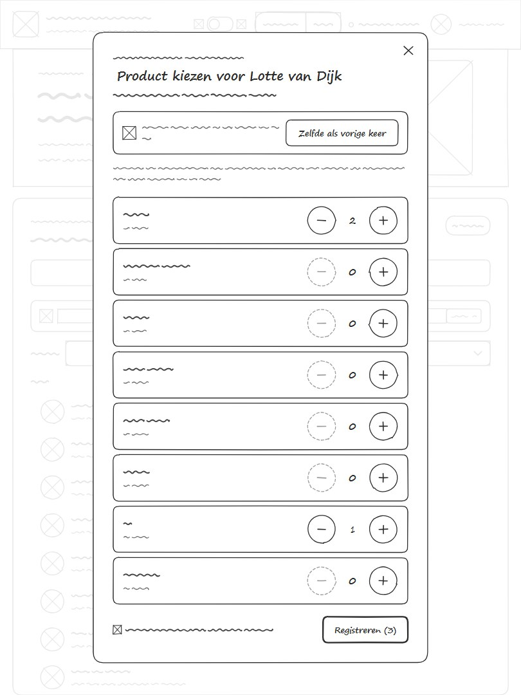

Een venster boven de beginpagina met bovenaan de kop met de naam van de medewerker en een sluitknop. Daaronder een vak met het voorstel en de knop `Zelfde als vorige keer`, een korte uitleg en een lijst met even grote productrijen: links naam en prijs, rechts een ronde `−`-knop, het aantal en een ronde `+`-knop. Bij een product dat op 0 staat, is de `−`-knop gestippeld (uitgeschakeld). Onderaan links de link voor de gezichtsherkenning en rechts de knop `Registreren (3)`, met een dikker kader omdat het de hoofdknop is. Uitgewerkt in [W07](#w07--productvenster-eerste-keer) tot en met [W10](#w10--productvenster-met-zelfde-als-vorige-keer).

#### L05 – Gezichtsherkenning instellen (demo)

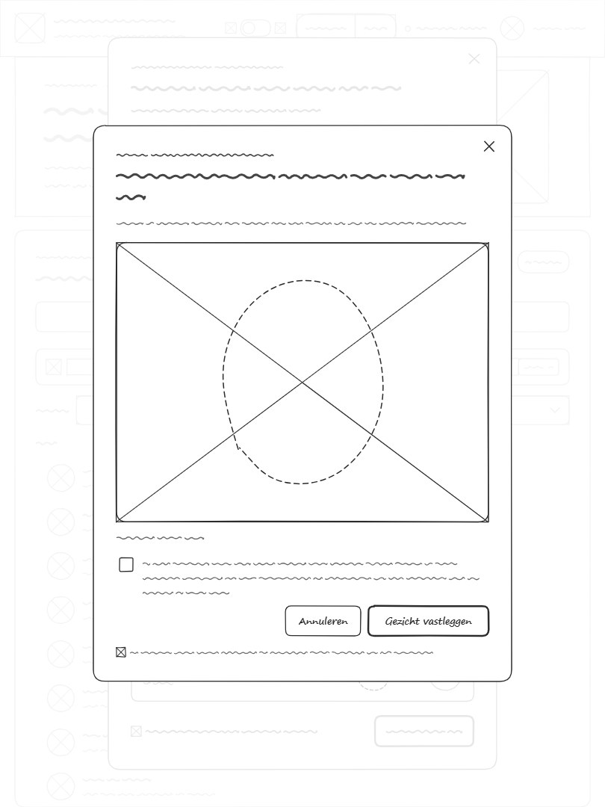

Een tweede venster boven het productvenster. Het grootste deel is het camerabeeld (kader met kruis) met daarin het ovale kader voor het gezicht. Daaronder een statusregel, een vinkje met de toestemmingstekst, de knoppen `Annuleren` en `Gezicht vastleggen` en een regel met een slot-icoon. Uitgewerkt in [W12](#w12--gezichtsherkenning-instellen-demo).

#### L06 – Inloggen als beheerder

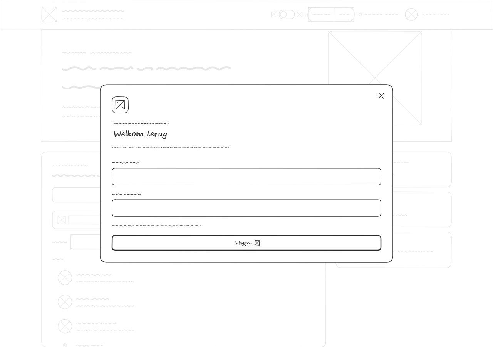

Een venster met een icoon, een kop, een korte uitleg, twee velden onder elkaar met hun label erboven, een hint en één brede knop `Inloggen`. Uitgewerkt in [W16](#w16--inloggen-als-beheerder).

#### L07 – Beheer: Registraties

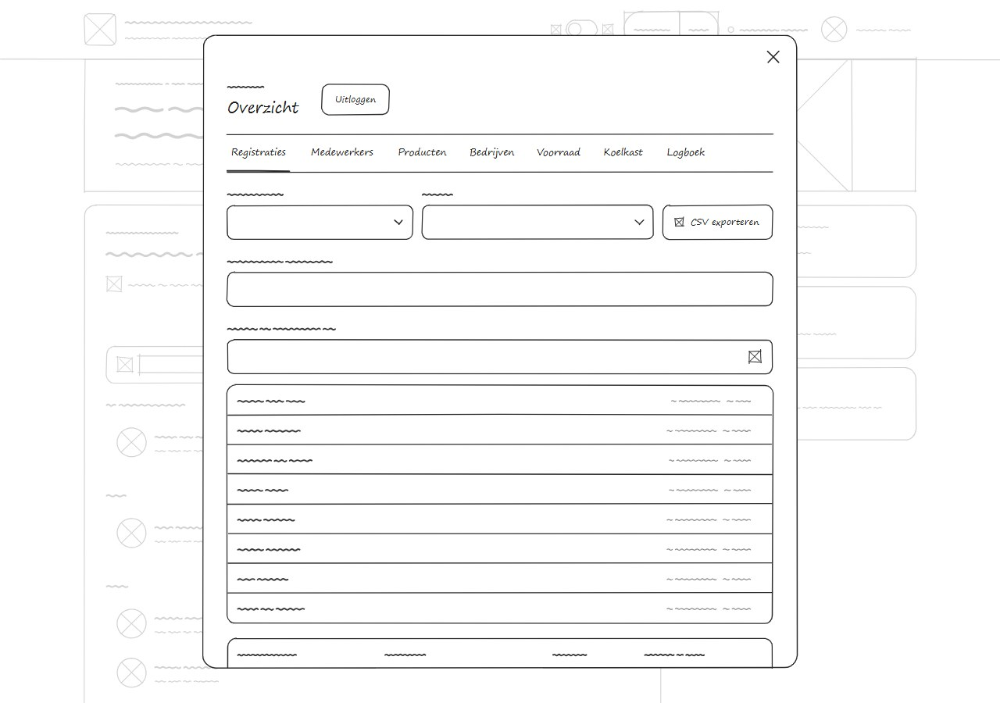

Het beheervenster met bovenaan de kop `Overzicht` en de knop `Uitloggen`, daaronder een rij met zes tabbladen. Op dit tabblad: twee keuzelijsten en een exportknop op één regel, een zoekveld, een datumveld, een lijst met per medewerker links een naam en rechts een totaal, en daaronder een tabel met vier kolommen. Uitgewerkt in [W18](#w18--beheer-registraties).

#### L08 – Beheer: Medewerkers

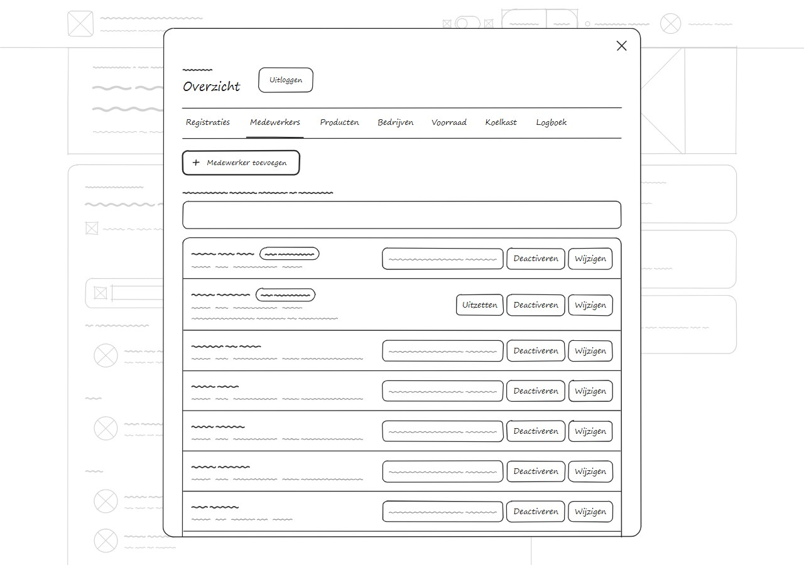

Een knop om een medewerker toe te voegen, een zoekveld met label en een lijst met rijen: links twee regels tekst, rechts de knoppen `Deactiveren` en `Wijzigen`. Uitgewerkt in [W21](#w21--beheer-medewerkers).

#### L09 – Medewerker toevoegen

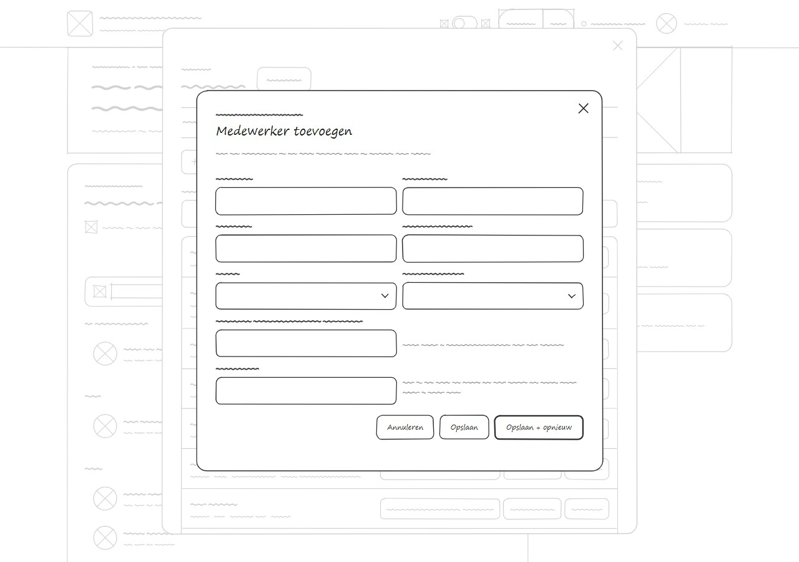

Een formulier in een venster boven het beheer, met de velden in twee kolommen en het label boven ieder veld, een hint naast het laatste veld en rechtsonder drie knoppen. Uitgewerkt in [W22](#w22--medewerker-toevoegen).

#### L10 – Beheer: Producten

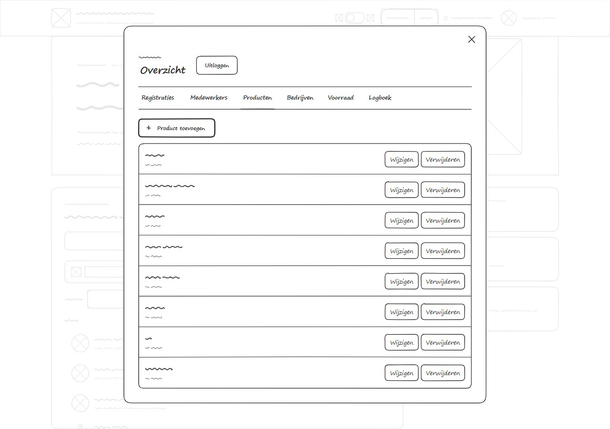

Een knop om een product toe te voegen en een lijst met rijen: links naam en prijs, rechts `Wijzigen` en `Verwijderen`. Dezelfde opbouw als de lijst met medewerkers. Uitgewerkt in [W25](#w25--beheer-producten).

#### L11 – Product toevoegen

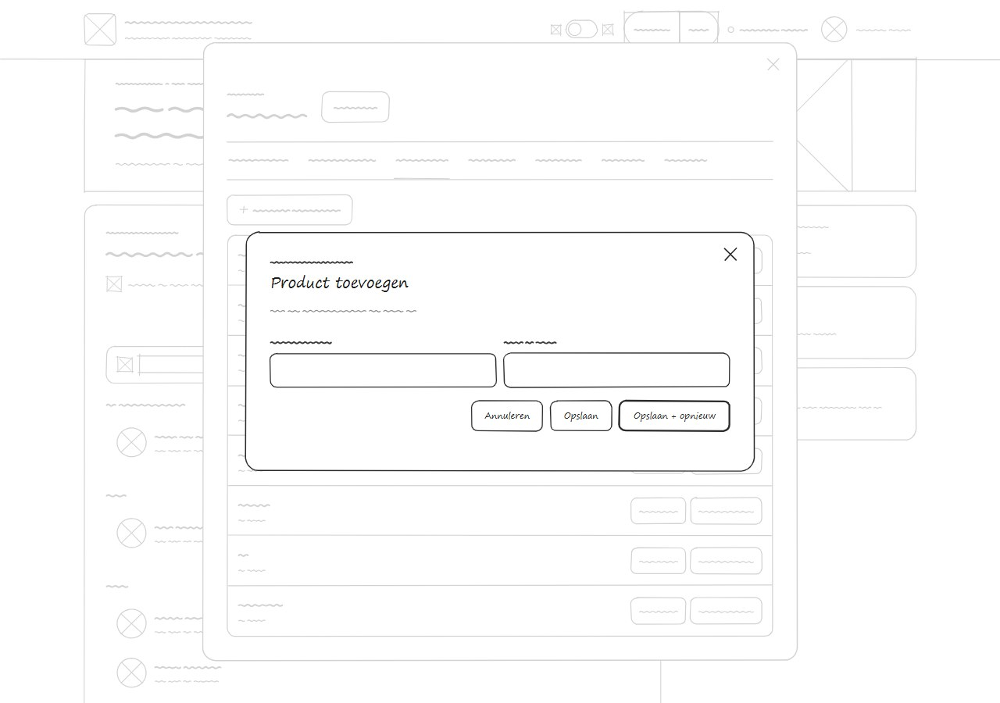

Een klein formulier met twee velden naast elkaar en drie knoppen, in dezelfde opbouw als het formulier voor medewerkers. Uitgewerkt in [W26](#w26--product-toevoegen).

#### L12 – Beheer: Bedrijven en consumptiepunten

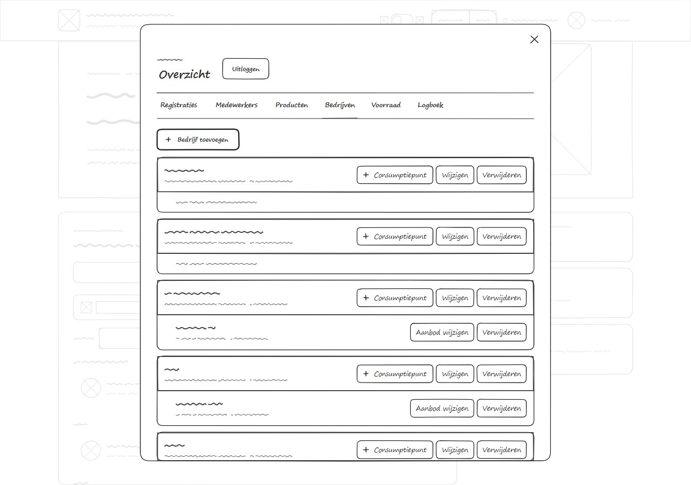

Een knop om een bedrijf toe te voegen en per bedrijf een blok: bovenin de bedrijfsregel met drie knoppen, daaronder ingesprongen de consumptiepunten met twee knoppen, of één regel tekst als er nog geen punt is. Uitgewerkt in [W28](#w28--beheer-bedrijven-en-consumptiepunten).

#### L13 – Consumptiepunt toevoegen

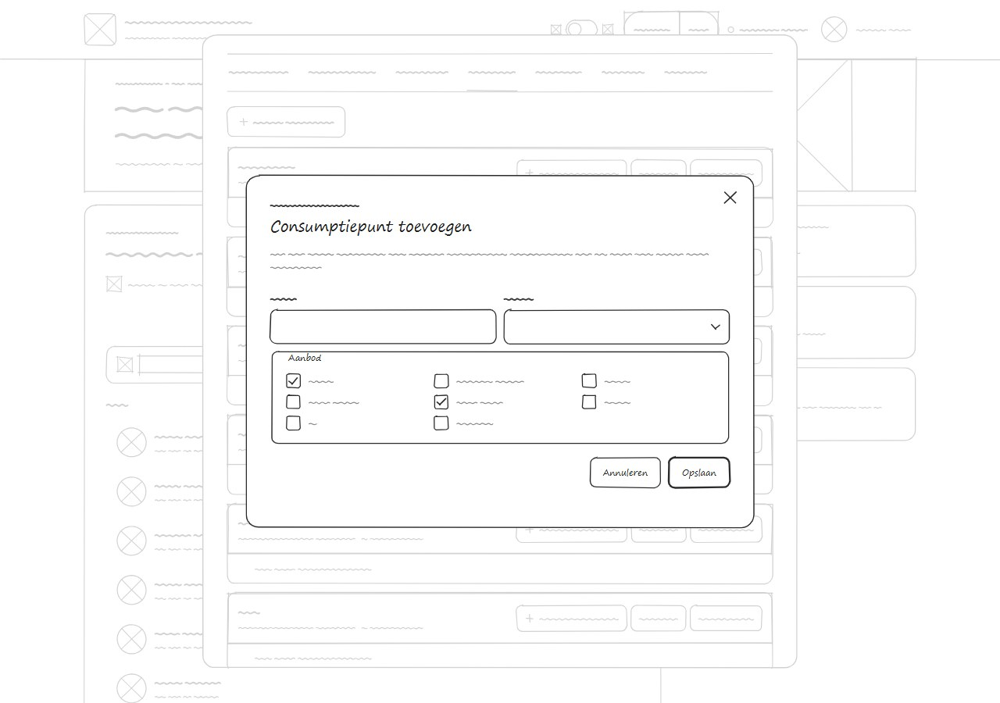

Een formulier met twee velden naast elkaar en een omkaderd blok `Aanbod` met een vinkje per product in drie kolommen, en daaronder twee knoppen. Uitgewerkt in [W30](#w30--consumptiepunt-toevoegen-met-aanbod).

#### L14 – Beheer: Voorraad

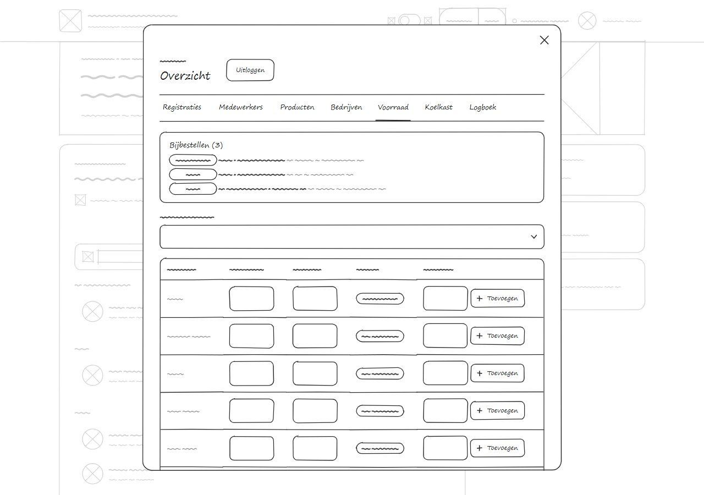

Bovenaan een blok `Bijbestellen (3)` met per regel een label, een link naar het punt en tekst. Daaronder een keuzelijst voor het consumptiepunt en een tabel met vijf kolommen: product, twee invoervelden (voorraad en minimum), een statuslabel en een invoerveld met de knop `Toevoegen`. Uitgewerkt in [W31](#w31--beheer-voorraad).

#### L15 – Beheer: Logboek

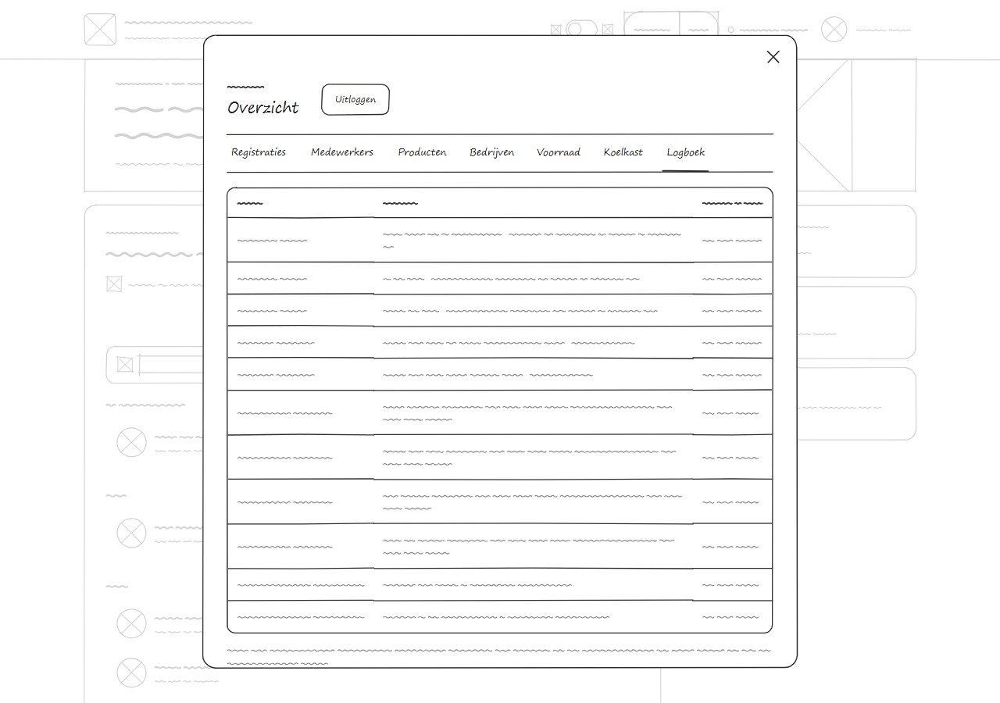

Een tabel met drie kolommen: actie, details en datum en tijd. Daaronder twee regels tekst (krabbellijnen) en één knop `Alle gegevens wissen`, los van de tabel. Uitgewerkt in [W33](#w33--beheer-logboek).

### Mid-fidelity wireframes

#### Eerste uitwerking (begin van het project)

```text
+------------------------------------------------------+
| [TVB] Blikjesregistratie       Systeem actief [ A ]  |
+------------------------------------------------------+
| Vandaag · datum                                      |
| Medewerkers                              8 totaal   |
| [ Zoek op voor- of achternaam... ]                   |
| [avatar] Mark Jansen                    [ + ]        |
|          0 blikjes gepakt                             |
| [avatar] Sophie de Boer                 [ + ]        |
|          3 blikjes gepakt                             |
+------------------------------+-----------------------+
| Vandaag gepakt: 5            | Deze maand: 5         |
+------------------------------+-----------------------+
```

Hier waren de kaarten, knoppen en informatie al duidelijker uitgewerkt. In de uiteindelijke versie zijn de persoonlijke aantallen weggehaald (FR-29) en opent een klik op de medewerker een productvenster.

#### M01 – Beginpagina op een tablet

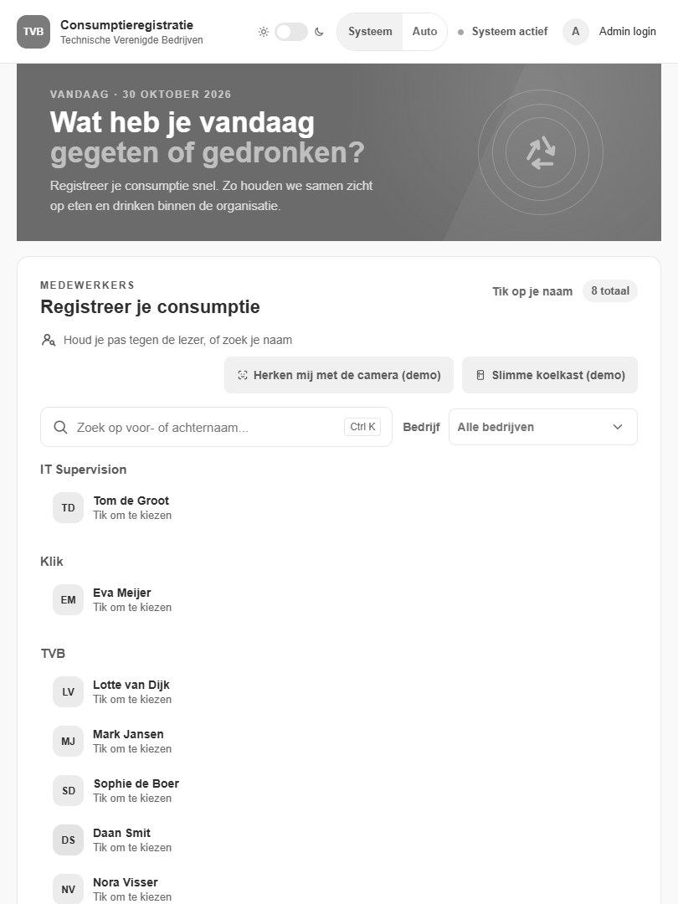

De indeling van L01 met de echte teksten: de datum en de vraag in de banner, de kop `Registreer je consumptie`, de teller `8 totaal`, de voorbeeldtekst in het zoekveld met `Ctrl K`, `Alle bedrijven` in het filter en de namen met initialen. De hiërarchie is al zichtbaar door grootte en dikte van de letters, zonder huiskleuren. Uitgewerkt in [W01](#w01--beginpagina-op-een-tablet).

#### M02 – Beginpagina op een groot scherm

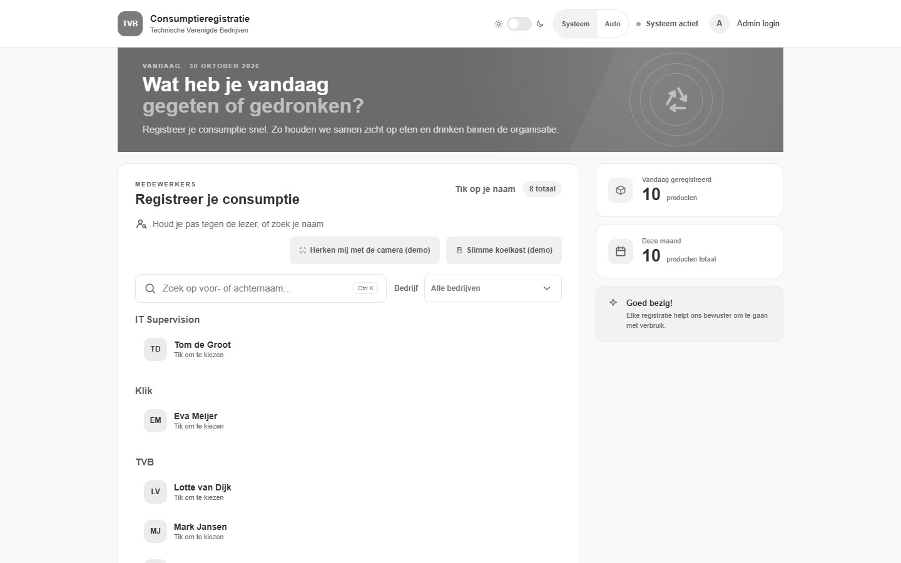

Twee kolommen met rechts de totalen (`Vandaag geregistreerd`, `Deze maand`) en de tipkaart `Goed bezig!`. Links de medewerkers onder IT Supervision, Klik en TVB. Uitgewerkt in [W02](#w02--beginpagina-op-een-groot-scherm).

#### M03 – Beginpagina op een telefoon

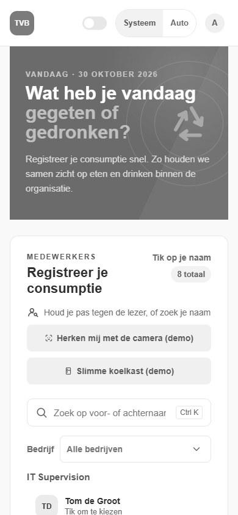

Eén kolom met dezelfde teksten. Hier is ook te zien dat de voorbeeldtekst in het zoekveld op een telefoon net niet past en dat de teller "8 totaal" over twee regels breekt (een beperking, zie W03). Uitgewerkt in [W03](#w03--beginpagina-op-een-telefoon).

#### M04 – Productvenster

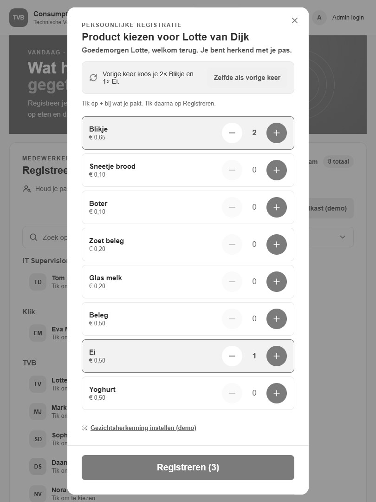

Met de echte inhoud: de begroeting "Goedemiddag Lotte, welkom terug.", het voorstel "Vorige keer koos je 2× Blikje en 1× Ei.", de productnamen met prijzen, de aantallen (2 en 1 na `Zelfde als vorige keer`) en `Registreren (3)`. De `+`-knoppen en `Registreren` zijn donker, de uitgeschakelde `−`-knoppen licht: het verschil tussen hoofdactie en uitgeschakeld is al zonder kleur te zien. Uitgewerkt in [W07](#w07--productvenster-eerste-keer) tot en met [W10](#w10--productvenster-met-zelfde-als-vorige-keer).

#### M05 – Gezichtsherkenning instellen (demo)

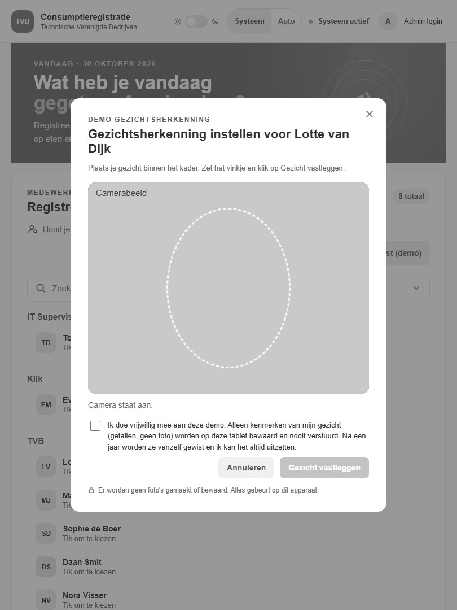

Het camerabeeld als grijs vlak met de tekst "Camerabeeld" en het ovale kader, de status `Camera staat aan.`, de volledige toestemmingstekst, de lichte (uitgeschakelde) knop `Gezicht vastleggen` en de privacyregel. Uitgewerkt in [W12](#w12--gezichtsherkenning-instellen-demo).

#### M06 – Inloggen als beheerder

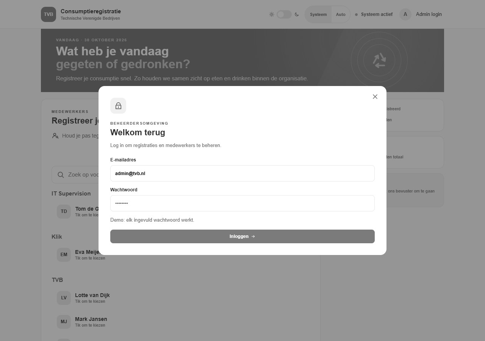

Het loginvenster met `Beheerdersomgeving`, `Welkom terug`, het ingevulde e-mailadres, het wachtwoordveld, de hint "Demo: elk ingevuld wachtwoord werkt." en de donkere knop `Inloggen`. Uitgewerkt in [W16](#w16--inloggen-als-beheerder).

#### M07 – Beheer: Registraties

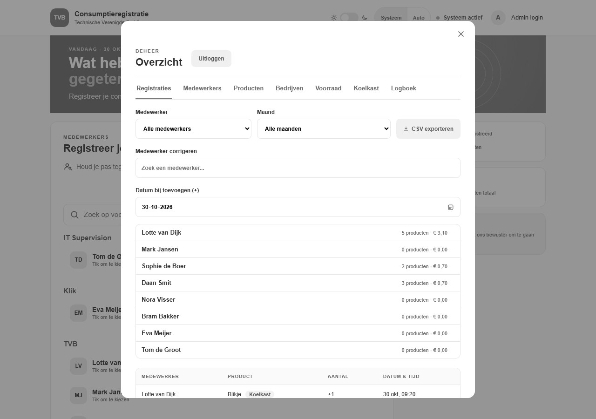

De tabbladen met het actieve tabblad onderstreept, de filters `Alle medewerkers` en `Alle maanden`, `CSV exporteren`, het zoekveld, het datumveld `Datum bij toevoegen (+)`, de totalen per medewerker (bijvoorbeeld "3 producten · € 1,80") en de tabel met de nieuwste registratie bovenaan. Uitgewerkt in [W18](#w18--beheer-registraties).

#### M08 – Beheer: Medewerkers

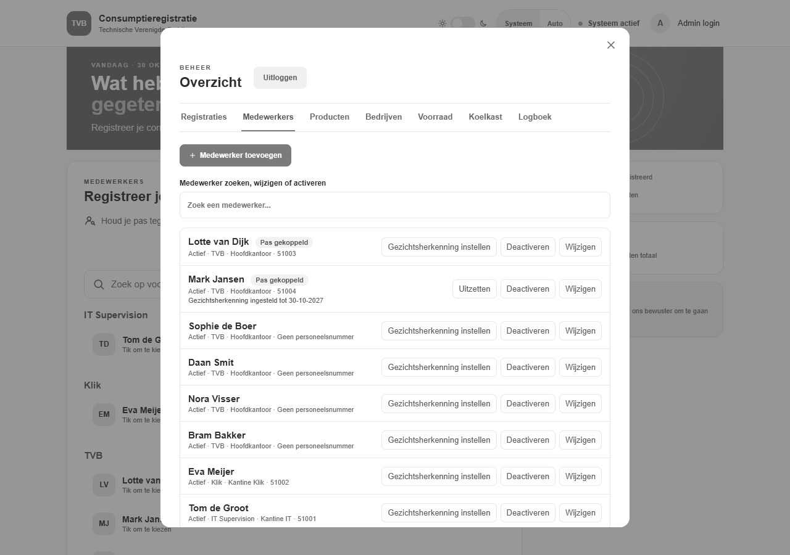

De lijst met per medewerker de naam en "Actief · TVB · Hoofdkantoor · Geen personeelsnummer", en de knoppen `Deactiveren` en `Wijzigen`. Uitgewerkt in [W21](#w21--beheer-medewerkers).

#### M09 – Medewerker toevoegen

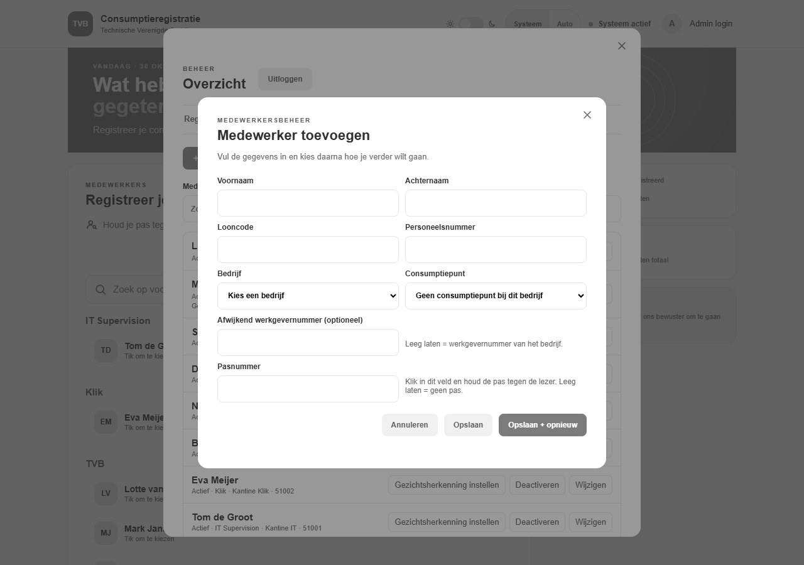

Het formulier met alle labels, de keuzelijsten `Kies een bedrijf` en `Geen consumptiepunt bij dit bedrijf`, de hint bij het werkgevernummer en de knoppen `Annuleren`, `Opslaan` en (donker) `Opslaan + opnieuw`. Uitgewerkt in [W22](#w22--medewerker-toevoegen).

#### M10 – Beheer: Producten

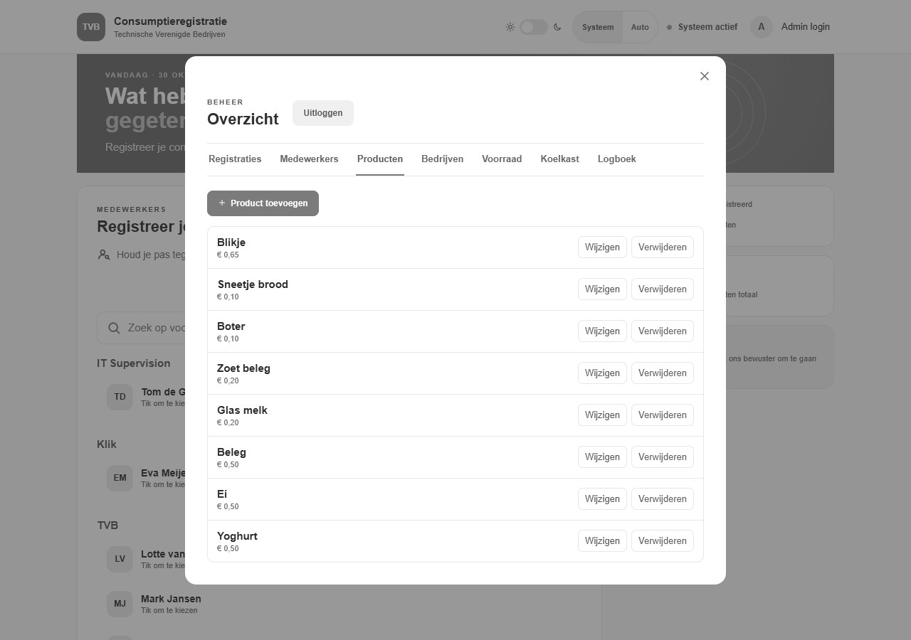

De acht producten met hun prijs en de knoppen `Wijzigen` en `Verwijderen`. Uitgewerkt in [W25](#w25--beheer-producten).

#### M11 – Product toevoegen

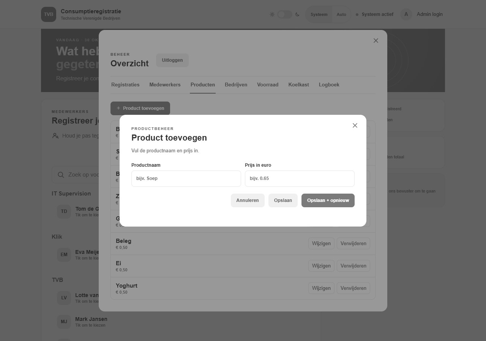

De velden `Productnaam` en `Prijs in euro` met de voorbeelden "bijv. Soep" en "bijv. 0.65", en de drie knoppen. Uitgewerkt in [W26](#w26--product-toevoegen).

#### M12 – Beheer: Bedrijven en consumptiepunten

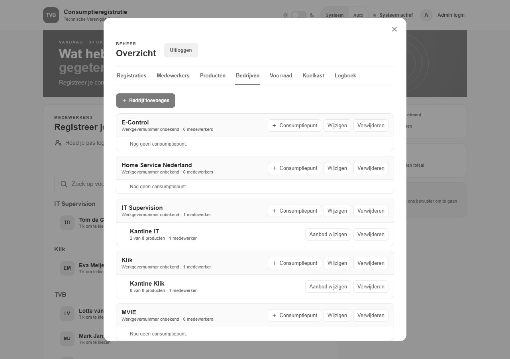

De bedrijven op alfabetische volgorde met "Werkgevernummer onbekend" en het aantal medewerkers ("0 medewerkers", of "1 medewerker" bij IT Supervision en Klik), de punten Kantine IT ("2 van 8 producten · 1 medewerker") en Kantine Klik ("0 van 8 producten · 1 medewerker"), en "Nog geen consumptiepunt." bij bedrijven zonder punt. Uitgewerkt in [W28](#w28--beheer-bedrijven-en-consumptiepunten).

#### M13 – Consumptiepunt toevoegen

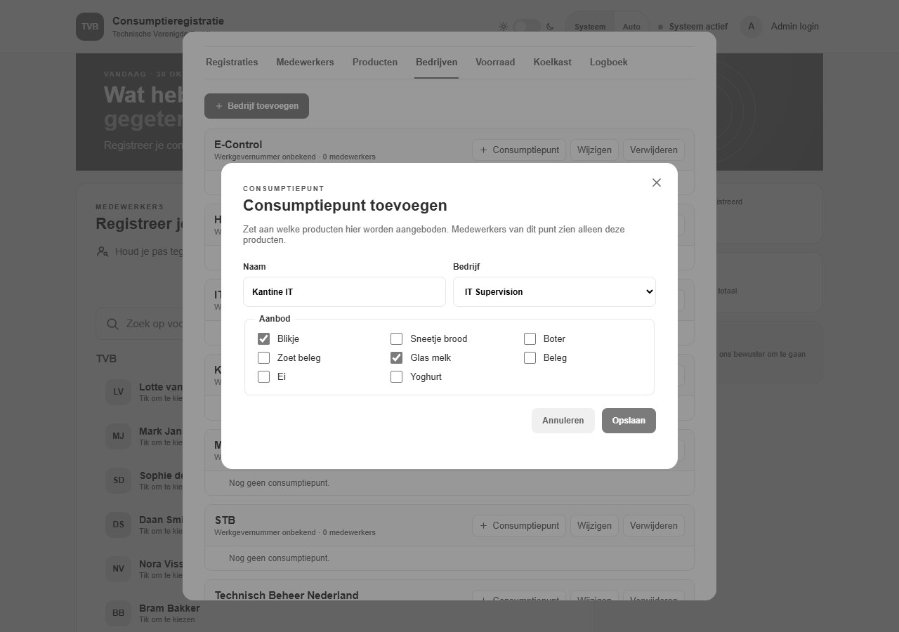

De uitleg over het aanbod, de naam `Kantine IT`, het bedrijf `IT Supervision` en de productnamen bij de vinkjes, met Blikje en Glas melk aangevinkt. Uitgewerkt in [W30](#w30--consumptiepunt-toevoegen-met-aanbod).

#### M14 – Beheer: Voorraad

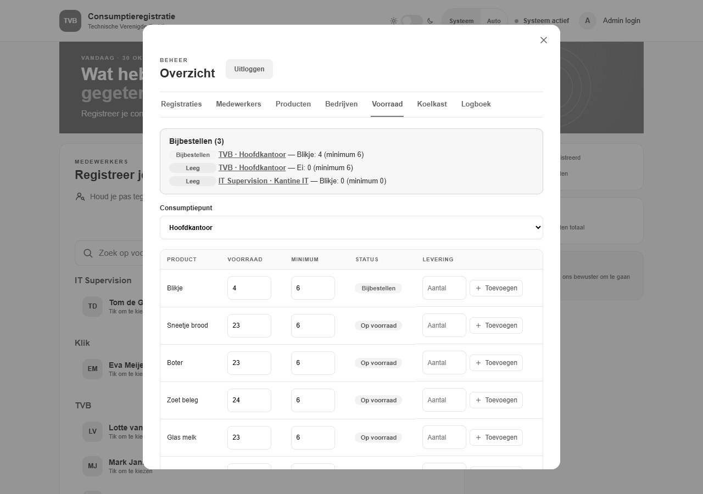

De bijbestellijst met de labels `Bijbestellen` en `Op` en de teksten (bijvoorbeeld "Blikje: 4 (minimum 6)"), en de tabel van Hoofdkantoor met de getallen, de statuslabels `Bijbestellen` en `Op voorraad` en de velden `Aantal` met `Toevoegen`. Zonder kleur zijn de labels alleen nog aan hun tekst te herkennen. In het eindontwerp helpen kleuren hierbij. Uitgewerkt in [W31](#w31--beheer-voorraad).

#### M15 – Beheer: Logboek

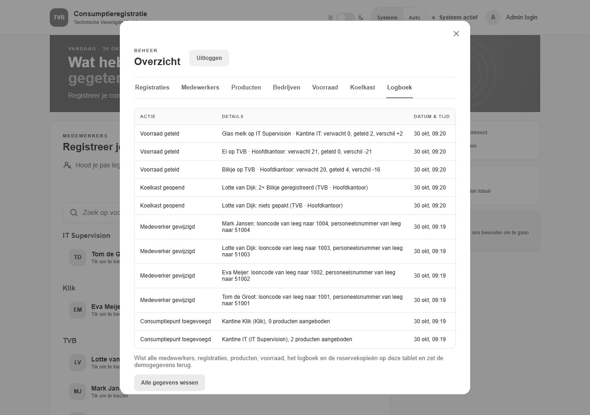

Het logboek met de echte regels, zoals "Consumptiepunt toegevoegd" en "Voorraad geteld", met de details en de datum en tijd (hier "02 okt, 14:35"). Onder de tabel staat de uitleg "Wist alle medewerkers, registraties, producten, voorraad, het logboek en de reservekopieën op deze tablet en zet de demogegevens terug." en de knop `Alle gegevens wissen`. Zonder kleur lijkt die knop op een gewone knop. In het eindontwerp is hij rood. Uitgewerkt in [W33](#w33--beheer-logboek).

#### Iteraties

Een ontwerp ontstaat niet in één keer. Voor de twee schermen die een medewerker het vaakst gebruikt, de beginpagina en het productvenster, zijn naast het definitieve ontwerp (M01 en M04) andere indelingen uitgewerkt en afgewogen. Hieronder staan twee van die ontwerpvarianten als mid-fidelity wireframe. Per iteratie staat wat er anders is dan het definitieve ontwerp, wat het voordeel en het nadeel is en waarom het definitieve ontwerp is gekozen. De codes H1 tot en met H10 zijn de heuristieken van Nielsen (zie [De tien heuristieken van Nielsen](#de-tien-heuristieken-van-nielsen)).

**Hoe de iteraties zijn gemaakt.** De afbeeldingen zijn op 12 oktober 2026 gemaakt, op dezelfde manier als de andere mid-fidelity wireframes: de echte website is geladen in Microsoft Edge zonder venster, met dezelfde demogegevens. Daarna is de variant alleen in de geladen pagina nagebouwd door tijdelijk extra CSS en HTML toe te voegen. De bestanden van de website zelf zijn niet veranderd. Tot slot heeft hetzelfde script als bij M01 tot en met M15 de pagina in grijstinten en met één lettertype gezet. Omdat de afbeeldingen 's ochtends zijn gemaakt, staat in iteratie 2 "Goedemorgen" in plaats van "Goedemiddag".

#### Mid-fidelity iteratie 1 – Beginpagina met een alfabetische lijst en de zoekbalk onderaan

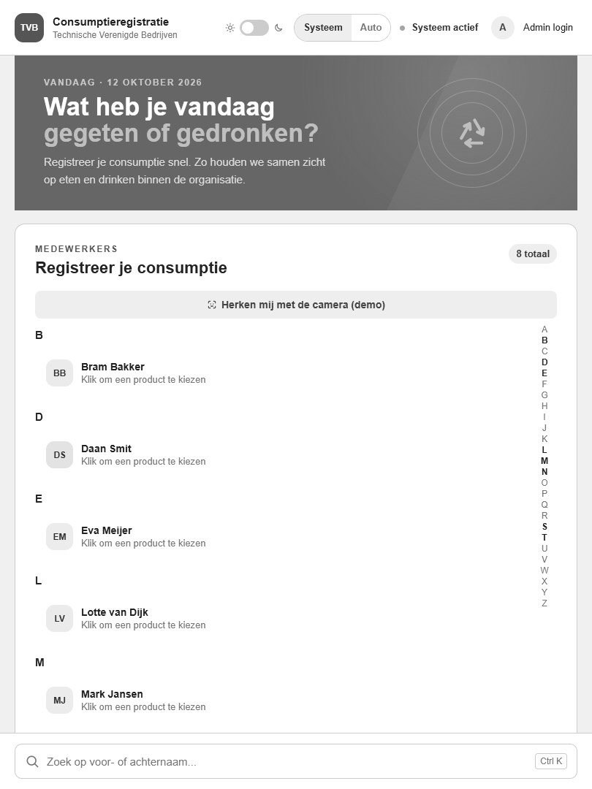

**Wat is anders.** De medewerkers staan niet per bedrijf, maar in één lijst op alfabet, met een letter boven iedere groep (B, D, E, L, M, enzovoort). Rechts naast de lijst staat een index van A tot en met Z, waarin de letters met medewerkers vet zijn. Het bedrijfsfilter is weg. Het zoekveld staat niet boven de lijst, maar vast onderaan het scherm, zodat het altijd in beeld is. De banner, de kop en de knop voor de camera zijn gelijk aan M01.

**Afweging.** Een alfabet is een ordening die iedereen kent (H2), en met de index kan een medewerker in een lange lijst direct naar de eigen beginletter springen. Een zoekveld onderaan zit op een staande tablet dicht bij de hand en blijft zichtbaar, ook als de lijst scrollt. Daar staan een paar nadelen tegenover:

- De lijst is gesorteerd op voornaam. Wie op achternaam zoekt (bijvoorbeeld "van Dijk"), vindt zichzelf niet onder de verwachte letter. Dat vraagt herinneren in plaats van herkennen (H6).
- De letters in de index zijn ongeveer 15 pixels hoog. Dat is veel kleiner dan de 44 × 44 pixels die de website voor aanraakvlakken aanhoudt (UI-principe toegankelijkheid, zie W01).
- Zonder groepering per bedrijf en zonder bedrijfsfilter voldoet het ontwerp niet aan FR-31. Bij meerdere bedrijven op één tablet staan collega's van verschillende bedrijven door elkaar.
- Het zoekveld staat los van de lijst die het filtert, aan de andere kant van het scherm (UI-principe groeperen). Op de meeste websites en apps staat het zoekveld boven de lijst (H4). Bovendien schuift het schermtoetsenbord van een tablet onderaan omhoog, precies waar het zoekveld staat.

**Besluit.** Gekozen is voor M01: de medewerkers per bedrijf (FR-31) met het bedrijfsfilter, en het zoekveld direct boven de lijst (FR-02). Met zoeken op voor- of achternaam is een naam ook in een lange lijst na een paar letters te vinden, en zoeken werkt ook met het toetsenbord (Ctrl K, H7). Daarmee is een index niet nodig.

#### Mid-fidelity iteratie 2 – Productvenster met een aantalveld per product

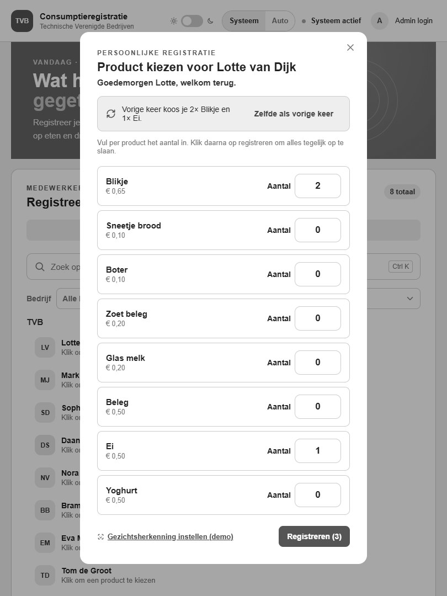

**Wat is anders.** In plaats van de knoppen `−` en `+` met het aantal ertussen heeft ieder product een invoerveld `Aantal`, waarin de medewerker het aantal typt. De rest is gelijk aan M04: het voorstel `Zelfde als vorige keer`, de uitleg (aangepast aan het invoerveld) en één knop `Registreren (3)` om alles tegelijk op te slaan.

**Afweging.** Een invoerveld is compact en een groter aantal (bijvoorbeeld 6) is in één keer te typen. Maar op een tablet zonder toetsenbord heeft dit ontwerp duidelijke nadelen:

- Voor één product moet de medewerker in het veld tikken, de 0 weghalen, een cijfer typen en het schermtoetsenbord sluiten. Met de `+`-knop is dat één tik. Het meest voorkomende geval (één blikje) kost met het invoerveld dus meer handelingen dan de 3 tikken van NFR-01 (naam, `+`, `Registreren`).
- Het schermtoetsenbord bedekt een groot deel van het venster, ook de knop `Registreren`.
- In een vrij veld kan alles worden ingevuld: een negatief getal, een kommagetal, niets of per ongeluk 100. Dat vraagt extra controles en foutmeldingen achteraf, terwijl de knoppen zulke fouten vooraf onmogelijk maken (H5).

**Besluit.** Gekozen is voor M04 met de ronde knoppen `−` en `+` van 44 × 44 pixels (FR-03 en FR-47). Het aantal staat groot tussen de knoppen (H1), de `−`-knop gaat niet onder 0 (H5) en een verkeerde tik is met `−` direct te herstellen (H3). Het gaat om losse consumpties (een blikje, een ei, een sneetje brood), waarbij grote aantallen per keer niet voor de hand liggen. Het snel typen van grote aantallen weegt daarom niet op tegen de nadelen.

### High-fidelity wireframe

De high-fidelity versie is de uiteindelijke website. Deze heeft:

- de groene en blauwe kleuren van TVB.
- afgeronde kaarten.
- duidelijke teksten.
- avatars en iconen.
- hover-effecten.
- meldingen na een actie.
- een mobiele indeling.
- een aparte admin-modal.

Van ieder scherm van de high-fidelity versie staat een screenshot in de paragraaf [Wireframes](#wireframes) hieronder.

#### Iteraties

Ook in de huisstijl zijn voor de beginpagina en het productvenster andere indelingen uitgewerkt en afgewogen tegen het definitieve ontwerp (W01 en W10). Hieronder staan twee van die ontwerpvarianten. Ze gebruiken dezelfde kleuren, lettertypes (DM Sans en Space Grotesk), iconen en onderdelen als de website, zodat alleen de ontwerpkeuze verschilt. Per iteratie staat wat er anders is, wat het voordeel en het nadeel is en waarom het definitieve ontwerp is gekozen. De codes H1 tot en met H10 zijn de heuristieken van Nielsen (zie [De tien heuristieken van Nielsen](#de-tien-heuristieken-van-nielsen)), de UI-principes staan in [Gebruikte UI-principes](#gebruikte-ui-principes).

**Hoe de iteraties zijn gemaakt.** De afbeeldingen zijn op 12 oktober 2026 gemaakt met de echte website in Microsoft Edge zonder venster, op een staande tablet (810 × 1080 pixels) en met dezelfde demogegevens als de screenshots W01 tot en met W41. De variant is alleen in de geladen pagina nagebouwd door tijdelijk extra CSS en HTML toe te voegen, met de bestaande stylesheet en onderdelen (kaarten, knoppen, avatars, iconen en statistiektegels). De bestanden van de website zelf zijn niet veranderd. Het zijn dus geen screenshots van een scherm dat in de website zit. Omdat ze 's ochtends zijn gemaakt, staat in iteratie 1 "Goedemorgen".

#### High-fidelity iteratie 1 – Productvenster met tegels en registreren per tegel

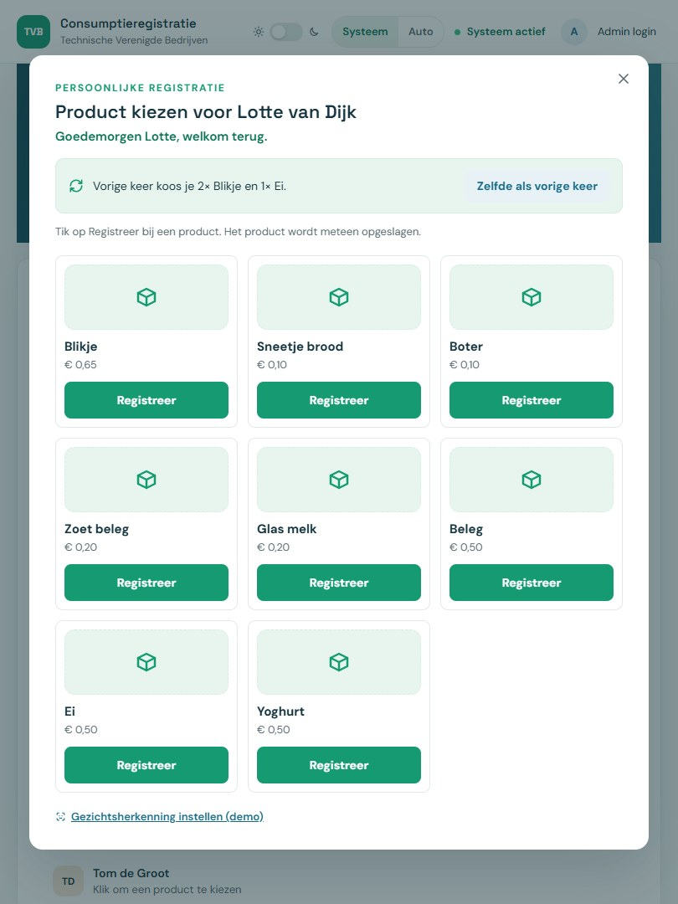

**Wat is anders.** Het venster is breder en de producten staan als tegels in drie kolommen. Iedere tegel heeft bovenaan een plek voor een productfoto (hier een icoon in een lichtgroen vlak, omdat er geen productfoto's zijn), daaronder de naam en de prijs en onderaan een eigen groene knop `Registreer`. Een tik op die knop slaat het product meteen op. De tellers met `−` en `+` en de knop `Registreren` onderaan zijn weg, en de uitleg zegt "Tik op Registreer bij een product. Het product wordt meteen opgeslagen."

**Afweging.** Een foto maakt een product sneller herkenbaar dan alleen een naam (H6) en sluit aan bij hoe het product er in de kantine uitziet (H2). Voor één product zijn maar twee tikken nodig (naam en `Registreer`), één minder dan in NFR-01. Daar staan deze nadelen tegenover:

- Er zijn geen productfoto's. Het datamodel heeft per product alleen een naam en een prijs en geen afbeelding (zie [Tabel Producten](#tabel-producten)). Foto's vragen een extra veld, uploaden en opslaan in het beheer, en de beheerder moet ze bij ieder nieuw product bijhouden. Dat valt buiten de scope van de demo.
- Er staan acht groene knoppen in één venster. Groen betekent in de website "de hoofdactie" (UI-principe kleur met betekenis). Met acht hoofdacties valt geen enkele knop meer op en is de visuele hiërarchie weg (H8).
- Wie meerdere producten pakt, zoals 2× Blikje en 1× Ei, tikt drie keer op `Registreer` en krijgt drie aparte registraties en meldingen in plaats van één.
- Iedere tik is meteen opgeslagen. Een verkeerde tik kan de medewerker niet zelf herstellen, omdat een medewerker geen registratie mag verlagen (FR-04). Daarvoor is een correctie door de beheerder nodig (H3 en H5).
- `Zelfde als vorige keer` kan de keuze niet meer klaarzetten om eerst te controleren, zoals FR-50 vraagt, want er is geen keuze meer die nog niet is opgeslagen.

**Besluit.** Gekozen is voor het productvenster van W07 tot en met W10: een lijst met even grote rijen, per product `−` en `+`, en één groene knop `Registreren (aantal)` die alles in één keer opslaat (FR-03, FR-47 en FR-48). De medewerker kiest eerst en bevestigt daarna één keer, en kan tot dat moment alles nog herstellen met `−` (H3 en H5). Zo blijft er één duidelijke hoofdactie in het venster. Een kleine productfoto in de rij kan later worden toegevoegd zonder deze werkwijze te veranderen.

#### High-fidelity iteratie 2 – Beginpagina met de totalen bovenaan en een raster met avatars

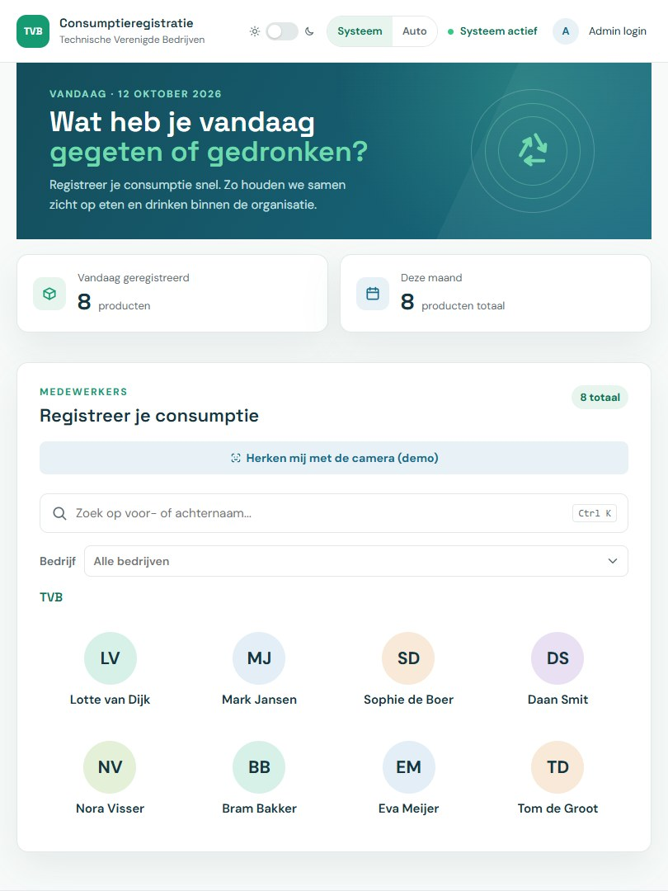

**Wat is anders.** De twee tegels met de totalen (`Vandaag geregistreerd` en `Deze maand`) staan direct onder de banner, boven de kaart met medewerkers. De tipkaart `Goed bezig!` is weg. De medewerkers staan niet in een lijst, maar in een raster van vier kolommen met per medewerker een grote avatar met initialen en de naam eronder. De tekst "Klik om een product te kiezen" is weggelaten.

**Afweging.** De totalen zijn meteen te zien (H1) en het raster ziet er beeldend uit, met grote aanraakvlakken en vier namen naast elkaar. Daar staan deze nadelen tegenover:

- De totalen zijn voor de taak van de medewerker (registreren) niet nodig en zijn een Could-eis (FR-62). Bovenaan duwen ze de lijst met namen ongeveer 130 pixels omlaag, terwijl de staande tablet in W01 juist een compactere banner heeft zodat de lijst zo hoog mogelijk begint (H8).
- Namen in smalle, gecentreerde kolommen zijn lastiger achter elkaar te lezen dan een lijst die links is uitgelijnd (UI-principe uitlijning). Een lange naam, bijvoorbeeld met een tussenvoegsel, past niet altijd in een kolom van ongeveer 170 pixels en loopt dan over twee regels. Op een telefoon past het raster van vier kolommen helemaal niet, dus daar is toch een andere indeling nodig (UI-principe responsief ontwerp).
- De avatar helpt nauwelijks bij het vinden van de eigen naam: het zijn initialen en een kleur, geen foto, en twee medewerkers kunnen dezelfde initialen hebben. De naam blijft dus het belangrijkste kenmerk.
- Zonder "Klik om een product te kiezen" is minder goed te zien dat een tegel aan te tikken is (UI-principe affordance).

**Besluit.** Gekozen is voor W01: een lijst met per medewerker een avatar, de naam en "Tik om te kiezen" (tot versie 3.12 "Klik om een product te kiezen"), met één keer "Tik op je naam" in de kop, gegroepeerd per bedrijf. Op een staande tablet staan de totalen onder de lijst (W06), op een groot scherm in een eigen kolom rechts (W02). De medewerker ziet zo eerst wat nodig is om te registreren, en de totalen blijven beschikbaar.

### Ontwerpkeuzes en Nielsen-heuristieken

- De melding na het registreren laat zien wat er is gebeurd. Dit past bij **zichtbaarheid van de systeemstatus**.
- De zoekbalk voorkomt dat de gebruiker alle namen moet onthouden. Dit past bij **herkenning in plaats van onthouden**.
- Knoppen volgen overal hetzelfde patroon. Een formulier met twee opslaanknoppen heeft `Opslaan` als gewone (secundaire) knop en `Opslaan + opnieuw` als groene hoofdknop, omdat de beheerder vaak meerdere medewerkers of producten achter elkaar invoert. Een formulier met één opslaanknop heeft `Opslaan` als groene hoofdknop: bij een bedrijf en een consumptiepunt, en bij het wijzigen van een medewerker of product, waar `Opslaan + opnieuw` wegvalt (zie W24). Knoppen die iets verwijderen, hebben rode tekst. Dit past bij **consistentie en standaarden**.
- Het beheervenster heeft een sluitknop en een knop `Uitloggen`. Sluiten logt de beheerder ook uit, zodat op een gedeelde tablet niemand per ongeluk ingelogd blijft. Met `Uitloggen` blijft het venster open met het loginformulier. Dit past bij **gebruikerscontrole en vrijheid** en **foutpreventie**.
- Een medewerker kan zelf niet verlagen en ziet alleen producten die op het eigen punt aanwezig zijn. Dit helpt om fouten te voorkomen en past bij **foutpreventie**.
- De website werkt op verschillende schermen: telefoon, tablet en groot scherm (het UI-principe responsief ontwerp). Op ieder scherm zien de onderdelen er hetzelfde uit en blijft op een klein scherm alleen het noodzakelijke staan. Dit past bij **consistentie en standaarden** en **esthetisch en minimalistisch ontwerp**.
- Hoort een registratie bij een medewerker die niet (meer) bestaat, dan staat er `Verwijderd` in plaats van een naam, in de tabel en in de CSV-export. Dat komt alleen voor bij oude of geïmporteerde gegevens: een medewerker met registraties kan niet worden verwijderd, en alleen een inactieve medewerker zonder registraties kan definitief worden verwijderd. Zo blijft de registratie zichtbaar en raakt er niets ongemerkt kwijt. Dit past bij **zichtbaarheid van de systeemstatus**: de beheerder ziet dat er een registratie is waarvan de medewerker niet meer bestaat, in plaats van dat die stil uit de tabel of de export verdwijnt.
- Het productvenster heeft naast `+` ook een `−`-knop, zodat een verkeerde tik direct te herstellen is. Dit past bij **gebruikerscontrole en vrijheid**.
- De melding na het registreren noemt de naam en de producten, staat onderaan in het midden en blijft 4 seconden staan. Dit past bij **zichtbaarheid van de systeemstatus**, belangrijk op een gedeelde tablet.
- Formulieren hebben labels boven de velden in plaats van alleen voorbeeldtekst die verdwijnt tijdens het typen. Dit past bij **herkenning in plaats van onthouden** en **foutpreventie**.
- Knoppen voor aanraakschermen zijn minstens 44 × 44 pixels (het UI-principe toegankelijkheid), en op een staande tablet en op schermen met weinig hoogte (zoals een liggende tablet) is de banner compacter zodat de medewerkerlijst hoger begint. Die compactere banner past bij **esthetisch en minimalistisch ontwerp**: wat de medewerker nodig heeft, de lijst met namen, staat zo hoog mogelijk.
- Foutmeldingen in formulieren staan direct onder het veld (met een waarschuwingsteken), het eerste foute veld krijgt de focus en de melding verdwijnt zodra je het veld aanpast. Dit past bij **fouten herkennen en herstellen**.
- Lege lijsten en tabellen tonen een icoon, een korte uitleg en waar nodig een knop, zoals "Zoekopdracht wissen" of "Naar Bedrijven". Dit past bij **hulp en documentatie** en **fouten herstellen**.
- Meldingen tonen een vinkje bij succes en een uitroepteken in een cirkel bij een fout. De melding zelf heeft altijd dezelfde donkere achtergrond. Het verschil zit in het icoon (en de kleur van het icoon), dus niet alleen in kleur. Dit past bij **zichtbaarheid van de systeemstatus**.
- Alle iconen zijn eenvoudige SVG-lijntekeningen met dezelfde lijndikte (`assets/js/icons.js`) in plaats van teksttekens, zodat ze op ieder apparaat hetzelfde en scherp zijn. Dit past bij **consistentie en standaarden**.
- Ieder venster sluit ook met de Escape-toets, en met Tab blijft de focus binnen het open venster in plaats van te verdwijnen naar de pagina erachter. Ctrl K werkt alleen als er geen venster open is. Bij het openen van een venster staat de focus meteen in het venster (in het productvenster op de eerste `+`-knop, in het venster `Registratie verwijderen` op de eerste knop `Verwijderen`), en na een druk op `+` of `−` houdt dezelfde knop de focus, zodat je met het toetsenbord meerdere keren kunt drukken. Dit past bij **gebruikerscontrole en vrijheid** en **flexibiliteit en efficiënt gebruik**.
- Na het sluiten van een venster (kruisje, achtergrond, Escape of na opslaan) gaat de focus terug naar de knop of medewerkerrij waarmee het werd geopend. Wie met het toetsenbord of een schermlezer werkt, hoeft dan niet opnieuw te zoeken waar die was gebleven. Dit past bij **gebruikerscontrole en vrijheid** en bij toegankelijkheid.
- Acties die niet terug te draaien zijn of die een verwerkte loonmaand kunnen raken, vragen eerst om bevestiging: `Alle gegevens wissen` twee keer. Een correctie met `−` op een registratie uit een andere maand ("Deze registratie is van … Die loonmaand is mogelijk al verwerkt. Toch verwijderen?"). Een correctie met `+` op een datum in een eerdere maand ("Deze registratie komt in … Die loonmaand is mogelijk al verwerkt. Toch toevoegen?"). En het verwijderen van een inactieve medewerker, een product ("Product <naam> verwijderen?"), een bedrijf of een consumptiepunt. Dit past bij **foutpreventie**.
- Bij een correctie met `−` kiest de beheerder zelf welke registratie verdwijnt, met de datum en tijd erbij (W41). De beheerder hoeft dus niet te onthouden in welke volgorde de registraties zijn ingevoerd. Dit past bij **herkennen in plaats van herinneren** en **foutpreventie**.

#### UX-review oktober 2026

In oktober 2026 is de medewerkerskant van de website nog een keer beoordeeld op gebruiksgemak en toegankelijkheid. Dat was een beoordeling door de ontwikkelaar zelf (een expert review met de heuristieken van Nielsen en de richtlijnen van WCAG 2.2, W3C, 2023), met screenshots en metingen in Microsoft Edge zonder venster op een staande tablet (810 × 1080), een liggende tablet (1080 × 810), een telefoon (390 × 844), een groot scherm en bij 200% zoom. Er zijn geen tests met gebruikers gedaan. Of de verbeteringen in de praktijk werken, moet nog blijken uit de acceptatietests (AC-81 en AC-99 t/m AC-107). In versie 3.12 zijn twaalf verbeteringen doorgevoerd, binnen de huisstijl: er zijn geen nieuwe kleuren, lettertypes of animaties bijgekomen.

| Nr. | Probleem | Verbetering | Principe |
|---|---|---|---|
| 1 | Liep een medewerker weg zonder te registreren, dan bleef het productvenster met zijn naam open staan. De volgende gebruiker kon dan per ongeluk op naam van die collega registreren. | Het productvenster sluit na 75 seconden zonder tik of toets vanzelf, zonder op te slaan. In de laatste 10 seconden staat er "Venster sluit zo. Tik om door te gaan." Een tik geeft weer 75 seconden. Daarna zijn het zoekveld en het bedrijfsfilter leeg (FR-70). | **Foutpreventie** (H5) en privacy op een gedeelde tablet. De waarschuwing met verlengen in één tik volgt WCAG 2.2.1 (aanpasbare tijd) en past bij **zichtbaarheid van de systeemstatus** (H1). |
| 2 | Hield iemand de pas tegen de lezer terwijl er een venster open stond, dan gebeurde er niets en kreeg de medewerker geen reactie. | Staat het productvenster van een collega open, dan vervangt de pas dat venster door het eigen venster. Staat een ander venster open (beheer, formulier, camera), dan verschijnt "Sluit eerst het open venster om je pas te gebruiken." (FR-71). | **Zichtbaarheid van de systeemstatus** (H1) en **fouten herkennen en herstellen** (H9): iedere scan geeft een reactie. |
| 3 | Op een liggende tablet en een telefoon stond de knop `Registreren` onder de rand van het venster (de bovenkant van de knop op 867 pixels bij een schermhoogte van 810). De knop was 109 × 40 pixels met tekst van 12 pixels. | De knopbalk blijft onderaan het venster in beeld (`position: sticky`). De knop loopt over de volle breedte, is 54 pixels hoog en heeft vette tekst van 19 pixels. Witte tekst op `--green` is 3,56:1. Dat is genoeg voor grote tekst (vet vanaf 14 punt, 3:1), dus de kleuren konden blijven. De link `Gezichtsherkenning instellen (demo)` staat op een eigen regel boven de balk. | **Visuele hiërarchie** (de hoofdactie valt het meest op) en **esthetisch en minimalistisch ontwerp** (H8). Een groter doel is sneller te raken (wet van Fitts). |
| 4 | Na registreren bleef de zoekterm van de vorige gebruiker staan, zodat de volgende alleen die naam zag (en dus wist naar wie werd gezocht). | Na registreren en na automatisch sluiten (sinds versie 3.16 ook na sluiten zonder registreren) zijn het zoekveld en het bedrijfsfilter leeg en staat de lijst weer bovenaan in beeld. De focus gaat naar de rij van de medewerker die net klaar is, zonder te scrollen en zonder het schermtoetsenbord te openen (FR-48). | **Consistentie** (iedereen begint bij dezelfde beginpagina) en privacy. |
| 5 | Op een liggende tablet stond de eerste naam op 691 pixels van de 810, zodat er maar één naam helemaal in beeld was. | Op schermen tot 900 pixels hoog is de banner compacter, en vanaf tabletbreedte staan het zoekveld en het bedrijfsfilter naast elkaar. De eerste naam staat nu op 511 pixels en er zijn vier namen helemaal in beeld. Op een staande tablet ging de eerste naam van 610 naar 555 pixels en staan alle acht demonamen in beeld. | **Esthetisch en minimalistisch ontwerp** (H8): de lijst met namen staat zo hoog mogelijk. |
| 6 | Dat een pas werkt, was nergens te zien. | Boven het zoekveld staat (alleen als de pasjeslezer aan staat) een rustige hint met een icoon: "Houd je pas tegen de lezer, of zoek je naam". | **Herkennen in plaats van herinneren** (H6) en **hulp en documentatie** (H10). |
| 7 | Bij acht producten was niet snel te zien welke al waren gekozen. Alleen het getal veranderde. | Een product met een keuze krijgt een lichtgroene achtergrond (`--mint`), een groene rand (`--green`) en een vet aantal, ook in het donkere thema. | **Zichtbaarheid van de systeemstatus** (H1) en **kleur met betekenis**. De keuze is niet alleen aan de kleur te zien, maar ook aan de rand en het vette getal. |
| 8 | Een aantal knoppen was kleiner dan 44 pixels: de pijlknop van het bedrijfsfilter (30 × 30), de opties (30 pixels hoog), de themaknoppen (36), de knop `Admin login` (34), `Herken mij` (40) en de correctieknoppen in het beheer (30 × 30). | Deze knoppen zijn 44 pixels hoog (de pijlknop 40 × 40, binnen een veld van 44). Op een aanraakscherm (`pointer: coarse`) zijn `−` en `+` in het productvenster 52 × 52 pixels. | **Toegankelijkheid**: aanraakvlakken van minstens 44 pixels (WCAG 2.5.5) zijn met een vinger goed te raken, en de wet van Fitts. |
| 9 | De medewerkerslijst had `aria-live`, zodat een schermlezer na iedere letter in het zoekveld de hele lijst voorlas. Meldingen (toasts) werden in één keer opnieuw gemaakt en daardoor niet altijd voorgelezen. | Een vaste, onzichtbare regel meldt alleen het aantal ("3 medewerkers gevonden", "Geen medewerker gevonden"). Meldingen staan in twee vaste regio's (`role="status"` en `role="alert"`) die eerst zichtbaar worden en daarna pas de tekst krijgen. Op het scherm is niets veranderd. | **Toegankelijkheid**: statusberichten volgens WCAG 4.1.3. |
| 10 | De tekst in meldingen was 13 pixels. De kleine kopjes (zoals "MEDEWERKERS") waren `--green` op wit (3,56:1), te weinig voor kleine tekst. | Meldingen hebben tekst van 16 pixels. De kleine kopjes gebruiken `--green-dark` (5,9:1 op wit). In het donkere thema is dat de lichte groene tint, die op de donkere achtergrond ook ruim voldoet. | **Toegankelijkheid**: contrast van minstens 4,5:1 voor gewone tekst (WCAG 1.4.3). |
| 11 | "Klik om een product te kiezen" stond acht keer op de pagina, terwijl de medewerker op een tablet tikt. De uitleg in het productvenster was lang. Het voorraadlabel "Op" leek op "Op voorraad". | Eén keer "Tik op je naam" in de kop bij de teller en per rij korter "Tik om te kiezen" (zo blijft te zien dat een rij aan te tikken is). In het productvenster "Tik op + bij wat je pakt. Tik daarna op Registreren." Het voorraadlabel heet nu "Leeg". | **Overeenkomst met de echte wereld** (H2: de woorden van de gebruiker op een tablet), **esthetisch en minimalistisch ontwerp** (H8) en **affordance**. |
| 12 | `Registreren` zonder keuze gaf de foutmelding "Kies eerst minimaal één product", dus pas achteraf. | Zonder keuze is de knop uitgeschakeld met `aria-disabled="true"` (niet met `disabled`, zodat hij met Tab bereikbaar blijft en een schermlezer de uitleg voorleest). Erboven staat "Kies eerst een product met +". Een tik op de knop maakt die regel vet en rood, zonder foutmelding (FR-47). | **Foutpreventie** (H5) in plaats van achteraf een fout melden (H9), en **affordance**: een uitgeschakelde knop is vaag. |

### Wireframes

Deze paragraaf laat ieder scherm van de website zien zoals het nu werkt. Per scherm staan een naam, een omschrijving, de UI-principes die erin zitten en de heuristieken van Nielsen die erin terugkomen.

**Hoe de screenshots zijn gemaakt.** Alle afbeeldingen staan in de map `docs/wireframes/` en zijn screenshots van de echte website, gemaakt met Microsoft Edge zonder venster (headless). Er is niets in getekend of nagemaakt.

**15 oktober 2026: alle screenshots opnieuw gemaakt.** De eerste screenshots zijn op 1 oktober 2026 gemaakt en daarna per scherm opnieuw gemaakt als de website op die plek veranderde (op 2, 6 en 12 oktober). Na de verbeteringen uit de [UX-review van oktober 2026](#ux-review-oktober-2026) (versie 3.12) zag geen enkel scherm er nog hetzelfde uit. Op de beginpagina, die ook achter ieder venster te zien is, staan nu "Tik op je naam", de hint voor de pas, het zoekveld naast het bedrijfsfilter en "Tik om te kiezen". Het productvenster heeft een knopbalk met een brede knop `Registreren`, de correctieknoppen in het beheer zijn groter, de voorraad zegt "Leeg" in plaats van "Op" en in ieder venster is het kleine kopje boven de titel donkergroen. Daarom zijn W01 tot en met W41 op 15 oktober 2026 's ochtends (tussen 9:45 en 10:00 uur) allemaal opnieuw gemaakt. Op die screenshots staat dus `Vandaag · 15 oktober 2026` en in het productvenster "Goedemorgen" (behalve op de screenshots die later opnieuw zijn gemaakt, zie hieronder). De afmetingen en het bestandsformaat (JPEG) zijn gelijk gebleven.

Daarbij zijn dezelfde stappen en demogegevens gebruikt als bij de eerdere screenshots. De demogegevens zijn via de website zelf ingevoerd: Lotte van Dijk registreerde 2× Blikje en 1× Ei, Sophie de Boer 1× Yoghurt en 1× Glas melk, en Daan Smit 2× Sneetje brood en 1× Beleg. Daarna zijn in het beheer het consumptiepunt Kantine IT (IT Supervision, alleen Blikje en Glas melk) en Kantine Klik (Klik, geen producten) aangemaakt, is Tom de Groot naar Kantine IT en Eva Meijer naar Kantine Klik verplaatst en is de voorraad Blikje op Hoofdkantoor op 4 gezet. Bij het verplaatsen moesten de verplichte velden looncode en personeelsnummer worden ingevuld. Tom kreeg personeelsnummer 1 en Eva personeelsnummer 2, omdat een personeelsnummer uniek moet zijn. Of een screenshot vóór of na die beheerstappen is gemaakt, hangt af van wat het scherm moet laten zien. In de screenshots van vóór de beheerstappen (zoals W01 en W05) staan alle medewerkers onder TVB. In de screenshots erna (zoals W02, W04, W11, W28 en W31) staan Tom de Groot onder IT Supervision en Eva Meijer onder Klik. Voor een paar schermen is een aparte, nieuwe sessie gebruikt zonder de beheerstappen, zodat daar alle medewerkers onder TVB staan:

- **W10:** na de drie registraties heeft de beheerder bij Lotte van Dijk een pas gekoppeld (veld `Pasnummer`) en daarna is op de beginpagina die pas gescand.
- **W12 tot en met W15:** de schermen van de camera (zie hieronder) en de waarschuwing bij openen als los bestand, zonder registraties. Voor W12 heeft de beheerder eerst bij Lotte van Dijk een pas gekoppeld (met looncode 101 en personeelsnummer 5001). Daarna is die pas gescand en is bij de vraag na de passcan `Ja, instellen` gekozen.
- **W35 tot en met W40:** alleen de drie registraties. Voor W38 zijn daarna Mark Jansen en Daan Smit op inactief gezet. Voor W35 heeft de beheerder daarna bij Lotte van Dijk een pas gekoppeld, op dezelfde manier als voor W12, en is bij de vraag na de passcan `Ja, instellen` gekozen.
- **W41:** na de drie registraties heeft de beheerder met `+` een Blikje op 14 september toegevoegd voor Lotte van Dijk.

Een paar dingen om te weten:

- **Camera.** Bij de schermen van de gezichtsherkenning (W12 en W13) gebruikt de browser zijn eigen testbeeld als camera (een groen vlak met een draaiende cirkel en een teller). Er staan dus geen echte gezichten in dit document. Het beeld is gespiegeld, net als bij een echte camera aan de voorkant.
- **W13.** Het venster `Herken mij` opent alleen als er minstens één gezicht is ingesteld. Met het testbeeld kan geen gezicht worden vastgelegd. Alleen voor deze screenshot is daarom nagebootst dat er iemand is ingesteld. Het venster zelf is ongewijzigd.
- **W14.** Hier is echt herkend: als camerabeeld is een voorbeeldfoto gebruikt. De screenshot is gemaakt nadat het cameravenster vanzelf was gesloten, dus de foto staat er niet op.
- **W35.** Hier weigert de browser de camera (de toestemming voor de camera staat in de browser op "geweigerd"). De foutmelding komt dus uit de echte code. Er is niets nagebootst.
- **W36.** Voor deze screenshot is in de opslag van de browser (localStorage) één registratie met een kapotte datum gezet, en daarna is de pagina opnieuw geladen. De melding komt uit de echte controle bij het laden.
- **Bevestigingsvragen.** Bij het verwijderen van een medewerker, product ("Product <naam> verwijderen?"), bedrijf of consumptiepunt, bij een correctie met `−` op een registratie uit een andere maand, bij een correctie met `+` op een datum in een eerdere maand en bij `Alle gegevens wissen` vraagt de browser om bevestiging met een eigen venster (`window.confirm`). Dat venster hoort bij de browser en niet bij de website en staat daarom niet tussen de screenshots.
- **Schermformaten.** De medewerkerskant is vastgelegd op een staande tablet (810 × 1080 pixels), omdat de website op een tablet bij het consumptiepunt wordt gebruikt. Het beheer is vastgelegd op een laptopscherm (1280 × 900). W02 en W03 tonen de beginpagina op een groot scherm (1440 × 900) en een telefoon (390 × 844), W40 het beheer op een telefoon (390 × 844). W15 (waarschuwing bij openen als los bestand) is vastgelegd op 1280 × 800.
- **Thema.** Alle screenshots staan in het lichte thema, behalve W04, W39 en W44 (donker thema).
- **Slimme koelkast (W42 tot en met W44).** Deze drie screenshots zijn eerst op 19 oktober 2026 gemaakt, met versie 3.14. Op 21 oktober 2026 zijn ze met versie 3.16 opnieuw gemaakt, op dezelfde manier en op een staande tablet (810 × 1080), zodat de lege keuze "Kies een medewerker" (W42) en de regel "Alles wat je nu pakt, staat op naam van Lotte van Dijk." (W43) erop staan. Daarvoor heeft de beheerder bij Lotte van Dijk via het formulier een pas gekoppeld (met looncode 101 en personeelsnummer 5001). Daarna is de pas gescand. Het slot en de weegschalen zijn nagebootst. Op de screenshots W01 tot en met W41, gemaakt op 15 oktober 2026, staan de knop `Slimme koelkast (demo)` op de beginpagina en het tabblad Koelkast in het beheer nog niet (zie de bekende beperkingen in hoofdstuk 16). Alleen W33 en de screenshots die op 27 oktober 2026 opnieuw zijn gemaakt (zie hieronder) zijn daarop een uitzondering.
- **Logboek (W33).** Sinds versie 3.16 staan bij een telling de verwachte voorraad, de getelde voorraad en het verschil in het logboek, en bij een gewijzigde medewerker de oude en de nieuwe looncode en het personeelsnummer. Daarom is W33 op 21 oktober 2026 om 9:03 uur opnieuw gemaakt, met dezelfde stappen en demogegevens als op 15 oktober. Op die screenshot staat het tabblad Koelkast wel.
- **27 oktober 2026 (versie 3.22).** Sinds versie 3.22 staat in het productvenster na kiezen op naam geen link `Gezichtsherkenning instellen (demo)` meer, maar de regel "Gezichtsherkenning instellen? Houd je pas tegen de lezer of vraag het de beheerder.", en staat in het tabblad `Medewerkers` bij iedere actieve medewerker de knop `Gezichtsherkenning instellen`. Daarom zijn W07, W08, W11, W12, W21, W22, W23, W24, W35 en W38 op 27 oktober 2026 's ochtends opnieuw gemaakt met versie 3.22, met dezelfde stappen, demogegevens en schermformaten als hierboven (staande tablet 810 × 1080 voor W07, W08, W11, W12 en W35, laptopscherm 1280 × 900 voor W21 tot en met W24 en W38, JPEG). W22 tot en met W24 zijn ook opnieuw gemaakt, omdat de lijst met de nieuwe knoppen achter het formulier te zien is. Sinds versie 3.21 opent de website op het startscherm, daarom is in het script eerst op `Handmatig zoeken` getikt. Op deze screenshots staan dus `Vandaag · 27 oktober 2026`, "Goedemorgen", de knop `Slimme koelkast (demo)` op de beginpagina en het tabblad Koelkast in het beheer. De browser had bij deze screenshots een (nagebootste) camera, zodat de knop `Gezichtsherkenning instellen` niet is uitgeschakeld. Hoe W12 en W35 tot stand kwamen, staat hierboven. De andere screenshots zijn niet door versie 3.22 veranderd en zijn niet opnieuw gemaakt.
- **Productvenster.** "Welkom terug" en de keuze van de vorige keer verschijnen alleen na herkenning met de pas of de camera (FR-49, FR-50), daarom is W10 gemaakt na een scan van de pas van Lotte. De pasjeslezer werkt als een toetsenbord. Daardoor laat de browser op W10 de focus zien: de eerste `+`-knop heeft een donkere rand. Het productvenster sluit na 75 seconden zonder tik of toets vanzelf (FR-70). Iedere screenshot van het productvenster is binnen die tijd gemaakt en de klok van de browser is niet aangepast. De waarschuwing "Venster sluit zo. Tik om door te gaan." staat daarom op geen enkele screenshot.
- **Focus.** De screenshots zijn gemaakt met klikken vanuit een script en niet met een vinger. Na het sluiten van een venster zet de website de focus terug op de rij of knop waarmee het venster werd geopend. Voor W02 tot en met W05 is die focus weggehaald, zoals na een tik ergens anders op de pagina, zodat er geen focusrand in beeld staat.

#### Gebruikte UI-principes

| UI-principe | Betekenis in deze website |
|---|---|
| Visuele hiërarchie | Het belangrijkste valt het eerst op door grootte, gewicht en kleur, zoals de vraag in de banner en de groene hoofdknop. |
| Consistentie | Dezelfde onderdelen zien er overal hetzelfde uit en werken hetzelfde: kaarten, knoppen, vensters, labels en iconen. |
| Feedback | Iedere actie geeft een zichtbare reactie: een teller, een melding, een status of een foutmelding. |
| Affordance | Aan een element is te zien wat je ermee kunt: knoppen zien eruit als knoppen, een uitgeschakelde knop is vaag. |
| Groeperen (nabijheid) | Wat bij elkaar hoort, staat bij elkaar: medewerkers per bedrijf, consumptiepunten onder hun bedrijf, filters boven de tabel. |
| Kleur met betekenis | Groen voor de hoofdactie en succes, rood voor fouten en verwijderen, oranje voor bijbestellen. |
| Witruimte en eenvoud | Weinig onderdelen per scherm en genoeg ruimte ertussen. |
| Uitlijning | Alle onderdelen volgen dezelfde paginabreedte, zijmarge en kolommen. |
| Toegankelijkheid | Grote aanraakvlakken (minstens 44 × 44 pixels), labels boven velden, voldoende contrast en bediening met het toetsenbord. |
| Progressieve onthulling | Details komen pas in beeld als ze nodig zijn, bijvoorbeeld in een venster of een uitklapbare rij. |
| Responsief ontwerp | De indeling past zich aan het scherm aan: telefoon, tablet of groot scherm. |

#### De tien heuristieken van Nielsen

De codes H1 tot en met H10 verwijzen naar de tien heuristieken van Nielsen (1994).

| Code | Heuristiek |
|---|---|
| H1 | Zichtbaarheid van de systeemstatus |
| H2 | Overeenkomst tussen het systeem en de echte wereld |
| H3 | Gebruikerscontrole en vrijheid |
| H4 | Consistentie en standaarden |
| H5 | Foutpreventie |
| H6 | Herkennen in plaats van herinneren |
| H7 | Flexibiliteit en efficiëntie |
| H8 | Esthetisch en minimalistisch ontwerp |
| H9 | Gebruikers helpen fouten te herkennen, begrijpen en herstellen |
| H10 | Hulp en documentatie |

#### Overzicht

W35 tot en met W47 zijn later toegevoegd. Ze hebben een nieuw nummer gekregen, zodat de nummers van de andere screenshots (en verwijzingen ernaar) niet veranderen, en staan in de lijst en in deze paragraaf direct naast het scherm waar ze bij horen (bijvoorbeeld W35 na de andere schermen van de camera, W41 en W37 na W19, W42 tot en met W44 van de slimme koelkast na de schermen van de camera, en W45 tot en met W47 van de standby en de vraag na een passcan (versie 3.17, gemaakt op 21 oktober 2026) daarna). W48 tot en met W51 van het startscherm (versie 3.21, gemaakt op 26 oktober 2026) staan direct na W47.

| Nr. | Naam | Wie |
|---|---|---|
| W01 | Beginpagina op een tablet | Medewerker |
| W02 | Beginpagina op een groot scherm | Medewerker |
| W03 | Beginpagina op een telefoon | Medewerker |
| W04 | Beginpagina in het donkere thema | Medewerker |
| W05 | Bedrijfsfilter geopend | Medewerker |
| W06 | Zoeken zonder resultaat | Medewerker |
| W07 | Productvenster, eerste keer | Medewerker |
| W08 | Productvenster met een keuze | Medewerker |
| W09 | Bevestiging na registreren | Medewerker |
| W10 | Productvenster met "Zelfde als vorige keer" | Medewerker |
| W11 | Productvenster zonder producten | Medewerker |
| W12 | Gezichtsherkenning instellen (demo) | Medewerker |
| W13 | Herken mij met de camera (demo) | Medewerker |
| W14 | Herkend met de camera (demo) | Medewerker |
| W35 | Camera zonder toegang (demo) | Medewerker |
| W42 | Slimme koelkast: deur dicht (demo) | Medewerker |
| W43 | Slimme koelkast: deur open met de schappen (demo) | Medewerker |
| W44 | Slimme koelkast: overzicht na sluiten, donker thema (demo) | Medewerker |
| W45 | Standby: "Tik op het scherm om te beginnen" | Medewerker |
| W46 | Korte scan na een tik (demo) | Medewerker |
| W47 | Vraag na een passcan: "Gezichtsherkenning nog niet ingesteld. Wil je dit?" (demo) | Medewerker |
| W48 | Startscherm zonder camera: pas en Handmatig zoeken | Medewerker |
| W49 | Startscherm met de camera: "Kijk in het ovaal" (demo) | Medewerker |
| W50 | Startscherm: "Even stil blijven…" (demo) | Medewerker |
| W51 | Startscherm: niet herkend (demo) | Medewerker |
| W15 | Waarschuwing bij openen als los bestand | Iedereen |
| W36 | Melding bij beschadigde opgeslagen gegevens | Iedereen |
| W16 | Inloggen als beheerder | Beheerder |
| W17 | Inloggen met een foutmelding | Beheerder |
| W18 | Beheer: Registraties | Beheerder |
| W19 | Beheer: registratie corrigeren | Beheerder |
| W41 | Beheer: registratie kiezen bij `−` | Beheerder |
| W37 | Beheer: correctiedatum met foutmelding | Beheerder |
| W20 | Beheer: filter zonder registraties | Beheerder |
| W21 | Beheer: Medewerkers | Beheerder |
| W38 | Beheer: inactieve medewerkers | Beheerder |
| W22 | Medewerker toevoegen | Beheerder |
| W23 | Medewerker toevoegen met foutmeldingen | Beheerder |
| W24 | Medewerker wijzigen | Beheerder |
| W25 | Beheer: Producten | Beheerder |
| W26 | Product toevoegen | Beheerder |
| W27 | Product met een bestaande naam | Beheerder |
| W28 | Beheer: Bedrijven en consumptiepunten | Beheerder |
| W29 | Bedrijf wijzigen | Beheerder |
| W30 | Consumptiepunt toevoegen met aanbod | Beheerder |
| W31 | Beheer: Voorraad | Beheerder |
| W32 | Voorraad van een punt zonder aanbod | Beheerder |
| W33 | Beheer: Logboek | Beheerder |
| W34 | Foutmelding bij een levering | Beheerder |
| W39 | Beheer in het donkere thema | Beheerder |
| W40 | Beheer op een telefoon | Beheerder |

#### W01 – Beginpagina op een tablet

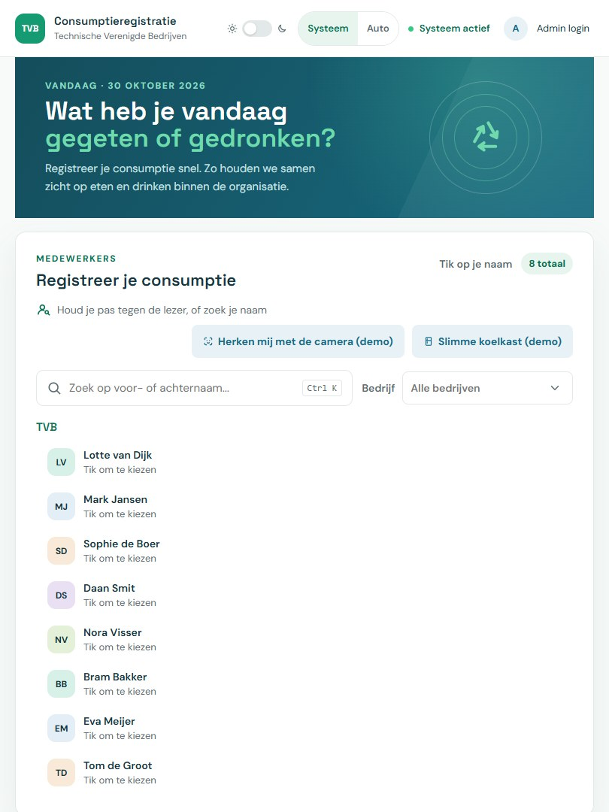

**Omschrijving.** Dit is het eerste scherm dat een medewerker op de tablet bij het consumptiepunt ziet. Bovenaan staat de bovenbalk met het TVB-logo, de naam `Consumptieregistratie`, de themakeuze (slider met zon en maan, en de knoppen `Systeem` en `Auto`), de status `Systeem actief` en de knop `Admin login`. Daaronder staat de banner met de datum (`Vandaag · 15 oktober 2026`) en de vraag "Wat heb je vandaag gegeten of gedronken?". Op een staande tablet is deze banner compacter, zodat de lijst hoger begint. In de kaart `Registreer je consumptie` staan rechts in de kop één keer "Tik op je naam" en het aantal medewerkers (`8 totaal`). Daaronder staan op één regel de hint "Houd je pas tegen de lezer, of zoek je naam" met een icoon (alleen als de pasjeslezer aan staat) en de knop `Herken mij met de camera (demo)`. Weer daaronder staan het zoekveld met de sneltoets `Ctrl K` en het bedrijfsfilter naast elkaar. De medewerkers staan per bedrijf (hier alleen TVB), met een gekleurde avatar met initialen en de korte tekst "Tik om te kiezen". Alle acht demonamen staan in beeld. De themaknoppen en `Admin login` zijn 44 pixels hoog en het kleine kopje `MEDEWERKERS` is donkergroen. De totalen van vandaag en deze maand staan op de tablet onder de lijst (zie W06).

**UI-principes:**
- *Visuele hiërarchie:* de grote vraag in de banner en de kop van de kaart zijn het eerst te zien. De uitleg is kleiner en lichter.
- *Groeperen:* medewerkers staan onder de naam van hun bedrijf.
- *Toegankelijkheid:* de rijen van de medewerkers zijn groot genoeg om met een vinger aan te tikken en werken ook met Enter of spatie. De knoppen in de bovenbalk, de cameraknop en het bedrijfsfilter zijn minstens 44 pixels hoog. Het kleine kopje in `--green-dark` heeft op wit een contrast van 5,9:1.
- *Responsief ontwerp:* op een staande tablet komen de totalen onder de lijst, is de banner lager en staan het zoekveld en het bedrijfsfilter naast elkaar.
- *Affordance:* "Tik om te kiezen" onder iedere naam laat zien dat een rij aan te tikken is.
- *Witruimte en eenvoud:* alleen wat nodig is om te registreren staat op het scherm, en de uitleg "Tik op je naam" staat er één keer in plaats van bij iedere rij.

**Nielsen-heuristieken:**
- *H1:* de datum, `Systeem actief` en `8 totaal` laten zien waar de gebruiker is en wat het systeem doet.
- *H2:* de vraag en de teksten zijn gewone taal voor een tablet ("Tik op je naam" en "Tik om te kiezen") en er worden echte namen getoond, geen nummers.
- *H6:* de medewerker zoekt de eigen naam op in een lijst met avatars en hoeft niets te onthouden of in te typen. De hint voor de pas laat zien dat de pas ook werkt.
- *H7:* zoeken, het bedrijfsfilter, de sneltoets `Ctrl K` en de camera zijn snellere wegen naar de eigen naam.
- *H8:* er staan geen persoonlijke aantallen of bedragen in de lijst.

#### W02 – Beginpagina op een groot scherm

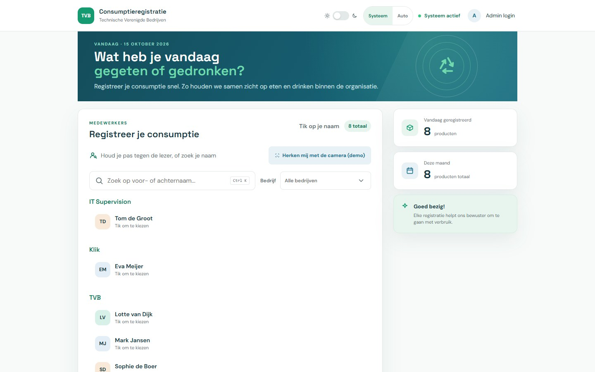

**Omschrijving.** Dezelfde beginpagina op een scherm van 1440 × 900 pixels. De inhoud blijft binnen een vaste paginabreedte in het midden. Omdat het scherm niet hoger is dan 900 pixels, is de banner compact (dezelfde regel als op een liggende tablet) en staat de uitleg in de banner op één regel. Links staat de kaart met medewerkers, met dezelfde kop, hint, cameraknop, zoekveld en bedrijfsfilter als in W01. De medewerkers zijn nu verdeeld over IT Supervision (Tom de Groot), Klik (Eva Meijer) en TVB. Rechts staan de kaarten `Vandaag geregistreerd` (8 producten) en `Deze maand` (8 producten totaal) en een tipkaart `Goed bezig!` met de tekst "Elke registratie helpt ons bewuster om te gaan met verbruik."

**UI-principes:**
- *Uitlijning:* bovenbalk, banner, kaarten en footer hebben dezelfde linker- en rechterrand.
- *Responsief ontwerp:* op een groot scherm staan de lijst en de totalen naast elkaar in twee kolommen.
- *Groeperen:* de bedrijven staan op alfabetische volgorde, met hun medewerkers eronder.
- *Visuele hiërarchie:* de getallen in de totaalkaarten zijn groot, het label erboven is klein.
- *Consistentie:* de totaalkaarten hebben dezelfde opbouw (icoon, label, getal, eenheid).

**Nielsen-heuristieken:**
- *H1:* de totalen laten direct zien hoeveel er vandaag en deze maand is geregistreerd.
- *H4:* de kaarten, iconen en kleuren zijn dezelfde als op de tablet.
- *H8:* de tipkaart is de enige extra informatie. Verder staat er alleen wat nodig is.

#### W03 – Beginpagina op een telefoon

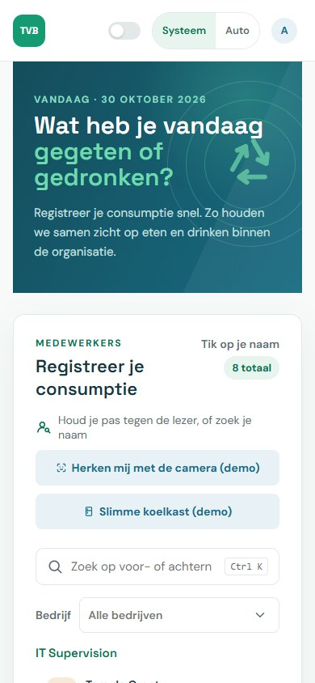

**Omschrijving.** De beginpagina op een telefoon van 390 pixels breed. In de bovenbalk vervallen de naam naast het logo, de status en de icoontjes naast de slider. De themaknoppen en de admin-knop (alleen de letter `A`) blijven staan. Banner, kaart en lijst staan onder elkaar over de volle breedte. Rechts naast de kop staan "Tik op je naam" en daaronder `8 totaal`. De kop `Registreer je consumptie` loopt daardoor over twee regels. De hint "Houd je pas tegen de lezer, of zoek je naam" loopt ook over twee regels, en daaronder staat de knop `Herken mij met de camera (demo)` over de volle breedte. Het zoekveld en het bedrijfsfilter staan op een telefoon onder elkaar. De voorbeeldtekst in het zoekveld past niet helemaal en wordt afgekapt ("Zoek op voor- of achtern").

**UI-principes:**
- *Responsief ontwerp:* alles staat in één kolom. Er is geen horizontaal scrollen.
- *Witruimte en eenvoud:* minder belangrijke teksten in de bovenbalk zijn weggelaten zodat de knoppen passen.
- *Toegankelijkheid:* de knoppen en rijen blijven even groot als op de tablet.

**Nielsen-heuristieken:**
- *H4:* de onderdelen zien er hetzelfde uit als op de andere schermen.
- *H8:* op het kleine scherm is alleen het noodzakelijke overgebleven.
- *Beperking:* op 390 pixels breed is de voorbeeldtekst in het zoekveld te lang en wordt hij afgekapt. Door de hint, de cameraknop en de kop over twee regels staat de eerste naam pas onderaan het scherm, zodat er zonder scrollen maar één naam in beeld is. Alles blijft bruikbaar, maar op een telefoon moet de medewerker eerder scrollen of zoeken. De tegels met de totalen staan op een telefoon onder de lijst en vallen buiten deze screenshot.

#### W04 – Beginpagina in het donkere thema

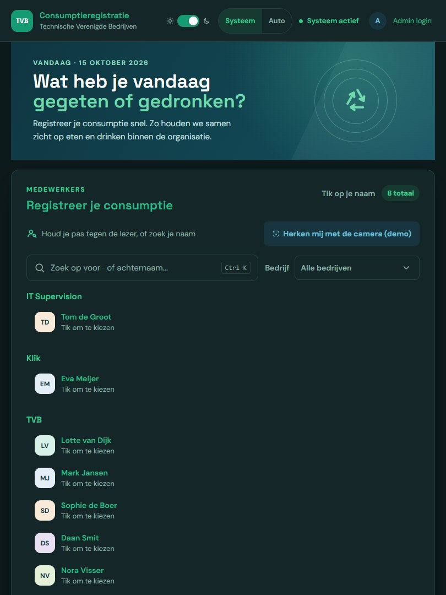

**Omschrijving.** De beginpagina op de tablet als het apparaat op donker staat. `Systeem` is gekozen, dus de website volgt het apparaat. De slider staat daarom naar de maan. De achtergrond en kaarten zijn donker, de huiskleuren blijven en koppen en namen krijgen een lichtere tint van het huisgroen, zodat ze goed leesbaar zijn. De voorbeeldteksten in het zoekveld en het bedrijfsfilter staan in `--muted` (zie W39). Deze screenshot is gemaakt na de beheerstappen, dus net als in W02 staat Tom de Groot onder IT Supervision en Eva Meijer onder Klik.

**UI-principes:**
- *Kleur met betekenis:* groen blijft de kleur van koppen en acties, ook in het donker.
- *Toegankelijkheid:* de lichtere groene tekst geeft genoeg contrast op de donkere achtergrond.
- *Consistentie:* indeling en onderdelen zijn gelijk aan het lichte thema. Alleen de kleuren wisselen.

**Nielsen-heuristieken:**
- *H1:* de slider laat zien welk thema actief is.
- *H7:* de gebruiker kan het thema aan zichzelf aanpassen: het apparaat volgen (`Systeem`), vast licht of donker, of `Auto` (overdag licht, na zonsondergang donker).

#### W05 – Bedrijfsfilter geopend

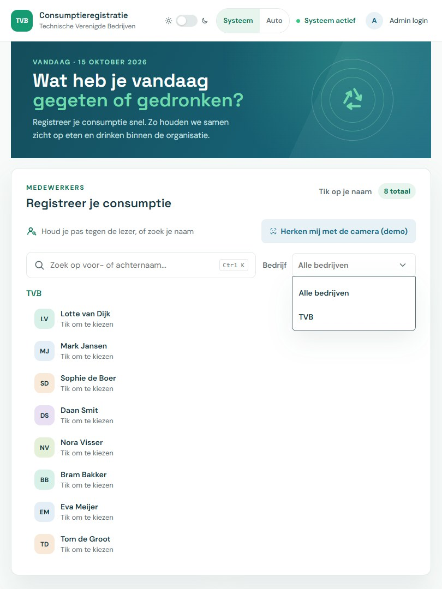

**Omschrijving.** Het bedrijfsfilter rechts naast het zoekveld is uitgeklapt. Het is een keuzelijst waarin je ook kunt typen. De lijst toont `Alle bedrijven` en alleen de bedrijven waar actieve medewerkers bij horen. Op dit moment is dat alleen TVB. Iedere optie is 44 pixels hoog en de pijlknop is 40 × 40 pixels.

**UI-principes:**
- *Affordance:* het pijltje rechts laat zien dat het veld uitklapt.
- *Progressieve onthulling:* de bedrijven komen pas in beeld als het filter wordt geopend.
- *Visuele hiërarchie:* de uitklaplijst ligt met een schaduw boven de medewerkerslijst.
- *Toegankelijkheid:* de opties zijn met een vinger goed te raken (44 pixels hoog).

**Nielsen-heuristieken:**
- *H5:* er staan geen bedrijven zonder medewerkers in de lijst, dus kiezen leidt nooit tot een lege lijst.
- *H6:* de bedrijven staan uitgeschreven in de lijst en hoeven niet te worden onthouden.
- *H7:* door één bedrijf te kiezen (of de naam in het filter te typen) toont de medewerkerslijst alleen dat bedrijf. Hier heeft dat nog weinig zin, omdat alle medewerkers bij TVB horen, maar zodra medewerkers over meer van de 13 bedrijven verdeeld zijn, scheelt het zoeken en scrollen.

#### W06 – Zoeken zonder resultaat

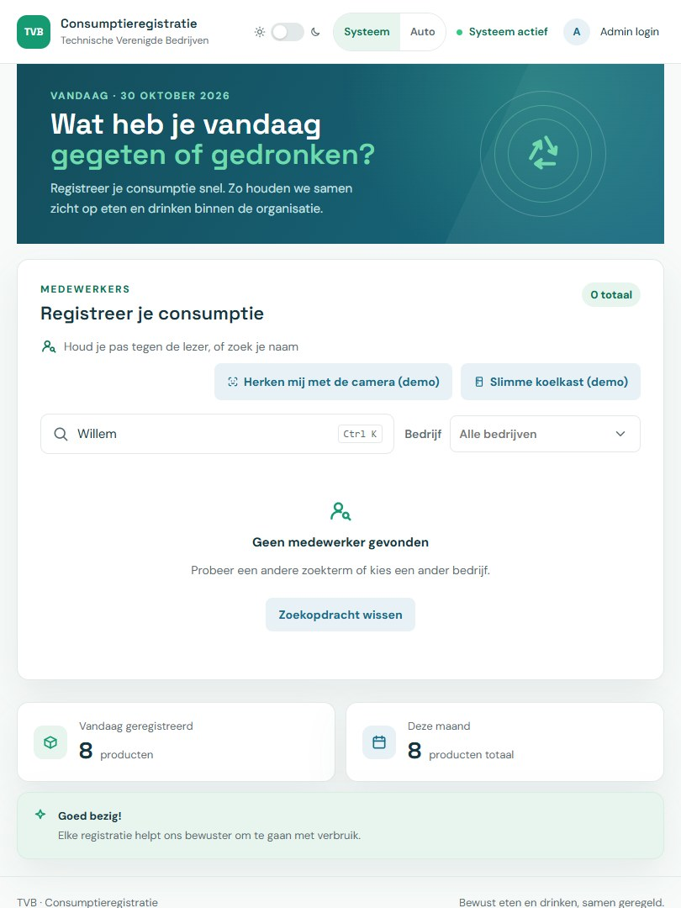

**Omschrijving.** Er is gezocht op "Willem", maar die medewerker bestaat niet. De teller springt naar `0 totaal`, "Tik op je naam" verdwijnt (er is geen naam om op te tikken) en in de kaart staat een lege toestand: een icoon, de tekst "Geen medewerker gevonden", de uitleg "Probeer een andere zoekterm of kies een ander bedrijf." en de knop `Zoekopdracht wissen`. Onder de kaart staan de totalen naast elkaar (8 producten vandaag, 8 deze maand) met daaronder de tipkaart.

**UI-principes:**
- *Feedback:* de teller en de lege toestand laten direct zien dat er niets is gevonden.
- *Affordance:* de knop `Zoekopdracht wissen` geeft één duidelijke vervolgstap.
- *Responsief ontwerp:* op de tablet staan de totalen in twee kolommen onder de lijst.

**Nielsen-heuristieken:**
- *H1:* `0 totaal` toont het resultaat van het zoeken.
- *H3:* met één knop is de zoekopdracht weg en staat de hele lijst er weer.
- *H9:* de melding zegt wat er aan de hand is en wat de gebruiker kan doen.
- *H10:* de uitleg in de lege toestand helpt verder zonder handleiding.

#### W07 – Productvenster, eerste keer

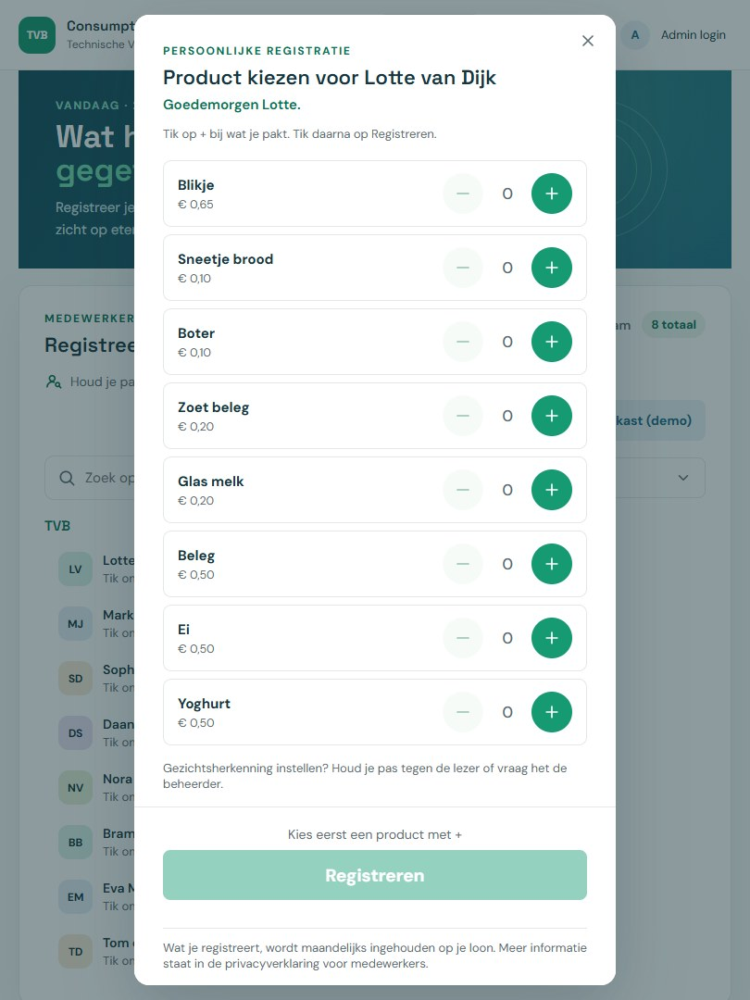

**Omschrijving.** Na een tik op Lotte van Dijk opent het productvenster. Bovenaan staan `Persoonlijke registratie`, `Product kiezen voor Lotte van Dijk` en een begroeting die bij het tijdstip past ("Goedemorgen Lotte."). Daaronder staat de korte uitleg "Tik op + bij wat je pakt. Tik daarna op Registreren." en de lijst met producten van het consumptiepunt van Lotte, met de prijs. Per product is er een `−`-knop, het aantal en een `+`-knop. Omdat er nog niets is gekozen, staan alle aantallen op 0 en zijn de `−`-knoppen uitgeschakeld. Onder de lijst staat in kleine grijze tekst "Gezichtsherkenning instellen? Houd je pas tegen de lezer of vraag het de beheerder." (sinds versie 3.22, FR-87). Lotte heeft op haar naam getikt, en dan kan ze hier geen gezicht instellen of uitzetten, want iedereen kan op de naam van een collega tikken. Die regel staat er ook als het gezicht van Lotte al is ingesteld, zodat niet te zien is wie gezichtsherkenning gebruikt. De link `Gezichtsherkenning instellen (demo)` verschijnt op die plek alleen als het venster opende na herkenning met de pas (zoals in W10). Daaronder begint, na een dunne lijn, de knopbalk met de regel "Kies eerst een product met +" en de knop `Registreren` over de volle breedte (54 pixels hoog, vette tekst van 19 pixels). Zolang er niets is gekozen, is die knop uitgeschakeld (`aria-disabled="true"`) en ziet hij er vaag uit. Een tik erop slaat niets op en maakt de regel erboven vet en rood. Als de productlijst niet in het venster past (op een liggende tablet of een telefoon), blijft de knopbalk onderaan in beeld terwijl de lijst erachter scrolt. Helemaal onderaan staat, onder een dunne lijn en in dezelfde kleine grijze tekst als de uitleg bovenin (`--muted`), "Wat je registreert, wordt maandelijks ingehouden op je loon. Meer informatie staat in de privacyverklaring voor medewerkers." (FR-69). Het contrast van die tekst is 5,5:1 in het lichte en 6,9:1 in het donkere thema. Het venster sluit met het kruisje, met een tik naast het venster of met de Escape-toets. Na 75 seconden zonder tik of toets sluit het vanzelf, zonder op te slaan. In de laatste 10 seconden staat dan "Venster sluit zo. Tik om door te gaan." in de knopbalk (FR-70, niet op de screenshot).

**UI-principes:**
- *Affordance:* de groene `+`-knoppen zijn opvallend. De uitgeschakelde `−`-knoppen en de uitgeschakelde knop `Registreren` zijn vaag.
- *Toegankelijkheid:* de `−`- en `+`-knoppen zijn 44 × 44 pixels en op een aanraakscherm (`pointer: coarse`) 52 × 52 pixels, goed te raken met een vinger. `Registreren` is uitgeschakeld met `aria-disabled` en niet met `disabled`, zodat de knop met Tab bereikbaar blijft en een schermlezer de uitleg erboven voorleest.
- *Consistentie:* iedere productrij heeft dezelfde opbouw: naam, prijs, `−`, aantal, `+`.
- *Visuele hiërarchie:* de naam van de medewerker staat groot bovenaan en `Registreren` is de grootste knop, over de hele breedte onderaan.
- *Progressieve onthulling:* de producten verschijnen pas na het kiezen van een naam.

**Nielsen-heuristieken:**
- *H2:* bekende productnamen en prijzen in euro, en een uitleg in de woorden van iemand die op een tablet tikt. De begroeting voelt als een gesprek.
- *H3:* het venster is altijd te sluiten zonder iets op te slaan.
- *H5:* de `−`-knop werkt niet onder 0, er wordt pas opgeslagen na `Registreren` en een medewerker ziet alleen producten van het eigen punt. Zolang er niets is gekozen, is `Registreren` uitgeschakeld en zegt de regel erboven wat er eerst moet gebeuren, zodat er geen foutmelding achteraf nodig is. Een venster dat open blijft staan als iemand wegloopt, sluit vanzelf, zodat de volgende niet op naam van een collega registreert.
- *H6:* alle producten staan in beeld. Niets hoeft te worden onthouden.

#### W08 – Productvenster met een keuze

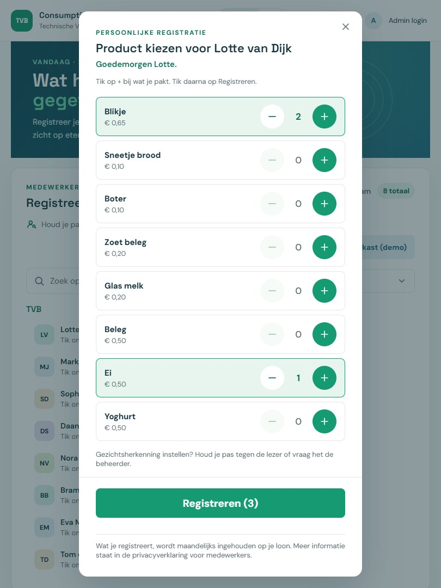

**Omschrijving.** Lotte heeft 2× Blikje en 1× Ei gekozen. Die twee rijen hebben nu een lichtgroene achtergrond (`--mint`), een groene rand en een vet aantal, en hun `−`-knop is actief (wit). De regel "Kies eerst een product met +" is weg en de knop onderaan is actief en toont het totaal: `Registreren (3)`. Er is nog niets opgeslagen. De begroeting ("Goedemorgen Lotte."), de regel "Gezichtsherkenning instellen? Houd je pas tegen de lezer of vraag het de beheerder." en de regel over de inhouding op het loon staan er nog, net als in W07.

**UI-principes:**
- *Feedback:* de aantallen, de kleur van de rij en de tekst op de knop veranderen direct bij iedere tik.
- *Kleur met betekenis:* de gekozen producten vallen in één oogopslag op. Dat zit niet alleen in de kleur, maar ook in de rand en het vette getal.
- *Affordance:* de `−`-knop en `Registreren` worden pas actief als er iets te verlagen of op te slaan is.

**Nielsen-heuristieken:**
- *H1:* de gemarkeerde rijen laten zien wat er is gekozen en `Registreren (3)` hoeveel producten worden opgeslagen.
- *H3:* een verkeerde tik is met `−` direct te herstellen, vóór het opslaan.
- *H5:* de gebruiker ziet de hele keuze voordat die wordt opgeslagen.

#### W09 – Bevestiging na registreren

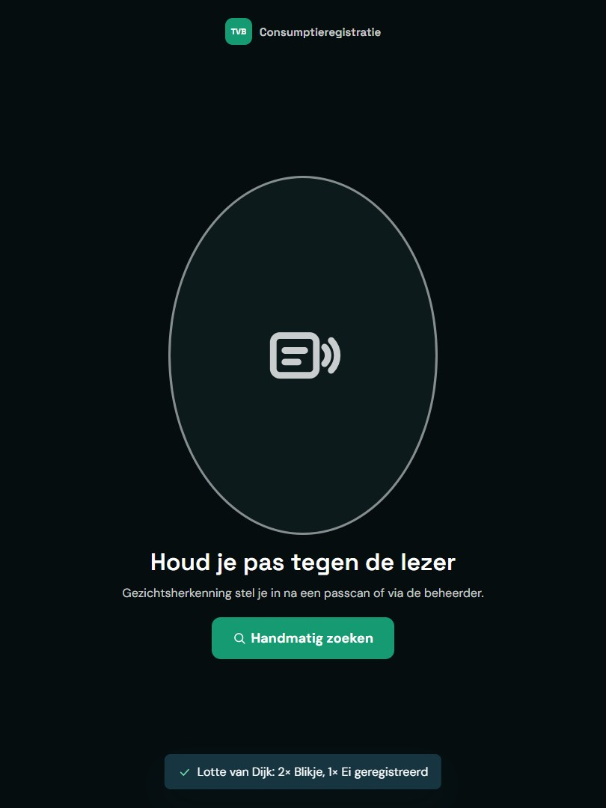

**Omschrijving.** Na `Registreren` sluit het productvenster en verschijnt onderaan in het midden een melding met een vinkje: "Lotte van Dijk: 2× Blikje, 1× Ei geregistreerd". De tekst van de melding is 16 pixels. De melding blijft 4 seconden staan en een tik gaat erdoorheen naar wat eronder ligt. Het zoekveld en het bedrijfsfilter zijn leeg en de lijst staat bovenaan, dus de pagina is direct weer klaar voor de volgende medewerker (FR-48).

**UI-principes:**
- *Feedback:* de melding bevestigt wat er is opgeslagen.
- *Toegankelijkheid:* het vinkje toont dat het gelukt is. Bij een fout heeft de melding dezelfde donkere achtergrond maar een ander icoon: een uitroepteken in een cirkel (zie W34). Het verschil zit dus in de vorm van het icoon en niet alleen in kleur.
- *Witruimte en eenvoud:* de melding bedekt de lijst nauwelijks en verdwijnt vanzelf.

**Nielsen-heuristieken:**
- *H1:* de melding noemt de naam en de producten, zodat op een gedeelde tablet duidelijk is wat er voor wie is opgeslagen.
- *H2:* de melding is één zin in gewone taal.

#### W10 – Productvenster met "Zelfde als vorige keer"

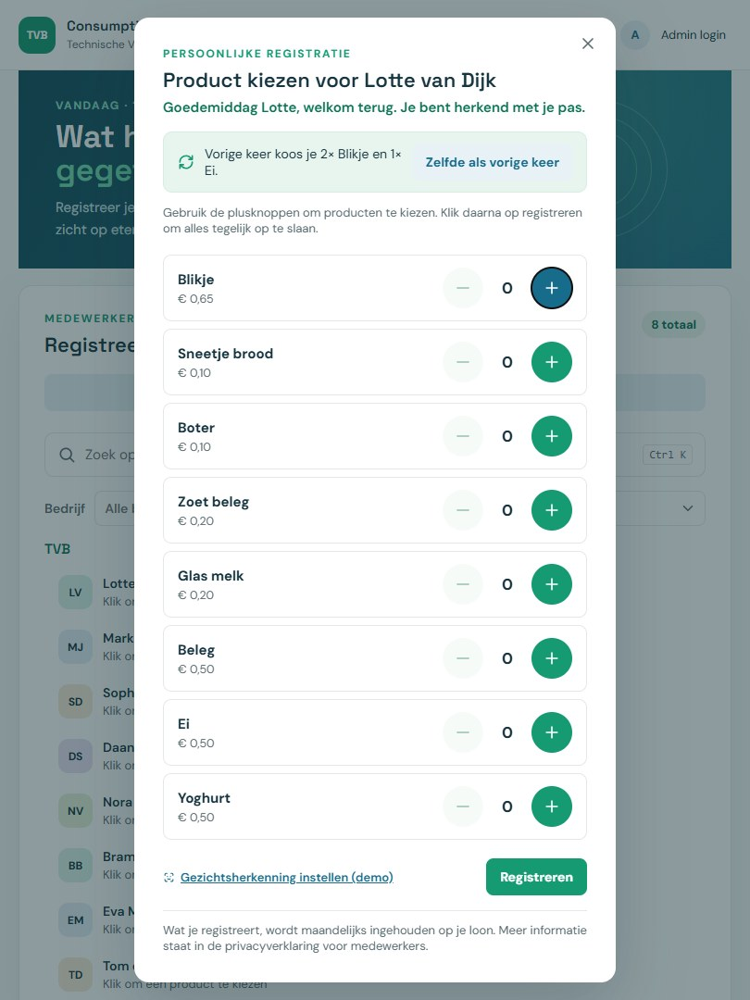

**Omschrijving.** Lotte heeft eerder 2× Blikje en 1× Ei geregistreerd en houdt nu haar pas bij de lezer op de beginpagina. Het productvenster van Lotte opent met de begroeting "Goedemorgen Lotte, welkom terug. Je bent herkend met je pas." Daaronder staat een groen vak met een icoon: "Vorige keer koos je 2× Blikje en 1× Ei." met de knop `Zelfde als vorige keer`. Onderaan staat dezelfde knopbalk als in W07, met "Kies eerst een product met +" en de uitgeschakelde knop `Registreren`. Door het extra vak past het venster niet helemaal op het scherm. De knopbalk blijft onderaan in beeld en de regel over de inhouding op het loon komt pas in beeld als het venster omlaag scrolt. De eerste `+`-knop heeft een donkere focusrand, omdat de pasjeslezer als toetsenbord werkt en de focus bij het openen op die knop wordt gezet. Het vak met de vorige keuze en "welkom terug" verschijnen alleen na herkenning met de pas of de camera. Na een tik op de naam staat er alleen "Goedemorgen Lotte." en geen voorstel, zoals in W07. De reden: iedereen kan op de naam van een collega tikken, en dan zou te zien zijn of die collega al eens iets registreerde en wat (zie hoofdstuk 13). Die knop vult de aantallen in. Opslaan gebeurt pas met `Registreren`. Het voorstel bestaat uit de laatste registratie en alles wat binnen 60 seconden daarvoor is geregistreerd, en bevat alleen producten die het punt nu aanbiedt. Correcties van de beheerder tellen niet mee.

**UI-principes:**
- *Visuele hiërarchie:* het voorstel staat boven de productlijst en valt op door de lichtgroene achtergrond.
- *Groeperen:* het voorstel en de knop staan samen in één vak.
- *Feedback:* de begroeting laat zien dat het systeem de medewerker heeft herkend en hoe: met de pas.

**Nielsen-heuristieken:**
- *H6:* de medewerker hoeft niet te onthouden wat er vorige keer is gekozen.
- *H7:* met één tik is een vaste keuze ingevuld. Een sneltoets voor wie vaak hetzelfde neemt.
- *H3:* na het invullen kunnen de aantallen nog worden aangepast voordat er iets wordt opgeslagen.

#### W11 – Productvenster zonder producten

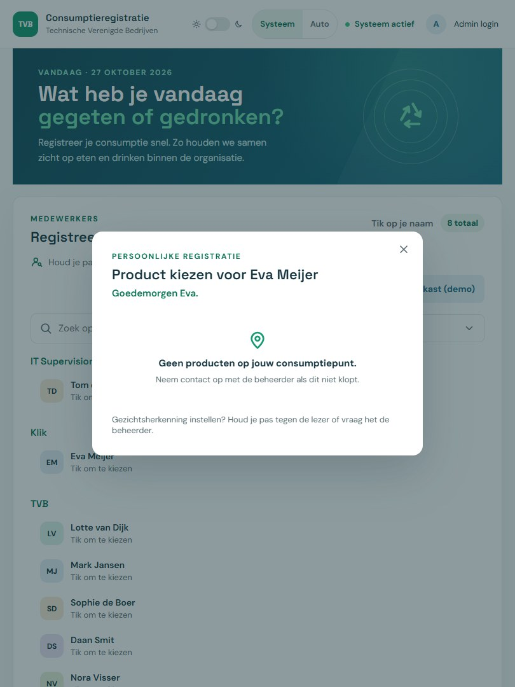

**Omschrijving.** Eva Meijer hoort bij Kantine Klik, waar nog geen producten zijn aangezet. In het productvenster staat daarom een lege toestand met een locatie-icoon: "Geen producten op jouw consumptiepunt." en "Neem contact op met de beheerder als dit niet klopt." Alles wat over kiezen en registreren gaat, is weggelaten: de uitleg "Tik op + bij wat je pakt. Tik daarna op Registreren.", de knopbalk met de regel "Kies eerst een product met +" en de knop `Registreren`, en de regel over de inhouding op het loon. Die regel hoort bij registreren en zegt hier niets, want er valt niets te registreren. Onder de melding staat alleen nog, zonder scheidingslijnen eronder, de regel "Gezichtsherkenning instellen? Houd je pas tegen de lezer of vraag het de beheerder." (sinds versie 3.22, zoals in W07, want Eva heeft op haar naam getikt). De focus staat op het kruisje. Het automatisch sluiten na 75 seconden zonder invoer werkt hier hetzelfde als in W07. De waarschuwing verschijnt dan onder die regel.

**UI-principes:**
- *Feedback:* in plaats van een leeg venster staat er een uitleg.
- *Witruimte en eenvoud:* knoppen die niets kunnen doen, zijn weggelaten.
- *Consistentie:* de lege toestand heeft dezelfde vorm als in W06, W20 en W32 (icoon, titel, uitleg).

**Nielsen-heuristieken:**
- *H5:* zonder producten is er geen knop om iets te registreren.
- *H9:* de melding zegt wat er aan de hand is en wat de medewerker kan doen.
- *H8:* zonder knopbalk, loonregel en extra lijnen valt de aandacht direct op de uitleg in het midden. In een eerdere versie bleef de knopbalk als lege strook tussen twee lijnen staan, met daaronder de regel over het loon.
- *H10:* de medewerker weet bij wie die terecht kan.

#### W12 – Gezichtsherkenning instellen (demo)

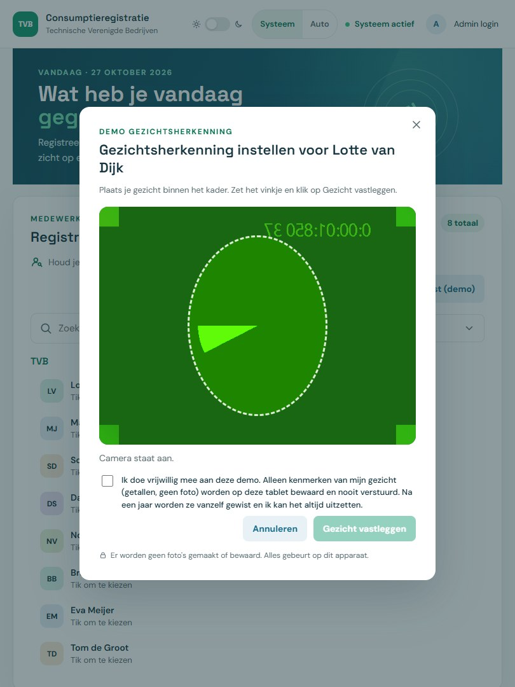

**Omschrijving.** Lotte van Dijk heeft een pas (gekoppeld door de beheerder in het veld `Pasnummer`, met looncode 101 en personeelsnummer 5001) en nog geen gezichtsinstelling. Ze houdt haar pas tegen de lezer en kiest `Ja, instellen` bij de vraag "Gezichtsherkenning nog niet ingesteld. Wil je dit?" (W47). Dan opent dit venster boven de beginpagina. Sinds versie 3.22 kan een medewerker zijn gezicht alleen zelf instellen na herkenning met de pas (FR-87): via deze vraag, of via de link `Gezichtsherkenning instellen (demo)` in een productvenster dat opende na de pas (zoals W10), dan bovenop het productvenster. Na kiezen op naam kan het niet meer (W07). Ook de beheerder opent dit venster vanuit het tabblad `Medewerkers` (FR-88, W21), dan boven het beheer en met de uitleg "Laat Lotte van Dijk zelf in de camera kijken en het vinkje zetten. Klik daarna op Gezicht vastleggen." De titel is `Gezichtsherkenning instellen voor Lotte van Dijk`, met de uitleg "Plaats je gezicht binnen het kader. Zet het vinkje en klik op Gezicht vastleggen." In het camerabeeld (hier het testbeeld van de browser) staat een ovaal kader. Onder het beeld staat de status `Camera staat aan.` en een vinkje voor toestemming: "Ik doe vrijwillig mee aan deze demo. Alleen kenmerken van mijn gezicht (getallen, geen foto) worden op deze tablet bewaard en nooit verstuurd. Na een jaar worden ze vanzelf gewist en ik kan het altijd uitzetten." (sinds versie 3.17). De knop `Gezicht vastleggen` is uitgeschakeld tot het vinkje is gezet. Daarnaast staat `Annuleren`. Na `Annuleren`, of na het vastleggen, gaat de koelkast open voor Lotte, zoals na iedere passcan. Onderaan staat met een slotje: "Er worden geen foto's gemaakt of bewaard. Alles gebeurt op dit apparaat." Zie ook de paragraaf over privacy in hoofdstuk 13.

**UI-principes:**
- *Affordance:* de uitgeschakelde knop is vaag en wordt pas groen na toestemming.
- *Visuele hiërarchie:* het camerabeeld met het kader neemt de meeste ruimte in, omdat de gebruiker daar moet kijken.
- *Feedback:* de status onder het beeld laat zien wat de camera doet.

**Nielsen-heuristieken:**
- *H1:* de status (`Camera staat aan.`) laat zien wat er gebeurt.
- *H3:* de camera start alleen als de medewerker daar zelf voor kiest, en `Annuleren` en het kruisje stoppen de camera en sluiten het venster. Zo houdt de medewerker zelf de controle over het eigen gezicht (privacy).
- *H5:* zonder vinkje kan er niets worden vastgelegd.
- *H10:* de toestemmingstekst en de privacyregel leggen uit wat er met het beeld gebeurt.

#### W13 – Herken mij met de camera (demo)


**Omschrijving.** Na een klik op `Herken mij met de camera (demo)` op de beginpagina opent dit venster: `Herken mij`, met de uitleg "Plaats je gezicht binnen het kader en kijk recht in de camera." De status is hier "Geen gezicht in beeld. Plaats je gezicht binnen het kader." Andere statussen zijn "Gezicht gevonden, maar niet herkend. Blijf rustig in het kader kijken." en "Bijna herkend. Blijf even rustig in het kader kijken." Pas als dezelfde actieve medewerker twee keer achter elkaar wordt herkend, telt het. Lukt het na 20 seconden niet, dan gaat de camera uit en staat er "Niet herkend. De camera is uitgezet. Sluit dit venster en kies je naam in de lijst." Is er nog niemand ingesteld, dan opent het venster niet en verschijnt sinds versie 3.22 "Er is nog niemand ingesteld voor gezichtsherkenning. Houd je pas tegen de lezer of vraag het de beheerder." (tot en met 3.21: "… Kies je naam en zet het aan in het productvenster.", maar dat kan sinds 3.22 niet meer, FR-87).

**UI-principes:**
- *Feedback:* de status verandert terwijl de camera zoekt.
- *Consistentie:* dit venster lijkt op W12 (zelfde kader, status en privacyregel).
- *Witruimte en eenvoud:* er is maar één knop (`Annuleren`). Herkennen gaat vanzelf.

**Nielsen-heuristieken:**
- *H1:* de status vertelt steeds wat het systeem ziet.
- *H3:* `Annuleren` en het kruisje stoppen de camera. De lijst met namen blijft altijd een alternatief.
- *H5:* twee keer achter elkaar dezelfde uitkomst voorkomt dat de verkeerde persoon wordt gekozen.
- *H9:* bij niet herkennen staat erbij wat de gebruiker dan moet doen.

#### W14 – Herkend met de camera (demo)


**Omschrijving.** Lotte is herkend. Het cameravenster sluit vanzelf en het productvenster van Lotte opent met de begroeting "Goedemorgen Lotte. Je bent herkend met de camera." Sinds versie 3.17 opent na herkenning standaard de koelkast (FR-80, zoals W43 met "Je bent herkend met de camera."). Dit productvenster verschijnt met `RECOGNITION_TARGET = "products"`, als het consumptiepunt geen schapindeling heeft, of na de knop "Liever brood of beleg? Open het productvenster" in de koelkast. Onder de productlijst staat op een eigen regel met een vinkje "Gezichtsherkenning staat aan (demo)" en de link `Uitzetten`, op de plek van de regel "Gezichtsherkenning instellen? …" uit W07. Sinds versie 3.22 staat `Uitzetten` er alleen na herkenning met de pas of de camera, zoals hier (FR-87). Na kiezen op naam staat er alleen "Gezichtsherkenning instellen? Houd je pas tegen de lezer of vraag het de beheerder." Daaronder staan dezelfde knopbalk en loonregel als in W07. Het venster is net iets hoger dan het scherm, maar opent bovenaan: het kruisje, `Persoonlijke registratie` en de titel staan helemaal in beeld en de focus staat op de eerste `+`. Verder werkt het venster hetzelfde als in W07.

**UI-principes:**
- *Feedback:* de begroeting zegt dat de camera de medewerker heeft herkend.
- *Consistentie:* na herkennen ziet het productvenster eruit zoals altijd.

**Nielsen-heuristieken:**
- *H1:* de medewerker ziet dat herkennen is gelukt en dat de functie aan staat.
- *H3:* met `Uitzetten` wordt het gezicht direct vergeten. Is de verkeerde naam gekozen, dan sluit het kruisje het venster zonder iets op te slaan.
- *H5:* de naam staat groot bovenaan, zodat een verkeerde herkenning opvalt vóór het registreren.

#### W35 – Camera zonder toegang (demo)


**Omschrijving.** Lotte van Dijk heeft haar pas tegen de lezer gehouden en `Ja, instellen` gekozen bij de vraag na de passcan (W47), net als in W12. De browser geeft geen toegang tot de camera (de toestemming is geweigerd). Het venster `Gezichtsherkenning instellen voor Lotte van Dijk` is wel open, maar het camerabeeld is een leeg donker vlak met alleen het gestippelde ovale kader. Onder het beeld staat in rood: "Geen toegang tot de camera. Geef toestemming in de browser, of kies je naam in de lijst." Het vinkje voor toestemming ("Ik doe vrijwillig mee aan deze demo. …", zoals in W12) staat er nog, maar de knop `Gezicht vastleggen` blijft uitgeschakeld (lichtgroen), omdat er geen camerabeeld is. Daarnaast staat `Annuleren` en daaronder de privacyregel. Achter het venster is de beginpagina te zien. Daar staat `6 totaal`, omdat in deze sessie Mark Jansen en Daan Smit voor W38 op inactief zijn gezet. Dezelfde melding verschijnt als het instelvenster opende via de link in een productvenster na de pas, of vanuit het beheer (UC-23). Dezelfde melding verschijnt in het venster `Herken mij` (W13), want beide vensters starten de camera op dezelfde manier. Als het starten mislukt, zet de website de camera ook meteen weer uit.

**UI-principes:**
- *Feedback:* de fout staat op dezelfde plek als de gewone status (`Camera staat aan.` in W12), nu in rood.
- *Affordance:* `Gezicht vastleggen` blijft vaag en werkt niet, omdat er niets vast te leggen is.
- *Consistentie:* het venster is verder gelijk aan W12. Alleen de status en het camerabeeld verschillen.

**Nielsen-heuristieken:**
- *H1:* de medewerker ziet direct dat de camera niet werkt, in plaats van een leeg beeld zonder uitleg.
- *H9:* de melding zegt wat er mis is en geeft twee oplossingen: toestemming geven in de browser, of de eigen naam in de lijst kiezen.
- *H3:* `Annuleren` en het kruisje sluiten het venster. De lijst met namen blijft altijd een andere weg.
- *H5:* zonder camerabeeld kan er niets worden vastgelegd.

#### W42 – Slimme koelkast: deur dicht (demo)


**Omschrijving.** De beginpagina op een staande tablet (810 × 1080) na een tik op `Slimme koelkast (demo)`, op 21 oktober 2026 (versie 3.16). Het koelkastvenster heeft het kleine kopje "Slimme koelkast (demo)" en de titel "Koelkast openen". In het midden staat een gesloten koelkast: een kast met een handgreep rechts en in het midden het label "Op slot" met een slotje. Daaronder staat groot en vet "Houd je pas tegen de lezer om de koelkast te openen" met het icoon van de pas. Daaronder staat een apart vak met een oranje stippelrand en de kop "Demo zonder pasjeslezer": "Kies een medewerker. In de demo werkt dat als het tonen van zijn pas.", met een keuzelijst `Medewerker` en de knop `Openen (demo)`. De keuzelijst staat op de lege keuze "Kies een medewerker", daarna volgen de actieve medewerkers op alfabet. `Openen (demo)` is lichtgrijs en uitgeschakeld en gaat pas aan na een keuze, zodat niemand de koelkast per ongeluk opent op naam van de collega die bovenaan de lijst staat. Onderaan staat de regel "De koelkast legt alleen vast wie hem opent, wanneer, en hoeveel gewicht er van ieder schap verdwijnt. Er worden geen beelden gemaakt. Wat je pakt, wordt maandelijks ingehouden op je loon." Achter het venster is rechts nog een stukje van de demoknoppen op de beginpagina te zien. Een onbekende pas laat de koelkast dicht met de rode statusregel "Deze pas is niet gekoppeld aan een medewerker. De koelkast blijft dicht." onder de titel.

**UI-principes:**
- *Herkenning boven herinnering:* de gesloten koelkast met "Op slot" laat zien wat er gebeurt, en de instructie zegt wat de medewerker moet doen.
- *Visuele hiërarchie:* de instructie voor de pas is het grootst. Het demovak is kleiner en valt op door een andere kleur, zodat het niet wordt verward met de echte werking.
- *Consistentie:* hetzelfde vensterpatroon als het productvenster (kleine kop, titel, sluitknop, uitleg over de inhouding op het loon onderaan) en dezelfde melding bij een onbekende pas als bij FR-65.
- *Toegankelijkheid:* de statusregel heeft `role="status"`, de knoppen zijn minstens 44 pixels hoog en Escape sluit het venster.

**Nielsen-heuristieken:**
- *H1:* "Op slot" en de statusregel laten zien of de koelkast dicht blijft of opengaat.
- *H2:* "Houd je pas tegen de lezer" en "Op slot" zijn woorden uit de praktijk.
- *H10:* de privacyregel zegt wat de koelkast vastlegt en dat er geen beelden worden gemaakt.

#### W43 – Slimme koelkast: deur open met de schappen (demo)


**Omschrijving.** Lotte van Dijk heeft haar pas tegen de lezer gehouden en twee keer op schap 1 getikt. De titel is "De deur is open", met daaronder in groen "Goedemorgen Lotte. Pak wat je wilt en sluit de deur.", in gewone tekst "Alles wat je nu pakt, staat op naam van **Lotte van Dijk**." (de naam vet, zodat een collega die de deur open ziet staan weet dat het niet op zijn eigen naam komt) en in grijs "Tik op een schap om een product te pakken. Zet je iets terug, tik dan op Terugleggen." De open koelkast heeft links een smalle open deur met een open slotje en "Open", en rechts drie schappen, gescheiden door een plank: "Schap 1 · Blikje" met "22 op het schap", "Schap 2 · Yoghurt" en "Schap 3 · Ei" met elk "24 op het schap". Per schap staan zes ronde tegels met een productpictogram en daarachter "+16" of "+18". Alle tegels van een schap samen zijn één knop. Naast schap 1 staat `Terugleggen`, omdat Lotte daar iets van in de hand heeft. Onder de koelkast staat in een lichtgroen vak "In je hand: 2× Blikje" en daaronder de link `Iets anders op schap 1 leggen (demo)`. Onderaan blijft de knopbalk met `Deur dicht` (groen, over de volle breedte) in beeld, net als `Registreren` in het productvenster. Na 60 seconden verschijnt daarboven "De deur staat al lang open. Sluit de deur. Wat er nu wordt gepakt, staat op naam van Lotte van Dijk." De schappen zijn gevuld met de voorraad van Hoofdkantoor (24, min de 2 blikjes in de hand).

**UI-principes:**
- *Directe manipulatie:* een product pakken is op het schap tikken, terugleggen staat bij het schap. Er is geen `+` of `−`.
- *Feedback:* het aantal op het schap gaat omlaag en "In je hand" gaat omhoog. Een schermlezer hoort bijvoorbeeld "Blikje gepakt. In je hand: 2× Blikje."
- *Fitts' wet:* de tegels van een schap zijn samen één groot tikdoel (56 pixels hoog), en `Deur dicht` is groot en staat altijd onderaan.
- *Consistentie:* dezelfde groene en lichtgroene kleuren en dezelfde knopbalk als in het productvenster.

**Nielsen-heuristieken:**
- *H1:* "In je hand" laat steeds zien wat er straks wordt geregistreerd.
- *H3:* `Terugleggen` maakt een vergissing ongedaan zonder dat er iets wordt geregistreerd.
- *H7:* pakken en de deur sluiten is genoeg. Er hoeft niets te worden gekozen of bevestigd.

#### W44 – Slimme koelkast: overzicht na sluiten (demo, donker thema)


**Omschrijving.** Hetzelfde scenario in het donkere thema, na een tik op `Deur dicht`. De titel is "De deur is dicht". In het midden staat een groen vinkje in een rondje, daaronder vet "Je hebt gepakt: 2× Blikje" en "Dit is geregistreerd op naam van Lotte van Dijk. De koelkast is weer op slot." en de groene knop `Klaar`. Die knop krijgt bij het openen van het overzicht de focus. Op de screenshot is de focus weggehaald, zodat er geen focusrand in beeld staat. Achter het venster staat de beginpagina in het donkere thema. Klopt het gewicht van een schap niet, dan staat er onder de tekst in een oranje vak bijvoorbeeld "Bij schap 1 klopt het gewicht niet. Dat schap is niet geregistreerd. De beheerder kijkt ernaar." Is er niets gepakt, dan staat er "Je hebt niets gepakt" met een slotje. `Klaar` en Escape sluiten het venster, en met de deur dicht sluit het venster na 60 seconden zonder invoer vanzelf. De twee registraties tellen direct mee in "Vandaag geregistreerd" en staan in het beheer met het label `Koelkast`.

**UI-principes:**
- *Feedback:* het overzicht zegt wat er is geregistreerd en op wiens naam, zoals de melding na `Registreren` (W09).
- *Visuele hiërarchie:* het resultaat is het grootst. Een afwijking staat in de oranje waarschuwingskleur, niet in rood, want de medewerker heeft niets fout gedaan.
- *Consistentie:* het donkere thema gebruikt dezelfde kleurvariabelen als de rest van de website (W04).

**Nielsen-heuristieken:**
- *H1:* de medewerker ziet direct wat er op zijn naam staat en dat de koelkast weer op slot is.
- *H9:* bij een afwijking zegt het overzicht wat er niet is geregistreerd en dat de beheerder ernaar kijkt.
- *H5:* een onverklaarbaar verschil wordt niet automatisch geregistreerd, zodat er nooit te veel op iemands naam komt.

#### W45 – Standby: "Tik op het scherm om te beginnen"


**Omschrijving.** Sinds versie 3.21 vervangen door het startscherm (W48). Deze screenshot toont het standby-scherm van versie 3.17 tot en met 3.20. Staande tablet (810 × 1080), licht thema. De beginpagina is 2 minuten niet gebruikt en er staat geen venster open (FR-78). Over de hele pagina ligt een bijna dekkende laag in de donkere huiskleur van de banner (`--hero-start`). De beginpagina is er nog vaag doorheen te zien, zodat duidelijk is dat de tablet gewoon aan staat. In het midden staan het groene TVB-logo, in grote witte letters "Tik op het scherm om te beginnen" en daaronder "Na de tik kijkt de camera hooguit 10 seconden of hij je herkent. Alles blijft op deze tablet. Je kunt ook je pas tegen de lezer houden." Die tweede regel staat er omdat Lotte haar gezicht heeft ingesteld. Heeft niemand een gezicht ingesteld, dan staat er alleen "Je kunt ook meteen je pas tegen de lezer houden." Het hele scherm is één knop met de focus: een tik, Enter of spatie maakt wakker. De pagina eronder is `inert`, dus niet met Tab of een schermlezer te bereiken. Het zoekveld en het bedrijfsfilter zijn leeggemaakt. Bij "minder beweging" verschijnt het scherm zonder fade.

**UI-principes:**
- *Duidelijkheid:* één tekst en één handeling. Er is niets anders om op te tikken.
- *Openheid:* vóór de tik staat er al dat de camera daarna even kijkt, hoe lang en dat alles op de tablet blijft.
- *Consistentie:* alleen de bestaande huiskleuren, het logo en de lettertypes (Space Grotesk voor de kop).

**Nielsen-heuristieken:**
- *H1:* de gedimde pagina laat zien dat de tablet in rust is en wat de volgende stap is.
- *H5:* de tik valt op het standby-scherm zelf en drukt geen knop eronder in. Een klik die de browser binnen 500 ms daarna stuurt, telt niet.
- *H7:* wie zijn pas heeft, hoeft niet eerst te tikken: een passcan maakt wakker en wordt meteen verwerkt.

#### W46 – Korte scan na een tik (demo)


**Omschrijving.** Sinds versie 3.21 verschijnt dit venster alleen met `FACE_DEMO.scanMode = "tap"`, na een tik op het ovaal van het startscherm. De screenshot is gemaakt in versie 3.17, na een tik op het standby-scherm van W45. Het cameravenster opent in een smallere vorm (FR-79). Kicker "Demo gezichtsherkenning", titel "Even kijken wie je bent" en de uitleg "Kijk in de camera. Na hooguit 10 seconden gaat de camera weer uit. Alles blijft op deze tablet." Het camerabeeld is hier het testbeeld van de browser (`--use-fake-device-for-media-stream`), dus de status is "Geen gezicht in beeld. Plaats je gezicht binnen het kader." De knop heet hier `Stoppen` in plaats van `Annuleren` en heeft bij het openen de focus (op de screenshot weggehaald). Onderaan staat met een slotje "Er worden geen foto's gemaakt of bewaard. Alles gebeurt op dit apparaat." Het venster verschijnt alleen als de demo aan staat, er een camera is en minstens één actieve medewerker een geldige gezichtsinstelling heeft. Wordt Lotte twee keer achter elkaar herkend, dan gaat de camera uit, sluit het venster en gaat de koelkast open met "Goedemorgen Lotte. Je bent herkend met de camera. Pak wat je wilt en sluit de deur." (zoals W43). Na 10 seconden zonder herkenning gaat de camera uit, sluit het venster en staat op de beginpagina "Je bent niet herkend. Kies je naam in de lijst of houd je pas tegen de lezer." De herkenning zelf is hier nagebootst: in de headless browser is geen echt gezicht in beeld, en de gezichtsinstelling van Lotte is voor deze screenshot in de opslag gezet.

**UI-principes:**
- *Feedback:* de status onder het beeld zegt wat de camera ziet.
- *Gebruikerscontrole:* `Stoppen` zet de camera meteen uit.
- *Minimalisme:* geen vinkje en geen andere knoppen, want er wordt niets ingesteld.

**Nielsen-heuristieken:**
- *H1:* de titel en de status zeggen dat de camera nu kijkt, en hoe lang hooguit.
- *H3:* `Stoppen`, het kruisje en Escape zetten de camera uit.
- *H5:* de camera gaat alleen aan na de tik en altijd weer uit na de scantijd, ook als niemand iets doet.

#### W47 – Vraag na een passcan: "Gezichtsherkenning nog niet ingesteld. Wil je dit?" (demo)


**Omschrijving.** Mark heeft een pas maar nog geen gezichtsinstelling en houdt zijn pas tegen de lezer (FR-81). Voordat de koelkast opengaat, verschijnt dit venster. Kicker "Demo gezichtsherkenning", titel "Gezichtsherkenning nog niet ingesteld. Wil je dit?", in groen "Goedemorgen Mark. Je bent herkend met je pas." en de uitleg in één zin: "Het is vrijwillig, alleen kenmerken van je gezicht (geen foto) worden op deze tablet bewaard en na een jaar vanzelf gewist, en je pas blijft altijd werken." Daaronder de knoppen `Nee` (secundair) en `Ja, instellen` (primair, met het icoon van de gezichtsscan), allebei minstens 44 pixels hoog. `Nee` heeft bij het openen de focus (op de screenshot weggehaald): wie niets kiest, stelt niets in. `Nee` wordt onthouden en daarna gaat de koelkast open. `Ja, instellen` opent het instelvenster met het toestemmingsvinkje (W12). Daarna, of na `Annuleren`, gaat de koelkast open. Het kruisje, de achtergrond en Escape onthouden niets en openen de koelkast. Is de instelling verlopen, dan is de titel "Je gezichtsherkenning is verlopen. Opnieuw instellen?" Zonder antwoord sluit het venster na 60 seconden zonder iets te onthouden. Sinds versie 3.22 is deze vraag, naast de link in een productvenster na de pas en de beheerder, de enige manier om (opnieuw) in te stellen. Het venster zelf is niet veranderd.

**UI-principes:**
- *Vrijwilligheid:* `Nee` staat gelijkwaardig naast `Ja, instellen` en heeft de focus. Nee kost geen extra stap.
- *Duidelijkheid:* de vraag zegt in één zin wat er wordt bewaard, waar, hoe lang en dat de pas blijft werken.
- *Consistentie:* dezelfde vensteropbouw, knoppen en privacyregel als het cameravenster.

**Nielsen-heuristieken:**
- *H2:* gewone taal ("nog niet ingesteld", "vanzelf gewist").
- *H3:* `Nee` wordt onthouden, en wie het later toch wil, zet het zelf aan in een productvenster dat opende na zijn pas, of vraagt het de beheerder (sinds versie 3.22, FR-87 en FR-88).
- *H10:* de uitleg staat in het venster zelf.

#### W48 – Startscherm zonder camera: pas en Handmatig zoeken


**Omschrijving.** Staande tablet (810 × 1080). Zo opent de website sinds versie 3.21 (FR-78, FR-83). Het scherm is bijna zwart (`--start-screen-bg`), ook in het lichte thema. Bovenaan staan klein het groene TVB-logo en "Consumptieregistratie". In het midden staat een staand ovaal met een grijze rand. Deze tablet heeft geen camera (in de headless browser geeft `enumerateDevices` geen camera), dus toont het ovaal een pas met de golven van een lezer en staat eronder in grote letters "Houd je pas tegen de lezer". Daaronder de groene knop `Handmatig zoeken` (56 pixels hoog) met de focus (op de screenshot weggehaald). Een schermlezer hoort "Startscherm. Begin zo: houd je pas tegen de lezer of kies Handmatig zoeken om je naam in de lijst te zoeken." De pagina eronder is `inert`. Kan een medewerker wel gezichtsherkenning instellen terwijl nog niemand dat heeft gedaan, dan staat er nog "Gezichtsherkenning stel je in na een passcan of via de beheerder." (tot en met versie 3.21 "… of in je productvenster.") onder.

**UI-principes:**
- *Duidelijkheid:* één tekst en één knop. De pas werkt zonder knop.
- *Consistentie:* het logo, de groene huisstijlknop en de lettertypes van de rest van de website. Het zwart is een uitdrukkelijke wens van de opdrachtgever.
- *Toegankelijkheid:* de knop is groot genoeg voor een vinger en werkt met Enter en spatie.

**Nielsen-heuristieken:**
- *H1:* het ovaal en de tekst laten zien dat de tablet klaar is en hoe je begint.
- *H7:* wie zijn pas heeft, hoeft niets aan te raken.
- *H8:* een rustig scherm zonder lijst, totalen of beheer.

#### W49 – Startscherm met de camera: "Kijk in het ovaal" (demo)


**Omschrijving.** Lotte heeft een gezicht ingesteld en de tablet heeft een camera, dus kijkt de camera op het startscherm mee (`scanMode` "auto", FR-84). Het ovaal toont het camerabeeld in 320 × 240 pixels, gespiegeld. Hier is dat het nagebootste testbeeld van de browser (`--use-fake-device-for-media-stream`, een groene klok en cirkel zonder gezicht), omdat er in de headless browser geen echt gezicht voor de camera staat. Onder het ovaal staat "Kijk in het ovaal" met daaronder "Of houd je pas tegen de lezer." en de knop `Handmatig zoeken`. Onderaan staat met een slotje "De camera zoekt alleen een gezicht dichtbij in het ovaal. Er worden geen beelden bewaard of verstuurd." De camera zoekt drie keer per seconde alleen naar gezichten. Een voorbijganger op afstand of naast het ovaal verandert niets aan het scherm.

**UI-principes:**
- *Openheid:* het camerabeeld en de regel onderaan laten zien dat de camera aan staat en wat hij doet.
- *Duidelijkheid:* één opdracht ("Kijk in het ovaal") en twee andere manieren (pas en handmatig).

**Nielsen-heuristieken:**
- *H1:* het live camerabeeld laat zien wat de camera ziet.
- *H7:* geen tik nodig: wie in het ovaal kijkt, wordt herkend.
- *H10:* de privacyregel staat op het scherm zelf.

#### W50 – Startscherm: "Even stil blijven…" (demo)


**Omschrijving.** Iemand staat dichtbij in het ovaal (FR-84). De rand van het ovaal wordt groen (`--start-screen-accent`, #70d9ad) met een lichte gloed, en de tekst wordt "Even stil blijven…". Na een seconde stilstaan worden de kenmerken van dit ene gezicht berekend en vergeleken. Bij "minder beweging" ademt de gloed niet. Wordt Lotte herkend, dan staat er "Goedemorgen Lotte." in het groene ovaal, gaat de camera uit en opent na ongeveer een seconde de koelkast (FR-80). De toestand is voor deze screenshot in de pagina nagebootst, omdat het testbeeld van de browser geen gezicht heeft. Het scherm is verder precies zoals de app het tekent.

**UI-principes:**
- *Feedback:* de kleur en de tekst zeggen dat de tablet de persoon ziet en wat hij moet doen.

**Nielsen-heuristieken:**
- *H1:* de status verandert zodra iemand goed staat.
- *H5:* kenmerken pas na stilstaan voorkomt dat iemand die langsloopt per ongeluk wordt herkend.

#### W51 – Startscherm: niet herkend (demo)


**Omschrijving.** Na drie vergelijkingen zonder resultaat, terwijl het gezicht in het ovaal blijft (FR-84), wordt de rand oranje (`--start-screen-warning`, #f0b36b) en staat er iets kleiner, op twee regels, "Je bent niet herkend. Houd je pas tegen de lezer of zoek handmatig." De regel "Of houd je pas tegen de lezer." is dan verborgen, maar houdt zijn plek, zodat de knop niet verspringt. Vijf seconden lang kijkt de camera niet, daarna probeert hij het opnieuw. De toestand is voor deze screenshot in de pagina nagebootst, net als bij W50.

**UI-principes:**
- *Foutpreventie en herstel:* de melding zegt wat de medewerker wel kan doen, zonder een venster dat moet worden weggeklikt.

**Nielsen-heuristieken:**
- *H9:* een vriendelijke melding met twee uitwegen (pas en handmatig).
- *H3:* `Handmatig zoeken` blijft altijd bereikbaar.

#### W15 – Waarschuwing bij openen als los bestand


**Omschrijving.** Wie `index.html` dubbelklikt (adres begint met `file://`), krijgt de website zonder werkende JavaScript, omdat browsers ES-modules niet laden vanaf een los bestand. Bovenaan staat dan een lichtoranje balk: "Deze pagina werkt niet als los bestand. Open de map in VS Code en start hem met Live Server (of een andere lokale webserver)." Op de rest van de pagina is te zien dat de website niet werkt: geen datum, geen medewerkers, totalen op 0 en geen iconen. Alleen wat vast in de HTML staat, is er wel, zoals "Tik op je naam" met een lege teller, het zoekveld en het bedrijfsfilter. De hint voor de pas en de cameraknop ontbreken, omdat JavaScript die pas zichtbaar maakt.

**UI-principes:**
- *Kleur met betekenis:* de lichtoranje balk valt op boven de rest.
- *Visuele hiërarchie:* de melding staat helemaal bovenaan, vóór alle andere inhoud.

**Nielsen-heuristieken:**
- *H1:* het is direct duidelijk dat de pagina niet goed is gestart.
- *H9:* de melding zegt wat er mis is en hoe het op te lossen is.
- *H10:* de oplossing (Live Server) staat erbij.

#### W36 – Melding bij beschadigde opgeslagen gegevens


**Omschrijving.** De beginpagina op de tablet direct na het laden, terwijl er in de opslag van de browser een registratie met een kapotte datum stond. De website slaat die ene registratie over, laadt de rest gewoon en bewaart de oorspronkelijke gegevens als reservekopie in de browser. Onderaan in het midden staat een melding met een uitroepteken in een cirkel: "Een deel van de opgeslagen gegevens was beschadigd en is overgeslagen. Er staat een reservekopie in de browser." De melding heeft tekst van 16 pixels en loopt daardoor over drie regels. Ze blijft 8 seconden staan, langer dan een gewone melding. De rest van de pagina is normaal: de datum (`Vandaag · 15 oktober 2026`), "Tik op je naam", `8 totaal` en de medewerkers onder TVB. Zijn de gegevens helemaal onleesbaar, dan start de demo opnieuw met de melding "De opgeslagen gegevens waren onleesbaar. De demo is opnieuw gestart. Er staat een reservekopie in de browser."

**UI-principes:**
- *Feedback:* de gebruiker merkt dat er iets mis was met de opgeslagen gegevens, ook al werkt de pagina gewoon.
- *Consistentie:* de melding staat op dezelfde plek en heeft dezelfde vorm als de andere meldingen (W09 en W34).
- *Toegankelijkheid:* het uitroepteken laat zien dat het om een probleem gaat. Het verschil met een succesmelding zit niet alleen in kleur.

**Nielsen-heuristieken:**
- *H1:* de gebruiker weet dat er gegevens zijn overgeslagen.
- *H9:* de melding zegt in gewone taal wat er is gebeurd en dat er een reservekopie is. Een beperking: de melding zegt niet welke gegevens zijn overgeslagen.
- *H5:* één kapotte regel laat de website niet vastlopen, en de oorspronkelijke gegevens blijven als reservekopie bewaard, zodat er niets ongemerkt verloren gaat.

#### W16 – Inloggen als beheerder


**Omschrijving.** Na `Admin login` opent het loginvenster met een slot-icoon, `Beheerdersomgeving`, de titel `Welkom terug` en "Log in om registraties en medewerkers te beheren." Het e-mailadres staat al ingevuld (`admin@tvb.nl`). Het wachtwoordveld is leeg (de puntjes zijn voorbeeldtekst). Onder het wachtwoord staat "Demo: elk ingevuld wachtwoord werkt." en daaronder de knop `Inloggen` met een pijl.

**UI-principes:**
- *Consistentie:* labels staan boven de velden, net als in alle andere formulieren.
- *Visuele hiërarchie:* `Inloggen` is de enige grote groene knop.
- *Witruimte en eenvoud:* alleen e-mailadres, wachtwoord en één knop.

**Nielsen-heuristieken:**
- *H4:* een standaard loginformulier met de gebruikelijke velden en volgorde.
- *H10:* de hint legt uit hoe inloggen in de demo werkt.
- *H3:* het kruisje, een klik naast het venster of de Escape-toets sluit het zonder in te loggen.

#### W17 – Inloggen met een foutmelding


**Omschrijving.** Er is op `Inloggen` geklikt zonder wachtwoord. Onder de knop staat in rood: "Vul een e-mailadres en wachtwoord in." Het venster blijft open.

**UI-principes:**
- *Feedback:* de fout wordt in het venster zelf getoond, onder de knop.
- *Kleur met betekenis:* rood voor een fout.

**Nielsen-heuristieken:**
- *H9:* de melding zegt in gewone taal wat er moet gebeuren. Een beperking: de melding staat onder de knop en niet bij het veld, en zegt niet welk veld ontbreekt (hier het wachtwoord). Het veld krijgt ook geen rode rand, anders dan in de andere formulieren (W23).
- *H1:* de gebruiker ziet meteen waarom er niets gebeurt.

#### W18 – Beheer: Registraties


**Omschrijving.** Na inloggen opent het beheer (`Beheer` / `Overzicht`) met de knop `Uitloggen` en zes tabbladen: Registraties, Medewerkers, Producten, Bedrijven, Voorraad en Logboek. Het actieve tabblad is groen en onderstreept. Op `Registraties` staan de filters `Medewerker` en `Maand` en de knop `CSV exporteren`. Onder `Medewerker corrigeren` staan een zoekveld, het datumveld `Datum bij toevoegen (+)` (standaard vandaag: 15-10-2026) en per medewerker het aantal producten en het bedrag (bijvoorbeeld Lotte van Dijk: 3 producten · € 1,80). Daaronder staat de tabel met Medewerker, Product, Aantal en Datum & tijd, met de nieuwste registratie bovenaan (in de screenshot staan alleen de kolomkoppen net boven de rand).

**UI-principes:**
- *Groeperen:* filters en export staan samen boven de lijst. Correcties en de tabel zijn aparte blokken.
- *Consistentie:* dezelfde knoppen, velden en kleuren als op de medewerkerskant.
- *Visuele hiërarchie:* het actieve tabblad valt op door kleur en onderstreping.
- *Uitlijning:* de kolommen van de tabel en de bedragen staan recht onder elkaar.

**Nielsen-heuristieken:**
- *H1:* het actieve tabblad en de totalen per medewerker laten de stand zien.
- *H4:* tabbladen en tabellen werken zoals de gebruiker gewend is.
- *H6:* medewerkers en maanden worden uit een lijst gekozen.
- *H7:* filteren en zoeken maken een lange lijst snel kleiner. De export gebruikt dezelfde filters.
- *H5:* het datumveld staat al op vandaag. De kalender van het veld biedt geen datum na vandaag aan, en een ingetypte datum na vandaag wordt geweigerd met een melding bij het veld (zie W37).

#### W19 – Beheer: registratie corrigeren


**Omschrijving.** De rij van Lotte van Dijk is opengeklapt. Per product staan een lichtrode `−`-knop, het aantal (Blikje 2, Ei 1, de rest 0) en een lichtgroene `+`-knop, allebei 44 × 44 pixels. `−` opent het venster `Registratie verwijderen` (W41), waarin de beheerder kiest welke registratie weg moet. `+` voegt er één toe op de datum uit `Datum bij toevoegen (+)`. Valt die datum in een eerdere maand, dan vraagt de browser eerst "Deze registratie komt in … Die loonmaand is mogelijk al verwerkt. Toch toevoegen?". Is bij `−` de gekozen registratie uit een andere maand dan de huidige, dan vraagt de browser eerst "Deze registratie is van … Die loonmaand is mogelijk al verwerkt. Toch verwijderen?" (met de naam van de maand). Iedere correctie geeft een melding en komt in het logboek. De correctie en de logboekregel worden in één keer opgeslagen.

**UI-principes:**
- *Progressieve onthulling:* de producten van een medewerker zijn pas zichtbaar na openklappen.
- *Kleur met betekenis:* rood voor verlagen, groen voor verhogen.
- *Consistentie:* dezelfde volgorde `−` / aantal / `+` als in het productvenster (W07). De knoppen hebben wel een andere vorm: hier vierkante knoppen met afgeronde hoeken en een lichtrode of lichtgroene achtergrond, in het productvenster ronde knoppen.
- *Toegankelijkheid:* de knoppen zijn 44 × 44 pixels (tot versie 3.12 30 × 30), ook op een tablet goed te raken.

**Nielsen-heuristieken:**
- *H3:* een verkeerde registratie is door de beheerder terug te draaien.
- *H1:* het aantal per product is direct zichtbaar en verandert na iedere klik.
- *H5:* een correctie in een oude maand vraagt eerst om bevestiging, omdat die loonmaand al verwerkt kan zijn.

#### W41 – Beheer: registratie kiezen bij `−`


**Omschrijving.** Bij Lotte van Dijk is op `−` naast Blikje geklikt. Boven het beheer opent het venster `Correctie` / `Registratie verwijderen` met de uitleg "Blikje van Lotte van Dijk. Kies welke registratie weg moet. De nieuwste staat bovenaan." In één kader staat per registratie een rij met de datum en tijd (vetgedrukt), daaronder het product en het aantal ("Blikje · aantal 1") en rechts een lichtrode knop `Verwijderen`. Er zijn drie registraties: twee van vandaag (15 okt, 09:53) en een vergeten blikje dat de beheerder met `+` op 14 september heeft toegevoegd. Bij die laatste staat "toegevoegd door beheerder". Onderaan staat `Annuleren`. Bij het openen staat de focus op de eerste knop `Verwijderen`. Tab blijft binnen het venster, en `Annuleren`, het kruisje, een klik naast het venster of Escape sluiten het venster zonder iets te veranderen. Na `Verwijderen` sluit het venster, verschijnt "Blikje registratie verwijderd" en staat de focus weer op de `−`. Is de gekozen registratie uit een andere maand, dan vraagt de browser eerst "Deze registratie is van september 2026. Die loonmaand is mogelijk al verwerkt. Toch verwijderen?". Het venster verschijnt ook als er maar één registratie is, zodat `−` altijd op dezelfde manier werkt.

**UI-principes:**
- *Progressieve onthulling:* de losse registraties verschijnen pas als de beheerder er een wil verwijderen.
- *Kleur met betekenis:* de knoppen `Verwijderen` hebben dezelfde lichtrode stijl als `Alle gegevens wissen` en de `−`-knop.
- *Consistentie:* het venster heeft dezelfde opbouw als de andere vensters (kleine kop, titel, uitleg en knoppen rechtsonder) en de lijst dezelfde stijl als de correctielijst: één kader met een lijn tussen de rijen. De datum en tijd staan op dezelfde manier als in de tabel met registraties.
- *Toegankelijkheid:* iedere knop `Verwijderen` heeft voor een schermlezer een eigen naam ("Blikje van 14 sep, 12:00 verwijderen") en het venster werkt helemaal met het toetsenbord.

**Nielsen-heuristieken:**
- *H6:* de beheerder ziet de datum en tijd van iedere registratie en hoeft niet te onthouden in welke volgorde ze zijn ingevoerd.
- *H5:* er verdwijnt pas iets na een bewuste keuze voor één registratie. Een registratie uit een oude maand vraagt daarna nog om bevestiging.
- *H3:* `Annuleren` en Escape sluiten het venster zonder gevolgen.
- *H1:* na het verwijderen verschijnt een melding en wordt het aantal bij Blikje 1 lager.

#### W37 – Beheer: correctiedatum met foutmelding


**Omschrijving.** In het veld `Datum bij toevoegen (+)` is een datum na vandaag ingetypt (18-10-2026, terwijl het 15 oktober is) en daarna is bij Lotte van Dijk op `+` naast Blikje geklikt. In de kalender van het veld kan geen datum na vandaag worden gekozen, maar intypen kan wel. Daarom controleert de website de datum ook zelf. Het veld krijgt een rode rand en eronder staat met een waarschuwingsteken: "Kies een geldige datum, niet later dan vandaag." De focus springt naar het datumveld. Er is niets opgeslagen: bij Blikje staat nog steeds 2. Dezelfde melding verschijnt bij een datum die niet bestaat of van vóór 2000 is. Zodra de beheerder de datum verandert, verdwijnt de melding.

**UI-principes:**
- *Feedback:* de fout staat direct onder het veld waar hij bij hoort, niet bij de knop waarop is geklikt.
- *Consistentie:* dezelfde foutweergave (rode rand, icoon, tekst onder het veld) als in W23 en W27.
- *Kleur met betekenis:* rood voor de fout, samen met een icoon en tekst.

**Nielsen-heuristieken:**
- *H5:* de kalender staat geen datum na vandaag toe, en een ingetypte datum na vandaag wordt niet opgeslagen. Zo komt er geen registratie in de toekomst.
- *H9:* de melding zegt wat er moet gebeuren: een geldige datum kiezen, niet later dan vandaag.
- *H1:* het aantal bij Blikje is niet veranderd, dus de beheerder ziet dat er niets is toegevoegd.

#### W20 – Beheer: filter zonder registraties


**Omschrijving.** Bij het filter `Mark Jansen` zijn er geen registraties. In de tabel staat een lege toestand met een icoon en "Geen registraties voor deze filters.", gevolgd door de uitleg "Kies een andere medewerker of maand, of kies weer voor alle medewerkers en maanden." Voor deze screenshot is het venster naar beneden gescrold, zodat de lege toestand helemaal zichtbaar is. Met dit filter geeft `CSV exporteren` de melding "Geen registraties om te exporteren voor deze filters."

**UI-principes:**
- *Feedback:* een lege tabel krijgt een uitleg in plaats van alleen kolomkoppen.
- *Consistentie:* zelfde opbouw van de lege toestand als in W06.

**Nielsen-heuristieken:**
- *H1:* het filter staat zichtbaar ingesteld, zodat duidelijk is waarom de tabel leeg is.
- *H9:* de uitleg zegt hoe de gebruiker weer resultaten krijgt.
- *H5:* er wordt geen leeg CSV-bestand gemaakt.

#### W21 – Beheer: Medewerkers


**Omschrijving.** Het tabblad `Medewerkers` met de knop `Medewerker toevoegen`, een zoekveld ("Medewerker zoeken, wijzigen of activeren") en de lijst. Per medewerker staan de naam en een regel met status, bedrijf, consumptiepunt en personeelsnummer (bijvoorbeeld "Actief · TVB · Hoofdkantoor · Geen personeelsnummer"), met de knoppen `Gezichtsherkenning instellen`, `Deactiveren` en `Wijzigen`. De knop `Verwijderen` verschijnt alleen bij een inactieve medewerker zonder registraties en vraagt dan eerst om bevestiging (zie W38). Sinds versie 3.6 staat bij een medewerker met een gekoppelde pas het label "Pas gekoppeld" achter de naam. Het pasnummer zelf staat niet in de lijst. In de screenshot heeft niemand een pas, dus het label staat er niet. De knop `Gezichtsherkenning instellen` staat er sinds versie 3.22 bij iedere actieve medewerker (FR-88, UC-23) en opent het instelvenster van W12 boven het beheer. In de screenshot heeft niemand een gezicht ingesteld. Bij een ingesteld gezicht staat onder de gegevens in groen "Gezichtsherkenning ingesteld tot 27-10-2027" en in plaats van de knop `Uitzetten`. Zonder camera is `Gezichtsherkenning instellen` uitgeschakeld (vaag) met "Geen camera gevonden. Instellen kan alleen met een camera." eronder. Bij een inactieve medewerker (W38) en als de demo uit staat, zijn er geen knoppen voor gezichtsherkenning. Sinds versie 3.14 staat tussen `Voorraad` en `Logboek` ook het tabblad `Koelkast`.

**UI-principes:**
- *Groeperen:* alle gegevens van één medewerker staan in één rij, de acties rechts.
- *Visuele hiërarchie:* de naam is vet, de details eronder kleiner en grijs.
- *Consistentie:* iedere rij heeft dezelfde knoppen op dezelfde plek.

**Nielsen-heuristieken:**
- *H1:* de status (`Actief`) staat bij iedere medewerker.
- *H5:* een actieve medewerker kan niet direct worden verwijderd. Eerst deactiveren, dan verwijderen met bevestiging. Een medewerker met registraties kan helemaal niet worden verwijderd, zodat de CSV-export altijd een naam en looncode heeft.
- *H3:* deactiveren is met `Activeren` terug te draaien.

#### W38 – Beheer: inactieve medewerkers


**Omschrijving.** Het tabblad `Medewerkers` nadat Mark Jansen en Daan Smit met `Deactiveren` op inactief zijn gezet. Bij beiden staat nu "Inactief · TVB · Hoofdkantoor · Geen personeelsnummer" en de knop `Activeren` in plaats van `Deactiveren`. De knop `Gezichtsherkenning instellen` staat er bij hen niet, want alleen een actieve medewerker kan gezichtsherkenning gebruiken (sinds versie 3.22, zie W21). Alleen bij Mark Jansen staat ook de rode knop `Verwijderen`, want er zijn geen registraties van Mark. Daan Smit heeft wel registraties (2× Sneetje brood en 1× Beleg) en kan daarom niet worden verwijderd. Op de pagina achter het venster staan Mark en Daan niet meer in de lijst met medewerkers: een inactieve medewerker kan niet registreren. `Verwijderen` vraagt eerst "Mark Jansen definitief verwijderen? Dit kan niet ongedaan worden gemaakt." Deactiveren en activeren vragen geen bevestiging, omdat ze altijd terug te draaien zijn.

**UI-principes:**
- *Feedback:* de status in de rij (`Inactief`) en de knop (`Activeren`) veranderen direct.
- *Kleur met betekenis:* alleen de knop die iets definitief weghaalt, heeft rode tekst.
- *Consistentie:* de knoppen staan op dezelfde plek als bij actieve medewerkers. Alleen `Verwijderen` komt erbij.

**Nielsen-heuristieken:**
- *H5:* `Verwijderen` verschijnt alleen bij een inactieve medewerker zonder registraties, en vraagt dan nog om bevestiging. Een medewerker met registraties blijft bewaard, zodat de CSV-export altijd een naam en looncode heeft.
- *H3:* deactiveren is met `Activeren` terug te draaien.
- *H1:* bij iedere medewerker staat of die actief of inactief is.

#### W22 – Medewerker toevoegen


**Omschrijving.** Het formulier `Medewerker toevoegen` (boven het beheer) met de velden Voornaam, Achternaam, Looncode, Personeelsnummer, Bedrijf, Consumptiepunt, `Afwijkend werkgevernummer (optioneel)` en `Pasnummer`. Naast dat laatste veld staat "Leeg laten = werkgevernummer van het bedrijf." De keuzelijst Consumptiepunt toont alleen de punten van het gekozen bedrijf. Zonder bedrijf staat er "Geen consumptiepunt bij dit bedrijf". Onderaan staan `Annuleren`, `Opslaan` en `Opslaan + opnieuw`.

Sinds versie 3.6 heeft het formulier ook het optionele veld "Pasnummer" (`#newEmployeeBadgeId`), met de hint "Klik in dit veld en houd de pas tegen de lezer. Leeg laten = geen pas." Het veld staat onder het afwijkende werkgevernummer, ook in W23 en W24. Met de pasjeslezer typt de lezer het pasnummer in het veld. Enter in dit veld verstuurt het formulier niet, zodat de Enter van de lezer niet per ongeluk opslaat (FR-66).

**UI-principes:**
- *Uitlijning:* de velden staan in twee nette kolommen.
- *Groeperen:* naam, nummers en koppeling met bedrijf en punt staan per paar naast elkaar.
- *Toegankelijkheid:* ieder veld heeft een label boven het veld.
- *Visuele hiërarchie:* `Opslaan + opnieuw` is de groene hoofdknop.

**Nielsen-heuristieken:**
- *H5:* bedrijf en consumptiepunt worden gekozen uit een lijst, dus een tikfout is niet mogelijk en een punt van een ander bedrijf kan niet. Looncode, personeelsnummer en werkgevernummer mogen alleen cijfers bevatten. Anders verschijnt "Gebruik alleen cijfers." bij het veld. Een personeelsnummer dat een andere medewerker al heeft, wordt geweigerd ("Er is al een medewerker met dit personeelsnummer.").
- *H7:* met `Opslaan + opnieuw` voegt de beheerder snel meerdere medewerkers achter elkaar toe.
- *H10:* de hint bij het werkgevernummer legt uit wat leeg laten betekent.
- *H3:* `Annuleren` en het kruisje sluiten het formulier zonder op te slaan.

#### W23 – Medewerker toevoegen met foutmeldingen


**Omschrijving.** Het formulier is leeg opgeslagen. De verplichte velden hebben een rode rand en eronder staat met een waarschuwingsteken "Vul dit veld in." of, bij Bedrijf, "Maak een keuze." Het eerste foute veld krijgt de focus. Zodra de gebruiker een veld aanpast, verdwijnt de melding bij dat veld. De twee optionele velden (werkgevernummer en pasnummer) krijgen geen melding, en Consumptiepunt ook niet, omdat er nog geen bedrijf is gekozen. Consumptiepunt wordt pas verplicht als het gekozen bedrijf consumptiepunten heeft. Dan staat er "Maak een keuze." als het leeg is.

**UI-principes:**
- *Feedback:* iedere fout staat direct onder het veld waar hij bij hoort.
- *Kleur met betekenis:* rood voor fouten, samen met een icoon (niet alleen kleur).
- *Toegankelijkheid:* de focus springt naar het eerste foute veld.

**Nielsen-heuristieken:**
- *H9:* de melding zegt per veld wat er moet gebeuren.
- *H5:* er wordt niets opgeslagen zolang verplichte velden leeg zijn.
- *H1:* de rode randen laten in één oogopslag zien welke velden nog ontbreken.

#### W24 – Medewerker wijzigen


**Omschrijving.** Na `Wijzigen` bij Lotte van Dijk opent hetzelfde formulier met de titel `Medewerker wijzigen` en de uitleg "Pas de gegevens aan en klik daarna op Opslaan." De velden zijn ingevuld met de gegevens van Lotte (Lotte, van Dijk, TVB, Hoofdkantoor). Looncode en Personeelsnummer zijn leeg, omdat de demogegevens die niet bevatten. Die twee velden zijn wel verplicht: `Opslaan` lukt pas als ze zijn ingevuld (anders verschijnt "Vul dit veld in.", zoals in W23). Bij wijzigen zijn er alleen de knoppen `Annuleren` en `Opslaan`. `Opslaan` is hier de groene hoofdknop, want het is de enige opslaanknop. Het formulier `Product wijzigen` werkt op dezelfde manier (niet als aparte screenshot opgenomen). Bij het openen verschijnt kort de melding "Gegevens geladen om te wijzigen" (niet in de screenshot).

**UI-principes:**
- *Consistentie:* toevoegen en wijzigen gebruiken hetzelfde formulier.
- *Feedback:* titel en uitleg laten zien dat het om wijzigen gaat.

**Nielsen-heuristieken:**
- *H1:* de titel maakt het verschil tussen toevoegen en wijzigen duidelijk.
- *H6:* de huidige gegevens staan al ingevuld. Alleen wat ontbreekt of verandert, hoeft te worden getypt.
- *H4:* dezelfde velden en volgorde als bij toevoegen.

#### W25 – Beheer: Producten


**Omschrijving.** Het tabblad `Producten` met de knop `Product toevoegen` en de lijst van acht producten met hun prijs (van Blikje € 0,65 tot Yoghurt € 0,50). Per product staan de knoppen `Wijzigen` (groen) en `Verwijderen` (rood). Een product dat al eens is geregistreerd, kan niet worden verwijderd. Dan verschijnt de melding "Dit product wordt al gebruikt en kan niet worden verwijderd".

**UI-principes:**
- *Kleur met betekenis:* rood voor verwijderen, groen voor wijzigen.
- *Consistentie:* dezelfde lijstopbouw als bij Medewerkers.
- *Uitlijning:* de knoppen staan in iedere rij recht onder elkaar.

**Nielsen-heuristieken:**
- *H5:* een product met registraties kan niet weg, zodat oude registraties en de export blijven kloppen.
- *H4:* `Wijzigen` en `Verwijderen` staan in iedere lijst op dezelfde plek.
- *H9:* als verwijderen niet mag, zegt de melding waarom.

#### W26 – Product toevoegen


**Omschrijving.** Het formulier `Product toevoegen` met de velden `Productnaam` (voorbeeld "bijv. Soep") en `Prijs in euro` (voorbeeld "bijv. 0.65") en de knoppen `Annuleren`, `Opslaan` en `Opslaan + opnieuw`.

**UI-principes:**
- *Witruimte en eenvoud:* maar twee velden.
- *Consistentie:* dezelfde opbouw en knoppen als het medewerkersformulier (W22).

**Nielsen-heuristieken:**
- *H2:* "Prijs in euro" zegt in welke eenheid de prijs moet.
- *H10:* de voorbeelden in de velden laten zien wat er verwacht wordt.
- *H7:* `Opslaan + opnieuw` voor meerdere producten achter elkaar.
- *H5:* een prijs onder 0, boven 1000 euro of met meer dan twee decimalen wordt niet opgeslagen. Bij het veld staat dan "Vul een prijs van 0 tot en met 1000 euro in, met hooguit twee decimalen."

#### W27 – Product met een bestaande naam


**Omschrijving.** Er is geprobeerd een nieuw product "Blikje" op te slaan. Omdat die naam al bestaat, krijgt het veld een rode rand en staat eronder "Er bestaat al een product met deze naam." Het venster blijft open en er is niets opgeslagen.

**UI-principes:**
- *Feedback:* de fout staat direct onder het veld.
- *Consistentie:* dezelfde foutweergave als in W23.

**Nielsen-heuristieken:**
- *H5:* dubbele productnamen worden tegengehouden, zodat de lijst en de export niet verwarrend worden.
- *H9:* de melding zegt precies wat er mis is.

#### W28 – Beheer: Bedrijven en consumptiepunten


**Omschrijving.** Het tabblad `Bedrijven` met de knop `Bedrijf toevoegen` en de bedrijven op alfabetische volgorde (E-Control, Home Service Nederland, IT Supervision, Klik, MVIE, …). Ieder bedrijf is een blok met het werkgevernummer en het aantal medewerkers ("0 medewerkers", of "1 medewerker" bij IT Supervision en Klik), en de knoppen `Consumptiepunt` (met plusteken), `Wijzigen` en `Verwijderen`. Daaronder staan de consumptiepunten van dat bedrijf, met hoeveel producten er worden aangeboden en het aantal medewerkers (bijvoorbeeld Kantine IT: "2 van 8 producten · 1 medewerker"), en de knoppen `Aanbod wijzigen` en `Verwijderen`. Zonder punt staat er "Nog geen consumptiepunt."

**UI-principes:**
- *Groeperen:* de consumptiepunten staan ingesprongen onder hun bedrijf, in hetzelfde blok.
- *Visuele hiërarchie:* bedrijven zijn groter en vet, punten iets kleiner en ingesprongen.
- *Consistentie:* dezelfde knoppen en kleuren als op de andere tabbladen.

**Nielsen-heuristieken:**
- *H1:* per bedrijf en punt is te zien hoeveel medewerkers en producten erbij horen, en of het werkgevernummer bekend is.
- *H5:* een bedrijf met medewerkers of consumptiepunten kan niet worden verwijderd, en een consumptiepunt met medewerkers ook niet. Verwijderen vraagt altijd om bevestiging.
- *H2:* de opbouw volgt de echte organisatie: bedrijven met hun eigen kantines.

#### W29 – Bedrijf wijzigen


**Omschrijving.** Het formulier `Bedrijf wijzigen` voor IT Supervision met de uitleg "Het werkgevernummer komt in de CSV-export bij de medewerkers van dit bedrijf, behalve bij wie een afwijkend nummer heeft." en de velden `Bedrijfsnaam` en `Werkgevernummer` (nog leeg).

**UI-principes:**
- *Witruimte en eenvoud:* twee velden en twee knoppen.
- *Consistentie:* zelfde vensteropbouw als de andere formulieren.

**Nielsen-heuristieken:**
- *H10:* de uitleg zegt waar het werkgevernummer voor wordt gebruikt.
- *H2:* termen uit de salarisadministratie (werkgevernummer) die de beheerder kent.
- *H5:* een werkgevernummer mag alleen cijfers bevatten en mag niet al bij een ander bedrijf horen. Anders staat bij het veld "Gebruik alleen cijfers." of "Er bestaat al een bedrijf met dit werkgevernummer." en wordt er niets opgeslagen. Een leeg werkgevernummer mag wel.

#### W30 – Consumptiepunt toevoegen met aanbod


**Omschrijving.** Het formulier `Consumptiepunt toevoegen`, geopend via `Consumptiepunt` bij IT Supervision. De uitleg is "Zet aan welke producten hier worden aangeboden. Medewerkers van dit punt zien alleen deze producten." Er zijn velden voor `Naam` (Kantine IT) en `Bedrijf` (IT Supervision staat al gekozen) en een blok `Aanbod` met een vinkje per product. Hier zijn Blikje en Glas melk aangevinkt.

**UI-principes:**
- *Groeperen:* de producten staan samen in een omkaderd blok `Aanbod`.
- *Uitlijning:* de vinkjes staan in drie kolommen.
- *Affordance:* vinkjes laten zien dat meerdere producten tegelijk kunnen worden gekozen.

**Nielsen-heuristieken:**
- *H6:* alle producten staan in beeld. De beheerder hoeft ze niet te kennen.
- *H5:* het bedrijf staat al ingevuld vanuit het bedrijf waar op is geklikt.
- *H10:* de uitleg zegt wat het aanbod voor medewerkers betekent.

#### W31 – Beheer: Voorraad


**Omschrijving.** Het tabblad `Voorraad`. Bovenaan staat een oranje blok `Bijbestellen (3)` met alle aangeboden producten die op zijn of bijna op zijn, over alle punten: een oranje label `Bijbestellen` bij "TVB · Hoofdkantoor — Blikje: 4 (minimum 6)" en twee rode labels `Leeg` bij Kantine IT (nieuw punt, nog voorraad 0). De naam van het punt is een link die de voorraad van dat punt opent. Daaronder kiest de beheerder een consumptiepunt (de lijst is per bedrijf gegroepeerd) en ziet een tabel met Product, Voorraad, Minimum, Status en Levering. Voorraad en minimum zijn direct aan te passen (een heel getal van 0 tot en met 100.000). Bij Levering vult de beheerder een aantal in (1 tot en met 100.000) en klikt op `Toevoegen`. Een tweede tik op dezelfde knop `Toevoegen` binnen 800 milliseconden na een geboekte levering wordt genegeerd, zodat een dubbele tik op de tablet geen onterechte foutmelding geeft. De status is `Leeg` bij 0 (tot versie 3.12 `Op`), `Bijbestellen` bij een voorraad op of onder het minimum en anders `Op voorraad`.

**UI-principes:**
- *Visuele hiërarchie:* wat aandacht nodig heeft, staat bovenaan in een opvallend blok.
- *Kleur met betekenis:* rood voor leeg, oranje voor bijbestellen, groen voor op voorraad, telkens met tekst erbij.
- *Uitlijning:* een tabel met vaste kolommen.
- *Feedback:* na het aanpassen van voorraad of minimum verandert de status direct.

**Nielsen-heuristieken:**
- *H1:* de bijbestellijst en de statuslabels tonen de voorraad zonder te hoeven rekenen.
- *H2:* "Bijbestellen", "Leeg" en "Levering" zijn woorden uit de praktijk. "Leeg" (eerder "Op") is niet te verwarren met "Op voorraad".
- *H7:* de links in de bijbestellijst springen direct naar het juiste punt. Voorraad en minimum zijn in de tabel zelf aan te passen.
- *H4:* dezelfde kleuren betekenen overal hetzelfde.

#### W32 – Voorraad van een punt zonder aanbod


**Omschrijving.** In de voorraad is Kantine Klik gekozen. Dit punt biedt nog niets aan, dus de tabel toont een lege toestand met een pakket-icoon: "Dit consumptiepunt biedt nog geen producten aan.", "Zet producten aan via Bedrijven en dan Aanbod wijzigen." en de knop `Naar Bedrijven`, die direct naar dat tabblad gaat.

**UI-principes:**
- *Feedback:* de lege tabel legt uit waarom hij leeg is.
- *Affordance:* de knop brengt de gebruiker naar de plek waar het op te lossen is.
- *Consistentie:* zelfde lege toestand als in W06, W11 en W20.

**Nielsen-heuristieken:**
- *H9:* de melding zegt wat er ontbreekt en hoe het op te lossen is.
- *H10:* de uitleg noemt de stappen (Bedrijven, dan Aanbod wijzigen).
- *H7:* `Naar Bedrijven` scheelt zoeken naar het juiste tabblad.

#### W33 – Beheer: Logboek


**Omschrijving.** Het tabblad `Logboek` op 21 oktober 2026 (versie 3.16), met een tabel van Actie, Details en Datum & tijd, nieuwste bovenaan. De rij met tabbladen heeft nu ook Koelkast. Hier staan de vijf acties die in de beheer-screenshots zijn gedaan: "Voorraad geteld" met "Blikje op TVB · Hoofdkantoor: verwacht 22, geteld 4, verschil -18", "Medewerker gewijzigd" met "Eva Meijer: looncode van leeg naar 1, personeelsnummer van leeg naar 2" en "Tom de Groot: looncode van leeg naar 1, personeelsnummer van leeg naar 1", en "Consumptiepunt toegevoegd" voor Kantine Klik (Klik, 0 producten aangeboden) en Kantine IT (IT Supervision, 2 producten aangeboden). Lange details breken af over twee regels, zodat de tabel in de breedte van het venster past en de kolom Datum & tijd ("21 okt, 09:05") altijd zichtbaar blijft. Het pasnummer staat nooit in het logboek. Het logboek toont 20 regels per keer. Als er meer zijn, verschijnt `Meer laden`. Het logboek bevat de wijzigingen van de beheerder. De registraties die medewerkers zelf doen, staan op het tabblad Registraties.

Onder de tabel staat in grijze tekst "Wist alle medewerkers, registraties, producten, voorraad, het logboek en de reservekopieën op deze tablet en zet de demogegevens terug." met daaronder de knop `Alle gegevens wissen`: rode tekst op een lichtrode achtergrond, dezelfde stijl als de andere verwijderknoppen. Na een klik vraagt de browser twee keer om bevestiging ("Alle medewerkers, registraties, producten, voorraad, koelkastopeningen, ingestelde gezichten, het logboek en de reservekopieën op deze tablet wissen?" en "Weet je het zeker? Dit kan niet ongedaan worden gemaakt."). Na twee keer OK worden alle gegevens, beide reservekopieën en de ingestelde gezichten van de demo gewist, wordt de beheerder uitgelogd (het beheervenster sluit) en staan de demogegevens er weer. De melding is dan "Alle gegevens zijn gewist. De demogegevens staan er weer." Bij `Annuleren` op een van de twee vragen verandert er niets. De knop is bedoeld voor het recht op vergetelheid uit de AVG, bijvoorbeeld als de tablet ergens anders wordt gebruikt.

**UI-principes:**
- *Uitlijning:* vaste kolommen met datum en tijd rechts. Lange details breken af in hun eigen kolom, zodat die kolom op zijn plek blijft.
- *Witruimte en eenvoud:* één tabel met daaronder één knop. De knop staat los van de tabel, zodat hij niet als onderdeel van het logboek wordt gezien.
- *Kleur met betekenis:* de wisknop is rood, net als de andere knoppen die iets verwijderen.
- *Progressieve onthulling:* eerst de 20 nieuwste regels, de rest met `Meer laden`.

**Nielsen-heuristieken:**
- *H1:* de beheerder kan terugzien wat er is gewijzigd en wanneer.
- *H2:* de acties staan in gewone zinnen met namen in plaats van codes.
- *H5:* wissen kan niet ongedaan worden gemaakt. Daarom zijn er twee bevestigingen, en bij `Annuleren` op een van de twee vragen verandert er niets.
- *H10:* de grijze uitleg boven de knop zegt precies wat er wordt gewist en dat de demogegevens terugkomen, nog vóór de beheerder klikt.

#### W34 – Foutmelding bij een levering


**Omschrijving.** In de voorraad is op `Toevoegen` geklikt zonder een geleverd aantal in te vullen. Onderaan verschijnt een melding met een waarschuwingsteken: "Vul een geleverd aantal van minimaal 1 in". De voorraad is niet veranderd.

**UI-principes:**
- *Feedback:* de actie geeft direct een reactie, ook als hij niet lukt.
- *Toegankelijkheid:* een foutmelding heeft een uitroepteken in een cirkel in plaats van het vinkje uit W09. De achtergrond van de melding is hetzelfde, dus het verschil zit niet alleen in kleur.
- *Consistentie:* de melding staat op dezelfde plek als alle andere meldingen.

**Nielsen-heuristieken:**
- *H5:* een lege levering, een levering van 0 of minder, een aantal dat geen heel getal is of een levering van meer dan 100.000 wordt niet geboekt, zodat de voorraad niet verkeerd wordt.
- *H9:* de melding zegt wat de beheerder moet doen: "Vul een geleverd aantal van minimaal 1 in" of, bij een te groot aantal, "Vul een geleverd aantal van hooguit 100.000 in". Het ingevulde aantal blijft staan, zodat het direct te verbeteren is.
- *H1:* de gebruiker ziet waarom de voorraad niet is veranderd.
- *Beperking:* de foutmelding verschijnt als melding onderaan het scherm (toast) en niet direct onder het veld. Dat wijkt af van de regel dat foutmeldingen in formulieren direct onder het veld staan (zie "Ontwerpkeuzes en Nielsen-heuristieken" en W23). Het veld krijgt ook geen rode rand, en de melding verdwijnt vanzelf.

#### W39 – Beheer in het donkere thema


**Omschrijving.** Het tabblad `Registraties` (zoals W18) terwijl het apparaat op donker staat. `Systeem` is gekozen, dus de slider staat naar de maan. Het beheervenster heeft een donkere achtergrond. De kop `Overzicht`, het actieve tabblad, de labels van de velden en de namen van de medewerkers zijn lichtgroen. Het zoekveld `Zoek een medewerker...` (de placeholdertekst in `--muted`), het datumveld (15-10-2026) en de twee keuzelijsten `Alle medewerkers` en `Alle maanden` zijn donker met lichte tekst. `Uitloggen` en `CSV exporteren` zijn donkerblauw met lichtblauwe tekst. Onder het datumveld staan de totalen per medewerker (bijvoorbeeld Lotte van Dijk: 3 producten · € 1,80) en onderaan de kolomkoppen van de tabel. De pagina achter het venster is donker en gedimd.

**UI-principes:**
- *Consistentie:* de indeling is precies gelijk aan het lichte thema (W18). Alleen de kleuren wisselen, ook die van de keuzelijsten.
- *Toegankelijkheid:* lichte tekst op een donkere achtergrond, met de lichtere tint van het huisgroen voor goed contrast.
- *Visuele hiërarchie:* het actieve tabblad en de namen vallen op door het groen. De details zijn grijs.

**Nielsen-heuristieken:**
- *H4:* knoppen, velden en tabbladen staan op dezelfde plek als in het lichte thema.
- *H7:* de beheerder kan het thema kiezen dat bij het apparaat of de omgeving past.
**Controle keuzelijsten (uitgevoerd in versie 3.8).** Op een eerdere versie van deze screenshot waren de keuzelijsten licht. Dat bleek een fout in de screenshot en niet in de website. In Edge zonder venster (headless, aangestuurd via het DevTools-protocol) is het beheer in drie situaties bekeken: direct donker geladen, gewisseld met de slider en gewisseld doordat het apparaat (nagebootst) naar donker ging. In alle drie zijn de keuzelijsten op een screenshot van het hele scherm donker, en de berekende stijlen zijn ook donker. Door `color-scheme: dark` op `:root[data-theme="dark"]` gebruikt de browser voor een `select` en de opties de donkere systeemkleuren: witte tekst op de achtergrond `--paper`. De uitgeklapte lijst tekent de browser zelf en die komt niet in een screenshot. Daarom zijn daarvan de berekende kleuren van de opties gemeten. De opties hebben geen eigen achtergrond en nemen de kleuren van de keuzelijst over. De contrastverhoudingen zijn berekend volgens WCAG 2.1 (minimaal 4,5:1 voor gewone tekst):

| Onderdeel | Licht thema | Donker thema |
|---|---|---|
| Gesloten keuzelijst (`Alle medewerkers`, `Alle maanden`, consumptiepunt bij Voorraad, bedrijf en consumptiepunt in de formulieren) | `#000000` op `#ffffff`: 21:1 | `#ffffff` op `#142628`: 15,7:1 |
| Opties en groepskoppen in de uitgeklapte lijst, ook keuzes als `Kies een bedrijf` en `Geen consumptiepunt bij dit bedrijf` | 21:1 | 15,7:1 |
| Uitgeschakelde keuzelijst (komt in de app niet voor, ter controle gemeten) | `#6d6d6d`: 5,2:1 | `#aaaaaa`: 6,8:1 |
| Bedrijfsfilter op de beginpagina: tekst en keuzes (`--ink` op `--paper`) | 13,0:1 | 6,7:1 |
| Bedrijfsfilter: keuze onder de muis of met de focus (`--ink` op `--mint`) | 11,6:1 | 5,3:1 |
| Placeholdertekst `Alle bedrijven` (en de zoekvelden), vóór versie 3.8 | `#757575`: 4,6:1 | `#757575`: 3,4:1 |
| Placeholdertekst, vanaf versie 3.8 | `#757575`: 4,6:1 (ongewijzigd) | `--muted` (`#8fb3a8`): 6,9:1 |
| Uitleg- en bijschrifttekst (`--muted`), vóór versie 3.8 | `#71858a`: 3,9:1 op wit, 3,3:1 op `--error-bg` | 6,9:1 |
| Uitleg- en bijschrifttekst (`--muted`), vanaf versie 3.8 | `#5a6c71`: 5,5:1 op wit, minstens 4,6:1 op alle lichte vlakken | 6,9:1 (ongewijzigd) |

Bij deze controle bleek ook dat de grijze uitleg- en bijschrifttekst (`--muted`) in het lichte thema de norm niet haalde. Die kleur is daarom iets donkerder gemaakt, met dezelfde grijsgroene tint, zodat de huisstijl gelijk blijft. Gemeten op alle lichte achtergronden van de app (`--paper`, `--paper-soft`, `--bg`, `--mint`, `--blue-soft`, `--warning-soft`, `--warning-bg` en `--error-bg`) is het contrast nu 4,6:1 tot 5,5:1.

De keuzelijsten zelf voldoen in beide thema's en zijn niet aangepast. De placeholdertekst haalde in het donkere thema de norm niet, omdat de browser daar hetzelfde grijs gebruikt als in het lichte thema. De placeholder van het bedrijfsfilter is ook de tekst van de standaardkeuze (`Alle bedrijven`) en moet dus goed leesbaar zijn. Daarom krijgt placeholdertekst in het donkere thema de bestaande huiskleur `--muted` (regel `:root[data-theme="dark"] ::placeholder` in `assets/css/base.css`, tot en met versie 3.19 in `styles.css`). In een nieuwe screenshot hebben de getekende pixels precies die kleur. De markering van de gekozen optie in de uitgeklapte lijst komt van het besturingssysteem en valt buiten de website. Of Chrome en Firefox de keuzelijsten hetzelfde tonen, valt onder de bekende beperking "Alleen in Edge getest" in hoofdstuk 16.

#### W40 – Beheer op een telefoon


**Omschrijving.** Het tabblad `Registraties` op een telefoon van 390 pixels breed. Het beheervenster is bijna zo breed als het scherm. De rij met tabbladen past niet helemaal: `Registraties`, `Medewerkers` en `Producten` zijn te zien en het volgende tabblad wordt afgesneden. De rij is opzij te scrollen. De filters `Medewerker` en `Maand` staan onder elkaar over de volle breedte, met daaronder `CSV exporteren`, ook over de volle breedte. Alles past binnen het venster. Daaronder staan het zoekveld, het datumveld en de totalen per medewerker.

**UI-principes:**
- *Responsief ontwerp:* het venster, de filters, de exportknop en de lijsten passen zich aan de smalle breedte aan.
- *Toegankelijkheid:* knoppen en velden blijven groot genoeg om met een vinger te bedienen.
- *Consistentie:* dezelfde onderdelen en volgorde als op het grote scherm (W18).

**Nielsen-heuristieken:**
- *H4:* het beheer werkt op een telefoon op dezelfde manier als op een laptop.
- *H8:* alles staat onder elkaar, zonder extra onderdelen.
- *H6 (beperking):* de rij met tabbladen past niet in de breedte. Dat die rij opzij scrollt, is alleen te zien aan het afgesneden tabblad rechts. De beheerder moet zelf bedenken dat er rechts nog tabbladen (Bedrijven, Voorraad en Logboek) zijn. Het beheer is vooral bedoeld voor een laptop of tablet.

## 10. Use cases en procesbeschrijvingen

Dit hoofdstuk beschrijft wat de gebruikers met het systeem doen. Er zijn drie actoren:

- **Medewerker:** registreert op de tablet de eigen consumpties (eten en drinken).
- **Beheerder:** logt in en beheert registraties, medewerkers, producten, bedrijven, consumptiepunten, voorraad, logboek en export.
- **Systeem:** doet zelf iets zonder dat een gebruiker op een knop klikt (de dagwissel na middernacht en het overnemen van wijzigingen uit een ander tabblad).

Na de use cases staan aan het eind van dit hoofdstuk de [user stories](#user-stories): in één zin per functie wat de medewerker of de beheerder wil bereiken en waarom, met de FR's, use cases en acceptatiecriteria die erbij horen.


*Figuur: use-casediagram met de actoren Medewerker, Beheerder en Systeem en de use cases UC-01 tot en met UC-23 uit dit hoofdstuk. UC-03, UC-04, UC-05 en UC-20 zijn getekend als «extend» van UC-02. UC-21 (slimme koelkast, demo) staat los van UC-02, omdat de medewerker daar niets kiest. Sinds versie 3.17 bevat UC-22 de herkenning met de camera van UC-04 («include»), en is UC-20 ook een «extend» van UC-21, omdat de pas standaard de koelkast opent. UC-22 heette tot en met versie 3.20 "Tablet wekken en herkend worden" en heet sinds versie 3.21 "Startscherm en herkend worden (demo)". UC-23 (sinds versie 3.22) hoort bij de actor Beheerder en is getekend als «extend» van UC-10 Medewerker beheren, omdat de beheerder het instellen en uitzetten start in het tabblad `Medewerkers`.*

UC-03, UC-04 en UC-05 (de demo gezichtsherkenning) zijn een uitbreiding («extend») van UC-02 Product registreren: ze zijn vrijwillig en alleen beschikbaar als de demo aan staat, en ze komen altijd uit bij het productvenster van UC-02. UC-03 en UC-05 starten vanuit het productvenster (de link `Gezichtsherkenning instellen (demo)` en `Uitzetten`). Sinds versie 3.22 staat de link er alleen als het venster opende na herkenning met de pas, en `Uitzetten` alleen na de pas of de camera, niet na kiezen op naam (FR-87). De beheerder kan het voor een medewerker instellen en uitzetten in UC-23 (FR-88). UC-04 opent na herkenning het productvenster (UC-02, pad A6). Zonder deze drie use cases werkt UC-02 precies hetzelfde. UC-20 Herkend worden met de pas is op dezelfde manier een uitbreiding van UC-02: na herkenning opent het productvenster (UC-02, pad A9). De pas koppelen hoort bij UC-10 Medewerker beheren. UC-21 Koelkast openen met de pas (demo, sinds versie 3.14) gebruikt dezelfde pas, maar opent de slimme koelkast in plaats van het productvenster. Daar wordt niets gekozen: het gewicht bepaalt wat er wordt geregistreerd. Sinds versie 3.17 opent herkennen met de pas of de camera standaard de koelkast (`RECOGNITION_TARGET`, FR-80), met een knop naar het productvenster. UC-04 en UC-20 komen dan uit bij UC-21 in plaats van bij UC-02. UC-22 Startscherm en herkend worden (demo) beschrijft het startscherm, het automatisch scannen met de intentie-drempel en de korte scan na een tik (tot en met versie 3.20: Tablet wekken en herkend worden). De vraag over gezichtsherkenning na een passcan is pad A5 van UC-20 en leidt naar UC-03.

| ID | Use case | Actor |
|---|---|---|
| UC-01 | Medewerker zoeken | Medewerker |
| UC-02 | Product registreren | Medewerker |
| UC-03 | Gezichtsherkenning instellen (demo) | Medewerker |
| UC-04 | Herkend worden met de camera (demo) | Medewerker |
| UC-05 | Gezichtsherkenning uitzetten (demo) | Medewerker |
| UC-06 | Thema wisselen | Medewerker en beheerder |
| UC-07 | Inloggen en uitloggen | Beheerder |
| UC-08 | Registraties bekijken en filteren | Beheerder |
| UC-09 | Registratie corrigeren | Beheerder |
| UC-10 | Medewerker beheren | Beheerder |
| UC-11 | Product beheren | Beheerder |
| UC-12 | Bedrijf beheren | Beheerder |
| UC-13 | Consumptiepunt en aanbod instellen | Beheerder |
| UC-14 | Voorraad bijhouden | Beheerder |
| UC-15 | CSV-export maken | Beheerder |
| UC-16 | Logboek bekijken | Beheerder |
| UC-17 | Alle gegevens wissen | Beheerder |
| UC-18 | Dagwissel na middernacht | Systeem |
| UC-19 | Wijzigingen uit een ander tabblad overnemen | Systeem |
| UC-20 | Herkend worden met de pas | Medewerker |
| UC-21 | Koelkast openen met de pas (demo) | Medewerker (indeling: beheerder) |
| UC-22 | Startscherm en herkend worden (demo, tot en met versie 3.20: Tablet wekken en herkend worden) | Medewerker (startscherm: systeem) |
| UC-23 | Gezichtsherkenning instellen of uitzetten door de beheerder (demo, sinds versie 3.22) | Beheerder (met de medewerker voor de camera) |

Iedere use case gebruikt hetzelfde sjabloon: ID, actor, doel, gerelateerde eisen (FR's uit hoofdstuk 4), preconditie, hoofdscenario, alternatieve en uitzonderingspaden, en postconditie. Bij het hoofdscenario staat tussen haakjes welke methode het werk doet, zodat de use case direct naar de code te volgen is. Meldingen staan letterlijk tussen aanhalingstekens.

Voor alle wijzigingen van de beheerder geldt dezelfde manier van opslaan: `RegistrationApp.persist(wijziging, logboekregel)` voert de wijziging uit, voegt de logboekregel toe en slaat beide in één keer op. Lukt opslaan niet, dan worden de wijziging en de logboekregel samen teruggedraaid en verschijnt "Opslaan mislukt. Probeer het opnieuw." (FR-61). Geeft het model aan dat er niets kon worden gewijzigd (de gegevens zijn intussen veranderd), dan verschijnt "Er is niets gewijzigd: de gegevens zijn intussen veranderd." Dit wordt hieronder niet bij iedere use case herhaald.

### UC-01 Medewerker zoeken

| Onderdeel | Beschrijving |
|---|---|
| **ID** | UC-01 |
| **Actor** | Medewerker |
| **Doel** | Snel de eigen naam vinden in de lijst. |
| **Gerelateerde FR's** | FR-01, FR-02, FR-31, FR-48, FR-65, FR-70 |
| **Preconditie** | De beginpagina is geopend. Er is geen venster open. |

**Hoofdscenario:**

1. De medewerker ziet de lijst met alle actieve medewerkers, gegroepeerd per bedrijf (`RegistrationView.renderEmployees`), met in de kop "Tik op je naam" en per rij "Tik om te kiezen". Staat de pasjeslezer aan, dan staat boven het zoekveld "Houd je pas tegen de lezer, of zoek je naam" (zie UC-20).
2. De medewerker typt (een deel van) de voor- of achternaam in het zoekveld "Zoek op voor- of achternaam...".
3. Bij iedere letter toont het systeem alleen de medewerkers waarvan de naam de zoekterm bevat (hoofdletters tellen niet). Het aantal staat erboven ("… totaal"). Een schermlezer hoort alleen het aantal, bijvoorbeeld "3 medewerkers gevonden" of "Geen medewerker gevonden" (een vaste statusregel, niet de hele lijst).
4. Eventueel kiest de medewerker een bedrijf in het bedrijfsfilter. Typen in het filter maakt de keuzelijst korter. "Alle bedrijven" toont weer iedereen. Escape sluit een open keuzelijst, zonder verder iets te doen. Een schermlezer hoort of de lijst open is (`aria-expanded`) en welk bedrijf is gekozen (`aria-selected`).
5. De medewerker vindt de eigen naam en gaat verder met UC-02.

**Alternatieve en uitzonderingspaden:**

- **A1 Sneltoets:** met `Ctrl K` (of `Cmd K` op een Mac) springt de focus naar het zoekveld. Staat er een venster open, dan doet de sneltoets niets.
- **A2 Geen resultaat:** de lijst is leeg en er staat "Geen medewerker gevonden" met "Probeer een andere zoekterm of kies een ander bedrijf." De knop `Zoekopdracht wissen` maakt het zoekveld en het bedrijfsfilter leeg en toont alle medewerkers weer.
- **A3 Onbekend bedrijf:** hoort een actieve medewerker bij geen (bestaand) bedrijf, dan staat in het filter ook de keuze "Onbekend bedrijf".

- **A4 Zoekterm van de vorige gebruiker:** na een registratie (UC-02 stap 9), na sluiten zonder registreren (UC-02 A13) en nadat het productvenster vanzelf is gesloten (UC-02 A11) zijn het zoekveld en het bedrijfsfilter weer leeg. De volgende medewerker begint dus altijd met de volledige lijst.

**Postconditie:** De lijst toont alleen de actieve medewerkers die bij de zoekterm en het bedrijfsfilter passen, gegroepeerd per bedrijf.

### UC-02 Product registreren

| Onderdeel | Beschrijving |
|---|---|
| **ID** | UC-02 |
| **Actor** | Medewerker |
| **Doel** | Vastleggen wat de medewerker heeft gepakt, zodat het via de loonadministratie wordt verrekend. |
| **Gerelateerde FR's** | FR-03, FR-04, FR-05, FR-07, FR-08, FR-29, FR-32, FR-37, FR-38, FR-47, FR-48, FR-49, FR-50, FR-62, FR-69, FR-70 |
| **Preconditie** | De medewerker is actief en staat in de lijst (UC-01). |

**Hoofdscenario:**

1. De medewerker tikt op de eigen medewerkerrij (of drukt erop op Enter of spatie).
2. Het productvenster opent (`EmployeeController.openEmployeeProducts`). Een melding van de vorige gebruiker die nog in beeld was, verdwijnt. Bovenaan staat een begroeting die past bij het tijdstip: "Goedemorgen" (tot 12 uur), "Goedemiddag" (tot 18 uur) of "Goedenavond", met de voornaam, bijvoorbeeld "Goedemorgen Lotte."
3. Het venster toont de uitleg "Tik op + bij wat je pakt. Tik daarna op Registreren." en alleen de producten die het eigen consumptiepunt aanbiedt. Er zijn geen persoonlijke aantallen of bedragen te zien. Na een tik op de naam staat er ook geen "welkom terug" en geen keuze van de vorige keer (zie A1 en A2). Onderaan staat een knopbalk die in beeld blijft als de lijst scrolt, met `Registreren` over de volle breedte. Zolang er niets is gekozen, is die knop uitgeschakeld (`aria-disabled="true"`) en staat erboven "Kies eerst een product met +". Helemaal onderaan staat "Wat je registreert, wordt maandelijks ingehouden op je loon. Meer informatie staat in de privacyverklaring voor medewerkers." (FR-69).
4. De medewerker kiest producten met de `+`-knoppen. Een product met een keuze krijgt een lichtgroene achtergrond en een groene rand. De knop toont het totaal, bijvoorbeeld `Registreren (3)`, en is nu ingeschakeld. Een schermlezer leest na iedere `+` of `−` het nieuwe aantal voor, bijvoorbeeld "Blikje: 2" (de vaste live region `#productLiveStatus`).
5. De medewerker tikt op `Registreren` (`registerSelectedProducts`).
6. Voor iedere gekozen eenheid maakt `RegistrationModel.addRegistration` een registratie met de prijs en het werkgevernummer van dat moment, het consumptiepunt en de huidige datum en tijd.
7. Biedt het punt het product aan, dan gaat de voorraad van dat product op het punt 1 omlaag.
8. Alles wordt in één keer opgeslagen. Een eigen registratie van een medewerker komt niet in het logboek. Het logboek is voor wijzigingen van de beheerder.
9. Het venster sluit. Het zoekveld en het bedrijfsfilter worden leeggemaakt, de lijst en de tegels worden vernieuwd en de lijst staat weer bovenaan in beeld (`resetEmployeeSearch`). De focus gaat terug naar de rij van de medewerker, zonder dat de pagina daarvoor scrolt.
10. Er verschijnt vier seconden lang een melding met de naam en de producten, bijvoorbeeld "Lotte van Dijk: 2× Blikje, 1× Ei geregistreerd".

**Alternatieve en uitzonderingspaden:**

- **A1 Welkom terug:** is het venster geopend via herkenning met de camera (A6) of de pas (A9) en heeft de medewerker zelf al eens iets geregistreerd, dan eindigt de begroeting met ", welkom terug." (bijvoorbeeld "Goedemorgen Lotte, welkom terug. Je bent herkend met je pas."). Correcties van de beheerder tellen niet mee. Na een tik op de naam staat er nooit "welkom terug", omdat iedereen op de naam van een collega kan tikken.
- **A2 Zelfde als vorige keer:** is het venster geopend via herkenning met de camera (A6) of de pas (A9) en heeft de medewerker eerder zelf iets geregistreerd, dan staat er "Vorige keer koos je 1× Blikje en 1× Ei." met de knop `Zelfde als vorige keer`. Die knop zet de aantallen van de vorige keer klaar (alles wat binnen één minuut vóór de laatste eigen registratie is geregistreerd, alleen producten die het punt nu aanbiedt). Er is dan nog niets opgeslagen. De medewerker gaat verder bij stap 5. Na een tik op de naam staan de tekst en de knop er niet (`RegistrationView.renderEmployeeProducts`), en doet `repeatLastSelection` niets.
- **A3 Vergissing herstellen:** met `−` gaat het gekozen aantal van een product 1 omlaag, nooit onder 0 (bij 0 is de knop uitgeschakeld). Dit verandert alleen de keuze die nog niet is opgeslagen. Een opgeslagen registratie kan een medewerker niet verwijderen.
- **A4 Niets gekozen:** tikt de medewerker op de uitgeschakelde knop `Registreren` zonder product, dan wordt er niets opgeslagen en verschijnt er geen foutmelding. De regel "Kies eerst een product met +" boven de knop wordt vet en rood, en een schermlezer leest die regel voor.
- **A5 Geen producten op het punt:** biedt het consumptiepunt niets aan (of heeft de medewerker geen punt), dan staat in het venster "Geen producten op jouw consumptiepunt." met "Neem contact op met de beheerder als dit niet klopt." Alles wat over kiezen en registreren gaat, staat er dan niet: de uitleg "Tik op + bij wat je pakt. Tik daarna op Registreren.", de knopbalk met `Registreren` en "Kies eerst een product met +" en de regel over de inhouding op het loon. De focus staat op het kruisje.
- **A6 Geopend via herkenning:** is het venster geopend door UC-04, dan staat achter de begroeting "Je bent herkend met de camera." Ook A1 en A2 gelden dan. Verder is het scenario hetzelfde.
- **A7 Medewerker in een ander tabblad verwijderd of gedeactiveerd:** het productvenster (en een open cameravenster erboven) sluit en er verschijnt "Deze medewerker is in een ander venster verwijderd of gedeactiveerd. Het productvenster is gesloten." Er wordt niets geregistreerd.
- **A8 Aanbod in een ander tabblad gewijzigd:** een product dat het punt niet meer aanbiedt, verdwijnt uit het venster en uit de keuze, zodat het niet toch wordt geregistreerd (`removeUnavailableSelections`).
- **A9 Geopend via de pas:** is het venster geopend door UC-20, dan staat achter de begroeting "Je bent herkend met je pas." Ook A1 en A2 gelden dan. Verder is het scenario hetzelfde.
- **A10 Dubbelklik of dubbeltik op `Registreren`:** de eerste klik registreert en sluit het venster. De tweede klik valt op de medewerkerrij die onder de knop ligt, maar opent geen productvenster van die collega: een klik op een medewerkerrij telt niet als het de tweede klik van een dubbelklik is of als het productvenster minder dan 500 ms geleden sloot (`EmployeeController.isGhostRowClick`). Ook een ingedrukt gehouden Enter op de rij opent het venster niet opnieuw (`handleEmployeeRowKey`).
- **A11 Venster niet gebruikt:** tikt of typt de medewerker 75 seconden niets in het productvenster (bijvoorbeeld omdat hij is weggelopen), dan verschijnt na 65 seconden boven de knop "Venster sluit zo. Tik om door te gaan." Een tik, toets of scroll in het venster laat die regel verdwijnen en begint de 75 seconden opnieuw. Gebeurt er niets, dan sluit het venster zonder op te slaan, worden het zoekveld en het bedrijfsfilter leeggemaakt en staat de lijst weer bovenaan (`closeProductWindowIfIdle`, FR-70). Dit geldt ook voor een venster dat via de pas of de camera is geopend. Staat het cameravenster boven het productvenster (gezicht instellen), dan loopt de tijd niet.
- **A12 Pas van een collega:** houdt een collega de pas tegen de lezer terwijl dit venster open is, dan sluit het venster zonder op te slaan en opent het venster van de collega (UC-20 A6).
- **A13 Sluiten zonder registreren:** sluit de medewerker het venster met het kruisje, een tik op de achtergrond of Escape, dan wordt er niets opgeslagen en worden het zoekveld en het bedrijfsfilter leeggemaakt (`dismissEmployeeProducts`, sinds versie 3.16). De focus gaat terug naar de rij van de medewerker.
- **E1 Opslaan mislukt:** alle registraties van deze keer worden teruggedraaid en er verschijnt "Opslaan mislukt. Probeer het opnieuw." Het venster blijft open met de keuze. Is de opslag van de browser vol, dan staat er "De opslag van de browser is vol. Er is niets opgeslagen. Vraag de beheerder om de registraties te exporteren en oude gegevens te wissen." (zie hoofdstuk 14).

**Postconditie:** Voor iedere gekozen eenheid bestaat één registratie met product, prijs, werkgevernummer, consumptiepunt, datum en tijd. De voorraad van het punt is bijgewerkt en de tegels op de beginpagina tonen de nieuwe totalen.

### UC-03 Gezichtsherkenning instellen (demo)

| Onderdeel | Beschrijving |
|---|---|
| **ID** | UC-03 |
| **Actor** | Medewerker |
| **Doel** | Vrijwillig het eigen gezicht instellen, zodat de medewerker zich daarna met de camera kan laten herkennen. |
| **Gerelateerde FR's** | FR-51, FR-81, FR-82, FR-87 |
| **Preconditie** | De demo staat aan (`FACE_DEMO.enabled`), de browser heeft een camera-functie (alleen via `https://` of `http://localhost`) en de medewerker is herkend met zijn pas (sinds versie 3.22): hij heeft na een passcan `Ja, instellen` gekozen (UC-20, pad A5), of zijn productvenster is open na herkenning met de pas (UC-02, pad A9). Na kiezen op naam kan het niet (A3). De beheerder kan het ook instellen (UC-23). |

**Hoofdscenario:**

1. De medewerker klikt op `Ja, instellen` bij de vraag na een passcan, of in het productvenster (geopend na de pas) op `Gezichtsherkenning instellen (demo)` (`FaceController.startFaceEnrollmentFor` of `startFaceEnrollment`, die eerst controleren of de medewerker met de pas is herkend).
2. Het cameravenster opent met de titel "Gezichtsherkenning instellen voor …" en de status "Herkenningsmodel laden. De eerste keer kan dit even duren." De bibliotheek face-api wordt pas nu geladen, uit het project zelf.
3. De camera start ("Camera starten…", daarna "Camera staat aan.").
4. De medewerker zet het vinkje voor vrijwillige deelname. Het vinkje staat bij het openen altijd uit, ook als het de vorige keer aan stond. Pas als het vinkje staat én de camera aan staat, werkt de knop `Gezicht vastleggen`.
5. De medewerker klikt op `Gezicht vastleggen`. Het systeem probeert vijf keer een gezicht te lezen (het grootste gezicht in beeld telt).
6. De kenmerken (128 getallen, geen foto) worden met de datum van vandaag en het moment van toestemming (`consentAt`, hetzelfde moment) opgeslagen (`FaceController.captureEnrollment` met `persist` en `RegistrationModel.saveFaceEnrollment`), met de logboekregel "Gezichtsherkenning ingesteld" en de naam, zonder kenmerken. Een eerder `Nee` vervalt. Het cameravenster sluit en de camera gaat uit.
7. Er verschijnt "Gezichtsherkenning staat aan voor …. Na een jaar wordt het vanzelf gewist." Kwam de medewerker van de vraag na een passcan, dan gaat daarna de koelkast of het productvenster open (FR-80).

**Alternatieve en uitzonderingspaden:**

- **E1 Model laadt niet:** de status wordt "De demo kon niet worden geladen. Herlaad de pagina en probeer het opnieuw."
- **E2 Geen cameratoegang:** de camera wordt (als die al aan stond) uitgezet en de status wordt "Geen toegang tot de camera. Geef toestemming in de browser, of kies je naam in de lijst." Is er geen camera, dan wordt de status "Geen camera gevonden. Kies je naam in de lijst." Is de camera al in gebruik door een ander programma (bijvoorbeeld een videogesprek), dan wordt de status "De camera wordt al door een ander programma gebruikt. Sluit dat programma, of kies je naam in de lijst." (sinds versie 3.19, `FaceController.cameraErrorMessage`).
- **E3 Geen gezicht gevonden:** de status wordt "Geen gezicht gevonden. Plaats je gezicht binnen het kader en probeer het opnieuw." Er is niets vastgelegd.
- **E4 Vinkje weggehaald tijdens het vastleggen:** er wordt niets onthouden en de status wordt "Er is niets vastgelegd, omdat het vinkje voor toestemming niet meer staat."
- **A1 Venster gesloten:** sluiten (kruisje, `Annuleren`, klik naast het venster of Escape) zet de camera direct uit. Een vastlegging die nog bezig was, wordt niet onthouden. Kwam de medewerker van de vraag na een passcan, dan gaat de koelkast of het productvenster toch open.
- **A2 Geen https:** zonder camera-functie (bijvoorbeeld via een gewoon netwerkadres) zijn de knoppen van de demo niet zichtbaar.
- **E5 Tijd om:** na 20 seconden zonder `Gezicht vastleggen` gaat de camera uit. Na de vraag na een passcan sluit het venster dan ook, met "De tijd is om en de camera is uitgezet. Er is niets ingesteld.", en opent er niets.
- **E6 Opslaan mislukt:** de status wordt "Het gezicht kon niet worden opgeslagen. Er is niets ingesteld."
- **A3 Na kiezen op naam (sinds versie 3.22):** heeft de medewerker via `Handmatig zoeken` op een naam getikt, dan staat in het productvenster geen link maar "Gezichtsherkenning instellen? Houd je pas tegen de lezer of vraag het de beheerder." Wordt het instellen toch aangeroepen, dan gaat de camera niet aan, wordt er niets bewaard en verschijnt "Gezichtsherkenning instellen kan alleen na herkenning met je pas, of via de beheerder." Houdt de medewerker daarna zijn pas tegen de lezer terwijl zijn venster open is, dan is hij herkend met de pas en verschijnt de link (UC-20). Zo kan niemand zijn eigen gezicht onder de naam van een collega instellen (hoofdstuk 13).
- **A4 Opnieuw instellen na verlopen:** na 365 dagen is de instelling gewist (FR-82). Bij de volgende passcan is de vraag "Je gezichtsherkenning is verlopen. Opnieuw instellen?". Met `Ja, instellen` volgt het hoofdscenario, met een nieuw vinkje en een nieuw toestemmingsmoment, en de logboekregel "Gezichtsherkenning opnieuw ingesteld". `Nee` wordt onthouden zoals bij de eerste vraag. Na kiezen op naam kan opnieuw instellen niet (A3).

**Postconditie:** Van het gezicht is een reeks van 128 getallen met de datum van instellen en het moment van toestemming op de tablet bewaard (sinds versie 3.17, `consentAt` sinds versie 3.22, tot uitzetten, verlopen na 365 dagen, (de)activeren, verwijderen of `Alle gegevens wissen`). In het productvenster staat "Gezichtsherkenning staat aan (demo)".

### UC-04 Herkend worden met de camera (demo)

| Onderdeel | Beschrijving |
|---|---|
| **ID** | UC-04 |
| **Actor** | Medewerker |
| **Doel** | De koelkast of het eigen productvenster openen zonder de naam te zoeken. |
| **Gerelateerde FR's** | FR-51, FR-80, FR-82 |
| **Preconditie** | De demo is beschikbaar en minstens één actieve medewerker heeft een geldige (niet verlopen) gezichtsinstelling (UC-03). Op het startscherm (automatisch, of met `scanMode` "tap" na een tik op het ovaal) verloopt dezelfde herkenning via UC-22. |

**Hoofdscenario:**

1. De medewerker klikt op de beginpagina op `Herken mij met de camera (demo)`.
2. Het cameravenster "Herken mij" opent, het model laadt en de camera start (zoals UC-03, stap 2 en 3).
3. Het systeem zoekt steeds opnieuw naar een bekend gezicht ("Zoeken naar een bekend gezicht…"). Alleen gezichten van actieve medewerkers tellen.
4. Pas als twee keer achter elkaar dezelfde medewerker wordt gevonden, geldt die als herkend.
5. Het cameravenster sluit, de camera gaat uit en `RecognitionController.continueAfterRecognition` opent de koelkast voor die medewerker (FR-80, UC-21 vanaf stap 3) of zijn productvenster, met "Je bent herkend met de camera."

**Alternatieve en uitzonderingspaden:**

- **E1 Nog niemand ingesteld:** is er geen gezicht van een actieve medewerker ingesteld, dan opent de camera niet en verschijnt "Er is nog niemand ingesteld voor gezichtsherkenning. Houd je pas tegen de lezer of vraag het de beheerder." (sinds versie 3.22).
- **A1 Tussenstatus:** tijdens het zoeken toont het venster "Geen gezicht in beeld. Plaats je gezicht binnen het kader.", "Gezicht gevonden, maar niet herkend. Blijf rustig in het kader kijken." of "Bijna herkend. Blijf even rustig in het kader kijken."
- **E2 Niet herkend na de time-out:** na 20 seconden (`FACE_DEMO.scanTimeoutMs`) stopt het zoeken, gaat de camera uit en staat er "Niet herkend. De camera is uitgezet. Sluit dit venster en kies je naam in de lijst."
- **E3 Inactieve medewerker:** het gezicht van een gedeactiveerde medewerker wordt niet herkend. Sinds versie 3.17 wordt het bij deactiveren gewist (FR-82). Na opnieuw activeren stelt de medewerker het zelf opnieuw in als hij dat wil (na de pas of via de beheerder, FR-87 en FR-88).
- **E4 Model laadt niet of geen cameratoegang:** zoals UC-03, E1 en E2.
- **E5 Verlopen:** een gezichtsinstelling van 365 dagen of ouder doet niet mee en wordt gewist (FR-82).

**Postconditie:** De koelkast is open voor de herkende medewerker, of zijn productvenster is open (UC-02, pad A6), en de camera is uit.

### UC-05 Gezichtsherkenning uitzetten (demo)

| Onderdeel | Beschrijving |
|---|---|
| **ID** | UC-05 |
| **Actor** | Medewerker |
| **Doel** | Het ingestelde gezicht direct laten vergeten. |
| **Gerelateerde FR's** | FR-51, FR-82, FR-87 |
| **Preconditie** | Het productvenster van de medewerker is open na herkenning met de pas of de camera (sinds versie 3.22) en er staat "Gezichtsherkenning staat aan (demo)". Na kiezen op naam staat `Uitzetten` er niet (A2). |

**Hoofdscenario:**

1. De medewerker klikt in het productvenster op `Uitzetten` (`FaceController.forgetFace` controleert eerst of de medewerker met de pas of de camera is herkend).
2. Het systeem wist de opgeslagen kenmerken (`FaceController.forgetFace` met `persist` en `RegistrationModel.removeFaceEnrollment`) met de logboekregel "Gezichtsherkenning uitgezet" en de naam, vergeet het gezicht in het geheugen (`FaceRecognitionDemo.forget`) en tekent het venster opnieuw.
3. Er verschijnt "Gezichtsherkenning staat uit voor deze medewerker. De kenmerken zijn gewist."

**Alternatieve en uitzonderingspaden:**

- **A1 Vanzelf gewist:** ook zonder deze knop worden de kenmerken gewist na 365 dagen (FR-82), bij het deactiveren, opnieuw activeren of definitief verwijderen van de medewerker (UC-10) en na `Alle gegevens wissen` (UC-17).
- **A2 Na kiezen op naam (sinds versie 3.22):** wie via `Handmatig zoeken` op een naam tikt, ziet geen `Uitzetten`. Wordt `forgetFace` toch aangeroepen, dan verandert er niets en verschijnt "Uitzetten kan alleen na herkenning met je pas of de camera, of via de beheerder." Zo kan niemand de gezichtsherkenning van een collega uitzetten met alleen een tik op diens naam.
- **A3 Via de beheerder:** de beheerder kan het ook uitzetten in het tabblad `Medewerkers` (UC-23), met de logboekregel "Gezichtsherkenning uitgezet door beheerder".

**Postconditie:** Het gezicht van deze medewerker is uit de opslag en uit het geheugen verwijderd.

### UC-06 Thema wisselen

| Onderdeel | Beschrijving |
|---|---|
| **ID** | UC-06 |
| **Actor** | Medewerker en beheerder (iedere gebruiker van de tablet) |
| **Doel** | Het lichte of donkere thema kiezen. |
| **Gerelateerde FR's** | FR-42, FR-43, FR-44, FR-45, FR-46 |
| **Preconditie** | De pagina is geopend. |

**Hoofdscenario:**

1. Bij het openen kiest een klein script in `index.html` meteen het juiste thema, zodat de pagina niet eerst wit oplicht. Standaard is de instelling "Systeem": het thema volgt het apparaat.
2. De gebruiker klikt op de slider in de bovenbalk.
3. `ThemeManager.toggle` schakelt naar het tegenovergestelde van wat zichtbaar is. Dat is een handmatige keuze. "Systeem" en "Auto" staan daarna uit.
4. De keuze wordt bewaard en geldt ook na herladen.

**Alternatieve en uitzonderingspaden:**

- **A1 Systeem:** de gebruiker klikt op `Systeem`. Het thema volgt weer het apparaat en past zich direct aan als het apparaat wisselt.
- **A2 Auto:** de gebruiker klikt op `Auto`. Het thema is licht tussen zonsopkomst en zonsondergang (tijden per maand in `DAYLIGHT_HOURS` in `config.js`) en anders donker. Iedere minuut wordt opnieuw gekeken.
- **E1 Opslag niet beschikbaar:** kan de instelling niet worden bewaard (bijvoorbeeld in een privévenster), dan werkt het thema alleen tot de pagina sluit.

**Postconditie:** Het gekozen thema is zichtbaar en de instelling staat per browser in `localStorage` (`tvb-theme`).

### UC-07 Inloggen en uitloggen

| Onderdeel | Beschrijving |
|---|---|
| **ID** | UC-07 |
| **Actor** | Beheerder |
| **Doel** | Toegang krijgen tot het beheer, en het beheer weer afsluiten. |
| **Gerelateerde FR's** | FR-09, FR-68 |
| **Preconditie** | De beginpagina is geopend. |

**Hoofdscenario:**

1. De beheerder klikt op `Admin login`.
2. Het loginformulier opent. Het e-mailadres is al ingevuld (`admin@tvb.nl`). De focus staat op het e-mailveld.
3. De beheerder vult een wachtwoord in en klikt op `Inloggen`.
4. In de demo wordt ieder ingevuld e-mailadres en wachtwoord geaccepteerd (`AdminController.login`). Het dashboard opent (de eerste keer op het tabblad `Registraties`), met alle gegevens bijgewerkt en het datumveld van de correctie op vandaag.
5. De beheerder klikt op `Uitloggen`. Het wachtwoordveld wordt leeggemaakt en het loginformulier verschijnt direct in hetzelfde venster.

**Alternatieve en uitzonderingspaden:**

- **E1 Lege velden:** is het e-mailadres of het wachtwoord leeg, dan opent het dashboard niet en verschijnt onder het formulier (`#loginError`) "Vul een e-mailadres en wachtwoord in."
- **A1 Venster sluiten:** sluiten met het kruisje, een klik naast het venster of Escape logt de beheerder ook uit (`closeAdmin`). Bij het volgende openen verschijnt het loginformulier.
- **A2 Herladen:** de login staat alleen in het geheugen van de pagina. Na herladen is de beheerder uitgelogd.
- **A3 Automatisch uitloggen:** doet de beheerder 5 minuten niets in het beheer (geen muisbeweging, klik, toets, aanraking of scroll, `AdminController.noteAdminActivity`), dan logt het systeem de beheerder uit (`AdminController.logoutIfIdle`, iedere 10 seconden aangeroepen door een timer). Open beheerformulieren en het venster `Registratie verwijderen` sluiten zonder op te slaan, het beheervenster sluit (`closeAdmin`) en er verschijnt "Je bent automatisch uitgelogd omdat het beheer 5 minuten niet is gebruikt." Bij het volgende openen verschijnt het loginformulier.

**Postconditie:** Na inloggen staat het dashboard open (`adminLoggedIn` is `true`). Na uitloggen, sluiten of 5 minuten zonder invoer is de beheerder uitgelogd.

### UC-08 Registraties bekijken en filteren

| Onderdeel | Beschrijving |
|---|---|
| **ID** | UC-08 |
| **Actor** | Beheerder |
| **Doel** | Zien wie wat heeft geregistreerd, per medewerker en per maand. |
| **Gerelateerde FR's** | FR-06, FR-10, FR-11, FR-12 |
| **Preconditie** | De beheerder is ingelogd (UC-07) en het tabblad `Registraties` is open. |

**Hoofdscenario:**

1. De tabel toont alle registraties, de nieuwste bovenaan, met medewerker, product, aantal (`+1`) en datum en tijd (`RegistrationView.renderAdmin`).
2. De beheerder kiest bij `Medewerker` één medewerker en/of bij `Maand` één consumptiemaand. Bij iedere maand staat de loonmaand, bijvoorbeeld "september 2026 (loonmaand oktober 2026)".
3. De tabel toont direct alleen de registraties die bij beide filters passen.
4. In de lijst `Medewerker corrigeren` staat per medewerker het aantal registraties en het totaalbedrag, bijvoorbeeld "3 producten · € 1,80".

**Alternatieve en uitzonderingspaden:**

- **A1 Nog geen registraties:** de tabel toont "Nog geen registraties." met "Registraties verschijnen hier zodra medewerkers iets registreren."
- **A2 Niets voor deze filters:** de tabel toont "Geen registraties voor deze filters." met "Kies een andere medewerker of maand, of kies weer voor alle medewerkers en maanden."

**Postconditie:** De tabel toont de registraties die bij de filters passen. Er is niets gewijzigd.

### UC-09 Registratie corrigeren

| Onderdeel | Beschrijving |
|---|---|
| **ID** | UC-09 |
| **Actor** | Beheerder |
| **Doel** | Een vergeten registratie toevoegen of een verkeerde registratie verwijderen. |
| **Gerelateerde FR's** | FR-13, FR-14, FR-38, FR-54, FR-56, FR-61 |
| **Preconditie** | De beheerder is ingelogd en het tabblad `Registraties` is open. |

**Hoofdscenario (toevoegen met `+`):**

1. De beheerder zoekt de medewerker bij `Medewerker corrigeren` en klapt die open.
2. Eventueel kiest de beheerder bij `Datum bij toevoegen (+)` een eerdere datum (standaard vandaag).
3. De beheerder klikt bij een product op `+` (`CorrectionController.addCorrection`).
4. `readCorrectionDate` leest de datum. Vandaag krijgt het huidige tijdstip, een eerdere dag 12:00 uur.
5. `addRegistration` voegt één registratie toe met `correction: true`, de prijs en het werkgevernummer van nu en de gekozen datum.
6. De voorraad van het consumptiepunt van de medewerker gaat alleen 1 omlaag als dat punt het product aanbiedt **en** het tijdstip van de registratie niet vóór het tijdstip van de laatste telling van dat product (`countedAt`) ligt. Het gaat om het tijdstip uit stap 4: vandaag het huidige tijdstip, een eerdere dag 12:00 uur. Een correctie op de dag van de telling telt dus als "vóór de telling" als de telling na 12:00 uur was.
7. De registratie en de logboekregel "Registratie toegevoegd" worden samen opgeslagen.
8. Er verschijnt "… toegevoegd voor medewerker" (bij een eerdere datum met "op 14 september 2026" erachter). De lijst, de tabel en de voorraad worden vernieuwd en de focus blijft op dezelfde `+`-knop.

**Hoofdscenario (verwijderen met `−`):**

1. De beheerder klikt bij een product op `−` (`removeCorrection`).
2. Het venster `Registratie verwijderen` opent (`renderRemoveRegistrationList`, met `registrationsFor`). Het toont alle registraties van dat product bij die medewerker, met de nieuwste datum bovenaan: per registratie de datum en tijd, het product, het aantal (altijd 1) en bij een correctie `+` "toegevoegd door beheerder". Het venster opent ook als er maar één registratie is. Zo werkt `−` altijd op dezelfde manier en ziet de beheerder vóór het verwijderen welke registratie verdwijnt. De focus staat op de eerste knop `Verwijderen`.
3. De beheerder klikt bij de registratie die weg moet op `Verwijderen` (`removeChosenRegistration`).
4. `removeRegistration` verwijdert precies die registratie. Het product gaat terug naar de voorraad van het punt uit de registratie, maar alleen als de registratie na de laatste telling is gemaakt.
5. De verwijdering en de logboekregel "Registratie verwijderd" (bijvoorbeeld "Blikje van Lotte van Dijk, geregistreerd op 14 september 2026 om 12:00") worden samen opgeslagen.
6. Het venster sluit en de focus gaat terug naar de knop `−`. Er verschijnt "… registratie verwijderd" en het overzicht en de voorraad worden vernieuwd.

**Alternatieve en uitzonderingspaden:**

- **A1 `+` in een eerdere maand:** eerst verschijnt "Deze registratie komt in september 2026. Die loonmaand is mogelijk al verwerkt. Toch toevoegen?" (`confirmOldMonthAddition`). Bij `Annuleren` verandert er niets.
- **A2 `−` op een registratie uit een andere maand:** kiest de beheerder in stap 3 een registratie uit een andere maand, dan verschijnt eerst "Deze registratie is van september 2026. Die loonmaand is mogelijk al verwerkt. Toch verwijderen?" (`confirmOldMonthRemoval`). Bij `Annuleren` verandert er niets en blijft het venster open.
- **A3 Product niet aangeboden:** de correctielijst toont alle producten, ook producten die het punt van de medewerker niet (meer) aanbiedt. Voegt de beheerder zo'n product toe met `+`, dan krijgt de registratie geen consumptiepunt (`pointId` is `null`) en verandert de voorraad niet. (In UC-02 kan dit niet: het productvenster toont alleen aangeboden producten, en `removeUnavailableSelections` haalt een product dat intussen niet meer wordt aangeboden uit de keuze.)
- **A4 Venster sluiten zonder verwijderen:** `Annuleren`, het kruisje, een klik naast het venster of Escape sluiten het venster `Registratie verwijderen` (`closeRemoveRegistration`). Er verandert niets en de focus gaat terug naar de knop `−`. Bij het sluiten van het beheer (uitloggen) gaat het venster ook dicht.
- **E1 Ongeldige datum:** een datum in de toekomst, een niet-bestaande datum of een datum van vóór 2000 geeft bij het datumveld "Kies een geldige datum, niet later dan vandaag.". De focus gaat naar het veld en er wordt niets opgeslagen.
- **E2 Geen registratie om te verwijderen:** heeft de medewerker geen registratie van dat product, dan verschijnt "Dit product heeft geen registratie voor deze medewerker".
- **E3 Medewerker intussen verwijderd:** is de medewerker bij `+` in een ander tabblad verwijderd, dan verschijnt "Deze medewerker bestaat niet meer. Er is niets opgeslagen."
- **E4 Registratie intussen verwijderd:** is de gekozen registratie in een ander tabblad al verwijderd, dan verschijnt "Deze registratie bestaat niet meer. Er is niets opgeslagen." en wordt de lijst in het venster bijgewerkt. Is er van dat product bij die medewerker niets meer over, dan sluit het venster (`refreshRemoveRegistration`).

**Postconditie:** Er is precies één registratie bij of af voor de gekozen medewerker en het gekozen product (bij `−` de registratie die de beheerder koos), de voorraad is waar nodig aangepast en er staat een regel in het logboek.

### UC-10 Medewerker beheren

| Onderdeel | Beschrijving |
|---|---|
| **ID** | UC-10 |
| **Actor** | Beheerder |
| **Doel** | Medewerkers toevoegen, wijzigen, een pas koppelen, actief of inactief zetten en (als het mag) definitief verwijderen. |
| **Gerelateerde FR's** | FR-01, FR-15, FR-16, FR-23, FR-37, FR-41, FR-59, FR-61, FR-66, FR-88 |
| **Preconditie** | De beheerder is ingelogd en het tabblad `Medewerkers` is open. |

**Hoofdscenario (toevoegen):**

1. De beheerder klikt op `Medewerker toevoegen`.
2. De beheerder vult voornaam, achternaam, looncode en personeelsnummer in, kiest een bedrijf en (als het bedrijf punten heeft) een consumptiepunt, en vult eventueel een afwijkend werkgevernummer in. Om een pas te koppelen, klikt de beheerder in het veld "Pasnummer" en houdt de pas tegen de lezer. De lezer typt het pasnummer in het veld. Leeg laten betekent: geen pas.
3. De beheerder klikt op `Opslaan` (of op `Opslaan + opnieuw`, zie A1).
4. Het systeem controleert de verplichte velden, de cijfervelden, het personeelsnummer, het pasnummer (`validateBadgeField`) en of bedrijf en punt nog bestaan (`saveEmployee`). Het pasnummer wordt eerst gelijk gemaakt (`BadgeReader.normalize`: spaties, `:` en `-` weg, hoofdletters).
5. `addEmployee` maakt de medewerker aan met een unieke id, status actief en een kleur voor de avatar.
6. De medewerker en de logboekregel "Medewerker toegevoegd" worden samen opgeslagen. Er verschijnt "Medewerker toegevoegd" en het formulier sluit.

**Hoofdscenario (wijzigen, (de)activeren en verwijderen):**

1. De beheerder zoekt de medewerker in `Medewerker zoeken, wijzigen of activeren`.
2. `Wijzigen` opent het formulier met de huidige gegevens ("Gegevens geladen om te wijzigen"). Na `Opslaan` verschijnt "Medewerker gewijzigd" en staat de focus weer op de knop `Wijzigen` van die medewerker.
3. `Deactiveren` of `Activeren` zet de status om ("Medewerkerstatus gewijzigd"). De knop houdt de focus, ook al wisselt de tekst. Een inactieve medewerker verdwijnt uit de openbare lijst. De registraties blijven bestaan.
4. Alleen bij een **inactieve medewerker zonder registraties** staat de knop `Verwijderen`. Na de vraag "… definitief verwijderen? Dit kan niet ongedaan worden gemaakt." en `OK` verdwijnt de medewerker ("Inactieve medewerker definitief verwijderd") en gaat de focus naar `Medewerker toevoegen`. Het model controleert deze regel zelf ook (`RegistrationModel.removeEmployee`), dus niet alleen de knop.
5. Een ingesteld gezicht (demo) van die medewerker wordt daarbij ook vergeten.
6. Bij een actieve medewerker staan ook `Gezichtsherkenning instellen` of (met een instelling) "Gezichtsherkenning ingesteld tot …" met `Uitzetten` (sinds versie 3.22, zie UC-23).

**Alternatieve en uitzonderingspaden:**

- **A1 Opslaan + opnieuw:** bij toevoegen slaat `Opslaan + opnieuw` (de groene hoofdknop) de medewerker op en houdt het formulier open voor de volgende medewerker, met hetzelfde bedrijf en consumptiepunt al gekozen. `Opslaan` is dan de tweede knop en sluit het formulier. Bij wijzigen is er alleen `Opslaan`.
- **E1 Leeg verplicht veld:** onder ieder leeg veld staat "Vul dit veld in." (bij een keuzelijst "Maak een keuze.") en het eerste lege veld krijgt de focus.
- **E2 Geen cijfers:** staat er in looncode, personeelsnummer of werkgevernummer iets anders dan cijfers, dan staat bij het veld "Gebruik alleen cijfers." De velden zijn gewone tekstvelden met een cijfertoetsenbord op de tablet (`inputmode="numeric"`). Een veld met `type="number"` zou "12a" stil als "12" doorgeven en "12e" als een leeg veld, zodat deze melding nooit zou verschijnen.
- **E3 Personeelsnummer bestaat al:** "Er is al een medewerker met dit personeelsnummer." Twee medewerkers met dezelfde naam mag wel.
- **E4 Consumptiepunt verplicht:** heeft het gekozen bedrijf consumptiepunten, dan is het punt verplicht ("Maak een keuze."). Heeft het bedrijf geen punten, dan staat er "Geen consumptiepunt bij dit bedrijf".
- **E5 Bedrijf of punt bestaat niet meer:** "Dit bedrijf bestaat niet meer. Kies opnieuw." of "Dit consumptiepunt bestaat niet meer of hoort niet bij dit bedrijf. Kies opnieuw.". De keuzelijsten worden opnieuw gevuld en er wordt niets opgeslagen.
- **E6 Medewerker met registraties verwijderen:** "Deze medewerker heeft registraties en kan niet definitief worden verwijderd. Deactiveren is voldoende."
- **E7 Actieve medewerker zonder registraties verwijderen** (bijvoorbeeld via een verouderde knop. Heeft de medewerker ook registraties, dan verschijnt de melding van E6): "Zet deze medewerker eerst op inactief. Alleen een inactieve medewerker kan definitief worden verwijderd."
- **E8 Medewerker bestaat niet meer:** "Deze medewerker bestaat niet meer. Er is niets opgeslagen."
- **A2 Pas koppelen of weghalen:** het pasnummer wordt gelijk gemaakt opgeslagen. Na opslaan staat in de lijst het label "Pas gekoppeld". Een leeg veld haalt de koppeling weg. Het logboek krijgt de gewone regel "Medewerker toegevoegd" of "Medewerker gewijzigd", zonder het pasnummer.
- **A3 Enter van de lezer:** de lezer stuurt na het pasnummer meestal een Enter. Enter in het veld "Pasnummer" wordt tegengehouden, zodat het formulier niet vanzelf wordt opgeslagen. In het beheer (een venster is open) herkent de app niemand: de tekens komen gewoon in het veld met de focus. Alleen de Enter of Tab waarmee de scan eindigt, wordt tegengehouden.
- **A4 Opnieuw scannen:** staat er al een pasnummer in het veld en houdt de beheerder een (andere) pas tegen de lezer, dan vervangt het nieuwe pasnummer het oude (`BadgeController.fillBadgeFieldAfterScan`). In het veld staat het gelijkgemaakte nummer, bijvoorbeeld `0499AABB` en niet `04A1B2C30499AABB`.
- **E9 Pas al gekoppeld:** hoort het pasnummer al bij een andere medewerker, dan staat bij het veld "Deze pas is al gekoppeld aan een andere medewerker." en wordt er niets opgeslagen.
- **E10 Ongeldig pasnummer:** bevat het pasnummer (na gelijk maken) andere tekens dan letters en cijfers, of is het korter dan 4 of langer dan 64 tekens, dan staat bij het veld "Gebruik alleen letters en cijfers (4 tot 64 tekens)." en wordt er niets opgeslagen.

**Postconditie:** De medewerker is opgeslagen, gewijzigd, (in)actief gezet of verwijderd, en er staat een regel in het logboek.

### UC-11 Product beheren

| Onderdeel | Beschrijving |
|---|---|
| **ID** | UC-11 |
| **Actor** | Beheerder |
| **Doel** | Productsoorten en prijzen toevoegen, wijzigen en verwijderen. |
| **Gerelateerde FR's** | FR-17, FR-22, FR-24, FR-25, FR-26, FR-36, FR-57, FR-59, FR-61 |
| **Preconditie** | De beheerder is ingelogd en het tabblad `Producten` is open. |

**Hoofdscenario:**

1. De beheerder klikt op `Product toevoegen`, vult naam en prijs in en klikt op `Opslaan` (of `Opslaan + opnieuw`).
2. Het systeem controleert de verplichte velden, de prijs en of de naam al bestaat (`saveProduct`).
3. `RegistrationModel.saveProduct` slaat het product op, met de prijs afgerond op hele centen. Een nieuw product staat bij ieder consumptiepunt uit.
4. Er verschijnt "Product toegevoegd — zet het aan bij de consumptiepunten die het aanbieden".
5. `Wijzigen` opent het formulier met naam en prijs. Na `Opslaan` verschijnt "Product gewijzigd" en staat de focus weer op de knop `Wijzigen` van dat product (ook al is de lijst opnieuw getekend, zie `ModalManager.closeModal`). Een nieuwe prijs geldt alleen voor nieuwe registraties. Oude registraties houden hun eigen prijs.
6. `Verwijderen` bij een product dat nog nooit is geregistreerd, vraagt eerst "Product … verwijderen?". Na `OK` verdwijnt het product, ook uit de voorraadlijsten van alle punten ("Product verwijderd").

**Alternatieve en uitzonderingspaden:**

- **A1 Opslaan + opnieuw:** zoals bij UC-10, A1.
- **A2 Annuleren bij verwijderen:** er verandert niets.
- **E1 Ongeldige prijs:** "Vul een prijs van 0 tot en met 1000 euro in, met hooguit twee decimalen."
- **E2 Naam bestaat al:** "Er bestaat al een product met deze naam." (hoofdletters tellen niet).
- **E3 Product in gebruik:** "Dit product wordt al gebruikt en kan niet worden verwijderd". Er wordt dan niet om bevestiging gevraagd.
- **E4 Leeg verplicht veld of product bestaat niet meer:** zoals UC-10, E1 en E8 ("Dit product bestaat niet meer. Er is niets opgeslagen.").

**Postconditie:** Het product is opgeslagen, gewijzigd of verwijderd en er staat een regel in het logboek.

### UC-12 Bedrijf beheren

| Onderdeel | Beschrijving |
|---|---|
| **ID** | UC-12 |
| **Actor** | Beheerder |
| **Doel** | Bedrijven toevoegen, de naam en het werkgevernummer wijzigen en een leeg bedrijf verwijderen. |
| **Gerelateerde FR's** | FR-23, FR-33, FR-41, FR-55, FR-57, FR-59, FR-61 |
| **Preconditie** | De beheerder is ingelogd en het tabblad `Bedrijven` is open. |

**Hoofdscenario:**

1. De beheerder klikt op `Bedrijf toevoegen` (of bij een bedrijf op `Wijzigen`).
2. De beheerder vult de bedrijfsnaam en eventueel het werkgevernummer in en klikt op `Opslaan` (het formulier heeft één opslagknop, naast `Annuleren`).
3. Het systeem controleert de naam, de cijfers en of naam en werkgevernummer al bij een ander bedrijf voorkomen (`saveCompany`).
4. Het bedrijf en de logboekregel worden samen opgeslagen ("Bedrijf toegevoegd" of "Bedrijf gewijzigd"). De focus gaat terug naar de knop waarmee het formulier werd geopend (na het opnieuw tekenen van de lijst de nieuwe knop met dezelfde id, `ModalManager.preserveFocus`).
5. `Verwijderen` bij een bedrijf zonder medewerkers en zonder consumptiepunten vraagt eerst "… verwijderen?". Na `OK` verdwijnt het bedrijf ("Bedrijf verwijderd").

**Alternatieve en uitzonderingspaden:**

- **E1 Naam bestaat al:** "Er bestaat al een bedrijf met deze naam." (hoofdletters tellen niet).
- **E2 Werkgevernummer bestaat al:** "Er bestaat al een bedrijf met dit werkgevernummer." Een leeg werkgevernummer mag bij meerdere bedrijven. Het model controleert dit ook zelf.
- **E3 Geen cijfers:** "Gebruik alleen cijfers."
- **E4 Bedrijf met medewerkers of consumptiepunten verwijderen:** "Verwijder of verplaats eerst de medewerkers en consumptiepunten van dit bedrijf". Er wordt dan niet om bevestiging gevraagd.
- **E5 Bedrijf bestaat niet meer:** "Dit bedrijf bestaat niet meer. Er is niets opgeslagen."
- **A1 Werkgevernummer wijzigen na registraties:** oude registraties houden het nummer van het moment van registreren (FR-55).

**Postconditie:** Het bedrijf is opgeslagen, gewijzigd of verwijderd en er staat een regel in het logboek.

### UC-13 Consumptiepunt en aanbod instellen

| Onderdeel | Beschrijving |
|---|---|
| **ID** | UC-13 |
| **Actor** | Beheerder |
| **Doel** | Consumptiepunten aanmaken, wijzigen, verplaatsen en verwijderen, en per punt instellen welke producten er zijn. |
| **Gerelateerde FR's** | FR-34, FR-35, FR-36, FR-37, FR-57, FR-58, FR-59, FR-61 |
| **Preconditie** | De beheerder is ingelogd, het tabblad `Bedrijven` is open en het bedrijf bestaat. |

**Hoofdscenario:**

1. De beheerder klikt bij een bedrijf op `Consumptiepunt` (met een plusteken) of bij een bestaand punt op `Aanbod wijzigen`.
2. De beheerder vult de naam in, controleert het bedrijf en vinkt de producten aan die op dit punt worden aangeboden.
3. De beheerder klikt op `Opslaan`.
4. `savePoint` slaat naam, bedrijf en aanbod op. Voorraad en minimum van bestaande producten blijven behouden.
5. Er verschijnt "Consumptiepunt toegevoegd" of "Consumptiepunt gewijzigd". Medewerkers van dit punt zien voortaan alleen de aangevinkte producten.

**Alternatieve en uitzonderingspaden:**

- **A1 Verplaatsen naar een ander bedrijf (FR-58):** kiest de beheerder bij een bestaand punt een ander bedrijf, dan verhuizen alle medewerkers van dat punt mee (`moveEmployeesOfPoint`). Alleen hun bedrijf verandert. Naam en andere gegevens blijven precies zoals ze waren.
- **A2 Verwijderen:** `Verwijderen` bij een punt zonder medewerkers vraagt eerst "Consumptiepunt … verwijderen? De voorraad van dit punt verdwijnt." Na `OK` verdwijnen het punt en de voorraad ervan ("Consumptiepunt verwijderd"). Oude registraties blijven bestaan. Bij `Annuleren` verandert er niets.
- **E1 Punt met medewerkers verwijderen:** "Koppel eerst de medewerkers van dit consumptiepunt aan een ander punt".
- **E2 Naam bestaat al bij dit bedrijf:** "Dit bedrijf heeft al een consumptiepunt met deze naam." Dezelfde naam bij een ander bedrijf mag wel.
- **E3 Bedrijf bestaat niet meer:** "Dit bedrijf bestaat niet meer. Kies opnieuw."
- **E4 Punt bestaat niet meer:** "Dit consumptiepunt bestaat niet meer. Er is niets opgeslagen."

**Postconditie:** Het punt is opgeslagen met naam, bedrijf en aanbod (of verwijderd) en er staat een regel in het logboek.

### UC-14 Voorraad bijhouden

| Onderdeel | Beschrijving |
|---|---|
| **ID** | UC-14 |
| **Actor** | Beheerder |
| **Doel** | Weten wat er bijbesteld moet worden en de voorraad kloppend houden. |
| **Gerelateerde FR's** | FR-38, FR-39, FR-40, FR-61 |
| **Preconditie** | De beheerder is ingelogd en het tabblad `Voorraad` is open. Er is minstens één consumptiepunt met aanbod. |

**Hoofdscenario:**

1. Bovenaan staat de bijbestellijst "Bijbestellen (n)" met alle aangeboden producten met status `Leeg` of `Bijbestellen` (`stockAlerts`). Zijn er geen, dan staat er "Alles is op voorraad." Een klik op een punt in de lijst opent de voorraad van dat punt.
2. De beheerder kiest een consumptiepunt.
3. Na een levering vult de beheerder bij een product het geleverde aantal in en klikt op `Toevoegen`. `changeStock` telt het aantal bij de voorraad op ("Levering toegevoegd aan de voorraad").
4. Na het tellen past de beheerder de voorraad aan. `setStock` vervangt de voorraad en bewaart het tijdstip van de telling (`countedAt`, het moment van invoeren) ("Voorraad bijgewerkt"). De logboekregel bevat de verwachte voorraad, de getelde voorraad en het verschil, bijvoorbeeld "verwacht 20, geteld 18, verschil -2".
5. De beheerder past het minimum aan (`setMinimum`, "Minimum bijgewerkt").
6. Iedere levering, telling en minimumwijziging komt in het logboek, in dezelfde opslag als de wijziging zelf.

**Alternatieve en uitzonderingspaden:**

- **E1 Ongeldige voorraad of minimum:** voorraad en minimum moeten een heel getal van 0 tot en met 100.000 zijn. Anders verschijnt "Vul een geheel aantal in" (lege of geen hele voorraad), "Vul een geheel aantal van 0 of hoger in" (leeg of geen heel minimum, of een negatief getal) of "Vul een aantal van hooguit 100.000 in", en springt het veld terug naar de opgeslagen waarde.
- **E2 Ongeldige levering:** een levering moet een heel getal van 1 tot en met 100.000 zijn. Anders verschijnt "Vul een geleverd aantal van minimaal 1 in" of "Vul een geleverd aantal van hooguit 100.000 in". Er wordt niets geboekt. Het ingevulde aantal blijft staan, zodat de beheerder het kan verbeteren.
- **A1 Dubbele tik:** een tweede tik op dezelfde knop `Toevoegen` binnen 800 milliseconden na een geboekte levering wordt genegeerd.
- **A2 Geen punt of geen aanbod:** de tabel toont "Nog geen consumptiepunt." of "Dit consumptiepunt biedt nog geen producten aan.", met de knop `Naar Bedrijven`.
- **E3 Punt of product bestaat niet meer:** "Dit consumptiepunt of product bestaat niet meer. Er is niets opgeslagen."

**Postconditie:** Voorraad of minimum is bijgewerkt, de bijbestellijst klopt en er staat een regel in het logboek.

### UC-15 CSV-export maken

| Onderdeel | Beschrijving |
|---|---|
| **ID** | UC-15 |
| **Actor** | Beheerder |
| **Doel** | Een CSV-bestand maken dat de loonadministratie direct kan inlezen. |
| **Gerelateerde FR's** | FR-17, FR-18, FR-19, FR-20, FR-21, FR-28, FR-30, FR-41, FR-55 |
| **Preconditie** | De beheerder is ingelogd en het tabblad `Registraties` is open. Er zijn registraties. |

**Hoofdscenario:**

1. De beheerder kiest eventueel een medewerker en een consumptiemaand (zelfde filters als UC-08). Bij iedere maand staat de bijbehorende loonmaand.
2. De beheerder klikt op `CSV exporteren` (`AdminController.exportCsv`).
3. `CsvExport.buildRows` neemt de registraties die bij de filters passen.
4. Per registratie bepaalt het systeem de loonmaand: de maand na de consumptie (`RegistrationModel.payrollPeriod`).
5. De registraties worden opgeteld per **medewerker × loonmaand × werkgevernummer**, met de prijs die bij iedere registratie is bewaard (oude registraties zonder prijs: de huidige prijs uit het productbeheer).
6. Het bestand wordt gedownload, zonder totaalregel. De opbouw staat in hoofdstuk 12.

**Alternatieve en uitzonderingspaden:**

- **A1 Werkgevernummer veranderd binnen een maand:** heeft een medewerker binnen één maand registraties met twee verschillende werkgevernummers (bijvoorbeeld door een overstap naar een ander bedrijf), dan krijgt die maand twee regels, één per nummer.
- **E1 Niets te exporteren:** passen er geen registraties bij de filters, dan wordt er geen bestand gemaakt en verschijnt "Geen registraties om te exporteren voor deze filters."
- **E2 Niet ingelogd:** `exportCsv` doet niets en toont "Log eerst in als beheerder."

**Postconditie:** Het CSV-bestand is gedownload. De gegevens zijn niet veranderd.

### UC-16 Logboek bekijken

| Onderdeel | Beschrijving |
|---|---|
| **ID** | UC-16 |
| **Actor** | Beheerder |
| **Doel** | Nagaan welke administratieve wijzigingen er zijn gedaan. |
| **Gerelateerde FR's** | FR-27, FR-63 |
| **Preconditie** | De beheerder is ingelogd. |

**Hoofdscenario:**

1. De beheerder opent het tabblad `Logboek`.
2. Het systeem toont de 20 nieuwste regels, de nieuwste bovenaan, met actie, details en datum en tijd (`RegistrationView.renderAuditLog`).
3. Zijn er meer dan 20 regels, dan staat onder de tabel `Meer laden`. Iedere klik toont 20 regels meer (`loadMoreAudit`).
4. Na een nieuwe wijziging blijft het aantal zichtbare regels hetzelfde. Bij het opnieuw openen van het dashboard begint het weer bij 20.

**Alternatieve en uitzonderingspaden:**

- **A1 Leeg logboek:** "Nog geen administratieve wijzigingen." met "Wijzigingen aan registraties, medewerkers, producten, bedrijven en voorraad komen hier te staan."

**Postconditie:** Het logboek is getoond. Er is niets gewijzigd.

### UC-17 Alle gegevens wissen

| Onderdeel | Beschrijving |
|---|---|
| **ID** | UC-17 |
| **Actor** | Beheerder |
| **Doel** | Alle persoonsgegevens op de tablet verwijderen (recht op vergetelheid) en opnieuw beginnen met de demogegevens. |
| **Gerelateerde FR's** | FR-52, FR-64 |
| **Preconditie** | De beheerder is ingelogd en het tabblad `Logboek` is open. |

**Hoofdscenario:**

1. De beheerder klikt op `Alle gegevens wissen`.
2. Het systeem vraagt "Alle medewerkers, registraties, producten, voorraad, koelkastopeningen, ingestelde gezichten, het logboek en de reservekopieën op deze tablet wissen?" en daarna "Weet je het zeker? Dit kan niet ongedaan worden gemaakt." (`AdminController.wipeAllData`).
3. De beheerder klikt twee keer op `OK`.
4. `RegistrationModel.wipeAll` laat `DataStore.clearAll` de gegevens en alle reservekopieën uit `localStorage` wissen en start opnieuw met de demogegevens (8 medewerkers, 13 bedrijven, 8 producten en het punt Hoofdkantoor bij TVB, zie FR-64).
5. De demogegevens worden direct opgeslagen, zodat andere open tabbladen ze ook inladen. Die tabbladen wissen ook hun gegevens in het geheugen, loggen uit en vergeten de gezichten (UC-19, A2).
6. De ingestelde gezichten van de demo worden vergeten.
7. De beheerder wordt uitgelogd, het beheervenster sluit, alles wordt opnieuw getekend en er verschijnt "Alle gegevens zijn gewist. De demogegevens staan er weer."

**Alternatieve en uitzonderingspaden:**

- **A1 Annuleren:** bij `Annuleren` op een van de twee vragen gebeurt er niets.
- **E1 Opslaan na het wissen mislukt:** alles is wel gewist, maar de demogegevens staan nog niet in de opslag. Het systeem logt de beheerder toch uit en toont "De gegevens zijn gewist, maar de demogegevens konden niet worden opgeslagen. Herlaad de pagina."
- **E2 Niet ingelogd:** `wipeAllData` doet niets en toont "Log eerst in als beheerder."
- **E3 Wissen mislukt:** lukt het wissen van de opslag niet (`DataStore.clearAll` geeft `false`), dan geeft `RegistrationModel.wipeAll` ook `false` terug en blijven de gegevens staan. Er verschijnt "De gegevens konden niet worden gewist. Probeer het opnieuw." en het beheer blijft open, zodat de beheerder het opnieuw kan proberen. De melding "Alle gegevens zijn gewist" verschijnt dan niet.

**Postconditie:** Alle gegevens, reservekopieën en ingestelde gezichten zijn gewist, de demogegevens staan klaar en zijn opgeslagen, en de beheerder is uitgelogd.

### UC-18 Dagwissel na middernacht

| Onderdeel | Beschrijving |
|---|---|
| **ID** | UC-18 |
| **Actor** | Systeem |
| **Doel** | Ook op een tablet die dag en nacht aan staat de juiste datum en totalen tonen. |
| **Gerelateerde FR's** | FR-53, FR-62 |
| **Preconditie** | De pagina staat open. |

**Hoofdscenario:**

1. Bij het starten zet `RegistrationApp.initialize` een timer die iedere minuut `refreshIfNewDay` aanroept.
2. `refreshIfNewDay` vergelijkt de huidige kalenderdag met de dag op het scherm.
3. Is het een nieuwe dag, dan tekent het systeem de datum ("Vandaag · …") en de tegels opnieuw en wordt vandaag de hoogste datum in het veld `Datum bij toevoegen (+)`. Stond dat veld op de vorige hoogste datum (de standaard), dan staat het daarna op vandaag.

**Alternatieve en uitzonderingspaden:**

- **A1 Zelfde dag:** er gebeurt niets.
- **A2 Zelf gekozen datum:** heeft de beheerder in het veld `Datum bij toevoegen (+)` een eerdere datum gekozen, dan blijft die staan. Alleen de hoogste datum schuift op.

**Postconditie:** De datum bovenaan, de tegels "Vandaag geregistreerd" en "Deze maand" en de hoogste datum van het correctieveld horen bij de nieuwe dag.

### UC-19 Wijzigingen uit een ander tabblad overnemen

| Onderdeel | Beschrijving |
|---|---|
| **ID** | UC-19 |
| **Actor** | Systeem |
| **Doel** | Voorkomen dat een tweede tabblad oude gegevens terugschrijft en zo wijzigingen van het eerste tabblad weggooit. |
| **Gerelateerde FR's** | FR-60 |
| **Preconditie** | De website staat in twee tabbladen van dezelfde browser open. |

**Hoofdscenario:**

1. Tabblad A slaat iets op. De browser stuurt tabblad B een `storage`-event.
2. Tabblad B laadt de gegevens opnieuw (`RegistrationModel.reload`) en tekent alles opnieuw (`RegistrationApp.handleStorageChange`). Had een knop in een lijst de focus, dan krijgt de nieuwe knop met dezelfde id die focus terug. Ingestelde gezichten (demo) van medewerkers die in tabblad A zijn verwijderd, worden vergeten.
3. Een open wijzigformulier van een gegeven dat in tabblad A is verwijderd, sluit met "Wat je aan het wijzigen was, is in een ander venster verwijderd. Het formulier is gesloten."
4. Een open wijzigformulier van een gegeven dat in tabblad A is gewijzigd, sluit met "Wat je aan het wijzigen was, is in een ander venster gewijzigd. Open het opnieuw om verder te gaan." Bij een consumptiepunt telt alleen een andere naam, een ander bedrijf of een ander aanbod, niet een andere voorraad.
5. Een open productvenster blijft open, tenzij de medewerker is verwijderd of gedeactiveerd (UC-02, A7).

**Alternatieve en uitzonderingspaden:**

- **A1 Beheerder typt in de voorraadtabel:** dan wordt alleen de bijbestellijst vernieuwd en blijft de tabel staan, zodat het half ingetypte getal niet verdwijnt.
- **A4 Tabblad B slaat op voordat het event binnen is:** `DataStore.save` ziet dat de opslag is veranderd sinds tabblad B die las en schrijft niets (`saveProblem = "conflict"`). `persist` laadt de gegevens van A en voert de wijziging van B daarop opnieuw uit. Beide wijzigingen blijven bewaard. Past de wijziging niet meer, dan verschijnt "Er is niets gewijzigd: de gegevens zijn intussen veranderd." (sinds versie 3.16).
- **A2 `Alle gegevens wissen` in tabblad A:** `DataStore.clearAll` in tabblad A verwijdert de gegevenssleutel. Tabblad B krijgt een `storage`-event met `newValue === null`. Tabblad B roept `handleStorageCleared({ keepStore: true })` aan: het maakt de gegevens in het geheugen leeg (`RegistrationModel.wipeAll({ clearStore: false })`), vergeet de ingestelde gezichten, sluit het cameravenster, het productvenster, alle formulieren en het beheervenster (de beheerder is uitgelogd) en toont "De gegevens zijn in een ander venster gewist." De opslag raakt tabblad B niet aan. Het laadt de nieuwe demogegevens die tabblad A direct opslaat (meteen als ze er al staan, anders bij het volgende `storage`-event).
- **A3 Opslag op een andere manier leeggemaakt:** wordt in tabblad A `localStorage.clear()` uitgevoerd (bijvoorbeeld in de ontwikkelaarstools), dan krijgt tabblad B een event zonder sleutel (`event.key === null`). Levert opnieuw laden niets op en was er geen probleem bij het laden, dan doet tabblad B hetzelfde als bij A2, maar wist het de (al lege) opslag zelf nog eens en begint het met de demogegevens in het geheugen. Die worden pas bij de volgende wijziging opgeslagen.
- **E1 Nieuwe gegevens (deels) beschadigd of niet te lezen:** tabblad B toont de waarschuwing uit hoofdstuk 14 (bijvoorbeeld "Een deel van de opgeslagen gegevens was beschadigd en is overgeslagen. Er staat een reservekopie in de browser."). Was de opslag niet te lezen, dan blijft alles in tabblad B staan en wordt er niets gewist (ook niet bij A3).

**Postconditie:** Beide tabbladen tonen dezelfde gegevens. Formulieren met verouderde gegevens zijn gesloten.

### UC-20 Herkend worden met de pas

| Onderdeel | Beschrijving |
|---|---|
| **ID** | UC-20 |
| **Actor** | Medewerker |
| **Doel** | De koelkast of het eigen productvenster openen door de pas tegen de lezer te houden, zonder de naam te zoeken. |
| **Gerelateerde FR's** | FR-65, FR-71, FR-78, FR-80, FR-81 |
| **Preconditie** | Herkennen met de pas staat aan (`BADGE_READER.enabled` in `config.js`). Er is een USB-NFC-pasjeslezer aangesloten die zich als toetsenbord gedraagt. De beginpagina of het startscherm is open en er is geen venster open (voor een open venster zie A3 en A6). De beheerder heeft de pas aan de medewerker gekoppeld (UC-10). |

**Hoofdscenario:**

1. De medewerker ziet boven het zoekveld "Houd je pas tegen de lezer, of zoek je naam" en houdt de pas tegen de lezer.
2. De lezer typt razendsnel het pasnummer, gevolgd door Enter (of Tab).
3. De controller geeft iedere toets door aan `BadgeReader.handleKey` (`BadgeController.handleBadgeKey`, een `keydown`-listener in de capture-fase, zodat die vóór de andere toetsen-listeners komt). `BadgeReader` ziet een scan: minstens 4 tekens (`minLength`, even kort als het kortste pasnummer dat de beheerder kan koppelen), elk binnen 40 milliseconden na het vorige teken (`maxKeyIntervalMs`, gemeten met het tijdstip waarop de toets binnenkwam, `event.timeStamp`, zodat een trage tablet een scan niet als typen ziet), afgesloten met Enter of Tab. De Enter of Tab die de scan afsluit, wordt tegengehouden, zodat die geen andere actie start (bijvoorbeeld een medewerkerrij openen).
4. `BadgeReader.normalize` maakt het pasnummer gelijk (spaties, `:` en `-` weg, hoofdletters) en geeft het door aan de controller (`onScan`).
5. De controller (`BadgeController.recognizeBadge`) zoekt de medewerker met dat pasnummer (`RegistrationModel.findEmployeeByBadge`) en controleert of die actief is.
6. De controller geeft de medewerker door aan `RecognitionController.afterRecognition`. Heeft hij geen geldige gezichtsinstelling, heeft hij niet eerder `Nee` gezegd en heeft de tablet een camera, dan komt eerst de vraag (A5). Anders, of daarna, bepaalt `RECOGNITION_TARGET` wat er opent (FR-80). Met "fridge" (standaard) en een consumptiepunt met een schapindeling gaat de koelkast meteen open voor deze medewerker (`FridgeController.openFridgeFor`), met "Goedemorgen Lotte. Je bent herkend met je pas. Pak wat je wilt en sluit de deur." De medewerker gaat verder met UC-21 vanaf stap 5.
7. Anders opent het productvenster (`openEmployeeProducts` met `recognizedBy: "badge"`) met de begroeting en daarachter "Je bent herkend met je pas." Heeft de medewerker eerder zelf iets geregistreerd, dan staan er ook "welkom terug" en de keuze van de vorige keer (UC-02, A1 en A2). De medewerker gaat verder met UC-02 vanaf stap 3.

**Alternatieve en uitzonderingspaden:**

- **A1 Lezer zonder Enter:** stuurt de lezer geen Enter of Tab, dan telt 120 milliseconden stilte na de laatste toets (`endDelayMs`) ook als einde van de scan. Verder hetzelfde als het hoofdscenario.
- **A2 Focus in het zoekveld of het bedrijfsfilter:** de tekens van de lezer komen eerst in het veld met de focus. Na de scan worden ze er weer uit gehaald (`rememberSearchBeforeScan` en `restoreSearchAfterScan`). Het zoekveld heeft dezelfde inhoud als ervoor. Stond de focus in het bedrijfsfilter, dan staan daarna ook de tekst en het gekozen bedrijf weer zoals ervoor en is de keuzelijst dicht (typen in het filter wist anders de bedrijfskeuze en opent de lijst). Sinds versie 3.19 geldt dat ook voor ieder ander tekstveld met de focus, zoals het e-mailadres bij het inloggen, een zoekveld in het beheer of de naam in het medewerkersformulier (`restoreOtherFieldAfterScan`). Alleen in het veld `Pasnummer` blijft het nummer staan (A3).
- **A3 Ander venster open:** staat er een ander venster open dan het productvenster (het beheer, een formulier, het cameravenster, de vraag over gezichtsherkenning of `Registratie verwijderen`), dan herkent de app niemand en verschijnt "Sluit eerst het open venster om je pas te gebruiken." `BadgeReader` krijgt de toetsen wel en houdt de Enter of Tab tegen waarmee de scan eindigt, zodat die geen knop in het venster indrukt. Begon de scan in het veld `Pasnummer` van het medewerkersformulier, dan komt daar het gelijkgemaakte pasnummer te staan in plaats van het oude en verschijnt er geen melding (UC-10, A4). Zo kan de beheerder een pas koppelen.
- **A4 Gewoon typen:** een mens typt veel trager dan 40 milliseconden per teken. Gewoon typen wordt daarom nooit als scan gezien. De buffer wordt dan leeggemaakt en het typen werkt zoals altijd.
- **A5 Vraag over gezichtsherkenning (demo, FR-81):** vóór stap 6 verschijnt "Gezichtsherkenning nog niet ingesteld. Wil je dit?" (of bij een verlopen instelling "Je gezichtsherkenning is verlopen. Opnieuw instellen?") met de begroeting, de uitleg in één zin en de knoppen `Nee` (met de focus) en `Ja, instellen` (`RecognitionController.openFaceOffer`). `Nee` wordt onthouden (`RegistrationModel.declineFaceOffer`, zonder logboekregel) en daarna gaat stap 6 of 7 verder. `Ja, instellen` opent UC-03. Na vastleggen of `Annuleren` gaat stap 6 of 7 verder. Het kruisje, de achtergrond en Escape onthouden niets en gaan ook verder. Zonder antwoord sluit de vraag na 60 seconden zonder iets te onthouden of te openen. Zonder camera of met de demo uit komt de vraag niet.
- **A6 Productvenster open:** staat het productvenster van een collega nog open (die is weggelopen zonder te registreren), dan sluit dat venster zonder op te slaan, worden het zoekveld en het bedrijfsfilter leeggemaakt en gaat het verder met stap 6 voor de medewerker van de pas (`BadgeController.replaceProductWindow`, FR-71). Staat het eigen productvenster al open, dan blijft het open met de keuze die er al stond. Was het geopend door op de naam te tikken, dan staat er nu ook "Je bent herkend met je pas." De scan telt als invoer voor het automatisch sluiten (FR-70).
- **A7 Functie uitgezet:** met `BADGE_READER.enabled = false` doet de pasjeslezer niets en staat de hint boven het zoekveld er niet. Tekens van de lezer gedragen zich dan als gewone toetsaanslagen. Met `RECOGNITION_TARGET = "products"` of zonder schapindeling op het consumptiepunt opent altijd het productvenster (stap 7).
- **A8 Op het startscherm (FR-78, sinds versie 3.21):** de pas werkt ook op het startscherm. De Enter van de lezer drukt niet op `Handmatig zoeken`. Zodra het venster van de medewerker opent, verdwijnt het startscherm en gaat een eventuele camera uit. Een onbekende pas geeft de melding en het startscherm blijft staan.
- **A9 Liever het productvenster:** staat de koelkast open en heeft de medewerker nog niets in zijn hand, dan opent de knop "Liever brood of beleg? Open het productvenster" het productvenster met "Je bent herkend met je pas." De deur gaat dicht zonder registratie (`FridgeController.switchFridgeToProducts`).
- **E1 Onbekende pas:** hoort het pasnummer bij geen enkele medewerker, dan opent er geen venster en verschijnt de melding "Deze pas is niet gekoppeld aan een medewerker. Kies je naam in de lijst of vraag de beheerder om de pas te koppelen."
- **E2 Inactieve medewerker:** hoort de pas bij een inactieve medewerker, dan verschijnt dezelfde melding als bij E1. Het systeem maakt bewust geen onderscheid, zodat er niets uitlekt over een andere medewerker.

**Postconditie:** De koelkast is open voor de herkende medewerker (UC-21) of zijn productvenster is open (UC-02, pad A9), of er is een melding verschenen en er is niets veranderd. Een vervangen productvenster van een collega (A6) is gesloten zonder dat er iets is opgeslagen. Het pasnummer wordt nergens opgeslagen of gelogd bij het herkennen.

### UC-21 Koelkast openen met de pas (demo)

| Onderdeel | Beschrijving |
|---|---|
| **ID** | UC-21 |
| **Actor** | Medewerker (de indeling van de schappen: beheerder) |
| **Doel** | De slimme koelkast openen met de pas, pakken wat je wilt en de deur sluiten, waarna het systeem op basis van het gewicht registreert wat er is gepakt. |
| **Gerelateerde FR's** | FR-72, FR-73, FR-74, FR-75, FR-76, FR-77, FR-80 |
| **Preconditie** | De slimme koelkast staat aan (`SMART_FRIDGE.enabled` in `config.js`). De medewerker is actief en de beheerder heeft een pas aan hem gekoppeld (UC-10). Op minstens één schap van de koelkast van zijn consumptiepunt ligt een product dat het punt aanbiedt (standaardindeling of FR-76). Het slot en de weegschalen zijn in de demo nagebootst. |

**Hoofdscenario:**

1. De medewerker tikt op de beginpagina op `Slimme koelkast (demo)`. Het koelkastvenster opent met een gesloten koelkast ("Op slot") en "Houd je pas tegen de lezer om de koelkast te openen" (`FridgeController.openFridgeWindow`). Sinds versie 3.17 is deze stap meestal niet nodig: houdt de medewerker zijn pas op de beginpagina tegen de lezer, of wordt hij na een tik op het standby-scherm met de camera herkend, dan opent het koelkastvenster vanzelf en gaat het scenario door vanaf stap 3 (A7).
2. De medewerker houdt de pas tegen de lezer. `BadgeReader` herkent de scan zoals in UC-20 (stap 2 tot en met 4). Omdat het koelkastvenster bovenaan staat, stuurt `BadgeController.recognizeBadge` het pasnummer naar `FridgeController.fridgeScan`.
3. Het systeem zoekt de medewerker met dat pasnummer en controleert of die actief is. Het neemt de indeling van de schappen van zijn consumptiepunt (`RegistrationModel.fridgeLayout`). In de simulatie worden de schappen gevuld met de voorraad van het punt (`stockSimulatedShelves`).
4. `SmartFridge.start` weegt ieder schap (de beginmeting) en opent het slot. De deur gaat open (`openDoor`). Het venster toont "De deur is open", de begroeting met "Pak wat je wilt en sluit de deur.", de regel "Alles wat je nu pakt, staat op naam van Lotte van Dijk." en per schap het product, het aantal op het schap en tegels.
5. De medewerker tikt op een schap om een product te pakken (`takeFromShelf`). Onder de koelkast staat wat hij in de hand heeft, bijvoorbeeld "In je hand: 2× Blikje". Een schermlezer leest bijvoorbeeld "Blikje gepakt. In je hand: 2× Blikje." voor.
6. De medewerker tikt op `Deur dicht` (`closeFridgeDoor`). Het slot gaat dicht en `SmartFridge.finish` weegt ieder schap opnieuw. Per schap wordt het verschil gedeeld door het gewicht van één product en afgerond, als het binnen de tolerantie valt (`SmartFridge.countShelf`). Als gewicht van één product geldt het gemeten gemiddelde van het schap, als dat niet meer dan 25 procent van het ingestelde gewicht afwijkt (`SmartFridge.effectiveUnitWeight`).
7. Via `persist` worden in één keer opgeslagen: de opening (`RegistrationModel.addFridgeOpening`), per gepakt product een registratie met `source: "fridge"` (de voorraad gaat omlaag) en één logboekregel "Koelkast geopend" met bijvoorbeeld "Lotte van Dijk: 2× Blikje geregistreerd (TVB · Hoofdkantoor)".
8. Het venster toont "De deur is dicht", "Je hebt gepakt: 2× Blikje" en "Dit is geregistreerd op naam van Lotte van Dijk. De koelkast is weer op slot." De totalen op de beginpagina zijn bijgewerkt. De medewerker tikt op `Klaar` en het venster sluit.

**Alternatieve en uitzonderingspaden:**

- **A1 Terugleggen:** tikt de medewerker op `Terugleggen` bij een schap, dan gaat het laatst gepakte product van dat schap terug. Alleen wat netto is gepakt, wordt geregistreerd.
- **A2 Niets gepakt:** staat er bij het sluiten niets minder op de schappen, dan wordt er niets geregistreerd. Het overzicht toont "Je hebt niets gepakt" en "Er is niets geregistreerd. De koelkast is weer op slot." De opening krijgt de status "Niets gepakt".
- **A3 Escape of sluitknop:** met de deur open sluit Escape (of de sluitknop of een tik naast het venster) de deur zoals `Deur dicht`. Een tik naast het venster, op het kruisje of op `Klaar` binnen 500 ms na `Deur dicht` (de tweede tik van een dubbeltik) telt niet, zodat het overzicht blijft staan. Is er niets gepakt, dan sluit het venster meteen met de melding "Je hebt niets gepakt. Er is niets geregistreerd." Met de deur dicht sluit Escape het venster. De focus gaat terug naar de knop `Slimme koelkast (demo)`.
- **A4 Demo zonder pasjeslezer:** in het vak "Demo zonder pasjeslezer" staat eerst "Kies een medewerker" en is `Openen (demo)` uitgeschakeld. De medewerker kiest zijn naam, de knop gaat aan (`updateFridgeDemoButton`) en hij tikt op `Openen (demo)` (`openFridgeForDemo`). Verder gaat het scenario door vanaf stap 3.
- **A5 Volgende medewerker:** houdt een collega in het overzicht (stap 8) zijn pas tegen de lezer, dan opent de koelkast voor die collega.
- **A6 Beheerder stelt de indeling in:** in het beheer, tabblad Koelkast, kiest de beheerder een consumptiepunt, per schap een product (of `Leeg schap`) en het gewicht per stuk, en tikt op `Indeling opslaan` (`saveFridgeShelves`). Het logboek krijgt "Koelkastindeling gewijzigd". Onder de indeling staan de laatste 10 openingen.
- **A7 Geopend na herkenning op de beginpagina (sinds versie 3.17, FR-80):** na een passcan op de beginpagina (UC-20, eventueel na de vraag over gezichtsherkenning) of na herkenning met de camera (UC-04 en UC-22) opent `FridgeController.openFridgeFor` het koelkastvenster en gaat de koelkast meteen open (stap 3 en 4). De begroeting is dan "Goedemorgen Lotte. Je bent herkend met je pas. Pak wat je wilt en sluit de deur." of "… Je bent herkend met de camera. …". Zolang er niets in de hand is, staat onder "In je hand" de knop "Liever brood of beleg? Open het productvenster": de deur gaat dicht zonder registratie en het productvenster van dezelfde medewerker opent (`switchFridgeToProducts`). Een passcan terwijl het koelkastvenster al open is, werkt zoals in stap 2 en E2.
- **E1 Onbekende of inactieve pas:** het slot blijft dicht en de statusregel toont "Deze pas is niet gekoppeld aan een medewerker. De koelkast blijft dicht." Voor een onbekende pas en een pas van een inactieve medewerker is dat dezelfde melding.
- **E2 Tweede scan bij open deur:** de scan opent niets. Alles wat tijdens deze opening wordt gepakt, staat op naam van wie de deur opende. Met dezelfde (of een onbekende) pas toont de statusregel "De koelkast is al open. Sluit eerst de deur." Met de pas van een andere actieve medewerker toont de statusregel "De koelkast is al open op naam van Lotte van Dijk. Sluit eerst de deur en open dan met je eigen pas. De beheerder kijkt naar deze opening." De opening krijgt dan bij het sluiten de status "Controle nodig" (`SmartFridge.noteOtherBadge`), het logboek "Koelkast: controle nodig" met "pas van een collega gescand terwijl de deur open stond" en het overzicht "Er is een andere pas gescand terwijl de deur open stond. De beheerder kijkt ernaar." Wat er is gepakt, wordt wel geregistreerd. De beheerder kan het met een correctie (UC-09) naar de juiste medewerker verplaatsen.
- **E3 Onverklaarbaar verschil:** past het verschil van een schap niet bij een heel aantal, of is er iets bij gekomen, dan wordt alleen dat schap niet geregistreerd en krijgt de opening de status "Controle nodig" (FR-74). Het overzicht meldt "Bij schap 1 klopt het gewicht niet. Dat schap is niet geregistreerd. De beheerder kijkt ernaar." In de demo is dit na te bootsen met `Iets anders op schap 1 leggen (demo)`.
- **E4 Deur te lang open:** na 60 seconden staat onderaan "De deur staat al lang open. Sluit de deur. Wat er nu wordt gepakt, staat op naam van Lotte van Dijk." Na meer dan 5 minuten krijgt de opening bij het sluiten de status "Controle nodig". Wat er is gepakt, wordt toch gewogen en geregistreerd.
- **E5 Deur niet geopend:** gaat de deur na het openen van het slot niet binnen 10 seconden open, dan sluit het slot vanzelf en staat er "De deur is niet geopend. De koelkast is weer op slot." (in de demo gaat de deur direct open, zie [Bijlage B](#simulatie-in-de-demo-versie-314)).
- **E6 Opslaan mislukt:** `persist` draait de opening, de registraties, de voorraad en de logboekregel terug. Het overzicht toont "Er is niets geregistreerd" en "De registratie kon niet worden opgeslagen. Meld dit bij de beheerder."
- **E7 Pagina herladen of gegevens gewist:** wordt de pagina herladen terwijl de deur open is, dan is er nog niets opgeslagen en begint de nieuwe pagina met het slot dicht. Worden in een ander tabblad alle gegevens gewist, dan wordt de opening afgebroken (`abortFridge`) zonder registratie.
- **E8 Geen producten:** ligt er op geen enkel schap een product, dan blijft de koelkast dicht met "Er liggen geen producten in de koelkast van jouw consumptiepunt. De koelkast blijft dicht. Vraag de beheerder om de schappen in te delen."
- **E9 Venster niet gebruikt:** met de deur dicht sluit het venster na 60 seconden zonder invoer vanzelf.

**Postconditie:** De koelkast is op slot. Er is één opening opgeslagen met de gewichten per schap en de status, de gepakte producten zijn geregistreerd en van de voorraad afgehaald, en er staat één logboekregel, of er is niets veranderd (E1, E2, E5, E6, E7, E8).

### UC-22 Startscherm en herkend worden (demo)

Tot en met versie 3.20 heette deze use case "Tablet wekken en herkend worden": de tablet ging in standby en werd met een tik gewekt, waarna de camera hooguit 10 seconden keek. Sinds versie 3.21 begint iedere medewerker op het startscherm en herkent de camera zonder tik wie stil in het ovaal kijkt (`FACE_DEMO.scanMode = "auto"`). De werkwijze van versie 3.17 staat hieronder als pad A4 (`scanMode = "tap"`).

| Onderdeel | Beschrijving |
|---|---|
| **ID** | UC-22 |
| **Actor** | Medewerker (het startscherm en de camera: systeem) |
| **Doel** | Op het startscherm zonder tik met de camera worden herkend, zodat de koelkast opengaat zonder naam te zoeken of pas te pakken. Of met de pas of `Handmatig zoeken` beginnen. |
| **Gerelateerde FR's** | FR-78, FR-79, FR-80, FR-82, FR-83, FR-84, FR-85, FR-86 |
| **Preconditie** | Het startscherm staat aan (`STANDBY.enabled`). Voor de camera: de demo gezichtsherkenning staat aan met `scanMode` "auto", de tablet heeft een camera met toestemming en minstens één actieve medewerker heeft een geldige gezichtsinstelling (UC-03). Het startscherm is in beeld: na het openen van de website, na 2 minuten zonder invoer of na afloop van de vorige medewerker. |

**Hoofdscenario:**

1. Het startscherm is in beeld (`StandbyController.enterStandby`): het zoekveld en het bedrijfsfilter zijn leeg, de focus staat op `Handmatig zoeken` en onder het ovaal staat "Kijk in het ovaal" met daaronder "Of houd je pas tegen de lezer.". De camera gaat aan in 320 × 240 pixels en het ovaal toont het camerabeeld (`AutoScanController.updateAutoScan` en `startAutoScan`).
2. De camera zoekt drie keer per seconde alleen naar gezichten, zonder kenmerken (`scanTick`, `FaceRecognitionDemo.detectFaces`). Collega's die op afstand langslopen of naast het ovaal staan, veranderen niets.
3. Lotte komt dichtbij voor de tablet staan, met haar gezicht in het ovaal. `FaceIntent` ziet precies één gezicht dichtbij met het midden in het ovaal. De rand wordt groen met "Even stil blijven…".
4. Lotte staat een seconde stil. Pas nu worden de kenmerken van haar gezicht berekend, alleen van het uitgesneden stuk beeld rond haar gezicht (`recognizeFace`, `describeFace`), en vergeleken met de actieve medewerkers zoals UC-04 stap 4. Bij de volgende keer kijken is het weer Lotte: twee keer achter elkaar dezelfde.
5. Lotte is herkend. De camera gaat meteen uit en in het groene ovaal staat "Goedemorgen Lotte." (`greet`).
6. Na 1,2 seconden verdwijnt het startscherm en gaat de koelkast open voor Lotte met "Goedemorgen Lotte. Je bent herkend met de camera. Pak wat je wilt en sluit de deur." (FR-80). Ze gaat verder met UC-21 vanaf stap 5.
7. Na `Klaar` (of als het venster vanzelf sluit) komt het startscherm terug en gaat de camera weer aan voor de volgende medewerker (FR-85).

**Alternatieve en uitzonderingspaden:**

- **A1 Productvenster:** met `RECOGNITION_TARGET = "products"`, of als het consumptiepunt van Lotte geen schapindeling heeft, opent haar productvenster met "Je bent herkend met de camera." (UC-02, pad A6). Ook in de open koelkast kan ze met "Liever brood of beleg? Open het productvenster" naar het productvenster.
- **A2 Pas:** de medewerker houdt zijn pas tegen de lezer. Het startscherm verdwijnt, de camera gaat uit en het gaat verder zoals UC-20 (eventueel eerst de vraag "Gezichtsherkenning nog niet ingesteld. Wil je dit?", daarna de koelkast).
- **A3 Handmatig zoeken:** de medewerker tikt op `Handmatig zoeken` (of drukt Enter of spatie). Het startscherm verdwijnt, de camera gaat uit en de beginpagina staat klaar (UC-01). Met het toetsenbord staat de focus in het zoekveld. Een klik die de browser binnen 500 ms naar de pagina eronder stuurt, wordt tegengehouden (`swallowStandbyGhostClick`). Het beheer is ook alleen zo te bereiken (`Admin login` in de bovenbalk).
- **A4 Tikken in plaats van automatisch (`scanMode = "tap"`, FR-79):** de camera blijft op het startscherm uit en er staat "Tik op het ovaal om je gezicht te laten scannen". Na een tik op het ovaal opent het venster "Even kijken wie je bent" en kijkt de camera hooguit 10 seconden, zoals in versie 3.17 (UC-04 stap 3 en 4). `Stoppen`, het kruisje of Escape zet de camera meteen uit. Niet herkend: "Je bent niet herkend. Kies je naam in de lijst of houd je pas tegen de lezer." op de beginpagina.
- **A5 Geen gezichtsherkenning mogelijk:** staat de demo uit, is er geen camera, of heeft geen actieve medewerker een geldige gezichtsinstelling, dan gaat de camera niet aan. Het ovaal toont een pas en er staat "Houd je pas tegen de lezer" (zonder pasjeslezer "Tik op Handmatig zoeken om je naam te kiezen"). Kan iemand het wel instellen, dan staat er ook "Gezichtsherkenning stel je in na een passcan of via de beheerder." (tot en met versie 3.21 "… of in je productvenster.")
- **A6 Voorbijganger:** een gezicht op afstand (smaller dan 45 procent van het ovaal) of met het midden buiten het ovaal krijgt nooit kenmerken. Het scherm blijft "Kijk in het ovaal" tonen.
- **A7 Productvenster:** met `RECOGNITION_TARGET = "products"`, of als het consumptiepunt van Lotte geen schapindeling heeft, opent na stap 5 haar productvenster met "Je bent herkend met de camera." (UC-02, pad A6). Ook in de open koelkast kan ze met "Liever brood of beleg? Open het productvenster" naar het productvenster.
- **A8 Handmatig zoeken tijdens de begroeting:** dan opent er na stap 5 niets.
- **A9 Tabblad verborgen:** wordt het tabblad verborgen (ander tabblad, vergrendeld scherm), dan gaat de camera uit, en weer aan als het tabblad terugkomt op het startscherm.
- **E1 Niet herkend:** na drie vergelijkingen zonder resultaat, terwijl het gezicht in het ovaal blijft, wordt de rand oranje met "Je bent niet herkend. Houd je pas tegen de lezer of zoek handmatig." De camera kijkt 5 seconden niet en probeert het daarna opnieuw. Wie wegloopt, begint opnieuw met tellen.
- **E2 Meer dan één persoon dichtbij:** "Graag één persoon tegelijk" en er worden geen kenmerken berekend.
- **E3 Geen toestemming of de camera start niet:** het startscherm toont zonder melding alleen de pas en `Handmatig zoeken` (zoals A5). Tot het herladen van de pagina wordt de camera niet opnieuw geprobeerd.

**Postconditie:** De koelkast of het productvenster van de herkende medewerker is open en de camera is uit, of het startscherm of de beginpagina staat klaar. Er is geen beeld bewaard of verstuurd. De camera is alleen aan geweest zolang het startscherm in beeld was, en kenmerken zijn alleen berekend van een gezicht dichtbij, in het ovaal en stil.

### UC-23 Gezichtsherkenning instellen of uitzetten door de beheerder (demo)

Sinds versie 3.22. Een medewerker zonder pas, of die zijn pas vergeten is, kan zijn gezicht niet meer zelf instellen na kiezen op naam (FR-87). De beheerder kan het dan voor hem doen. De beheerder kent de medewerker en ziet wie er voor de camera staat, zodat het gezicht bij de juiste naam komt.

| Onderdeel | Beschrijving |
|---|---|
| **ID** | UC-23 |
| **Actor** | Beheerder, met de medewerker voor de camera |
| **Doel** | Het gezicht van een medewerker instellen bij de juiste naam, of een ingesteld gezicht uitzetten. |
| **Gerelateerde FR's** | FR-51, FR-82, FR-88 |
| **Preconditie** | De beheerder is ingelogd en het tabblad `Medewerkers` is open (UC-10). De demo staat aan. Voor instellen: de medewerker is actief, staat zelf voor de tablet en de tablet heeft een camera. |

**Hoofdscenario (instellen):**

1. Bij de medewerker staat de knop `Gezichtsherkenning instellen` (`RegistrationView.adminFaceParts`). De beheerder klikt erop.
2. `FaceController.startAdminFaceEnrollment` controleert of de beheerder is ingelogd (`requireAdmin`), of de medewerker actief is en of er een camera kan zijn, en opent het cameravenster boven het beheer: "Gezichtsherkenning instellen voor Lotte van Dijk" met "Laat Lotte van Dijk zelf in de camera kijken en het vinkje zetten. Klik daarna op Gezicht vastleggen."
3. Het model laadt en de camera start (zoals UC-03, stap 2 en 3). Het vinkje staat uit.
4. De medewerker kijkt in de camera en zet zelf het vinkje. De beheerder ziet dat de juiste persoon voor de camera staat.
5. `Gezicht vastleggen` werkt zoals UC-03, stap 5 en 6, met de logboekregel "Gezichtsherkenning ingesteld door beheerder" en de naam (na verlopen "Gezichtsherkenning opnieuw ingesteld door beheerder"), zonder kenmerken.
6. Het cameravenster sluit, de camera gaat uit en in de lijst staat "Gezichtsherkenning ingesteld tot 27-10-2027" met `Uitzetten`. De focus staat op die knop.

**Hoofdscenario (uitzetten):**

1. Bij een medewerker met een instelling klikt de beheerder op `Uitzetten` (voor een schermlezer "Gezichtsherkenning uitzetten voor Lotte van Dijk").
2. `FaceController.adminForgetFace` wist de kenmerken met de logboekregel "Gezichtsherkenning uitgezet door beheerder" en de naam, en vergeet het gezicht in het geheugen.
3. Er verschijnt "Gezichtsherkenning staat uit voor Lotte van Dijk. De kenmerken zijn gewist." en in de lijst staat weer `Gezichtsherkenning instellen`.

**Alternatieve en uitzonderingspaden:**

- **E1 Niet ingelogd:** wordt een van de methodes aangeroepen zonder ingelogde beheerder, dan gebeurt er niets en verschijnt "Log eerst in als beheerder."
- **E2 Geen camera:** de knop is uitgeschakeld (`aria-disabled="true"`) met "Geen camera gevonden. Instellen kan alleen met een camera." eronder. Een tik geeft "Geen camera gevonden op deze tablet. Instellen kan alleen met een camera." `Uitzetten` werkt wel.
- **E3 Demo uit:** er staan geen knoppen voor gezichtsherkenning in de lijst.
- **E4 Uitgelogd tijdens het instellen:** logt de beheerder uit, of wordt hij na 5 minuten automatisch uitgelogd (FR-68), dan sluit het cameravenster en gaat de camera uit. Er wordt niets bewaard. Was hij intussen al uitgelogd op het moment van vastleggen, dan staat er "Je bent uitgelogd als beheerder. Er is niets ingesteld."
- **E5 Inactieve of verwijderde medewerker:** bij een inactieve medewerker staan geen knoppen. Bestaat de medewerker niet meer, dan "Deze medewerker bestaat niet meer. Er is niets opgeslagen."
- **E6 Zonder vinkje, geen gezicht, tijd om of geen cameratoegang:** zoals UC-03, E2 tot en met E5.

**Postconditie:** Het gezicht van de medewerker is ingesteld met een nieuw toestemmingsmoment, of gewist, en er staat een regel in het logboek zonder kenmerken.

### User stories

Een user story beschrijft in één zin wat een gebruiker met het systeem wil bereiken en waarom. Iedere story heeft de vorm "Als <rol> wil ik <doel>, zodat <waarde>." Een story zegt dus niet hoe het systeem iets doet, maar wat het voor de gebruiker oplevert. De stories hieronder beschrijven alles wat de demo nu al kan. Stories die later zijn toegevoegd (US-65 en US-66 in versie 3.10, US-67 tot en met US-70 in versie 3.12, US-71 tot en met US-76 in versie 3.14, US-77 tot en met US-82 in versie 3.17, US-83 tot en met US-86 in versie 3.21, US-87 tot en met US-89 in versie 3.22) hebben een nieuw nummer en staan in de groep waar ze bij horen, zodat de nummers van de andere stories niet veranderen. Ze zijn gecontroleerd tegen de code in `assets/js/` en `index.html`: er staat geen story bij een functie die niet bestaat.

De stories hangen samen met de rest van dit document:

- **FR (hoofdstuk 4):** de functionele eisen die de story uitwerken. Een story kan bij meer dan één FR horen en een FR kan bij meer dan één story horen.
- **UC (dit hoofdstuk):** de use case die stap voor stap beschrijft hoe de gebruiker het doel bereikt, met de alternatieve paden en foutmeldingen.
- **AC (hoofdstuk 15):** de acceptatiecriteria waarmee wordt getest of de story klaar is.

De prioriteit volgt de MoSCoW-prioriteit van de gekoppelde FR's uit hoofdstuk 4. Horen er meerdere FR's bij een story, dan geldt de hoogste. Een "–" betekent dat er geen use case of acceptatiecriterium bij hoort.

De rollen zijn de rollen uit hoofdstuk 3: de medewerker en de beheerder. Het thema kan door iedere gebruiker van de tablet worden gekozen (UC-06). Die stories staan daarom in een eigen groep. De systeembeheerder bestaat alleen in productie en heeft in de demo geen functies. Daarom zijn er voor die rol geen stories.

#### Medewerker: eigen naam vinden

| ID | User story | Prioriteit | FR | UC | AC |
|---|---|---|---|---|---|
| US-01 | Als medewerker wil ik op de beginpagina alle actieve medewerkers zien, zodat ik mijn eigen naam kan kiezen zonder in te loggen. | Must | FR-01 | UC-01 | AC-16 |
| US-02 | Als medewerker wil ik in het zoekveld "Zoek op voor- of achternaam..." een deel van mijn naam typen (eventueel na `Ctrl K`), zodat ik mijn naam snel vind in een lange lijst. | Must | FR-02 | UC-01 | AC-01, AC-02 |
| US-03 | Als medewerker wil ik de medewerkers gegroepeerd per bedrijf zien en met het bedrijfsfilter één bedrijf kunnen kiezen, zodat ik alleen mijn eigen collega's hoef te doorzoeken. | Should | FR-31 | UC-01 | AC-61 |
| US-04 | Als medewerker wil ik bij "Geen medewerker gevonden" met de knop `Zoekopdracht wissen` in één keer de hele lijst terugzien, zodat ik na een tikfout snel opnieuw kan zoeken. | Must | FR-02 | UC-01 | AC-39 |

#### Medewerker: producten registreren

| ID | User story | Prioriteit | FR | UC | AC |
|---|---|---|---|---|---|
| US-05 | Als medewerker wil ik op mijn eigen medewerkerkaart tikken en dan alleen de producten van mijn eigen consumptiepunt zien, zodat ik niet hoef te zoeken tussen producten die hier niet liggen. | Must | FR-32, FR-37 | UC-02 | AC-80, AC-22 |
| US-06 | Als medewerker wil ik per product met `+` en `−` het aantal kiezen en op de knop `Registreren (n)` het totaal zien, zodat ik een verkeerde keuze kan herstellen voordat ik iets opsla. | Must | FR-03, FR-47 | UC-02 | AC-36 |
| US-07 | Als medewerker wil ik alle gekozen producten met één klik op `Registreren` vastleggen, waarbij de datum en het tijdstip vanzelf worden opgeslagen, zodat het registreren maar een paar seconden kost en de kosten via de loonadministratie worden verrekend. | Must | FR-03, FR-05, FR-07, FR-08 | UC-02 | AC-03, AC-04, AC-05 |
| US-08 | Als medewerker wil ik na het registreren een melding zien met mijn naam en de producten, bijvoorbeeld "Lotte van Dijk: 2× Blikje, 1× Ei geregistreerd", zodat ik zeker weet dat het goed is gegaan en op de juiste naam staat. | Should | FR-48 | UC-02 | AC-37 |
| US-09 | Als medewerker wil ik na herkenning met mijn pas of de camera zien wat ik de vorige keer koos en dat met `Zelfde als vorige keer` klaarzetten, terwijl een collega die op mijn naam tikt dat niet ziet, zodat ik mijn vaste keuze niet steeds opnieuw hoef in te tikken en mijn keuze privé blijft. | Could | FR-50 | UC-02, UC-20 | AC-41, AC-42, AC-91 |
| US-10 | Als medewerker wil ik in het productvenster persoonlijk worden begroet ("Goedemorgen Lotte.", en na herkenning met mijn pas of de camera "Goedemorgen Lotte, welkom terug."), zodat ik direct zie dat het venster van mij is. | Could | FR-49 | UC-02 | AC-41, AC-91 |
| US-66 | Als medewerker wil ik in het productvenster lezen dat wat ik registreer maandelijks op mijn loon wordt ingehouden en waar ik meer informatie vind, zodat ik weet wat er met mijn registratie gebeurt. | Should | FR-69 | UC-02 | AC-93 |
| US-67 | Als medewerker wil ik dat mijn productvenster vanzelf sluit als ik wegloop zonder te registreren, met eerst een waarschuwing die ik met één tik kan wegtikken, zodat niemand na mij op mijn naam registreert. | Should | FR-70 | UC-02 | AC-99 |
| US-68 | Als medewerker wil ik dat de knop `Registreren` altijd onderaan in beeld staat en zonder keuze uitgeschakeld is met de uitleg "Kies eerst een product met +", zodat ik niet hoef te zoeken naar de knop en vooraf zie wat ik nog moet doen. | Must | FR-47 | UC-02 | AC-102, AC-104 |
| US-69 | Als medewerker wil ik na het registreren een lege zoekbalk en de volledige lijst zien, zodat ik als volgende gebruiker niet de zoekterm van een collega tegenkom. | Should | FR-48 | UC-01, UC-02 | AC-103 |
| US-11 | Als medewerker wil ik dat er op de tablet geen persoonlijke aantallen of bedragen te zien zijn, zodat collega's die na mij de tablet gebruiken niet zien wat ik heb gebruikt. | Must | FR-29 | UC-02 | AC-06 |
| US-12 | Als medewerker wil ik op de beginpagina de tegels "Vandaag geregistreerd" en "Deze maand" zien, zodat ik merk dat het registreren door het hele team gebeurt. | Could | FR-62 | UC-02, UC-18 | AC-70 |
| US-13 | Als medewerker wil ik dat de datum bovenaan en de tegels na middernacht vanzelf bij de nieuwe dag horen, zodat ik ook op een tablet die dag en nacht aanstaat de juiste gegevens zie. | Should | FR-53 | UC-18 | AC-47 |

#### Medewerker: herkennen met de pas

| ID | User story | Prioriteit | FR | UC | AC |
|---|---|---|---|---|---|
| US-14 | Als medewerker wil ik mijn pas tegen de pasjeslezer houden, waarna de koelkast of mijn eigen productvenster opent met "Je bent herkend met je pas.", zodat ik mijn naam niet hoef te zoeken. | Should | FR-65, FR-80 | UC-20 | AC-84, AC-129 |
| US-15 | Als medewerker wil ik bij een pas die niet (meer) aan mij is gekoppeld een duidelijke melding krijgen, zodat ik weet dat ik mijn naam in de lijst moet kiezen of de beheerder moet vragen de pas te koppelen. | Should | FR-65 | UC-20 | AC-86 |
| US-70 | Als medewerker wil ik dat mijn pas ook werkt als het productvenster van een collega nog openstaat, en dat ik een melding krijg als een ander venster eerst dicht moet, zodat ik nooit een pas aanbied zonder dat er iets gebeurt. | Should | FR-71 | UC-20 | AC-100, AC-101 |

#### Medewerker: demo gezichtsherkenning

Deze stories horen bij FR-51, (sinds versie 3.17) FR-78 tot en met FR-82, (sinds versie 3.21) FR-83 tot en met FR-86 en (sinds versie 3.22) FR-87 en FR-88 (US-88 staat bij de beheerder). De gezichtsherkenning is alleen als demo gebouwd en wordt voor productie niet gebouwd (Won't), omdat een gezicht een biometrisch gegeven is. Het startscherm zelf (US-77, US-83 en US-86) kan wel zonder camera in productie, met de pas en `Handmatig zoeken`.

| ID | User story | Prioriteit | FR | UC | AC |
|---|---|---|---|---|---|
| US-16 | Als medewerker wil ik vrijwillig, na het zetten van het vinkje voor deelname, mijn gezicht instellen via `Ja, instellen` na een passcan of via `Gezichtsherkenning instellen (demo)` in een productvenster dat opende na mijn pas, zodat ik zelf bepaal of ik aan de demo meedoe. | Won't (productie), alleen demo | FR-51, FR-87 | UC-03 | AC-43, AC-141 |
| US-17 | Als medewerker wil ik op de beginpagina met `Herken mij met de camera (demo)` worden herkend, waarna de koelkast of mijn eigen productvenster opent, zodat ik mijn naam niet hoef te zoeken. | Won't (productie), alleen demo | FR-51, FR-80 | UC-04 | AC-44, AC-83 |
| US-18 | Als medewerker wil ik na herkenning met mijn pas of de camera in het productvenster met `Uitzetten` mijn ingestelde gezicht direct laten wissen, zodat ik op ieder moment kan stoppen met de demo. | Won't (productie), alleen demo | FR-51, FR-82, FR-87 | UC-05 | AC-132, AC-142 |
| US-77 | Als medewerker wil ik dat de tablet na een tijd zonder gebruik weer het rustige startscherm toont, zonder dat mijn zoekterm blijft staan, zodat ik direct zie dat de tablet klaar is en hoe ik begin. (Tot en met versie 3.20: een gedimd scherm dat ik met één tik wek.) | Could (demo) | FR-78 | UC-22 | AC-125, AC-126 |
| US-78 | Als medewerker met een ingesteld gezicht wil ik, als TVB tikken kiest (`scanMode` "tap"), na één tik op het ovaal worden herkend, waarna de koelkast voor mij opengaat, en ik wil dat de camera alleen na mijn tik en hooguit 10 seconden aan staat, zodat collega's die langslopen niet worden gescand. | Won't (productie), alleen demo | FR-79, FR-80 | UC-22 | AC-127, AC-128 |
| US-79 | Als medewerker zonder gezichtsherkenning wil ik na een passcan één keer de vraag krijgen of ik dat wil instellen, met `Ja, instellen` en `Nee`, en ik wil dat `Nee` wordt onthouden, zodat ik zelf kies en niet steeds hetzelfde word gevraagd. | Won't (productie), alleen demo | FR-81 | UC-20, UC-03 | AC-130 |
| US-80 | Als medewerker wil ik dat mijn gezichtsinstelling na een jaar vanzelf verloopt en wordt gewist, en dat ik dan opnieuw word gevraagd, zodat er geen oude gegevens van mijn gezicht blijven staan en de herkenning bij mijn huidige gezicht past. | Won't (productie), alleen demo | FR-82 | UC-03, UC-20 | AC-131 |
| US-83 | Als medewerker wil ik dat de website opent op een rustig zwart startscherm met drie manieren om te beginnen (pas, gezicht en `Handmatig zoeken`), en dat na mij het startscherm terugkomt, zodat ik bijna niets hoef aan te raken en de volgende collega niet in mijn gegevens begint. | Could (demo) | FR-78, FR-83, FR-85 | UC-22 | AC-133, AC-134, AC-135 |
| US-84 | Als medewerker met een ingesteld gezicht wil ik zonder tik worden herkend als ik stil in het ovaal kijk, waarna de koelkast voor mij opengaat, zodat ik zonder pas en zonder tikken kan pakken. | Won't (productie), alleen demo | FR-84, FR-80 | UC-22 | AC-136, AC-138 |
| US-85 | Als collega die langs de tablet loopt, wil ik dat de camera van mijn gezicht geen kenmerken berekent als ik op afstand of naast het ovaal sta, en dat de camera alleen op het startscherm aan staat, zodat ik niet word herkend als ik dat niet wil. | Won't (productie), alleen demo | FR-84, FR-85 | UC-22 | AC-136, AC-137, AC-139 |
| US-86 | Als medewerker die het toetsenbord of een schermlezer gebruikt, wil ik op het startscherm horen hoe ik kan beginnen en met Enter op `Handmatig zoeken` in het zoekveld uitkomen, zodat ik zonder camera of pas kan registreren. | Could (demo) | FR-86 | UC-22 | AC-140 |
| US-87 | Als medewerker wil ik dat een collega die op mijn naam tikt, geen eigen gezicht onder mijn naam kan instellen en mijn gezichtsherkenning niet kan uitzetten, zodat de koelkast niet voor een ander opent op mijn naam en er niets op mijn loon komt wat ik niet heb gepakt. | Won't (productie), alleen demo | FR-87 | UC-03, UC-05 | AC-141, AC-142, AC-143 |
| US-89 | Als medewerker wil ik dat mijn gezichtsinstelling na een jaar vervalt en dat ik die alleen opnieuw kan instellen na mijn pas of via de beheerder, met opnieuw mijn eigen vinkje voor toestemming, zodat mijn toestemming steeds actueel en aantoonbaar is. | Won't (productie), alleen demo | FR-82, FR-87 | UC-03, UC-23 | AC-146, AC-147 |

#### Medewerker en beheerder: thema

| ID | User story | Prioriteit | FR | UC | AC |
|---|---|---|---|---|---|
| US-19 | Als medewerker of beheerder wil ik dat de website standaard het thema van mijn apparaat volgt (`Systeem`), zodat ik niets hoef in te stellen. | Could | FR-43 | UC-06 | AC-32 |
| US-20 | Als medewerker of beheerder wil ik met de slider in de bovenbalk zelf licht of donker kiezen en die keuze bewaard zien na herladen, zodat het scherm past bij de plek waar de tablet staat. | Could | FR-44, FR-46 | UC-06 | AC-33 |
| US-21 | Als medewerker of beheerder wil ik met `Auto` het thema overdag licht en na zonsondergang donker laten zijn, zodat het scherm zich vanzelf aanpast aan het licht. | Could | FR-45 | UC-06 | AC-34 |
| US-22 | Als medewerker of beheerder wil ik dat ook het donkere thema de huiskleuren van TVB gebruikt en op alle schermen goed leesbaar is, zodat de website in beide thema's herkenbaar blijft. | Could | FR-42 | UC-06 | AC-35 |

#### Beheerder: inloggen en registraties bekijken

| ID | User story | Prioriteit | FR | UC | AC |
|---|---|---|---|---|---|
| US-23 | Als beheerder wil ik via `Admin login` inloggen in de `Beheerdersomgeving`, zodat alleen ik bij het beheer en de export kan. | Must | FR-09 | UC-07 | AC-10 |
| US-24 | Als beheerder wil ik met `Uitloggen` uitloggen en ook vanzelf uitgelogd zijn als ik het beheervenster sluit, zodat de volgende gebruiker van de gedeelde tablet niet in het beheer komt. | Must | FR-09 | UC-07 | AC-29, AC-30 |
| US-65 | Als beheerder wil ik automatisch worden uitgelogd als ik het beheer 5 minuten niet gebruik, met een melding waarom, zodat het beheer niet open blijft staan als ik wegloop zonder uit te loggen. | Must | FR-68 | UC-07 | AC-92 |
| US-25 | Als beheerder wil ik in het tabblad `Registraties` alle registraties zien met medewerker, product, aantal en datum en tijd, de nieuwste bovenaan, zodat ik kan nagaan wie wat heeft geregistreerd. | Must | FR-10 | UC-08 | AC-55 |
| US-26 | Als beheerder wil ik de registraties filteren op `Medewerker` en op `Maand`, met bij iedere maand de bijbehorende loonmaand, zodat ik snel de gegevens van één persoon of één loonperiode vind. | Must | FR-11, FR-12 | UC-08 | AC-13 |
| US-27 | Als beheerder wil ik bij `Medewerker corrigeren` per medewerker het aantal producten en het totaalbedrag zien, zodat ik vragen van een medewerker over de inhouding kan beantwoorden. | Should | FR-06 | UC-08 | AC-54 |

#### Beheerder: registraties corrigeren

| ID | User story | Prioriteit | FR | UC | AC |
|---|---|---|---|---|---|
| US-28 | Als beheerder wil ik bij `Medewerker corrigeren` met `+` een vergeten registratie toevoegen, zodat de verrekening toch klopt als een medewerker vergat te registreren. | Must | FR-13 | UC-09 | AC-11 |
| US-29 | Als beheerder wil ik bij `Datum bij toevoegen (+)` een eerdere datum kiezen (niet later dan vandaag) en een bevestigingsvraag krijgen als die in een eerdere maand valt, zodat een vergeten registratie in de juiste maand komt en ik niet per ongeluk een al verwerkte loonmaand wijzig. | Must | FR-56 | UC-09 | AC-52, AC-53 |
| US-30 | Als beheerder wil ik met `−` zelf kiezen welke registratie van een product bij een medewerker ik verwijder (met de datum en tijd erbij), zodat ik precies de verkeerde registratie herstel zonder andere registraties te raken. | Must | FR-14 | UC-09 | AC-12, AC-78, AC-90 |
| US-31 | Als beheerder wil ik een bevestigingsvraag krijgen als ik met `−` een registratie uit een andere maand verwijder, zodat ik niet ongemerkt een loonmaand wijzig die mogelijk al is verwerkt. | Must | FR-54 | UC-09 | AC-46 |
| US-32 | Als beheerder wil ik dat een medewerker een opgeslagen registratie niet zelf kan verlagen of verwijderen, zodat alleen gecontroleerde correcties via het beheer de gegevens veranderen. | Must | FR-04 | UC-02 | AC-06 |
| US-33 | Als beheerder wil ik dat registraties blijven bestaan als een medewerker, product of consumptiepunt wordt gedeactiveerd of verwijderd, en dat ze de prijs en het werkgevernummer van het moment van registreren houden, zodat een oude maand in de export nooit achteraf verandert. | Must | FR-17, FR-55 | UC-11, UC-12, UC-15 | AC-56, AC-51 |

#### Beheerder: medewerkers beheren

| ID | User story | Prioriteit | FR | UC | AC |
|---|---|---|---|---|---|
| US-34 | Als beheerder wil ik met `Medewerker toevoegen` een nieuwe medewerker aanmaken met bedrijf en vast consumptiepunt, en met `Opslaan + opnieuw` meteen de volgende invoeren, zodat nieuwe collega's snel op de tablet staan. | Must | FR-15, FR-37 | UC-10 | AC-14, AC-22 |
| US-35 | Als beheerder wil ik met `Wijzigen` de looncode, het personeelsnummer en een eventueel afwijkend werkgevernummer van een medewerker aanpassen, zodat de export de juiste gegevens voor de loonadministratie bevat. | Must | FR-23, FR-41 | UC-10 | AC-15, AC-64 |
| US-36 | Als beheerder wil ik een medewerker met `Deactiveren` en `Activeren` uit de lijst halen en terugzetten, zodat een collega die uit dienst is niet meer kan registreren en de historie toch bewaard blijft. | Must | FR-01 | UC-10 | AC-16 |
| US-37 | Als beheerder wil ik een inactieve medewerker zonder registraties met `Verwijderen` definitief verwijderen, terwijl een medewerker met registraties niet verwijderd kan worden, zodat ik foutief aangemaakte medewerkers kan opruimen zonder exportgegevens kwijt te raken. | Must | FR-16 | UC-10 | AC-17, AC-75 |
| US-38 | Als beheerder wil ik in het veld "Pasnummer" een pas aan een medewerker koppelen door de pas tegen de lezer te houden, en de koppeling weghalen door het veld leeg te maken, zodat de medewerker zich daarna met de eigen pas kan laten herkennen. | Should | FR-66 | UC-10 | AC-85 |
| US-88 | Als beheerder wil ik in het tabblad `Medewerkers` de gezichtsherkenning van een medewerker instellen terwijl hij voor de camera staat, en uitzetten, met de vervaldatum in de lijst, zodat ook iemand zonder pas het kan gebruiken en ik zeker weet dat het gezicht bij de juiste naam hoort. | Won't (productie), alleen demo | FR-88 | UC-23 | AC-144, AC-145 |
| US-39 | Als beheerder wil ik bij een fout in een formulier (leeg verplicht veld, letters in een cijferveld of een dubbel nummer of dubbele naam) de melding direct bij het veld zien, zodat ik weet wat ik moet verbeteren en er geen foute gegevens worden opgeslagen. | Must | FR-59 | UC-10, UC-11, UC-12, UC-13 | AC-38, AC-67, AC-77 |

#### Beheerder: producten beheren

| ID | User story | Prioriteit | FR | UC | AC |
|---|---|---|---|---|---|
| US-40 | Als beheerder wil ik dat de acht standaardproducten (zoals Blikje voor € 0,65) met hun prijzen al klaarstaan, zodat de demo direct bruikbaar is zonder eerst producten in te voeren. | Should | FR-22, FR-25, FR-26 | UC-11 | AC-07, AC-58 |
| US-41 | Als beheerder wil ik met `Product toevoegen` en `Wijzigen` productsoorten en prijzen beheren, zodat het assortiment en de prijzen kloppen met wat er werkelijk ligt. | Must | FR-24 | UC-11 | AC-59 |
| US-42 | Als beheerder wil ik dat een nieuw product bij alle consumptiepunten uit staat, zodat medewerkers het pas zien als ik het bij hun punt heb aangezet. | Should | FR-36 | UC-11, UC-13 | AC-23 |
| US-43 | Als beheerder wil ik een product dat nog nooit is geregistreerd na een bevestiging kunnen verwijderen, zodat ik een verkeerd ingevoerd product kan opruimen zonder dat oude registraties hun product kwijtraken. | Must | FR-57 | UC-11 | AC-76 |

#### Beheerder: bedrijven en consumptiepunten

| ID | User story | Prioriteit | FR | UC | AC |
|---|---|---|---|---|---|
| US-44 | Als beheerder wil ik met `Bedrijf toevoegen` en `Wijzigen` bedrijven beheren, met de naam en het standaard werkgevernummer, waarbij de 13 bedrijven van TVB al klaarstaan, zodat iedere medewerker onder het juiste werkgevernummer in de export komt. | Must | FR-33, FR-23, FR-41 | UC-12 | AC-62 |
| US-45 | Als beheerder wil ik bij een bedrijf met `Consumptiepunt` een punt toevoegen en de naam later wijzigen, zodat ieder bedrijf geen, één of meerdere punten kan hebben. | Should | FR-34 | UC-13 | AC-63 |
| US-46 | Als beheerder wil ik met `Aanbod wijzigen` per consumptiepunt aanvinken welke producten er worden aangeboden, zodat medewerkers alleen de producten zien die op hun eigen punt liggen. | Must | FR-35, FR-37 | UC-13 | AC-22 |
| US-47 | Als beheerder wil ik een consumptiepunt naar een ander bedrijf verplaatsen, waarbij de medewerkers van dat punt meeverhuizen, zodat ik bij een reorganisatie niet iedere medewerker los hoef aan te passen. | Could | FR-58 | UC-13 | AC-66 |
| US-48 | Als beheerder wil ik een consumptiepunt of bedrijf alleen kunnen verwijderen als er niets meer aan hangt, en altijd pas na een bevestiging, zodat er geen medewerkers zonder bedrijf of punt achterblijven. | Must | FR-34, FR-57 | UC-12, UC-13 | AC-28, AC-63, AC-65 |

#### Beheerder: voorraad

| ID | User story | Prioriteit | FR | UC | AC |
|---|---|---|---|---|---|
| US-49 | Als beheerder wil ik dat de voorraad per consumptiepunt vanzelf daalt bij een registratie en weer stijgt bij een correctie met `−`, zodat ik de voorraad niet met de hand hoef bij te houden. | Should | FR-38 | UC-02, UC-09, UC-14 | AC-24, AC-25 |
| US-50 | Als beheerder wil ik in het tabblad `Voorraad` bij een product het geleverde aantal invullen en op `Toevoegen` klikken, zodat een levering direct in de voorraad staat. | Should | FR-39 | UC-14 | AC-27 |
| US-51 | Als beheerder wil ik na het tellen de voorraad en per product een minimum invullen, zodat de voorraad in het systeem overeenkomt met wat er echt ligt. | Should | FR-39 | UC-14 | AC-48 |
| US-52 | Als beheerder wil ik bovenaan de lijst "Bijbestellen" zien met alle aangeboden producten die op zijn of op of onder het minimum zitten, zodat ik in één oogopslag weet wat ik moet bestellen. | Should | FR-40 | UC-14 | AC-26 |
| US-53 | Als beheerder wil ik bij een consumptiepunt zonder aanbod een uitleg en de knop `Naar Bedrijven` zien, zodat ik weet dat ik eerst het aanbod moet instellen. | Should | FR-35, FR-39 | UC-14 | AC-40 |

#### Beheerder: CSV-export voor de loonadministratie

| ID | User story | Prioriteit | FR | UC | AC |
|---|---|---|---|---|---|
| US-54 | Als beheerder wil ik met `CSV exporteren` een `.csv`-bestand downloaden dat direct in Excel opent, zodat ik de consumpties kan aanleveren bij de loonadministratie. | Must | FR-18 | UC-15 | AC-18 |
| US-55 | Als beheerder wil ik dat iedere regel de kolommen Jaar, Maand, Looncode, Personeelsnummer, Werkgevernummer, Naam, Totaal en Prijs in die vaste volgorde heeft, zodat de loonadministratie het bestand zonder aanpassingen kan inlezen. | Must | FR-19, FR-28 | UC-15 | AC-19, AC-20 |
| US-56 | Als beheerder wil ik dat Jaar en Maand in de export de loonmaand zijn (de maand na de consumptie) en dat het maandfilter de bijbehorende loonmaand toont, zodat de consumpties in de juiste salarisstrook worden ingehouden. | Must | FR-30, FR-12 | UC-15 | AC-21, AC-73 |
| US-57 | Als beheerder wil ik dat de export per medewerker, loonmaand en werkgevernummer één regel heeft en geen totaalregel, zodat iedere regel precies één inhouding is. | Must | FR-20, FR-21 | UC-15 | AC-57, AC-74 |
| US-58 | Als beheerder wil ik dat een afwijkend werkgevernummer van een medewerker in de export voorgaat op het nummer van het bedrijf en dat oude registraties hun eigen nummer houden, zodat de inhouding bij de juiste werkgever terechtkomt. | Must | FR-41, FR-55 | UC-12, UC-15 | AC-51, AC-64 |

#### Beheerder: logboek en gegevens

| ID | User story | Prioriteit | FR | UC | AC |
|---|---|---|---|---|---|
| US-59 | Als beheerder wil ik in het tabblad `Logboek` alle administratieve wijzigingen zien met actie, details en datum en tijd, zodat ik achteraf kan nagaan wie wat heeft veranderd. | Must | FR-27 | UC-16 | AC-27, AC-60 |
| US-60 | Als beheerder wil ik het logboek per 20 regels zien, de nieuwste bovenaan, en met `Meer laden` verder terugkijken, zodat het logboek ook bij veel wijzigingen overzichtelijk blijft. | Could | FR-63 | UC-16 | AC-71 |
| US-61 | Als beheerder wil ik met `Alle gegevens wissen` na twee bevestigingen alle gegevens op de tablet wissen, zodat er geen persoonsgegevens achterblijven als de tablet ergens anders wordt gebruikt. | Must | FR-52 | UC-17 | AC-45 |
| US-62 | Als beheerder wil ik dat er bij de eerste start en na `Alle gegevens wissen` demogegevens klaarstaan (8 medewerkers, 13 bedrijven, 8 producten en het punt Hoofdkantoor), zodat ik de demo direct kan laten zien. | Should | FR-64 | UC-17 | AC-72 |
| US-63 | Als beheerder wil ik dat een tweede tabblad de wijzigingen van het eerste overneemt en een verouderd formulier met een melding sluit, zodat ik nooit per ongeluk oude gegevens terugschrijf. | Should | FR-60 | UC-19 | AC-68, AC-82 |

#### Medewerker en beheerder: slimme koelkast (demo)

Deze stories horen bij de simulatie van de slimme koelkast (FR-72 tot en met FR-77, sinds versie 3.14). Het slot en de weegschalen zijn in de demo nagebootst.

| ID | User story | Prioriteit | FR | UC | AC |
|---|---|---|---|---|---|
| US-71 | Als medewerker wil ik de koelkast openen door mijn pas tegen de lezer te houden, zodat ik niets op de tablet hoef te zoeken of te kiezen. | Could | FR-72 | UC-21 | AC-108 |
| US-72 | Als medewerker wil ik pakken wat ik wil, de deur sluiten en daarna zien wat er op mijn naam is geregistreerd, zodat registreren vanzelf gaat en ik zeker weet dat het klopt. | Could | FR-73, FR-77 | UC-21 | AC-110, AC-111 |
| US-73 | Als medewerker wil ik bij een pas die niet (meer) aan mij is gekoppeld een duidelijke melding krijgen en een koelkast die dicht blijft, zodat ik weet dat ik de beheerder moet vragen de pas te koppelen. | Could | FR-72 | UC-21 | AC-109 |
| US-74 | Als medewerker wil ik een waarschuwing krijgen als de deur te lang open staat, en een melding als mijn pas niet telt omdat de deur al open is, zodat niemand op mijn naam pakt. | Could | FR-75 | UC-21 | AC-113 |
| US-75 | Als beheerder wil ik per consumptiepunt instellen welk product op welk schap ligt en hoe zwaar één stuk is, zodat de koelkast het juiste product en aantal registreert. | Could | FR-76 | UC-21 | AC-114 |
| US-76 | Als beheerder wil ik de laatste openingen zien, met een markering en een logboekregel als het gewicht niet klopt, zodat ik een fout kan corrigeren en de weging kan controleren. | Could | FR-74, FR-76, FR-77 | UC-21 | AC-110, AC-112, AC-115 |
| US-81 | Als medewerker wil ik dat mijn pas op de beginpagina meteen de koelkast opent, met een knop naar het productvenster voor brood of beleg, zodat ik met één handeling kan pakken wat ik wil. | Could (demo) | FR-80, FR-65 | UC-20, UC-21 | AC-128, AC-129 |
| US-82 | Als beheerder wil ik dat de kenmerken van gezichten nooit in de CSV-export of het logboek staan en worden gewist bij uitzetten, verlopen, (de)activeren, verwijderen en `Alle gegevens wissen`, zodat de demo zo min mogelijk biometrische gegevens bewaart. | Won't (productie), alleen demo | FR-82, FR-52 | UC-05, UC-10, UC-17 | AC-132 |

#### Productie, niet in de demo

Deze story hoort bij het ontwerp voor productie (zie [Koppeling met AFAS Profit (ontwerp)](#koppeling-met-afas-profit-ontwerp)). De demo heeft deze functie niet en de knop `Nu synchroniseren` bestaat in de demo niet. De story telt daarom niet mee in de stories van de demo.

| ID | User story | Prioriteit | FR | UC | AC |
|---|---|---|---|---|---|
| US-64 | Als beheerder wil ik dat de medewerkers iedere nacht en na een klik op `Nu synchroniseren` uit AFAS Profit worden overgenomen, waarbij medewerkers uit dienst inactief worden en nooit worden verwijderd, zodat ik nieuwe en vertrokken collega's niet met de hand hoef bij te houden. | Could (productie) | FR-67 | – | AC-87, AC-88, AC-89 |

#### Eisen zonder eigen user story

- **FR-61 (opslaan als één geheel):** deze eis beschrijft hoe het systeem opslaat. Een wijziging en de logboekregel worden samen opgeslagen of samen teruggedraaid. Dat is een technische waarborg zonder eigen gebruikersdoel. De eis ligt onder alle stories van de beheerder waarbij iets wordt opgeslagen (bijvoorbeeld US-28, US-34, US-41, US-44, US-50 en US-61) en onder het registreren (US-07), en wordt getest met AC-09 en AC-69.

Daarnaast bevatten twee eisen met een story ook een technisch deel dat niet in de story staat. Bij FR-16 is dat de controle op drie plekken (view, controller en model). Bij FR-38 is dat de regel dat een registratie van vóór de laatste telling de voorraad niet verandert. Die delen staan in UC-09, UC-10 en UC-14.

**Controle.** Alle FR's uit hoofdstuk 4 (FR-01 tot en met FR-88) komen terug in minstens één user story, behalve FR-61. Die eis staat met de reden in de lijst hierboven. FR-51 komt alleen terug in de stories van de demo gezichtsherkenning (US-16 tot en met US-18), FR-67 alleen in de productiestory US-64, FR-72 tot en met FR-77 alleen in de stories van de slimme koelkast (US-71 tot en met US-76) FR-78 tot en met FR-82 in US-77 tot en met US-82 en FR-83 tot en met FR-86 in US-83 tot en met US-86. Alle use cases UC-01 tot en met UC-22 komen bij minstens één story terug.

## 11. Interfaces

### CSV

De class `CsvExport` (`assets/js/CsvExport.js`) maakt zelf een CSV-bestand, bedoeld voor de loonadministratie:

- kolommen in vaste volgorde: Jaar, Maand, Looncode, Personeelsnummer, Werkgevernummer, Naam, Totaal, Prijs.
- Jaar en Maand zijn de **loonmaand**: consumpties worden verwerkt in de daaropvolgende maand (september → oktober, december → januari van het volgende jaar).
- één regel per medewerker per loonmaand per werkgevernummer, zonder totaalregel (de loonadministratie leest iedere regel in als medewerker).
- puntkomma als scheidingsteken en komma als decimaalteken, zodat een Nederlandse Excel het bestand direct goed opent.
- UTF-8 met BOM, zodat letters zoals `é` goed worden getoond.
- waarden die met `=`, `+`, `-` of `@` beginnen, ook als daar eerst spaties, tabs of enters voor staan, krijgen een `'` ervoor, zodat Excel ze niet als formule uitvoert (CSV-injectie. OWASP Foundation, z.d.-a). Ook een waarde die met een tab, een carriage return (`\r`) of een regeleinde (`\n`) begint, krijgt altijd een `'`. Let op: daardoor verandert ook een gewone tekst die met `-` begint (bijvoorbeeld een naam als "-Jan") in het bestand. In de kolommen met een getal (Jaar, Maand, Totaal en Prijs) krijgt een echt getal sinds versie 3.16 geen `'`, ook niet als het negatief is (bijvoorbeeld "-0,65" bij een latere correctieregel). Alleen een waarde die precies een getal is (cijfers, eventueel met een minteken en een komma of punt) wordt zo doorgelaten. Iedere andere waarde krijgt ook daar de gewone controle, zodat de bescherming tegen formules niet zwakker wordt.

De volledige opbouw van het bestand staat in hoofdstuk 12.

### Mogelijke API

| Methode | Endpoint | Doel |
|---|---|---|
| `GET` | `/api/employees` | Medewerkers ophalen |
| `POST` | `/api/employees` | Medewerker toevoegen |
| `PATCH` | `/api/employees/{id}` | Medewerker wijzigen of inactief maken |
| `POST` | `/api/registrations` | Registratie toevoegen |
| `GET` | `/api/registrations` | Registraties ophalen met filters |
| `POST` | `/api/admin/login` | Beheerder inloggen |
| `POST` | `/api/admin/corrections` | Correctie opslaan |
| `GET` | `/api/companies` | Bedrijven met consumptiepunten ophalen |
| `POST` | `/api/companies` | Bedrijf toevoegen |
| `POST` | `/api/points` | Consumptiepunt toevoegen |
| `PATCH` | `/api/points/{id}/products` | Aanbod, voorraad of minimum van een punt wijzigen |
| `POST` | `/api/points/{id}/deliveries` | Levering boeken |
| `GET` | `/api/stock-alerts` | Bijbestellijst ophalen |
| `GET` | `/api/export` | CSV-export maken |

Een koppeling met Active Directory of Microsoft Entra ID (Microsoft, z.d.) kan later worden onderzocht. Deze koppeling zit niet in de demo.

Voor de knop `Nu synchroniseren` uit de AFAS-koppeling (hieronder) komt er in productie nog één endpoint bij:

| Methode | Endpoint | Doel |
|---|---|---|
| `POST` | `/api/admin/afas-sync` | Medewerkers nu uit AFAS synchroniseren (alleen voor een ingelogde beheerder) |

### Koppeling met AFAS Profit (ontwerp)

Dit is een ontwerp voor de productieversie (FR-67). De demo heeft geen koppeling met AFAS. De werkwijze hieronder volgt de algemene werkwijze van AFAS Profit (AFAS Software, z.d.-b). De precieze connector, velden, omgevingen en rechten zijn **te bepalen met de AFAS-beheerder van TVB**.

**Doel.** De medewerkergegevens komen uit AFAS Profit, het pakket waarin TVB de medewerkers en de salarissen al bijhoudt. De beheerder hoeft medewerkers dan niet meer met de hand in te voeren. Daarmee verdwijnen tikfouten in de looncode en het personeelsnummer, en staat een nieuwe medewerker of iemand die uit dienst gaat vanzelf goed in de lijst.

**Werking: REST API met connectoren.** AFAS Profit biedt een REST API met connectoren:

- **GetConnector (ophalen).** De AFAS-beheerder maakt een eigen GetConnector, bijvoorbeeld `TVB_Blikjes_Medewerkers`, met alleen de velden die nodig zijn: personeelsnummer (de sleutel), voornaam, achternaam, werkgever of bedrijf, looncode, datum uit dienst en eventueel het pasnummer (alleen als TVB dat in AFAS of in het toegangssysteem bijhoudt).
- **Dataminimalisatie (AVG).** Velden als adres, geboortedatum en BSN komen niet in de connector. Wat niet wordt opgehaald, kan ook niet uitlekken.
- **UpdateConnector (later, optioneel).** Later kan de backend de consumpties met een UpdateConnector als variabele looncomponent in AFAS zetten. Tot die tijd blijft de bestaande CSV-export, die de loonadministratie in AFAS inleest (hoofdstuk 12).

**Authenticatie.** Volgens de algemene werkwijze van AFAS (zie help.afas.nl):

- De AFAS-beheerder maakt een **App connector** met daarin alleen de GetConnector hierboven, en maakt daarvoor een **token**. Dat token geeft alleen toegang tot de connectoren in die App connector.
- Het token gaat mee in de HTTP-header: `Authorization: AfasToken <token>`, waarbij `<token>` de Base64-versie is van de token-XML `<token><version>1</version><data>…</data></token>`.
- Het adres heeft de vorm `https://<deelnemernummer>.rest.afas.online/ProfitRestServices/connectors/<connector>?skip=0&take=…`. Met `skip` en `take` worden de medewerkers in porties opgehaald. AFAS raadt aan dit altijd te combineren met een vaste sortering (bijvoorbeeld op personeelsnummer), zodat er tijdens het ophalen niets verschuift.
- AFAS heeft aparte omgevingen voor testen en acceptatie, met een eigen adres en een eigen token. Welke omgevingen TVB heeft en hoe de adressen precies luiden, is te bepalen met de AFAS-beheerder van TVB.

**Nooit vanuit de browser.** Het token geeft toegang tot personeelsgegevens. Het mag daarom nooit in de JavaScript van de website, in `config.js` of in de repository staan. De koppeling kan pas worden gebouwd als er een backend is (hoofdstuk 6 en 7). Alleen de backend roept AFAS aan. Het token staat in een kluis voor geheimen (bijvoorbeeld Azure Key Vault, als TVB voor Azure kiest) of in een omgevingsvariabele op de server, nooit in Git.

**Synchronisatie stap voor stap:**

1. **Starten.** Een taak op de server draait iedere nacht. Daarnaast heeft de beheerder een knop `Nu synchroniseren` (`POST /api/admin/afas-sync`), bijvoorbeeld na het invoeren van een nieuwe medewerker in AFAS.
2. **Ophalen in porties.** De backend haalt de medewerkers op met `skip` en `take` (bijvoorbeeld telkens 100), gesorteerd op personeelsnummer, tot er een portie terugkomt die kleiner is dan `take`.
3. **Controleren.** Pas als alle porties binnen zijn, gaat de backend iets wijzigen. Ontbreekt een verwacht veld, of is de lijst leeg of veel korter dan de vorige keer (de grens is te bepalen), dan stopt de synchronisatie zonder iets te wijzigen.
4. **Koppelen.** Iedere medewerker uit AFAS wordt gezocht op personeelsnummer (`employees.personnel_number`).
5. **Nieuw wordt toevoegen.** Een personeelsnummer dat nog niet bestaat, wordt een nieuwe, actieve medewerker.
6. **Gewijzigd wordt bijwerken.** Zijn naam, bedrijf of looncode in AFAS anders, dan worden ze bijgewerkt. Oude registraties houden hun werkgevernummer en prijs (FR-17, FR-55).
7. **Uit dienst of niet meer aanwezig wordt inactief.** Een medewerker met een datum uit dienst die voorbij is, of die niet meer in AFAS staat, wordt inactief. Er wordt nooit een medewerker verwijderd, omdat de oude registraties nodig blijven voor de loonadministratie (FR-17). Komt iemand weer in dienst, dan wordt de medewerker weer actief.
8. **Vastleggen.** Alle wijzigingen van één synchronisatie worden in één databasetransactie opgeslagen, met regels in `audit_log` (zonder beheerder, met als details "Gesynchroniseerd uit AFAS"). Mislukt iets, dan wordt de hele synchronisatie teruggedraaid.
9. **Fouten.** Is AFAS niet bereikbaar, geeft AFAS een fout of is het token verlopen, dan blijven alle bestaande gegevens staan. De fout gaat naar het log van de server en de beheerder ziet in het beheer wanneer de laatste geslaagde synchronisatie was. Een lege of mislukte uitkomst mag nooit alle medewerkers inactief maken.

**Gegevenskoppeling.** De namen van de AFAS-velden hieronder zijn een **voorbeeld, te bepalen** met de AFAS-beheerder van TVB. Ze hangen af van hoe de GetConnector wordt ingericht.

| AFAS-veld (voorbeeld, te bepalen) | Kolom in `employees` (`DATABASE-SCHEMA.sql`) | Uitleg |
|---|---|---|
| `Personeelsnummer` | `personnel_number` | De sleutel om AFAS en de app te koppelen. Uniek. |
| `Voornaam` | `first_name` | Verplicht. |
| `Achternaam` | `last_name` | Verplicht. Hoe AFAS voorvoegsels zoals "van" opslaat (apart veld of in de achternaam), is te bepalen. De app zet het voorvoegsel bij de achternaam ("van Dijk"). |
| `Werkgever` | `company_id` (via `companies.employer_number`) | Het werkgevernummer uit AFAS wordt gezocht bij de bedrijven. Een onbekend werkgevernummer wordt niet gekoppeld en komt in het log van de synchronisatie. |
| `Looncode` | `payroll_code` | Welk AFAS-veld de looncode is die nu in de export staat, is te bepalen met de loonadministratie. |
| `DatumUitDienst` | `active` | Datum voorbij: `active = false`. Leeg of in de toekomst: `active = true`. De datum zelf wordt niet bewaard. |
| `Pasnummer` (optioneel) | `badge_id` (voorstel, zie hoofdstuk 8) | Alleen als TVB het pasnummer in AFAS of in het toegangssysteem bijhoudt. Wordt bij het opslaan gelijk gemaakt, net als in de demo. |
| (geen) | `employer_number` | Het afwijkende werkgevernummer per medewerker. Of AFAS dit levert, is te bepalen. Zolang dat niet zo is, blijft het leeg en geldt het nummer van het bedrijf. |
| (geen) | `point_id`, `color` | Het consumptiepunt en de kleur van de avatar blijven in de app. AFAS kent ze niet. |

**Wat verandert er in de app:**

- Medewerkers toevoegen en naam, bedrijf, looncode en personeelsnummer wijzigen gebeurt in AFAS. In het beheer kan de beheerder die gegevens alleen bekijken. De knop `Medewerker toevoegen` en de knoppen `Activeren` en `Deactiveren` vervallen, omdat de synchronisatie dat regelt (FR-15 en FR-23 gaan dan voor deze velden over naar AFAS).
- Een pas en een consumptiepunt koppelen blijft in de app (FR-37, FR-66), tenzij TVB het pasnummer in AFAS of in het toegangssysteem bijhoudt. Dan komt het pasnummer uit de synchronisatie en is het veld "Pasnummer" alleen te bekijken.
- Het bedrijf en het werkgevernummer komen uit AFAS.

**Terug naar de loonadministratie.** De consumpties gaan zoals nu met de CSV-export naar de loonadministratie, die het bestand in AFAS inleest (hoofdstuk 12). Later kan de backend ze met een UpdateConnector direct in AFAS zetten. Dat vraagt een tweede connector met schrijfrechten en een eigen afspraak met de loonadministratie.

**Testen.** De koppeling wordt eerst getest in de testomgeving van AFAS, met testmedewerkers en een eigen token, nooit met het token van de echte omgeving. De acceptatiecriteria zijn AC-87 (een nieuwe medewerker komt erbij), AC-88 (uit dienst wordt inactief en de registraties blijven) en AC-89 (AFAS niet bereikbaar: er gaat niets verloren en niemand wordt inactief). Zie hoofdstuk 15.

**Risico's:**

| Risico | Maatregel |
|---|---|
| Token lekt uit | Het token staat alleen op de server, in een kluis voor geheimen of een omgevingsvariabele, nooit in Git of in de browser. De App connector bevat alleen de ene GetConnector, dus het token kan niets wijzigen. Bij een vermoeden van een lek trekt de AFAS-beheerder het token in en maakt een nieuw token. |
| Grenzen aan het aantal verzoeken (rate limits) | Ophalen in porties, 's nachts buiten werktijd, en bij een fout pas na een wachttijd opnieuw proberen. Welke grenzen AFAS voor TVB hanteert, is te bepalen met de AFAS-beheerder van TVB. |
| Velden in AFAS veranderen | De GetConnector is van TVB zelf, dus een wijziging gebeurt niet onverwacht. De synchronisatie controleert of alle verwachte velden er zijn en stopt anders zonder iets te wijzigen (stap 3). Een wijziging in de connector wordt eerst in de testomgeving getest. |
| AVG | De verwerking komt in het verwerkingsregister van TVB. De gegevens worden alleen gebruikt voor het registreren en verrekenen van consumpties (doelbinding). Er worden alleen de velden hierboven opgehaald (dataminimalisatie). Voor inactieve medewerkers geldt dezelfde bewaartermijn als voor de registraties (hoofdstuk 8 en 13). |

**Wie is eigenaar.** De koppeling heeft drie eigenaren (zie [Stakeholders](#stakeholders) in hoofdstuk 1): de **AFAS-beheerder** (connector, token en velden), **IT / systeembeheer** (backend, opslag van het token, de nachtelijke taak en het log) en de **privacyfunctionaris** (verwerkingsregister, doelbinding en bewaartermijn).

## 12. Exportontwerp

### CSV-bestand

Het CSV-bestand gebruikt altijd deze acht kolommen, in deze volgorde (`CsvExport.COLUMNS`):

| Nr. | Kolom | Betekenis | Bron | Voorbeeld |
|---|---|---|---|---|
| 1 | Jaar | Jaar van de **loonmaand** | `RegistrationModel.payrollPeriod(createdAt)` | `2026` |
| 2 | Maand | Nummer van de **loonmaand** (1–12, zonder voorloopnul): de maand na de consumptie | `payrollPeriod(createdAt)` | `10` (consumptie in september) |
| 3 | Looncode | Looncode van de medewerker | huidige gegevens van de medewerker (`payrollCode`) | `4410` |
| 4 | Personeelsnummer | Personeelsnummer van de medewerker | huidige gegevens van de medewerker (`personnelNumber`) | `10023` |
| 5 | Werkgevernummer | Werkgevernummer van het moment van registreren | `registrationEmployerNumber`: het nummer in de registratie, anders het huidige nummer (afwijkend nummer van de medewerker, anders dat van het bedrijf) | `4711` |
| 6 | Naam | Volledige naam van de medewerker | huidige gegevens van de medewerker (`name`). Bestaat de medewerker niet meer: `Verwijderd` | `Lotte van Dijk` |
| 7 | Totaal | **Aantal** registraties (producten) in deze groep | aantal registraties | `3` |
| 8 | Prijs | **Totaalbedrag** in euro van deze groep, met komma en twee decimalen | som van `registrationPrice` per registratie (de bewaarde prijs, anders de huidige productprijs), afgerond op centen | `1,80` |

Let op de namen: **Totaal is het aantal** en **Prijs is het totaalbedrag**, niet de prijs per stuk. Deze namen zijn zo afgesproken met de loonadministratie en blijven daarom staan.

Looncode, personeelsnummer en naam worden niet per registratie bewaard. Daarvoor gelden de huidige gegevens van de medewerker. Het werkgevernummer en de prijs worden wel per registratie bewaard (FR-17, FR-55), zodat een oude loonmaand niet verandert als de medewerker naar een ander bedrijf gaat, het nummer van het bedrijf wijzigt of een prijs wordt aangepast.

**Groepering:** één regel per medewerker × loonmaand × werkgevernummer. Is het werkgevernummer van een medewerker binnen één maand veranderd, dan staan er voor die maand twee regels, één per werkgevernummer. De losse registraties staan in de tabel in het admin-dashboard.

**Opbouw van het bestand:**

| Onderdeel | Afspraak |
|---|---|
| Bestandsnaam | `blikjesregistratie-loonmaand-JJJJ-MM.csv` bij één gekozen maand, met de **loonmaand** in de naam (consumptiemaand september 2026 → `blikjesregistratie-loonmaand-2026-10.csv`). Bij "Alle maanden": `blikjesregistratie-alle-periodes.csv`. |
| Eerste regel | De kolomnamen: `Jaar;Maand;Looncode;Personeelsnummer;Werkgevernummer;Naam;Totaal;Prijs`. |
| Sortering | Op jaar, dan maand, dan naam (alfabetisch volgens de Nederlandse sortering). |
| Scheidingsteken | Puntkomma (`;`). |
| Decimaalteken | Komma, altijd twee decimalen (`0,65`). |
| Regeleinden | `\r\n` (Windows-regeleinden), ook na de kopregel. Na de laatste regel staat geen regeleinde. |
| Aanhalingstekens | Alleen een veld met `"`, `;`, `\r` of `\n` komt tussen dubbele aanhalingstekens. Een `"` in het veld wordt dan `""`. |
| Formules | Een veld dat (eventueel na spaties, tabs of enters) met `=`, `+`, `-` of `@` begint, of dat met een tab, `\r` of `\n` begint, krijgt een `'` ervoor (`CsvExport.escapeField`, zie hoofdstuk 13. OWASP Foundation, z.d.-a). Uitzondering: een echt getal in de kolommen Jaar, Maand, Totaal en Prijs, zoals "-0,65", blijft zoals het is (`CsvExport.NUMERIC_COLUMNS`, sinds versie 3.16). |
| Tekenset | UTF-8 met BOM (het teken U+FEFF aan het begin), MIME-type `text/csv;charset=utf-8`. |
| Totaalregel | Geen (FR-21). |
| Geen resultaten | Er wordt geen bestand gemaakt. De beheerder krijgt de melding "Geen registraties om te exporteren voor deze filters." |

**Aandachtspunt voor de loonadministratie: voorloopnullen.** Looncode, personeelsnummer en werkgevernummer staan in het bestand precies zoals ze zijn ingevoerd, dus ook met voorloopnullen (bijvoorbeeld `0012`). Wie het bestand met een dubbelklik in Excel opent, ziet echter `12`: Excel maakt van een veld met alleen cijfers automatisch een getal en laat de nullen vooraan weg. Slaat iemand het bestand daarna vanuit Excel weer op, dan zijn de nullen echt weg en past het nummer mogelijk niet meer bij de gegevens in het loonsysteem. Dit wordt bewust niet in de code opgelost (bijvoorbeeld met `="0012"` of een `'` ervoor), omdat het bestand bedoeld is om in te lezen in het loonsysteem en daar de kale waarde moet staan. Afspraak met de loonadministratie:

- lees het CSV-bestand rechtstreeks in het loonsysteem in, of
- open het in Excel via `Gegevens` en `Uit tekst/CSV` en stel de kolommen Looncode, Personeelsnummer en Werkgevernummer in als **tekst**, en
- sla een in Excel geopend bestand niet opnieuw op als CSV voor het inlezen.

### Exportopties

De export gebruikt dezelfde filters als de registratietabel:

- alle medewerkers, of één medewerker.
- alle maanden, of één maand.

Het maandfilter kiest een **consumptiemaand** (de maand van de registratie), niet een loonmaand. In het filter staat daarom bij iedere maand de loonmaand erbij, bijvoorbeeld "september 2026 (loonmaand oktober 2026)". In het bestand zelf staan Jaar en Maand als loonmaand.

Week- en jaarfilters kunnen later worden toegevoegd.

## 13. Beveiliging

Dit hoofdstuk beschrijft eerlijk hoe het nu zit. De demo draait helemaal in de browser, zonder server. Een aantal dingen is in de demo al goed beveiligd, maar een echte beveiliging van gegevens en beheer kan pas met een backend. Daarom staat hieronder eerst wat al beveiligd is, daarna welke risico's er in de demo overblijven, en daarna wat er vóór productie moet gebeuren. De paragraaf [AVG-verantwoording (productie)](#avg-verantwoording-productie) aan het eind van dit hoofdstuk beschrijft hoe de verwerking van persoonsgegevens in productie aan de AVG moet voldoen.

### Authenticatie

De login in de demo is niet echt beveiligd. Elk ingevuld e-mailadres en wachtwoord wordt geaccepteerd. Of de beheerder is ingelogd, staat alleen in het geheugen van de pagina (`adminLoggedIn`). Na herladen is de beheerder uitgelogd. Sluiten van het beheervenster (kruisje, klik naast het venster of Escape) logt de beheerder ook uit. Wordt het beheer 5 minuten niet gebruikt, dan logt de app de beheerder vanzelf uit (FR-68). In productie moet een echte login met veilige wachtwoorden worden gebruikt, en hoort de sessie ook op de server na een tijd zonder gebruik te verlopen.

### Autorisatie

De rechten per rol staan in hoofdstuk 3. In de demo zit die controle alleen in de browser. Iedere beheeractie controleert in de controller zelf of er een beheerder is ingelogd (`AdminController.requireAdmin`), en niet alleen doordat de knop in het beheervenster staat. Dat geldt voor wijzigen, verwijderen, correcties, voorraad, exporteren, alles wissen en het openen van een beheerformulier. Zonder ingelogde beheerder gebeurt er niets en verschijnt "Log eerst in als beheerder.". Registreren door een medewerker zelf vraagt geen login. In productie moet de server deze rechten controleren. Controle in de browser alleen is niet genoeg.

### Wat in de demo al is beveiligd

| Maatregel | Wat het doet | Waar |
|---|---|---|
| HTML escapen | Alle tekst én alle waarden in HTML-attributen (zoals id's in `data-…`, `value="…"` en klassen) worden veilig gemaakt voordat ze in de pagina komen. Een naam of id met `"` of `<` kan zo geen eigen HTML of script op de pagina zetten. | `RegistrationView.escapeHtml` |
| Veilige selectors | Waarden uit id's die in een CSS-selector worden gebruikt (bijvoorbeeld om een statuslabel of knop terug te vinden), worden eerst veilig gemaakt met `CSS.escape`. | `cssAttributeValue` in `RegistrationView.js` |
| Controle bij het laden | Id's en verwijzingen moeten passen bij `^[A-Za-z0-9_-]{1,64}$`, de namen `__proto__`, `constructor` en `prototype` zijn als id niet toegestaan, prijzen moeten tussen 0 en 1000 liggen, kleuren hebben de vorm `#rrggbb` en teksten hebben een maximale lengte (namen 200 tekens, de volledige naam van een medewerker 401, codes 64 en logboekteksten 500). Komt een id twee keer voor in dezelfde lijst, dan blijft alleen de eerste regel staan. Een registratie met een tijdstip van meer dan één dag in de toekomst wordt overgeslagen, en een tijdstip van een telling (`countedAt`) in de toekomst wordt weggelaten (de voorraad telt dan als niet geteld). Ongeldige regels worden overgeslagen, met een reservekopie en een melding. Een ongeldige kleur wordt vervangen door een standaardkleur. Codes zijn tekst zonder stuurtekens (geen object of lijst) en tijdstippen staan in ISO-vorm en liggen niet vóór 2000. Zo kunnen aangepaste gegevens in `localStorage` niet via een id of kleur in de pagina terechtkomen, en geen vreemde waarden in de export zetten. Zie hoofdstuk 8 voor alle regels. | `DataStore.isSafeId`, `isSafeColor`, `isValidPrice`, `isText`, `isShortCode`, `isValidDateTime`, `withoutDuplicateIds`, `isValidRegistration` |
| Voorraadlijst zonder speciale sleutels | De voorraad van een consumptiepunt is een object met een product-id als sleutel. Bij het laden worden alleen sleutels overgenomen die een veilige id zijn en bij een geldig product horen. Een sleutel als `__proto__` of `constructor` kan het object dus niet veranderen en er geen voorraad in smokkelen. Het model zoekt een regel alleen op als eigen sleutel (`Object.hasOwn`), zodat een product-id als `toString` uit een aangepaste knop geen voorraadregel vindt en er ook geen schrijft. | `DataStore.renameStockKeys`, `completePointStock`, `hasSafeStockKeys`, `RegistrationModel.pointProduct` |
| Content-Security-Policy | Een `<meta>`-tag (MDN Web Docs, z.d.) laat de browser alleen bestanden van de eigen server laden (`default-src 'self'`). Scripts mogen alleen uit eigen bestanden komen, plus de twee kleine inline scripts in `index.html`, die via hun sha256-hash zijn toegestaan. `style-src` staat ook `'unsafe-inline'` toe, omdat de pagina `style`-attributen gebruikt (bijvoorbeeld de kleur van een avatar). Verder: `object-src 'none'`, `base-uri 'none'` en `form-action 'self'`. Een test controleert dat de hashes kloppen. | `index.html`, `tests/beveiliging-config.test.js` |
| Geen referrer | `<meta name="referrer" content="no-referrer">`: de browser stuurt bij links en verzoeken het adres van de pagina niet mee. | `index.html` |
| Geen externe bronnen | De lettertypes (DM Sans en Space Grotesk) staan in `assets/fonts/`, en face-api met de drie modellen staat in `assets/vendor/face-api/`. Er gaan dus geen verzoeken (en geen IP-adressen van medewerkers) naar Google of een CDN. | `assets/fonts/`, `assets/vendor/face-api/`, `config.js` |
| Controle van face-api | In `assets/vendor/face-api/README.md` staan de versie (1.7.15), de bron en een SHA-256-controlegetal van ieder bestand. Een test rekent de controlegetallen opnieuw uit, zodat een veranderd bestand opvalt, en een andere test controleert dat ieder bestand in die map een controlegetal heeft. `.gitattributes` zorgt dat Git deze bestanden en de lettertypes niet aanpast (geen omzetting van regeleinden). De licenties van face-api (MIT) en van de ingebouwde TensorFlow.js (Apache 2.0) staan in dezelfde map. | `assets/vendor/face-api/README.md`, `LICENSE`, `LICENSE-TENSORFLOWJS`, `.gitattributes`, `tests/beveiliging-config.test.js`, `tests/beveiligingsscan.test.js` |
| Invoer begrensd | De naamvelden in de formulieren (product, voornaam, achternaam, bedrijf en consumptiepunt) accepteren hooguit 100 tekens (`maxlength`). Een prijs moet tussen 0 en 1000 euro liggen. Anders verschijnt een foutmelding bij het veld. Looncode, personeelsnummer en werkgevernummer mogen alleen cijfers bevatten. | `index.html`, `FormController.isValidPrice`, `FormController.isDigitsOnly` |
| Beheeracties alleen na inloggen | Iedere beheeractie begint met `requireAdmin`: zonder ingelogde beheerder doet de actie niets, ook als de methode op een andere manier wordt aangeroepen of een verborgen knop toch wordt ingedrukt. Dat geldt voor de formulieren (medewerker, product, bedrijf, consumptiepunt), verwijderen, (de)activeren, correcties `+` en `−`, leveringen en tellingen, de export, `Alle gegevens wissen` en (sinds versie 3.22) het instellen en uitzetten van gezichtsherkenning voor een medewerker. Een correctie `+` voor een product dat niet bestaat, wordt geweigerd. | `AdminController.requireAdmin` |
| CSV-formules | Velden die (eventueel na spaties, tabs of enters) met `=`, `+`, `-` of `@` beginnen, en velden die met een tab, `\r` of `\n` beginnen, krijgen een `'` ervoor, zodat Excel ze niet als formule uitvoert (CSV-injectie, zie hoofdstuk 11 en 12). Een echt getal in een getalkolom (ook een negatief) krijgt geen `'`. | `CsvExport.escapeField` |
| Alle gegevens wissen | De beheerder kan alle gegevens, de reservekopieën en de ingestelde gezichten op de tablet wissen, na twee bevestigingen (recht op vergetelheid, AVG). | `AdminController.wipeAllData`, `DataStore.clearAll` |
| Uitloggen bij sluiten | Sluiten van het beheervenster logt de beheerder uit en verbergt ook het dashboard in het venster, zodat de volgende persoon op een gedeelde tablet niet zonder wachtwoord in het beheer komt. | `AdminController.closeAdmin` |
| Automatisch uitloggen | Wordt het beheer 5 minuten niet gebruikt (geen muisbeweging, klik, toets, aanraking of scroll), dan logt de app de beheerder uit, sluit open beheerformulieren zonder op te slaan en sluit het beheervenster, met de melding "Je bent automatisch uitgelogd omdat het beheer 5 minuten niet is gebruikt." Zo blijft het beheer niet open staan als de beheerder wegloopt. De tijd staat in `config.js` (`ADMIN_IDLE_LOGOUT_MS`). Een timer controleert iedere 10 seconden. | `AdminController.logoutIfIdle`, `noteAdminActivity`, `startIdleWatch` |
| Geen gegevens van een collega bij kiezen op naam | Wie op een naam in de lijst tikt, ziet een gewone begroeting zonder "welkom terug" en zonder de keuze van de vorige keer. Die verschijnen alleen na herkenning met de pas of de camera. Zo is op de tablet niet te zien of een collega al eens iets heeft geregistreerd en wat. | `RegistrationView.renderEmployeeProducts`, `EmployeeController.repeatLastSelection` |
| Gezicht instellen alleen na de pas of door de beheerder (sinds versie 3.22) | Zelf een gezicht instellen kan alleen na herkenning met de pas: via de vraag na een passcan of via de link in een productvenster dat opende na de pas. Na kiezen op naam staat er geen link en geen `Uitzetten`, en weigert de controller het instellen en uitzetten ook als de methode toch wordt aangeroepen. Zelf uitzetten kan na de pas of de camera. De beheerder kan per medewerker instellen en uitzetten, alleen ingelogd. Zo kan niemand zijn eigen gezicht onder de naam van een collega zetten (FR-87, FR-88). | `FaceController.canSelfEnroll`, `canSelfForget`, `startFaceEnrollment`, `startFaceEnrollmentFor`, `forgetFace`, `startAdminFaceEnrollment`, `adminForgetFace`, `RegistrationView.faceAreaHtml` |
| Productvenster sluit vanzelf | Wordt het productvenster 75 seconden niet gebruikt, dan sluit het zonder op te slaan (eerst 10 seconden de waarschuwing "Venster sluit zo. Tik om door te gaan."). Zo blijft het venster met de naam van een medewerker niet open staan als die wegloopt, en kan de volgende gebruiker niet per ongeluk op die naam registreren of de begroeting en de keuze van de vorige keer van die collega zien. Een pas van een andere medewerker vervangt een open productvenster ook direct. | `EmployeeController.closeProductWindowIfIdle`, `BadgeController.replaceProductWindow`, `EMPLOYEE_IDLE_CLOSE_MS` in `config.js` |
| Zoekveld leeg na gebruik | Na registreren, na automatisch sluiten en als een pas het venster van een collega vervangt, worden het zoekveld en het bedrijfsfilter leeggemaakt. De zoekterm van de vorige gebruiker (een deel van zijn naam) blijft dus niet op de gedeelde tablet staan. | `EmployeeController.resetEmployeeSearch` |
| Uitleg bij het registreren | Onder in het productvenster staat dat registraties maandelijks op het loon worden ingehouden en dat er meer informatie in de privacyverklaring voor medewerkers staat (informatieplicht, zie hieronder). | `index.html` (`#employeePrivacyNote`) |
| Camera uit na de tijdslimiet | Wordt er bij herkennen binnen 20 seconden (`scanTimeoutMs`) niemand herkend, of wordt er bij instellen in die tijd geen gezicht vastgelegd, dan gaat de camera uit. Het venster blijft open met een melding. Zo blijft de camera niet filmen als een medewerker wegloopt zonder het venster te sluiten. | `FaceController.stopCameraAfterTimeout`, `scheduleEnrollTimeout` |
| Gezichtsdata beperkt bewaard | Een gezicht wordt alleen vastgelegd na een vinkje voor toestemming, en alleen als rij van 128 getallen bewaard, nooit als foto en niet op een server. Sinds versie 3.17 staan die getallen met een datum in `localStorage`, gecontroleerd bij het laden, na 365 dagen vanzelf gewist en niet in de export of het logboek (FR-82). Sinds versie 3.22 staat er ook het moment van toestemming bij (`consentAt`), en vraagt opnieuw instellen na een jaar altijd een nieuw vinkje. Tot en met versie 3.20 ging de camera alleen aan na een bewuste handeling, zoals een tik op het standby-scherm (FR-79). Sinds versie 3.21 kijkt de camera op het startscherm mee, maar worden kenmerken alleen berekend boven de intentie-drempel (FR-84). | `FaceRecognitionDemo`, `FaceController`, `RegistrationModel`, `DataStore` |
| Camera alleen op het startscherm, met een intentie-drempel (sinds versie 3.21) | De camera van het automatisch scannen staat alleen aan als het startscherm in beeld is, in 320 × 240 pixels, en gaat uit bij `Handmatig zoeken`, ieder venster, het beheer en een verborgen tabblad. Hij zoekt alleen waar gezichten zijn. Kenmerken worden alleen berekend van precies één gezicht dichtbij, in het ovaal en stil, en alleen van het uitgesneden stuk beeld rond dat gezicht (het canvas wordt daarna leeggemaakt). Er worden geen beelden bewaard of verstuurd. Met `scanMode = "tap"` gaat de camera alleen na een tik aan. | `AutoScanController`, `FaceIntent`, `FaceRecognitionDemo.detectFaces` en `describeFace` |
| Pasnummer niet zichtbaar of gelogd | Het pasnummer staat niet in de medewerkerslijst (alleen het label "Pas gekoppeld"), niet in het logboek en niet in de CSV-export. Een onbekende pas en een pas van een inactieve medewerker geven dezelfde melding, zodat niets uitlekt over een andere medewerker. Een opgeslagen pasnummer wordt bij het laden gecontroleerd (alleen `A-Z` en `0-9`, hooguit 64 tekens). | `RegistrationView.renderAdminEmployees`, `DataStore.isSafeBadgeId` |
| Veilige CI | De GitHub Actions-workflow heeft alleen leesrechten (`permissions: contents: read`), bewaart het token niet (`persist-credentials: false`) en gebruikt actions die op een commit-SHA zijn vastgezet in plaats van op een tag. | `.github/workflows/ci.yml` |

### Risico's die in de demo blijven

| Risico | Uitleg |
|---|---|
| Demo-login | Ieder ingevuld wachtwoord werkt. Iedereen die de tablet heeft, kan in het beheer. |
| Gegevens leesbaar en aan te passen | Alle gegevens (namen, looncodes, personeelsnummers en wat iemand heeft geregistreerd) staan als gewone tekst in `localStorage` van de tablet. Iedereen met toegang tot het apparaat en de ontwikkelaarstools van de browser kan ze lezen en wijzigen. De controle bij het laden voorkomt dat dit de pagina kapotmaakt of code laat uitvoeren, en vangt sinds deze versie ook dubbele id's, registraties ver in de toekomst en tellingen in de toekomst af. Ze voorkomt niet dat iemand bijvoorbeeld aantallen of prijzen verandert binnen de toegestane grenzen. |
| Code via de console | Met de ontwikkelaarstools kan iemand de code van de pagina zelf uitvoeren of aanpassen, of `localStorage` direct wijzigen. De controle `requireAdmin` houdt een verborgen knop of een losse aanroep van een beheermethode tegen, maar wie de code zelf aanpast of `adminLoggedIn` op `true` zet, komt er toch omheen. Controle in de browser is daarom nooit een echte beveiliging. |
| Registreren op naam van een ander | Iedere medewerker kan in de lijst op de naam van een collega tikken en producten registreren. Die registraties komen via de CSV-export in de loonadministratie van die collega. Tot en met versie 3.21 kon iemand op dezelfde manier in het productvenster van een collega zijn eigen gezicht instellen. Daarna opende de koelkast voor hem als die collega en kwam alles wat hij pakte op het loon van die collega. **Dit deel van het risico is sinds versie 3.22 dicht** (FR-87, FR-88, bijlage B punt 8): zelf instellen kan alleen na herkenning met de pas, en anders stelt de beheerder het in terwijl hij ziet wie er voor de camera staat. De pas of de beheerder stelt vast wie de medewerker is, kiezen op naam doet dat niet. Ook `Uitzetten` kan niet meer na kiezen op naam, zodat niemand de gezichtsherkenning van een collega kan uitzetten. Wat blijft: registreren na kiezen op naam (een bewuste keuze voor de demo: kiezen op naam is snel en werkt zonder pas of pincode, en de demo heeft geen server die een identiteit kan controleren), en wie de pas van een collega heeft, kan na die pas ook diens gezicht instellen (zie "Pas is te kopiëren"). Wat het risico beperkt: iedere registratie staat met datum en tijd in het beheer, de beheerder kan een registratie corrigeren (FR-13, FR-14), het instellen van een gezicht staat met de naam in het logboek ("Gezichtsherkenning ingesteld", of "… door beheerder") en verloopt na een jaar (sinds versie 3.17 blijft een ingesteld gezicht na herladen bewaard), en een vergeten productvenster sluit na 75 seconden vanzelf (FR-70), zodat de volgende gebruiker niet per ongeluk in het venster van een collega registreert. Een medewerker kan zijn eigen registraties nog niet zelf inzien. Voor productie is een pas, QR-code of persoonlijke pincode nodig, plus een overzicht waarin een medewerker zijn eigen registraties kan controleren (zie hoofdstuk 16). |
| face-api wordt niet meer onderhouden | De GitHub-repository van face-api is gearchiveerd. Versie 1.7.15 is de laatste en er komen geen beveiligingsupdates meer, ook niet voor de ingebouwde TensorFlow.js 4.22.0. Bij het opnemen waren er geen bekende kwetsbaarheden voor deze versies. Wat het risico beperkt: de bibliotheek staat met een vaste versie en controlegetallen in het project, wordt pas geladen als iemand de demo gebruikt, laadt geen code van een andere server (CSP) en is met `FACE_DEMO.enabled = false` helemaal uit te zetten. Ze is alleen bedoeld voor de demo. Voor productie wordt gezichtsherkenning afgeraden (zie hieronder). Komt er toch herkenning met de camera, dan moet een bibliotheek worden gekozen die nog wordt onderhouden. |
| Logboek bewaart namen (AVG) | Logboekregels bevatten namen als tekst, bijvoorbeeld "Blikje voor Lotte van Dijk" bij "Registratie toegevoegd", of de naam bij "Medewerker definitief verwijderd". Die regels blijven staan, ook nadat een medewerker definitief is verwijderd. Alleen `Alle gegevens wissen` haalt ze weg. Een verzoek om verwijdering van één medewerker kan in de demo dus niet volledig worden uitgevoerd zonder alles te wissen. In productie hoort het auditlog te verwijzen naar een id en moeten namen na de bewaartermijn worden geanonimiseerd. |
| Logboek legt niet vast wie iets deed | Een logboekregel bevat actie, details en tijdstip, maar niet welke beheerder de wijziging deed: de demo heeft geen echte gebruikers. Het logboek is daarom geen bewijs van wie wat heeft gedaan. |
| Opslag kan vollopen | `localStorage` heeft per website een grens van ongeveer 5 MB (de precieze grens verschilt per browser). Er is geen archivering: registraties en logboekregels blijven groeien. Is de opslag vol, dan lukt opslaan niet meer. Iedere wijziging wordt dan teruggedraaid met de melding "De opslag van de browser is vol. Er is niets opgeslagen. Vraag de beheerder om de registraties te exporteren en oude gegevens te wissen." (sinds versie 3.11, zie hoofdstuk 14). Een registratie neemt ongeveer 220 tot 244 tekens in (zonder en met werkgevernummer), dus er passen naar schatting zo'n 20.000 registraties in (berekening bij NFR-17). De demo waarschuwt niet vooraf en is niet geschikt voor jarenlang gebruik. |
| Geen echte herkenning van een levend gezicht | De demo gezichtsherkenning heeft geen controle of er een echt, levend gezicht voor de camera staat (geen liveness-check). Een tabletcamera ziet alleen een plat beeld (2D), zonder dieptekaart en infraroodbeeld zoals bij Face ID (Apple, z.d.). Een foto van een collega kan dus mogelijk werken. Sinds versie 3.17 opent herkenning met de camera de koelkast (FR-80): wie met een foto wordt herkend, pakt op naam van die collega. Ook dit is een reden om voor productie de pas te gebruiken (bijlage B). Hoe vaak de demo de verkeerde persoon herkent, is nog niet gemeten. Dat gebeurt met het [testplan herkenningsnauwkeurigheid](#testplan-herkenningsnauwkeurigheid-demo) in hoofdstuk 15 (AC-83). |
| CSP-melding `wasm-eval` | Bij het laden van de demo gezichtsherkenning toont de console één CSP-melding over `wasm-eval`. Die komt doordat de bibliotheek (TensorFlow.js in face-api) test of WebAssembly werkt. De melding is onschadelijk. De demo werkt gewoon. De CSP is hiervoor bewust niet versoepeld. |
| Pas is te kopiëren | Een pasnummer is niet geheim en kan worden gekopieerd. Wie een pas van een collega kopieert of het nummer kent, kan op diens naam registreren, en sinds versie 3.22 (waarin zelf instellen alleen na de pas kan) ook na die pas een eigen gezicht onder diens naam instellen. Zie [Beveiliging van herkennen met de pas](#beveiliging-van-herkennen-met-de-pas) hieronder. |
| Namen van alle actieve medewerkers op de beginpagina | Iedereen bij de tablet ziet de namen (en het bedrijf) van alle actieve medewerkers. Dat is nodig om de eigen naam te kunnen kiezen. Aantallen, bedragen, eerdere keuzes en nummers staan er niet. Wie de lijst niet wil tonen, kan in productie alleen herkenning met de pas gebruiken en de lijst weglaten of pas tonen na zoeken. |
| CSV-bestand op de pc van de beheerder | De export komt als bestand in de downloadmap van de computer waarop de beheerder werkt, met namen, looncodes, personeelsnummers en bedragen. Dat bestand valt buiten de beveiliging van de app. Werkwijze: het bestand alleen beveiligd naar de loonadministratie sturen (bijvoorbeeld via een beveiligde map of een versleutelde verbinding, niet als gewone bijlage naar een extern adres) en het na het inlezen verwijderen uit de downloadmap en de prullenbak. |
| Beveiliging van het apparaat | De demo vertrouwt erop dat de tablet zelf beveiligd is. Zonder maatregelen kan iemand de browser sluiten, de ontwikkelaarstools openen of de tablet meenemen. Nodig: de tablet in kioskmodus (alleen deze website), automatische schermvergrendeling voor beheer op het apparaat, versleuteling van de opslag van het apparaat (bijvoorbeeld BitLocker) en beheer van het apparaat door IT. |
| Gezichtsherkenning ziet iedereen in beeld | De camera ziet ieder gezicht dat in beeld is, ook van collega's die achter de medewerker staan. Sinds versie 3.21 worden bij herkennen en instellen eerst alleen de gezichten gezocht, zonder kenmerken, en daarna alleen van het grootste gezicht de kenmerken (128 getallen) berekend. Tot en met versie 3.20 berekende de demo kort de kenmerken van ieder gezicht in beeld en vergat hij de rest direct weer. Tot en met versie 3.20 ging de camera alleen aan na een bewuste handeling (een tik op het standby-scherm, `Herken mij` of het instellen) en scande hij nooit constant (FR-79). Op het startscherm geldt dit sinds versie 3.21 niet meer voor het zoeken naar gezichten (zie de regel hieronder), wel voor de kenmerken: die worden daar alleen van één gezicht dichtbij in het ovaal berekend. Ingestelde gezichten worden sinds versie 3.17 op de tablet bewaard tot `Uitzetten`, verlopen (na 365 dagen), (de)activeren of verwijderen van de medewerker of `Alle gegevens wissen`. Ook dit is een reden om gezichtsherkenning niet in productie te gebruiken. |
| De camera kijkt de hele tijd op het startscherm (sinds versie 3.21) | Met `scanMode = "auto"` staat de camera aan zolang het startscherm in beeld is, dus ook als er niemand voor de tablet staat. Hij ziet iedereen die langsloopt, ook collega's zonder gezichtsherkenning en bezoekers. Van hen wordt alleen bepaald waar een gezicht is en hoe groot (geen kenmerken), maar het blijft een verwerking van beelden van personen, zonder dat zij daar iets voor doen. Voor collega's en de ondernemingsraad kan dat voelen als bewaking. Wat het risico beperkt: de intentie-drempel (kenmerken alleen van één gezicht dichtbij, in het ovaal en stil), een lage resolutie, niets bewaard of verstuurd, de camera uit zodra er een venster open is of het tabblad verborgen is, de regel "De camera zoekt alleen een gezicht dichtbij in het ovaal. Er worden geen beelden bewaard of verstuurd." op het startscherm, en `scanMode = "tap"` om met één instelling terug te gaan naar tikken. Dit draait het besluit uit versie 3.17 om (bijlage B, punt 7). Ook dit is een reden om gezichtsherkenning niet in productie te gebruiken. |
| Kenmerken van gezichten in `localStorage` (sinds versie 3.17) | Een descriptor is geen foto, maar wel een biometrisch gegeven: met dezelfde bibliotheek kan iemand die de opslag uitleest een ander beeld met de opgeslagen kenmerken vergelijken. Ze staan zonder versleuteling in de browser van de tablet, net als de andere gegevens. Wat het risico beperkt: alleen na toestemming, alleen getallen (gecontroleerd bij het laden), na een jaar vanzelf gewist, niet in de export of het logboek, en wissen bij uitzetten, (de)activeren, verwijderen en `Alle gegevens wissen`. Zie [Privacy en de demo gezichtsherkenning](#privacy-en-de-demo-gezichtsherkenning). |
| Inbedden in een frame (clickjacking) | Tegen het inbedden van de pagina in een frame van een andere website helpen alleen `frame-ancestors` of `X-Frame-Options`. Die werken niet via een `<meta>`-tag en moeten als HTTP-header door de webserver worden meegestuurd. Met Live Server is dat niet geregeld. |

### Verplicht vóór productie

| Onderwerp | Wat moet er gebeuren |
|---|---|
| Inloggen | Authenticatie en autorisatie op de server. Wachtwoorden alleen als hash met Argon2id (of bcrypt) met een eigen salt (OWASP Foundation, z.d.-b). Beperk het aantal inlogpogingen (rate limiting) en blokkeer een account tijdelijk na te veel mislukte pogingen (`failed_login_count`, `locked_until`). Tweestapsverificatie (MFA) voor beheerders (`mfa_enabled`). |
| Verbinding en headers | Alleen HTTPS, met HSTS (MDN Web Docs, z.d.). De webserver stuurt beveiligingsheaders mee: de Content-Security-Policy met `frame-ancestors 'none'` (of `X-Frame-Options: DENY`), en een `Permissions-Policy` die de camera alleen voor de eigen website toestaat. |
| Logboek | Een auditlog op de server waarin staat welke beheerder wat heeft gedaan en wanneer, met een verwijzing naar de medewerker in plaats van de naam als tekst. |
| Database | Databaserollen met zo weinig rechten als nodig, een logboek waarin de applicatie alleen mag toevoegen (append-only) en uitsluitend geparametriseerde queries. Voorbeelden staan in [`DATABASE-SCHEMA.sql`](./DATABASE-SCHEMA.sql). |
| AVG | Alles uit de paragraaf [AVG-verantwoording (productie)](#avg-verantwoording-productie): grondslag en doel per verwerking vastleggen, een DPIA, de verwerking in het verwerkingsregister, vastgestelde bewaartermijnen met verwijderen of anonimiseren daarna, een werkwijze voor de rechten van medewerkers (inzage, rectificatie, wissen, beperking en bezwaar), een privacyverklaring voor medewerkers, een datalekprocedure, verwerkersovereenkomsten, hosting in de EU en instemming van de ondernemingsraad. |
| Versleuteling | Versleuteling van de schijf of de database (encryption at rest, bijvoorbeeld TDE of versleutelde opslag bij de hostingpartij) is het uitgangspunt, samen met versleutelde back-ups, TLS tussen backend en database en databaserollen met zo weinig rechten als nodig. De kolommen zelf (zoals `personnel_number` en `payroll_code`) worden niet apart versleuteld: daarmee zou de `UNIQUE`-regel op het personeelsnummer en het zoeken op nummer (koppeling met AFAS) niet meer werken. Kiest TVB toch voor kolomversleuteling, dan is een extra kolom met een blind index nodig (een HMAC van het nummer met een geheime sleutel), waarop de `UNIQUE`-regel en het zoeken gebeuren. `pgcrypto` in [`DATABASE-SCHEMA.sql`](./DATABASE-SCHEMA.sql) levert alleen `gen_random_uuid()` en wordt niet voor versleuteling gebruikt (zie het commentaar in het schema). |
| Sessie | Een sessie van de beheerder verloopt op de server na een tijd zonder gebruik (net als FR-68 in de demo) en na een vaste maximale duur. |
| Back-ups en archivering | Back-ups van de database, met een geteste manier om ze terug te zetten. Oude registraties na de bewaartermijn archiveren of verwijderen. |
| Koppeling met AFAS | Het AFAS-token alleen op de server, in een kluis voor geheimen of een omgevingsvariabele, nooit in de browser of in Git. Een App connector met alleen de benodigde GetConnector en alleen de nodige velden (geen adres, geboortedatum of BSN). De verwerking opnemen in het verwerkingsregister. Zie [Koppeling met AFAS Profit (ontwerp)](#koppeling-met-afas-profit-ontwerp). |
| CI en afhankelijkheden | De actions vastgezet op een commit-SHA houden en Dependabot (of een vergelijkbare dienst) aanzetten, zodat updates van actions en bibliotheken zichtbaar worden. De CI op een Node.js-versie houden die nog wordt onderhouden (nu Node.js 24 LTS). Geen bibliotheken gebruiken die niet meer worden onderhouden, zoals face-api. |
| Identiteit van de medewerker | Registreren op naam van een ander voorkomen met een pas, QR-code of persoonlijke pincode, en medewerkers hun eigen registraties laten inzien. |

### Privacy en de demo gezichtsherkenning

Een gezichtsscan is een biometrisch gegeven en valt onder de bijzondere persoonsgegevens van de AVG (artikel 9. Europese Unie, 2016). In Nederland geldt het verbod op het verwerken van biometrische gegevens voor unieke identificatie niet als de verwerking noodzakelijk is voor authenticatie of beveiliging. Volgens de tekst van UAVG artikel 29 die geldt vanaf 1 september 2026 geldt die uitzondering alleen nog voor zover dat noodzakelijk is vanwege een "zwaarwegend algemeen belang" van rechtmatige toegang tot bepaalde plaatsen, gebouwen, diensten, producten of informatiesystemen (Overheid.nl, 2026). De eerdere tekst uit 2018 had die beperking niet. Voor het registreren van consumpties, en ook voor het openen van een koelkast met consumpties (sinds versie 3.17 in de demo), is biometrie niet noodzakelijk (kiezen op naam of met de pas werkt ook) en is er geen zwaarwegend algemeen belang. Toestemming van een medewerker is in een werkrelatie bovendien zelden "vrij gegeven". Gezichtsherkenning is daarom **niet** geschikt voor de echte toepassing.

Om het idee te kunnen laten zien, is het gebouwd als demo (`assets/js/FaceRecognitionDemo.js`) met deze voorwaarden:

- **Uit te schakelen:** met `FACE_DEMO.enabled = false` in `config.js` verdwijnen alle knoppen, de vraag na een passcan, de scan na een tik en het automatisch scannen. Het startscherm zelf (`STANDBY`) werkt dan nog, zonder camera, met de pas en `Handmatig zoeken`. Met `FACE_DEMO.scanMode = "tap"` blijft de demo aan, maar gaat de camera op het startscherm alleen na een tik aan.
- **Vrijwillig en per medewerker:** een medewerker zet het zelf aan na een passcan met `Ja, instellen` (FR-81) of in een productvenster dat opende na zijn pas, en moet een vinkje zetten voor vrijwillige deelname. `Nee` heeft de focus, wordt onthouden en kost geen extra stap. De pas blijft altijd werken. De aanleiding is dat een foto uit AFAS te oud kan zijn en dat medewerkers hun foto misschien niet gebruikt willen zien. Daarom wordt het gezicht altijd live voor de camera ingesteld, met het vinkje van de medewerker zelf, en nooit met een bestaande foto.
- **Alleen na de pas of door de beheerder (sinds versie 3.22):** wie het gezicht instelt, moet eerst zeker weten wie er voor de camera staat. Kiezen op naam zegt dat niet: iedereen kan op de naam van een collega tikken. De pas zegt het wel (de pas is van de medewerker zelf), en de beheerder ook (hij kent de medewerker en ziet hem voor de camera staan). Daarom kan zelf instellen alleen na de pas, en anders via de beheerder in het tabblad `Medewerkers` (FR-87, FR-88). Ook dan zet de medewerker zelf het toestemmingsvinkje: de beheerder kan geen toestemming geven namens een ander. Na kiezen op naam staat er alleen "Gezichtsherkenning instellen? Houd je pas tegen de lezer of vraag het de beheerder."
- **Toestemming aantoonbaar (sinds versie 3.22, artikel 7 lid 1 AVG):** bij iedere instelling wordt het moment van toestemming bewaard (`consentAt`, gelijk aan `enrolledAt`, omdat vastleggen alleen kan terwijl het vinkje staat). Zo is aantoonbaar wanneer de medewerker toestemming gaf. `consentAt` staat niet in de export of het logboek. Oudere instellingen krijgen bij het laden `consentAt` gelijk aan `enrolledAt`.
- **Alles op het apparaat:** de herkenning draait in de browser (bibliotheek face-api). De bibliotheek en de modellen staan in het project zelf (`assets/vendor/face-api/`), dus ook bij het laden gaat er geen verzoek naar een andere server. Er gaan geen beelden naar een server.
- **Alleen kenmerken bewaard, met een datum (sinds versie 3.17):** er worden geen foto's gemaakt of bewaard. Van een gezicht wordt alleen een reeks van 128 getallen bewaard, met de datum van instellen, in de opslag van de browser op de tablet (FR-82). Uitzetten wist ze direct.
- **Jaarlijks opnieuw:** een instelling verloopt na 365 dagen (`FACE_DEMO.validityDays`). Ze wordt dan gewist, telt niet meer mee bij herkennen en bij de volgende passcan komt de vraag "Je gezichtsherkenning is verlopen. Opnieuw instellen?" Zo past de herkenning bij het huidige gezicht en blijven er geen oude kenmerken staan. De bewaartermijn is dus een jaar, en de toestemming geldt ook een jaar: opnieuw instellen kan alleen na de pas of via de beheerder, nooit na kiezen op naam, en altijd met een nieuw vinkje en een nieuw toestemmingsmoment (logboekregel "Gezichtsherkenning opnieuw ingesteld"). `Nee` na verlopen wordt onthouden zoals bij de eerste vraag.
- **Camera alleen na een bewuste handeling (versie 3.17 tot en met 3.20, sinds 3.21 met `scanMode = "tap"`):** de camera gaat alleen aan na een tik op het ovaal (eerder het standby-scherm), `Herken mij`, `Gezichtsherkenning instellen` of `Ja, instellen`. De scan na een tik duurt hooguit 10 seconden.
- **Automatisch scannen met een intentie-drempel (sinds versie 3.21, `scanMode = "auto"`, standaard):** op het startscherm kijkt de camera wel steeds, op verzoek van de opdrachtgever. Ze zoekt drie keer per seconde alleen naar gezichten. Kenmerken worden alleen berekend als precies één gezicht dichtbij is (minstens 45 procent van de breedte van het ovaal), met het midden in het ovaal, en een seconde stil staat. Alleen dat ene gezicht gaat naar de herkenning. De camera staat alleen aan op het startscherm, in 320 × 240 pixels, en is uit bij `Handmatig zoeken`, ieder venster, een verborgen tabblad, zonder camera of toestemming en als niemand een gezicht heeft ingesteld. Op het startscherm staat dat de camera alleen een gezicht dichtbij zoekt en dat er geen beelden worden bewaard of verstuurd. De afweging tussen constant scannen, tikken en een aanwezigheidssensor staat in bijlage B ([Gezichtsherkenning met tik-om-te-scannen](#gezichtsherkenning-met-tik-om-te-scannen-versie-317)).
- **Camera alleen als het venster open is:** sluiten zet de camera meteen uit. Is de tijd om (20 seconden zonder herkenning, of 20 seconden zonder vastleggen bij instellen), dan gaat de camera ook uit, terwijl het venster met een melding open blijft. Lukt het starten van het camerabeeld niet nadat de camera al aan stond, dan wordt de camera ook uitgezet. Wordt de medewerker van een open productvenster in een ander tabblad verwijderd of gedeactiveerd, dan sluiten het productvenster en het cameravenster erboven.
- **Wissen:** `Alle gegevens wissen` wist ook alle ingestelde gezichten en antwoorden op de vraag. `Uitzetten`, verlopen, het deactiveren, opnieuw activeren en definitief verwijderen van een medewerker wissen het gezicht van die medewerker. Een wijziging in een ander tabblad wordt overgenomen (`FaceController.loadSavedFaces`).
- **Niet in de export of het logboek:** de kenmerken en het moment van toestemming komen niet in de CSV-export. Het logboek zegt alleen "Gezichtsherkenning ingesteld", "Gezichtsherkenning opnieuw ingesteld", "Gezichtsherkenning uitgezet" of "Gezichtsherkenning verlopen" met de naam (bij de beheerder met "door beheerder" erachter), zonder kenmerken. `Nee` komt niet in het logboek.
- **Extra zekerheid tegen vergissingen:** het grootste gezicht in beeld telt (de persoon voor de camera), iemand geldt pas als herkend na twee keer achter elkaar dezelfde uitkomst, en alleen de gezichten van actieve medewerkers die nog bestaan doen mee bij het vergelijken (`FaceRecognitionDemo.findMatch` met een lijst toegestane id's).

**Bewuste afwijking in de demo (versie 3.17).** Tot en met versie 3.16 stonden de kenmerken alleen in het geheugen. Om de wens "jaarlijks opnieuw instellen" te kunnen laten zien, worden ze nu bewaard. Voor de AVG betekent dat: er staat een bijzonder persoonsgegeven (artikel 9) op de tablet, zonder versleuteling, en een jaar lang in plaats van tot herladen. Het risico wordt beperkt met de maatregelen hierboven, maar het verandert niets aan de conclusie: ook met toestemming, een tik en een bewaartermijn van een jaar is biometrie voor het openen van een koelkast met consumpties niet noodzakelijk, omdat de pas hetzelfde doet. De demo laat daarom beide varianten zien, met één instelling (`RECOGNITION_TARGET`): pas naar de koelkast (het advies voor productie) en tik, gezicht en koelkast (het idee uit de organisatie, alleen demo). De volledige afweging, het advies en de besluiten staan in bijlage B, [Gezichtsherkenning met tik-om-te-scannen](#gezichtsherkenning-met-tik-om-te-scannen-versie-317) en [Afweging, advies en besluiten](#afweging-advies-en-besluiten).

**Automatisch scannen op het startscherm (versie 3.21).** Het zoeken naar een gezicht (waar is een gezicht en hoe groot) is op zichzelf geen biometrische identificatie: er worden geen kenmerken berekend en niemand wordt herkend. Het is wel een verwerking van beelden van personen, ook van collega's en bezoekers die alleen langslopen en daar niet voor hebben gekozen. Voor wie wel gezichtsherkenning heeft ingesteld, worden boven de drempel kenmerken berekend en vergeleken: dat blijft biometrie voor unieke identificatie (artikel 9 AVG en UAVG artikel 29). Met een camera die de hele tijd kijkt, wordt het AVG-bezwaar dus groter dan bij tikken: een DPIA is zeker nodig, de ondernemingsraad moet instemmen (WOR artikel 27), en iedereen die langs de tablet komt, moet worden geïnformeerd (artikel 13), bijvoorbeeld met een bordje bij de tablet en de regel op het startscherm. De intentie-drempel, de lage resolutie en het uitzetten van de camera buiten het startscherm verkleinen het risico, maar nemen het niet weg. Het advies voor productie blijft de pas, eventueel met een aanwezigheidssensor zonder camera die alleen het scherm wekt (bijlage B, punt 7 van [Afweging, advies en besluiten](#afweging-advies-en-besluiten)).

Voordat de demo bij TVB met echte medewerkers wordt gebruikt, moet dit worden besproken met de begeleider en de privacyfunctionaris. Voor de echte toepassing is een QR-code of medewerkerspas het advies (zie hoofdstuk 16).

### Beveiliging van herkennen met de pas

Herkennen met de pas (FR-65) is **gemak, geen bewijs van identiteit**. Daar zijn drie redenen voor:

- **Een pasnummer is niet geheim.** De lezer leest alleen het vaste nummer (UID) van de chip. Dat nummer wordt niet versleuteld of gecontroleerd en kan met goedkope apparatuur worden uitgelezen en op een andere pas of chip worden gezet.
- **De lezer is een toetsenbord.** De website ziet alleen toetsaanslagen. Wie een USB-toetsenbord aansluit of een programma gebruikt dat snel toetsen "typt", kan een pasnummer invoeren alsof het een pas is. De website kan een echte lezer niet onderscheiden van iemand die heel snel typt.
- **Geen pincode of tweede controle.** Wie de pas van een collega heeft, kan op diens naam registreren.

Voor het registreren van drankjes en eten is dit een **aanvaardbaar risico**. Het gaat om kleine bedragen, iedere registratie staat met datum en tijd in het beheer en de beheerder kan een fout corrigeren (FR-13, FR-14). Herkennen met de pas mag daarom niet worden gebruikt voor iets waarbij de identiteit echt moet vaststaan, zoals toegang tot een ruimte of het openen van een slot (zie het idee "Slim slot" in hoofdstuk 16). Daarvoor is een pas met cryptografische controle nodig.

Verder geldt:

- **Persoonsgegeven.** Een pasnummer dat aan een medewerker is gekoppeld, is een persoonsgegeven, maar geen biometrisch gegeven. Het valt dus niet onder artikel 9 van de AVG, zoals een gezicht. Het pasnummer komt niet in de CSV-export en niet in het logboek, en `Alle gegevens wissen` wist het mee (het staat bij de medewerker).
- **Geen onderscheid tussen onbekend en inactief.** Bij een onbekende pas en bij een pas van een inactieve medewerker verschijnt dezelfde melding. Zo kan niemand met een pas uitproberen of die bij een (oud-)medewerker hoort.
- **Productie.** In productie hoort het pasnummer bij het personeelsnummer in AFAS of in het toegangssysteem van TVB (zie [Koppeling met AFAS Profit (ontwerp)](#koppeling-met-afas-profit-ontwerp)). Dan is er één bron voor het pasnummer en hoeft de beheerder het niet zelf te koppelen. Zoeken op pasnummer gebeurt dan op de server.

### Beveiliging van de slimme koelkast (demo)

De slimme koelkast (FR-72 tot en met FR-77) is in de demo een **simulatie**. Het slot (`SimulatedLock`) en de weegschalen (`SimulatedShelfScale`) bestaan alleen in het geheugen van de browser. In de demo opent de browser dus zelf een nagebootst slot. Voor een demo is dat geen probleem, want er gaat niets echt open. Voor productie geldt:

- **Alleen de backend opent het slot.** De browser mag het echte slot nooit zelf aansturen. Een opdracht uit de browser is na te maken door iedereen die bij de tablet kan, en de Content-Security-Policy laat de browser alleen met de eigen server praten. In productie stuurt de tablet (of de kastcontroller) alleen het pasnummer naar de backend. De backend controleert de pas, legt de opening vast en geeft de kastcontroller de opdracht het slot te openen (bijlage B, [Ontwerpschets voor productie](#ontwerpschets-voor-productie)). In de code vervangen dan alleen classes met dezelfde methodes als `FridgeLock` en `ShelfScale` de nagebootste classes.
- **Het omrekenen hoort op de server.** In de demo rekent `SmartFridge` in de browser uit wat er is gepakt. Dat is in de browser aan te passen, net als iedere andere registratie in de demo (zie [Risico's die in de demo blijven](#risicos-die-in-de-demo-blijven)). In productie doet de backend de weging en het omrekenen, met dezelfde regels als `SmartFridge.countShelf`.
- **De pas wordt een sleutel.** Herkennen met de pas is gemak en geen bewijs van identiteit (zie hierboven). Voor een echte koelkast met een slot is een pas met cryptografische controle nodig en een lezer die niet als toetsenbord in de browser werkt (bijlage B, [Advies](#advies)). In de demo gebruikt de koelkast de pasjeslezer als toetsenbord, en kan in het vak "Demo zonder pasjeslezer" iedere actieve medewerker worden gekozen. Dat vak bestaat in productie niet.
- **Dataminimalisatie.** Van een opening worden alleen de medewerker, het consumptiepunt, de tijdstippen, de gewichten per schap, het berekende aantal, een eventuele markering, de status en of er een andere pas is gescand bewaard (FR-77). Er worden geen beelden gemaakt. Het venster zegt dat ook ("Er worden geen beelden gemaakt."). `Alle gegevens wissen` wist de openingen mee. Voor productie gelden de aanvullingen uit bijlage B: instemming van de ondernemingsraad (WOR artikel 27), een DPIA en een bewaartermijn voor openingen zonder registratie.
- **Geen onderscheid tussen onbekend en inactief.** Net als bij FR-65 geeft een onbekende pas dezelfde melding als een pas van een inactieve medewerker.
- **Eén opening tegelijk.** Een tweede scan terwijl de deur open is, opent niets. Alles wat tijdens een opening wordt gepakt, staat op naam van wie de deur opende. Dat staat sinds versie 3.16 letterlijk in het venster ("Alles wat je nu pakt, staat op naam van Lotte van Dijk.") en in de waarschuwing als de deur lang open staat, en moet in productie ook bij de koelkast staan. Scant een collega zijn pas terwijl de deur open is, dan krijgt de opening de status "Controle nodig". Er is gekozen voor een markering en niet voor een tweede opening of het niet registreren: met één slot en één weging per schap is niet te zien wie welk product pakte, en niet registreren zou twijfel gratis maken. De beheerder ziet de opening en kan met een correctie de registratie naar de juiste medewerker verplaatsen. Van de collega wordt niets bewaard, alleen dát er een andere pas is gescand.

### AVG-verantwoording (productie)

De demo werkt met fictieve medewerkers. Zodra het systeem met echte medewerkers wordt gebruikt, verwerkt TVB persoonsgegevens van eigen personeel en is TVB verwerkingsverantwoordelijke in de zin van de AVG (Europese Unie, 2016). Deze paragraaf beschrijft per onderwerp wat daarvoor in productie geregeld moet zijn. Het is een ontwerp en geen juridisch advies: de keuzes worden getoetst door de privacyfunctionaris van TVB, en waar nodig door HR of een jurist. Wat TVB zelf moet beslissen of nagaan, staat er als "nog vast te stellen door TVB". De demo zelf is al aangepast op de punten die zonder backend kunnen (automatisch uitloggen, geen gegevens van een collega bij kiezen op naam en de uitleg in het productvenster, zie de tabel [Wat in de demo al is beveiligd](#wat-in-de-demo-al-is-beveiligd)).

#### Grondslag per verwerking (artikel 6)

Iedere verwerking heeft een eigen grondslag nodig. Toestemming (artikel 6 lid 1 sub a en artikel 7) is hier geen geschikte grondslag: in een arbeidsrelatie is toestemming zelden vrij gegeven, omdat een medewerker afhankelijk is van de werkgever. Daarom steunt het ontwerp op de grondslagen hieronder.

| Verwerking | Grondslag (voorstel) | Toelichting |
|---|---|---|
| Registreren van consumpties per medewerker | Artikel 6 lid 1 sub b: uitvoering van een overeenkomst | De medewerker neemt producten af tegen betaling. Dat is een afspraak tussen medewerker en werkgever, als onderdeel van de arbeidsovereenkomst of als aparte afspraak. Om die afspraak uit te voeren, moet worden vastgelegd wie wat heeft genomen. |
| Inhouden op het loon (CSV-export naar de loonadministratie) | Artikel 6 lid 1 sub b: uitvoering van een overeenkomst | Een inhouding op het loon moet ook arbeidsrechtelijk geldig zijn. Artikel 7:632 van het Burgerlijk Wetboek stelt voorwaarden aan het verrekenen van vorderingen met het loon. Of de afspraak met de medewerkers daaraan voldoet (bijvoorbeeld een schriftelijke afspraak vooraf), is in dit document **niet inhoudelijk getoetst** en wordt voorgelegd aan HR of een jurist. |
| Bewaren van registraties en exports voor de Belastingdienst | Artikel 6 lid 1 sub c: wettelijke verplichting | Artikel 52 lid 4 van de Algemene wet inzake rijksbelastingen (AWR) verplicht een administratie zeven jaar te bewaren. Welke gegevens uit deze app tot die administratie horen (de losse registraties of alleen de verwerkte inhoudingen in de loonadministratie), is nog vast te stellen door TVB. |
| Logboek van wijzigingen door beheerders | Artikel 6 lid 1 sub f: gerechtvaardigd belang | TVB heeft er belang bij dat correcties en wijzigingen achteraf te controleren en te herstellen zijn. Het logboek bevat alleen wat daarvoor nodig is (zie dataminimalisatie). |
| Voorraadbeheer per consumptiepunt | Artikel 6 lid 1 sub f: gerechtvaardigd belang | De voorraad zelf bevat geen persoonsgegevens, maar wordt bijgewerkt bij iedere registratie. Er worden geen voorraadgegevens per medewerker getoond. |
| Medewerkergegevens uit AFAS | Artikel 6 lid 1 sub b: uitvoering van een overeenkomst | Naam, personeelsnummer, looncode en werkgever zijn nodig om registraties aan de juiste medewerker en werkgever te koppelen (zie [Koppeling met AFAS Profit (ontwerp)](#koppeling-met-afas-profit-ontwerp)). |
| Pasnummer koppelen en herkennen met de pas | Artikel 6 lid 1 sub f: gerechtvaardigd belang | Herkennen met de pas is gemak. Kiezen op naam blijft altijd mogelijk, dus een medewerker die bezwaar maakt, heeft geen nadeel (zie de rechten hieronder). |
| Gezichtsherkenning | Geen | Alleen een demo. Een gezicht is een bijzonder persoonsgegeven (artikel 9) en de uitzondering van UAVG artikel 29 is niet van toepassing (zie [Privacy en de demo gezichtsherkenning](#privacy-en-de-demo-gezichtsherkenning)). Wordt in productie niet gebruikt. |

#### Doelbinding (artikel 5 lid 1 sub b)

De gegevens worden alleen gebruikt voor deze doelen:

- consumpties registreren en maandelijks verrekenen via de loonadministratie.
- fouten in registraties herstellen en wijzigingen controleerbaar houden (logboek).
- de voorraad per consumptiepunt bijhouden en bijbestellen.

Wat **niet** mag, ook niet als de gegevens er technisch voor geschikt zijn:

- medewerkers beoordelen op wat, hoeveel of wanneer ze eten of drinken.
- aanwezigheid controleren (de tijdstippen laten zien wanneer iemand bij het consumptiepunt was) of werktijden afleiden uit de registraties.
- gedrag controleren of overzichten per medewerker maken voor een leidinggevende, anders dan het beantwoorden van een vraag over de eigen inhouding.
- de gegevens opnemen in een personeelsdossier of doorgeven aan anderen dan de loonadministratie.

Deze grenzen komen in de privacyverklaring voor medewerkers en in de regeling waarmee de ondernemingsraad instemt (zie hieronder). In het systeem helpt het dat alleen beheerders de registraties zien en dat het systeem geen rapportages per medewerker over tijdstippen heeft.

#### Dataminimalisatie per gegeven (artikel 5 lid 1 sub c)

| Gegeven | Waarvoor nodig | Waar het staat | Afweging |
|---|---|---|---|
| Voornaam en achternaam | De eigen naam kiezen op de tablet, en herkennen wie een registratie is in het beheer en in de export | `employees`, CSV-export (kolom Naam) | Nodig op de tablet. In de CSV-export staat de naam naast het personeelsnummer. Heeft de loonadministratie de naam niet nodig voor een controle, dan kan de kolom leeg blijven of vervallen. Omdat de kolommen met de loonadministratie zijn afgesproken (FR-28), is dit nog vast te stellen door TVB samen met de loonadministratie. |
| Looncode | De inhouding op de juiste looncomponent zetten | `employees`, CSV-export | Nodig voor de loonadministratie. Niet zichtbaar op de tablet. |
| Personeelsnummer | De sleutel voor de loonadministratie en voor de koppeling met AFAS | `employees`, CSV-export | Nodig. Niet zichtbaar op de tablet. |
| Werkgevernummer (bedrijf en afwijkend per medewerker) | De inhouding bij de juiste werkgever laten landen | `companies`, `employees`, per registratie | Nodig. Per registratie bewaard, zodat een oude maand niet verandert (FR-55). |
| Bedrijf en consumptiepunt | Het juiste aanbod en de voorraad per punt | `employees` | Nodig. Het bedrijf staat op de tablet bij de naam (groeperen). |
| Pasnummer | Herkennen met de pas | `employees` (voorstel `badge_id`) | Optioneel per medewerker. Niet in de export en niet in het logboek. Bij uit dienst direct leegmaken (zie bewaartermijnen). |
| Kleur van de avatar | Weergave op de tablet | `employees.color` | Zegt op zichzelf niets over de medewerker, maar hoort wel bij een persoon. Gaat niet mee in de export. Kan ook uit de positie in de lijst worden afgeleid en hoeft dan niet te worden bewaard. |
| Registratie: product, prijs en tijdstip | Verrekenen per loonmaand, correcties en de keuze van de vorige keer | `registrations` | Product en prijs zijn nodig. Het tijdstip is het gevoeligste gegeven, omdat het laat zien wanneer iemand bij het consumptiepunt was. Het blijft alleen zichtbaar voor beheerders en wordt niet gebruikt voor controle (doelbinding). Na de loonverwerking zou de tijd kunnen worden teruggebracht tot de datum. Of dat nodig is, is een keuze voor de DPIA. |
| Details in het logboek | Achteraf nagaan wat er is gewijzigd | `audit_log` | In productie een verwijzing naar de medewerker (id) en de beheerder in plaats van namen als tekst, en zo weinig mogelijk details (geen pasnummer, geen looncode). |
| Gegevens van beheerders (e-mailadres, wachtwoordhash, tweestapsverificatie) | Inloggen en vastleggen wie iets deed | `admins` | Nodig voor de beveiliging. Alleen voor de mensen met een beheerrol. |
| Adres, geboortedatum, BSN, foto's | Niet nodig | Nergens | Worden niet verwerkt en niet uit AFAS opgehaald. |

#### Bewaartermijnen (artikel 5 lid 1 sub e)

De termijnen hieronder zijn een **voorstel**. TVB stelt ze vast, en stelt daarbij ook vast welke gegevens onder de fiscale bewaarplicht van zeven jaar vallen (AWR artikel 52 lid 4). Na de termijn worden de gegevens verwijderd of geanonimiseerd (de naam en de nummers weg, de aantallen en bedragen mogen blijven voor statistiek).

| Gegevenssoort | Voorgestelde termijn | Toelichting |
|---|---|---|
| Registraties | 7 jaar na het einde van het jaar van de loonverwerking, als ze tot de fiscale administratie horen. Anders 2 jaar. | Staan de inhoudingen al in de loonadministratie, die zelf zeven jaar wordt bewaard, dan hoeft deze app de losse registraties niet zo lang te bewaren. Twee jaar geeft ruimte voor vragen en correcties. Nog vast te stellen door TVB. |
| Logboek | Even lang als de registraties waar het over gaat, daarna anonimiseren | Een logboekregel zonder de bijbehorende registratie heeft geen doel meer. |
| Gegevens van een inactieve medewerker | Zolang er registraties van de medewerker worden bewaard, daarna verwijderen | Een medewerker met registraties kan nu niet worden verwijderd (FR-16), omdat de registraties anders hun medewerker kwijtraken. Na het verlopen van de laatste registratie kan dat wel. |
| Pasnummer bij uit dienst | Direct leegmaken als de medewerker inactief wordt | Het pasnummer is na vertrek niet meer nodig. De demo maakt het pasnummer nog niet vanzelf leeg (de beheerder kan het veld leegmaken). In productie gebeurt dit bij de synchronisatie met AFAS. |
| Beheerdersaccounts | Verwijderen of blokkeren zodra iemand de rol niet meer heeft | Verwijzingen in het logboek blijven, maar wijzen dan naar een geblokkeerd of geanonimiseerd account. |
| Back-ups | Een vaste roulerende termijn, bijvoorbeeld 30 dagen | Verwijderde gegevens verdwijnen uiterlijk na die termijn ook uit de back-ups. Nog vast te stellen met IT. |
| CSV-bestanden | Op de pc van de beheerder direct na het inlezen door de loonadministratie verwijderen | Bij de loonadministratie geldt hun eigen bewaarbeleid. |
| Gezichtsgegevens (demo) | Sinds versie 3.17 hooguit 365 dagen na het instellen op de tablet, daarna vanzelf gewist. Eerder wissen bij `Uitzetten`, (de)activeren, verwijderen en `Alle gegevens wissen`. Het moment van toestemming (`consentAt`, sinds versie 3.22) wordt even lang bewaard als de kenmerken en samen gewist | Na een jaar is ook een nieuwe toestemming nodig: opnieuw instellen kan alleen na de pas of via de beheerder, met een nieuw vinkje. Niet in productie. Een jaar bewaren vergroot het risico ten opzichte van alleen het geheugen (zie [Privacy en de demo gezichtsherkenning](#privacy-en-de-demo-gezichtsherkenning)). |

#### Rechten van medewerkers (artikel 15 tot en met 21)

Een verzoek wordt binnen een maand beantwoord (artikel 12 lid 3). De medewerker stuurt het verzoek naar de privacyfunctionaris of de beheerder. Wie verzoeken behandelt, is nog vast te stellen door TVB.

| Recht | Werkwijze |
|---|---|
| Inzage (artikel 15) | De beheerder kiest in het tabblad `Registraties` de medewerker en "Alle maanden". De tabel toont dan alle losse registraties van die medewerker met product, aantal en datum en tijd, en `CSV exporteren` maakt een overzicht per loonmaand met het aantal en het bedrag. Samen geven ze de medewerker inzage. Een export van de losse registraties per medewerker bestaat in de demo niet. In productie komt er een eigen overzicht waarin de medewerker zijn registraties zelf ziet (zie hoofdstuk 16). |
| Rectificatie (artikel 16) | Onjuiste medewerkergegevens past de beheerder aan (FR-23), in productie in AFAS. Een onjuiste registratie corrigeert de beheerder met `+` of `−` (FR-13, FR-14). Beide komen in het logboek. |
| Wissen (artikel 17) | Een medewerker met registraties kan niet worden verwijderd (FR-16). De registraties zijn nodig om aan de wettelijke bewaarplicht te voldoen, en dan geldt het recht op wissen niet (artikel 17 lid 3 sub b). Wel kan het pasnummer direct worden verwijderd, en na de bewaartermijn worden de gegevens verwijderd of geanonimiseerd. Een medewerker zonder registraties kan direct worden verwijderd. |
| Beperking (artikel 18) | Betwist een medewerker de juistheid van registraties, dan worden die registraties niet geëxporteerd tot de vraag is opgelost. Hiervoor is in productie een markering per registratie nodig. De demo heeft die niet. |
| Overdraagbaarheid (artikel 20) | Geldt bij verwerking op grond van een overeenkomst. Het CSV-overzicht per medewerker (zie inzage) is een gangbaar, machineleesbaar formaat. Voor de losse registraties is in productie een export per medewerker nodig. |
| Bezwaar (artikel 21) | Geldt voor de verwerkingen op grond van gerechtvaardigd belang (artikel 6 lid 1 sub f). Bij de pas: de koppeling wordt verwijderd en de medewerker kiest de eigen naam in de lijst. Bij het logboek: TVB weegt het belang van controleerbaarheid af tegen het bezwaar. |
| Geautomatiseerde besluiten (artikel 22) | Niet van toepassing. Het systeem neemt geen besluiten over medewerkers. Inhoudingen volgen uit de eigen registraties en worden door de beheerder gecontroleerd. |

#### Informatieplicht en privacyverklaring (artikel 13)

Medewerkers worden vóór het eerste gebruik geïnformeerd over: wie de verwerkingsverantwoordelijke is, de doelen en grondslagen hierboven, wie de gegevens ontvangt (de loonadministratie en de hostingpartij), de bewaartermijnen, hun rechten, het recht om een klacht in te dienen bij de Autoriteit Persoonsgegevens en bij wie ze terechtkunnen met vragen. Dat gebeurt in een privacyverklaring voor medewerkers. Of TVB al een privacyverklaring voor medewerkers heeft en of deze verwerking daarin wordt opgenomen, is nog vast te stellen door TVB.

In de app staat onder in het productvenster "Wat je registreert, wordt maandelijks ingehouden op je loon. Meer informatie staat in de privacyverklaring voor medewerkers." (FR-69). Die regel vervangt de privacyverklaring niet, maar wijst er op het moment van registreren naar. Er is bewust geen link toegevoegd zolang de privacyverklaring er niet is. Is die er wel, dan kan de tekst een link krijgen naar de vindplaats op het intranet.

#### Datalekprocedure (artikel 33 en 34)

Een datalek is ieder beveiligingsincident waarbij persoonsgegevens verloren gaan of in verkeerde handen kunnen komen. Voorbeelden bij dit systeem: een tablet die wordt gestolen, een CSV-bestand dat naar een verkeerd adres wordt gestuurd, een gelekt AFAS-token of een beheerdersaccount dat is overgenomen. De werkwijze:

1. **Direct intern melden.** Wie een (mogelijk) lek ontdekt, meldt het meteen bij IT en de privacyfunctionaris.
2. **Beperken.** De schade zo snel mogelijk beperken: het AFAS-token intrekken en een nieuw token maken, wachtwoorden van beheerders resetten en hun sessies beëindigen, een kwijtgeraakte tablet op afstand vergrendelen of wissen, en een verkeerd verstuurd CSV-bestand laten verwijderen.
3. **Beoordelen.** De privacyfunctionaris beoordeelt welke gegevens het betreft, van hoeveel medewerkers en hoe groot het risico is.
4. **Melden bij de Autoriteit Persoonsgegevens.** Binnen 72 uur na ontdekking, tenzij het lek waarschijnlijk geen risico oplevert voor de medewerkers (artikel 33 lid 1).
5. **Vastleggen.** Ieder lek komt in het datalekregister van TVB, ook als het niet wordt gemeld, met de feiten, de gevolgen en de genomen maatregelen (artikel 33 lid 5).
6. **Medewerkers informeren.** Bij een hoog risico worden de betrokken medewerkers zonder onnodige vertraging geïnformeerd, in duidelijke taal (artikel 34).

Wie bij TVB het datalekregister bijhoudt en de melding doet, is nog vast te stellen door TVB.

#### Verwerkersovereenkomsten (artikel 28)

Partijen die in opdracht van TVB persoonsgegevens verwerken, zijn verwerker. Met iedere verwerker sluit TVB vóór gebruik een verwerkersovereenkomst:

- **De hostingpartij** van de backend en de database (bijvoorbeeld Microsoft Azure, als TVB daarvoor kiest).
- **Een externe beheerpartij**, als die de server, de database of de back-ups beheert.
- **AFAS Software.** TVB heeft al een overeenkomst met AFAS voor Profit. Gecontroleerd moet worden dat die ook het ophalen van medewerkergegevens via de REST API en de connector dekt.

Welke partijen dit worden en of er al overeenkomsten zijn, is nog vast te stellen door TVB.

#### Doorgifte buiten de EER (artikel 44 tot en met 49)

De gegevens blijven binnen de Europese Economische Ruimte. De backend, de database en de back-ups draaien in een datacenter in de EU (bij Azure bijvoorbeeld de regio West Europe of een regio in Nederland). Bij diensten van Microsoft geldt daarnaast de EU Data Boundary, waarmee gegevens van klanten in de EU binnen de EU worden opgeslagen en verwerkt. Diensten die gegevens buiten de EER verwerken, worden alleen gebruikt met passende waarborgen uit hoofdstuk V van de AVG. De website zelf laadt al niets van servers van derden (lettertypes en bibliotheken staan in het project, NFR-11).

#### Instemming van de ondernemingsraad (WOR artikel 27)

Volgens artikel 27 lid 1 van de Wet op de ondernemingsraden heeft de ondernemingsraad instemmingsrecht bij een voorgenomen besluit over:

- **sub k:** een regeling over de verwerking en de bescherming van persoonsgegevens van medewerkers. De invoering van dit systeem, met de doelen, de gegevens en de bewaartermijnen hierboven, is zo'n regeling.
- **sub l:** een regeling over voorzieningen die gericht zijn op of geschikt zijn voor waarneming of controle van aanwezigheid, gedrag of prestaties van medewerkers (een personeelsvolgsysteem). Omdat het systeem per medewerker tijdstippen vastlegt, is het daarvoor geschikt, ook als dat niet het doel is. Daarom is het verstandig ook sub l mee te nemen.

De instemming wordt gevraagd vóór de invoering, per onderneming van TVB waar het systeem wordt gebruikt en waar een ondernemingsraad is. Welke ondernemingsraden dat zijn, is nog vast te stellen door TVB.

#### DPIA (artikel 35)

Een gegevensbeschermingseffectbeoordeling (DPIA) is verplicht als een verwerking waarschijnlijk een hoog risico oplevert. De Autoriteit Persoonsgegevens heeft een lijst gepubliceerd van verwerkingen waarvoor een DPIA altijd verplicht is (Autoriteit Persoonsgegevens, 2019). Voor dit systeem zijn twee categorieën van belang:

- **Nr. 11 "Controle werknemers".** Het systeem legt per medewerker vast wat er wanneer is genomen, en is daarmee geschikt om medewerkers te volgen, ook als dat niet het doel is.
- **Nr. 17 "Biometrische gegevens".** Alleen van toepassing als gezichtsherkenning toch in productie zou komen, ook in de vorm van tik-om-te-scannen met een vrijwillige, zelf ingestelde gezichtsinstelling (bijlage B). Het advies is dat niet te doen.

Of het systeem zonder biometrie onder nr. 11 valt, is een beoordeling voor de privacyfunctionaris. Gezien de tijdstippen per medewerker en de koppeling met het loon is het advies **een DPIA uit te voeren vóór productie**. De DPIA beschrijft de verwerking, toetst de noodzaak en de verhouding tussen doel en middelen, benoemt de risico's voor medewerkers en legt de maatregelen vast. Dit hoofdstuk en hoofdstuk 8 leveren daarvoor de beschrijving van de gegevens en de beveiliging.

#### Verwerkingsregister (artikel 30)

De verwerking komt in het verwerkingsregister van TVB, met: de naam en contactgegevens van TVB (en van de functionaris gegevensbescherming, als die er is), de doelen, de categorieën betrokkenen (medewerkers en beheerders), de categorieën gegevens (zie de tabel dataminimalisatie), de ontvangers (de loonadministratie en de verwerkers), of er doorgifte buiten de EER is (nee), de bewaartermijnen en een algemene beschrijving van de beveiliging (dit hoofdstuk). De koppeling met AFAS komt in dezelfde vermelding.

#### Functionaris gegevensbescherming (artikel 37)

Of TVB een functionaris gegevensbescherming (FG) heeft aangesteld, is onbekend en nog vast te stellen door TVB. In dit document staat "privacyfunctionaris" voor degene die bij TVB over privacy gaat. Heeft TVB een FG, dan wordt die betrokken bij de DPIA en bij datalekken, en staan de contactgegevens in de privacyverklaring.

## 14. Foutafhandeling

Meldingen staan letterlijk zoals de gebruiker ze ziet. Een melding onderaan het scherm ("toast") verdwijnt vanzelf. Een melding bij een veld blijft staan tot het veld wordt aangepast.

Sinds versie 3.12 hebben toasts tekst van 16 pixels. Ze staan in twee vaste regio's die altijd op de pagina blijven: gewone meldingen in `#toast` (`role="status"`) en foutmeldingen in `#toastAlert` (`role="alert"`). De regio wordt eerst zichtbaar gemaakt en krijgt daarna pas de tekst, zodat een schermlezer de melding voorleest (`RegistrationView.showToast`). Er staat steeds maar één toast in beeld. Een toast reageert niet op tikken: een tik gaat erdoorheen naar de knop eronder. Opent er een productvenster, dan verdwijnt een toast die nog in beeld was, zodat die niet over de knop `Registreren` van de volgende gebruiker staat.

### Opslag en gegevens

| Situatie | Wat doet het systeem? |
|---|---|
| Onleesbare opgeslagen gegevens (geen geldige JSON, geen object, of een lijst die er wel staat maar geen lijst is) | De oorspronkelijke gegevens worden bewaard als reservekopie, de demo start met voorbeelddata en de gebruiker krijgt de melding "De opgeslagen gegevens waren onleesbaar. De demo is opnieuw gestart. Er staat een reservekopie in de browser." |
| Losse beschadigde regels (bijvoorbeeld een registratie met een kapotte of niet-bestaande datum zoals 31 februari, een datum vóór 2000 of van meer dan een dag in de toekomst, een id met verboden tekens, een tweede regel met dezelfde id, een prijs buiten 0 tot en met 1000, een code die geen tekst is of een pasnummer dat ook na gelijk maken ongeldig is) | Alleen die regels worden overgeslagen (een ongeldig pasnummer wordt leeggemaakt, de medewerker blijft). De rest blijft. Er komt een reservekopie en de melding "Een deel van de opgeslagen gegevens was beschadigd en is overgeslagen. Er staat een reservekopie in de browser." Een medewerker met een ongeldige kleur blijft bewaard en krijgt een standaardkleur. Een telling (`countedAt`) in de toekomst wordt weggelaten. |
| Reservekopieën | Er zijn hooguit twee reservekopieën: `tvb-blikjesregistratie-backup` (de eerste, wordt nooit overschreven) en `tvb-blikjesregistratie-backup-laatste` (de nieuwste, wordt steeds vervangen). Zo loopt de opslag niet vol door reservekopieën. |
| Opslag niet beschikbaar | Kan de browser `localStorage` niet lezen, dan start de demo met voorbeelddata en verschijnt "De opslag van de browser kon niet worden gelezen. De demo start met voorbeeldgegevens. Wijzigingen worden mogelijk niet bewaard." |
| Opslaan lukt niet | De wijziging én de bijbehorende logboekregel worden samen teruggedraaid en de gebruiker krijgt de melding "Opslaan mislukt. Probeer het opnieuw." |
| Opslaan lukt niet omdat de opslag van de browser vol is (de browser geeft een `QuotaExceededError`, `DataStore.saveProblem = "full"`) | De wijziging en de logboekregel worden teruggedraaid, net als hierboven. Opnieuw proberen helpt niet, dus de gebruiker krijgt (8 seconden) een eigen melding: "De opslag van de browser is vol. Er is niets opgeslagen. Vraag de beheerder om de registraties te exporteren en oude gegevens te wissen." De app verwijdert zelf geen gegevens: hoe lang registraties en het logboek bewaard blijven, is een besluit van TVB (zie de bewaartermijnen in hoofdstuk 13). De beheerder exporteert de registraties en wist daarna met `Alle gegevens wissen`. De grens ligt bij ongeveer 20.000 registraties (zie de bekende beperkingen in hoofdstuk 16). |
| `Alle gegevens wissen`: wissen van de opslag mislukt | `RegistrationModel.wipeAll` geeft `false` terug en de gegevens blijven staan. Er verschijnt "De gegevens konden niet worden gewist. Probeer het opnieuw." en het beheer blijft open. De melding "Alle gegevens zijn gewist" verschijnt niet. |
| Opslaan terwijl een ander tabblad intussen iets heeft opgeslagen dat dit tabblad nog niet had geladen (`DataStore.saveProblem = "conflict"`) | Er wordt niets overschreven. `persist` laadt de nieuwe gegevens en voert de wijziging (met de logboekregel) daarop nog één keer uit. Lukt dat, dan ziet de gebruiker geen melding en zijn de wijzigingen van beide tabbladen bewaard. Past de wijziging niet meer, dan volgt "Er is niets gewijzigd: de gegevens zijn intussen veranderd." Mislukt ook de tweede keer opslaan, dan volgt "Opslaan mislukt. Probeer het opnieuw." |
| Wijziging blijkt niet meer mogelijk (de gegevens zijn intussen veranderd) | Er wordt niets opgeslagen en ook geen logboekregel gemaakt. De gebruiker krijgt de melding "Er is niets gewijzigd: de gegevens zijn intussen veranderd." |
| Knop of formulier van iets dat intussen niet meer bestaat | Er wordt niets opgeslagen of opnieuw aangemaakt. De gebruiker krijgt de melding "… bestaat niet meer. Er is niets opgeslagen.", bijvoorbeeld "Dit product bestaat niet meer. Er is niets opgeslagen." Een open wijzigformulier gaat dan dicht. |
| De website staat in twee tabbladen open | Slaat het ene tabblad iets op, dan laadt het andere tabblad de nieuwe gegevens in (`storage`-event), zodat het geen oude gegevens terugschrijft. Een open wijzigformulier van iets dat in het andere tabblad is verwijderd, sluit met "Wat je aan het wijzigen was, is in een ander venster verwijderd. Het formulier is gesloten.". Is het gewijzigd, dan sluit het met "Wat je aan het wijzigen was, is in een ander venster gewijzigd. Open het opnieuw om verder te gaan." Is de medewerker van een open productvenster verwijderd of gedeactiveerd, dan sluiten het productvenster en het cameravenster met "Deze medewerker is in een ander venster verwijderd of gedeactiveerd. Het productvenster is gesloten." Typt de beheerder op dat moment in de voorraadtabel, dan blijft die tabel staan, zodat het half ingetypte getal niet verdwijnt. Zijn de nieuwe gegevens (deels) beschadigd, dan krijgt de gebruiker de waarschuwing hierboven. |
| Alle gegevens zijn in een ander tabblad gewist met `Alle gegevens wissen` | Dit tabblad maakt zijn gegevens in het geheugen leeg, vergeet de ingestelde gezichten, sluit het cameravenster, het productvenster, open formulieren en het beheervenster (de beheerder is uitgelogd) en toont "De gegevens zijn in een ander venster gewist." De opslag laat dit tabblad met rust: het laadt de nieuwe demogegevens die het andere tabblad opslaat. |
| De opslag is in een ander tabblad leeggemaakt op een andere manier (bijvoorbeeld `localStorage.clear()` in de ontwikkelaarstools) | Dezelfde reactie en dezelfde melding, maar dit tabblad begint zelf met de demogegevens. Die worden pas bij de volgende wijziging opgeslagen. Dit gebeurt niet als de opslag niet te lezen of beschadigd was (bijvoorbeeld geblokkeerd door de browser). Dan verschijnt de waarschuwing hierboven en blijft alles staan. |
| `Alle gegevens wissen`: wissen gelukt, maar opslaan van de demogegevens mislukt | Alles is gewist en de beheerder is uitgelogd, maar de demogegevens staan nog niet in de opslag. Melding: "De gegevens zijn gewist, maar de demogegevens konden niet worden opgeslagen. Herlaad de pagina." |
| `Alle gegevens wissen`: `Annuleren` op een van de twee vragen | Er verandert niets. |

### Registreren door de medewerker

| Situatie | Wat doet het systeem? |
|---|---|
| Medewerker niet gevonden | De lijst toont "Geen medewerker gevonden" met "Probeer een andere zoekterm of kies een ander bedrijf." en de knop `Zoekopdracht wissen`. |
| `Registreren` met 0 producten | De knop is uitgeschakeld (`aria-disabled="true"`) en erboven staat "Kies eerst een product met +". Een tik op de knop slaat niets op en geeft geen toast: de regel boven de knop wordt vet en rood en een schermlezer leest hem voor. (Tot versie 3.12 verscheen de foutmelding "Kies eerst minimaal één product".) |
| Productvenster 65 seconden niet gebruikt | Boven de knop `Registreren` verschijnt "Venster sluit zo. Tik om door te gaan." (een vaste statusregel, `role="status"`, die een schermlezer voorleest). Een tik, toets of scroll in het venster laat de regel verdwijnen. |
| Productvenster 75 seconden niet gebruikt | Het venster sluit zonder op te slaan, zonder toast. Het zoekveld en het bedrijfsfilter worden leeggemaakt en de lijst staat weer bovenaan (FR-70). |
| Productvenster gesloten zonder registreren (kruisje, achtergrond of Escape) | Er wordt niets opgeslagen. Het zoekveld en het bedrijfsfilter worden leeggemaakt, zodat de volgende gebruiker niet ziet naar wie er werd gezocht. De focus gaat terug naar de rij van de medewerker, zonder te scrollen (`EmployeeController.dismissEmployeeProducts`, sinds versie 3.16). |
| Geen producten op het consumptiepunt | Het productvenster toont "Geen producten op jouw consumptiepunt." met "Neem contact op met de beheerder als dit niet klopt.". De uitleg over `+`, de knopbalk met `Registreren` en de regel over de inhouding op het loon staan er niet, zodat er geen lege strook en geen dubbele scheidingslijn overblijft. De focus staat op het kruisje. |
| `−` in het productvenster bij 0 | De knop is uitgeschakeld. Het aantal gaat niet onder 0. |
| Dubbelklik of dubbeltik op `Registreren` | De eerste klik registreert en sluit het venster. De tweede klik valt op de medewerkerrij eronder, maar opent geen productvenster: een klik op een rij telt niet als het de tweede klik van een dubbelklik is (`event.detail > 1`) of als het productvenster minder dan 500 ms geleden sloot. |
| Enter ingedrukt gehouden op een medewerkerrij | Alleen de eerste Enter opent het productvenster. Herhaalde toetsaanslagen (`event.repeat`) tellen niet, zodat het venster na `Registreren` niet meteen opnieuw opent. |
| Productvenster geopend door op de naam te tikken | Er staat alleen een gewone begroeting ("Goedemiddag Lotte."), zonder "welkom terug" en zonder de keuze van de vorige keer. Wordt `Zelfde als vorige keer` toch aangeroepen (bijvoorbeeld via de ontwikkelaarstools), dan gebeurt er niets. |
| Pagina staat na middernacht nog open | Een timer kijkt iedere minuut of het een nieuwe dag is (`refreshIfNewDay`). Dan worden de datum en de totalen van vandaag en deze maand opnieuw getekend. Het datumveld van de correctie `+` krijgt vandaag als hoogste datum, en ook als waarde als het nog op de standaard stond. |
| Pagina geopend als los bestand (`file://`) | De pagina toont de waarschuwing "Deze pagina werkt niet als los bestand. Open de map in VS Code en start hem met Live Server (of een andere lokale webserver)." |

### Inloggen en rechten

| Situatie | Wat doet het systeem? |
|---|---|
| Inloggen met een leeg e-mailadres of wachtwoord | Het dashboard opent niet. Onder het formulier verschijnt "Vul een e-mailadres en wachtwoord in." |
| Onbevoegde actie (demo) | Iedere beheeractie (formulieren, verwijderen, correcties, voorraad, export en `Alle gegevens wissen`) doet niets zonder ingelogde beheerder, ook als de methode op een andere manier wordt aangeroepen. Melding: "Log eerst in als beheerder." Wie de code via de ontwikkelaarstools aanpast, komt er toch omheen (zie hoofdstuk 13). |
| Het beheer is 5 minuten niet gebruikt (geen muisbeweging, klik, toets, aanraking of scroll) | De beheerder wordt uitgelogd. Open beheerformulieren en het venster `Registratie verwijderen` sluiten zonder op te slaan, het beheervenster sluit en er verschijnt (8 seconden) "Je bent automatisch uitgelogd omdat het beheer 5 minuten niet is gebruikt." Wat nog niet was opgeslagen, is weg. Bij het volgende openen verschijnt het loginformulier. |
| Onbevoegde actie (productie) | De server controleert bij iedere beheeractie de rol, weigert de actie en legt de poging vast in het auditlog. Dit is nog niet gebouwd. |

### Formulieren van de beheerder

| Situatie | Wat doet het systeem? |
|---|---|
| Leeg verplicht veld | Onder ieder leeg veld staat "Vul dit veld in." (bij een keuzelijst "Maak een keuze."). Het eerste lege veld krijgt de focus en er wordt niets opgeslagen. |
| Looncode, personeelsnummer of werkgevernummer met andere tekens dan cijfers | Bij het veld staat "Gebruik alleen cijfers." Ook "12a" of "12e" geeft deze melding: de velden zijn tekstvelden met een cijfertoetsenbord (`inputmode="numeric"`) en geen `type="number"`, dat zulke invoer stil zou inkorten of leegmaken. |
| Na opslaan van een wijzigformulier, of na (de)activeren of verwijderen in een beheerlijst | De lijst wordt opnieuw getekend. De focus gaat naar de nieuwe knop met dezelfde id (bijvoorbeeld `Wijzigen` van hetzelfde product), of naar een logisch alternatief als het item weg is (de knop `Medewerker toevoegen`, `Product toevoegen` of `Bedrijf toevoegen`). Zo springt de focus niet naar het begin van de pagina (`ModalManager.preserveFocus` en `closeModal`). |
| Consumptiepunt niet gekozen terwijl het bedrijf punten heeft | Het veld is dan verplicht: "Maak een keuze." |
| Personeelsnummer bestaat al | "Er is al een medewerker met dit personeelsnummer." |
| Dubbele productnaam | "Er bestaat al een product met deze naam." (hoofdletters tellen niet) |
| Dubbele bedrijfsnaam | "Er bestaat al een bedrijf met deze naam." (hoofdletters tellen niet) |
| Dubbel werkgevernummer van een bedrijf | "Er bestaat al een bedrijf met dit werkgevernummer." Een leeg nummer mag bij meerdere bedrijven. |
| Dubbele naam van een consumptiepunt bij hetzelfde bedrijf | "Dit bedrijf heeft al een consumptiepunt met deze naam." Bij een ander bedrijf mag dezelfde naam wel. |
| Prijs, looncode, personeelsnummer of werkgevernummer gewijzigd | De logboekregel noemt de oude en de nieuwe waarde, bijvoorbeeld "Blikje: prijs van € 0,65 naar € 0,70" of "Lotte van Dijk: looncode van leeg naar 101". Het pasnummer staat er nooit in. Een omschrijving langer dan 500 tekens wordt ingekort met "…". |
| Ongeldige prijs (meer dan 1000 euro, negatief of meer dan twee decimalen) | Er verschijnt een foutmelding bij het veld ("Vul een prijs van 0 tot en met 1000 euro in, met hooguit twee decimalen.") en er wordt niets opgeslagen. |
| Medewerker of consumptiepunt met een bedrijf of punt dat niet (meer) bestaat of niet bij elkaar hoort | Er wordt niets opgeslagen. Bij het veld staat "Dit bedrijf bestaat niet meer. Kies opnieuw." of "Dit consumptiepunt bestaat niet meer of hoort niet bij dit bedrijf. Kies opnieuw." en de keuzelijst wordt opnieuw gevuld. |

### Verwijderen

| Situatie | Wat doet het systeem? |
|---|---|
| Inactieve medewerker zonder registraties verwijderen | Eerst de vraag "… definitief verwijderen? Dit kan niet ongedaan worden gemaakt." Alleen na `OK` wordt de medewerker verwijderd en het ingestelde gezicht vergeten. |
| Medewerker met registraties verwijderen | Geweigerd: "Deze medewerker heeft registraties en kan niet definitief worden verwijderd. Deactiveren is voldoende." |
| Actieve medewerker zonder registraties verwijderen (bijvoorbeeld via een verouderde knop) | Geweigerd: "Zet deze medewerker eerst op inactief. Alleen een inactieve medewerker kan definitief worden verwijderd." Het model weigert dit ook zelf. |
| Product verwijderen | Eerst de vraag "Product … verwijderen?". Bij `Annuleren` verandert er niets. |
| Product verwijderen dat al is geregistreerd | Geweigerd zonder vraag: "Dit product wordt al gebruikt en kan niet worden verwijderd". |
| Bedrijf verwijderen | Eerst de vraag "… verwijderen?". Bij `Annuleren` verandert er niets. |
| Bedrijf met medewerkers of consumptiepunten verwijderen | Geweigerd zonder vraag: "Verwijder of verplaats eerst de medewerkers en consumptiepunten van dit bedrijf". |
| Consumptiepunt verwijderen | Eerst de vraag "Consumptiepunt … verwijderen? De voorraad van dit punt verdwijnt." Bij `Annuleren` verandert er niets. |
| Consumptiepunt met medewerkers verwijderen | Geweigerd zonder vraag: "Koppel eerst de medewerkers van dit consumptiepunt aan een ander punt". |

### Correcties

| Situatie | Wat doet het systeem? |
|---|---|
| Correctie `−` op een registratie uit een andere maand | Eerst de vraag "Deze registratie is van … Die loonmaand is mogelijk al verwerkt. Toch verwijderen?". Bij `Annuleren` verandert er niets. |
| Correctie `−`: welke registratie verdwijnt | Precies de registratie die de beheerder in het venster `Registratie verwijderen` kiest (met de datum en tijd erbij). Andere registraties van dat product blijven staan, ook als ze later zijn ingevoerd. `Annuleren` of Escape sluit het venster zonder iets te verwijderen. |
| Correctie `+` met een datum in een eerdere maand | Eerst de vraag "Deze registratie komt in … Die loonmaand is mogelijk al verwerkt. Toch toevoegen?". Bij `Annuleren` verandert er niets. |
| Correctie `+` met een datum in de toekomst, een niet-bestaande datum of van vóór 2000 | Foutmelding bij het datumveld ("Kies een geldige datum, niet later dan vandaag."), de focus gaat naar het veld en er wordt niets opgeslagen. |
| Correctie `+`: voorraad | De voorraad gaat alleen 1 omlaag als het punt van de medewerker het product aanbiedt en het tijdstip van de registratie niet vóór het tijdstip van de laatste telling (`countedAt`) ligt. Dat tijdstip is vandaag het huidige tijdstip en op een eerdere dag 12:00 uur. Een correctie op de dag van een telling na 12:00 uur verandert de voorraad dus niet. Biedt het punt het product niet aan, dan krijgt de registratie geen consumptiepunt en verandert de voorraad ook niet. |
| Correctie `−`: voorraad | Het product gaat alleen terug naar het punt uit de registratie als het tijdstip van de registratie niet vóór het tijdstip van de laatste telling ligt. Anders blijft de telling staan. |
| Correctie `−` op een registratie die intussen in een ander tabblad is verwijderd | Er wordt niets opgeslagen. Melding "Deze registratie bestaat niet meer. Er is niets opgeslagen." De lijst in het venster wordt bijgewerkt. Is er van dat product niets meer over, dan sluit het venster. |
| Correctie `+` voor een medewerker die intussen is verwijderd | Er wordt niets opgeslagen. Melding "Deze medewerker bestaat niet meer. Er is niets opgeslagen." |
| Geen registratie om te verwijderen | De gebruiker krijgt de foutmelding "Dit product heeft geen registratie voor deze medewerker". |

### Voorraad

| Situatie | Wat doet het systeem? |
|---|---|
| Ongeldige voorraad of minimum (leeg, geen heel getal, negatief of meer dan 100.000) | Een foutmelding ("Vul een geheel aantal in", "Vul een geheel aantal van 0 of hoger in" of "Vul een aantal van hooguit 100.000 in") en het veld springt terug naar de opgeslagen waarde. Er wordt niets opgeslagen. |
| Ongeldige levering (leeg, geen heel getal, 0 of minder, of meer dan 100.000) | Een foutmelding ("Vul een geleverd aantal van minimaal 1 in" of "Vul een geleverd aantal van hooguit 100.000 in"). Er wordt niets geboekt. Het veld springt **niet** terug, zodat de beheerder het aantal kan verbeteren. |
| Dubbele tik op `Toevoegen` bij een levering | Een tweede tik binnen 800 milliseconden wordt genegeerd. |
| Voorraad geteld | De logboekregel "Voorraad geteld" bevat de verwachte voorraad, de getelde voorraad en het verschil, bijvoorbeeld "Blikje op TVB · Hoofdkantoor: verwacht 20, geteld 18, verschil -2". Zo blijft bewaard hoeveel er zonder registratie is verdwenen. De telling krijgt nog steeds het tijdstip van invoeren (`countedAt`), zoals in UC-14. |
| Registreren bij voorraad 0 | Dat mag: de voorraad wordt -1 en de status "Leeg" (hoofdstuk 8). De telling zet de voorraad later recht. |
| Consumptiepunt zonder aanbod, of nog geen consumptiepunt | De voorraadtabel toont een lege toestand met uitleg en de knop `Naar Bedrijven`. |

### Export

| Situatie | Wat doet het systeem? |
|---|---|
| Geen registraties voor de filters | De export wordt niet gestart. Melding "Geen registraties om te exporteren voor deze filters." |
| Negatief getal in de kolom Totaal of Prijs | Het getal blijft zoals het is ("-0,65"), zonder `'`. Een tekst die met `-` begint, krijgt wel een `'` (hoofdstuk 11). |

### Demo gezichtsherkenning

| Situatie | Wat doet het systeem? |
|---|---|
| Website geopend via een netwerkadres (zonder https) | De website werkt. Alleen de demo gezichtsherkenning is dan niet beschikbaar (de knoppen zijn verborgen), omdat de camera https of localhost vraagt. |
| `Herken mij` terwijl nog niemand (actief) is ingesteld | De camera opent niet. Melding "Er is nog niemand ingesteld voor gezichtsherkenning. Houd je pas tegen de lezer of vraag het de beheerder." (sinds versie 3.22) |
| Model laadt niet | Status in het cameravenster: "De demo kon niet worden geladen. Herlaad de pagina en probeer het opnieuw." |
| Geen cameratoegang of het camerabeeld start niet | De camera wordt uitgezet (als die al aan stond) en de status wordt "Geen toegang tot de camera. Geef toestemming in de browser, of kies je naam in de lijst." Sinds versie 3.19 hangt de tekst af van de reden die de browser geeft (`FaceController.cameraErrorMessage`): zonder camera (`NotFoundError`) "Geen camera gevonden. Kies je naam in de lijst.", met een camera die al door een ander programma wordt gebruikt (`NotReadableError`) "De camera wordt al door een ander programma gebruikt. Sluit dat programma, of kies je naam in de lijst." |
| Niet herkend na de time-out (20 seconden) | De camera gaat uit en het venster blijft open. Status: "Niet herkend. De camera is uitgezet. Sluit dit venster en kies je naam in de lijst." |
| Bij instellen binnen 20 seconden geen gezicht vastgelegd | De camera gaat uit, `Gezicht vastleggen` kan niet meer en het venster blijft open. Status: "De tijd is om en de camera is uitgezet. Sluit dit venster en probeer het opnieuw." Loopt het vastleggen op dat moment nog, dan wordt eerst gewacht tot dat klaar is. |
| Geen gezicht gevonden bij instellen | Status: "Geen gezicht gevonden. Plaats je gezicht binnen het kader en probeer het opnieuw." Er is niets vastgelegd. |
| Toestemmingsvinkje weggehaald tijdens het vastleggen | Er wordt niets onthouden. Status: "Er is niets vastgelegd, omdat het vinkje voor toestemming niet meer staat." |
| Gezicht van een inactieve medewerker voor de camera | Wordt niet herkend (alleen actieve medewerkers tellen). Is alleen een inactieve medewerker ingesteld, dan opent de camera niet (zie hierboven). Het gezicht van een inactieve of verwijderde medewerker doet bij het vergelijken niet mee (`FaceRecognitionDemo.findMatch` krijgt alleen de actieve medewerkers). Zo kan zo'n gezicht dat toevallig iets meer lijkt, een actieve medewerker niet "afschermen". |
| Venster gesloten terwijl het model laadt of de camera start | Het downloaden van de bibliotheek en de modellen gaat op de achtergrond door (dat kan niet worden afgebroken. Daarna staan ze klaar voor een volgende keer), maar de rest van het openen stopt: de camera wordt niet meer gestart, er wordt niet gezocht naar een gezicht en er verschijnt geen status of foutmelding meer. Kwam de toestemming voor de camera pas na het sluiten, dan wordt de camera direct weer uitgezet (`startCamera` controleert het sessienummer). Stond de camera al aan, dan zet het sluiten (`closeFaceModal`) hem uit. |
| Scan na een tik: niet herkend binnen 10 seconden (`wakeScanMs`) | De camera gaat uit, het venster sluit en op de beginpagina staat (toast, 5 seconden) "Je bent niet herkend. Kies je naam in de lijst of houd je pas tegen de lezer." |
| Scan na een tik: model laadt niet of de camera start niet | Het venster sluit (de camera is uit) en er verschijnt "De camera kon niet starten. Kies je naam in de lijst of houd je pas tegen de lezer." |
| Tik op het ovaal van het startscherm (`scanMode = "tap"`) zonder demo, zonder camera of zonder actief ingesteld gezicht | Het ovaal is dan geen knop: er gebeurt niets en het startscherm blijft staan (tot en met versie 3.20: de tablet werd alleen wakker). |
| Opslaan van een vastgelegd gezicht mislukt | Status: "Het gezicht kon niet worden opgeslagen. Er is niets ingesteld." Er staat niets in het geheugen of de opslag (`persist` draait terug). |
| Instellen na `Ja, instellen` en 20 seconden geen gezicht vastgelegd | De camera gaat uit, het venster sluit zonder dat de koelkast of het productvenster opent: "De tijd is om en de camera is uitgezet. Er is niets ingesteld." |
| Vraag na een passcan en niemand antwoordt | Na 60 seconden (`offerIdleCloseMs`) sluit de vraag zonder iets te onthouden en zonder iets te openen. |
| Vraag na een passcan zonder camera of met de demo uit | De vraag verschijnt niet. De koelkast of het productvenster opent meteen. |
| Gezichtsinstelling ouder dan 365 dagen | Wordt niet meer gebruikt, gewist met de logboekregel "Gezichtsherkenning verlopen" en bij de volgende passcan is de vraag "Je gezichtsherkenning is verlopen. Opnieuw instellen?" Lukt het opslaan van het wissen niet, dan telt de instelling toch niet meer mee bij herkennen. |
| Instellen of `Uitzetten` na kiezen op naam (sinds versie 3.22) | De link en `Uitzetten` staan er niet, wel "Gezichtsherkenning instellen? Houd je pas tegen de lezer of vraag het de beheerder." Wordt de methode toch aangeroepen, dan gaat de camera niet aan en verandert er niets, met de melding "Gezichtsherkenning instellen kan alleen na herkenning met je pas, of via de beheerder." of "Uitzetten kan alleen na herkenning met je pas of de camera, of via de beheerder." |
| Beheerder: instellen of uitzetten zonder in te loggen | Er gebeurt niets. Melding "Log eerst in als beheerder." |
| Beheerder: instellen zonder camera | De knop is uitgeschakeld met "Geen camera gevonden. Instellen kan alleen met een camera." eronder. Een tik geeft "Geen camera gevonden op deze tablet. Instellen kan alleen met een camera." Met de demo uit staan er geen knoppen ("De demo gezichtsherkenning staat uit." als de methode toch wordt aangeroepen). |
| Beheerder: uitgelogd terwijl het cameravenster open is | Bij uitloggen (ook automatisch na 5 minuten) sluit het cameravenster en gaat de camera uit. Is hij op het moment van vastleggen al uitgelogd, dan staat er "Je bent uitgelogd als beheerder. Er is niets ingesteld." Er wordt niets bewaard. |
| Opnieuw instellen na verlopen zonder nieuw vinkje | Het vinkje staat bij het openen altijd uit. Zonder vinkje werkt `Gezicht vastleggen` niet en wordt er niets bewaard. |
| Geknoeide kenmerken in de opgeslagen gegevens (verkeerde lengte, tekst, extra veld, datum in de toekomst, sinds versie 3.22 een ongeldig toestemmingsmoment of toestemming na het instellen, medewerker inactief of weg) | Die regel wordt overgeslagen, met reservekopie en de melding over overgeslagen gegevens (hoofdstuk 8). |

### Startscherm (demo, sinds versie 3.21, eerder de standby)

| Situatie | Wat doet het systeem? |
|---|---|
| Venster open als de tijd tot het startscherm om is | Geen startscherm. De tijd begint opnieuw zodra er geen venster meer open is (een venster heeft zijn eigen automatische sluiting, FR-70). |
| Tik op `Handmatig zoeken` op een plek waar eronder een knop of medewerkerrij ligt | Alleen de beginpagina. Een klik die de browser binnen 500 ms daarna naar de pagina stuurt, wordt tegengehouden. |
| Passcan op het startscherm | Herkennen met de pas (FR-65). Het startscherm verdwijnt pas als het venster van de medewerker opent. Een onbekende pas geeft de melding en het startscherm blijft staan. De Enter van de lezer drukt niet op `Handmatig zoeken`. |
| Gewone toets op het startscherm | Er gebeurt niets. Alleen Enter of spatie op `Handmatig zoeken` opent de lijst. |
| Geen camera, geen toestemming of de camera start niet | Geen melding in beeld of in de console. Het startscherm toont alleen de pas en `Handmatig zoeken`. Na een mislukte start wordt de camera tot het herladen van de pagina niet opnieuw geprobeerd, zodat de browser niet steeds om toestemming vraagt. Bij `scanMode = "auto"` gaat de camera pas aan als de app zeker weet dat er een camera is (`detectCamera`), en eerst de camera, daarna het herkenningsmodel. Zonder camera of toestemming wordt de bibliotheek dus niet geladen. |
| Niemand heeft een gezicht ingesteld | De camera gaat niet aan. Het startscherm toont de pas en `Handmatig zoeken`, en als het kan "Gezichtsherkenning stel je in na een passcan of via de beheerder." (tot en met versie 3.21 "… of in je productvenster.") |
| Gezicht in het ovaal, maar niet herkend | Na drie pogingen een oranje rand met "Je bent niet herkend. Houd je pas tegen de lezer of zoek handmatig." en 5 seconden pauze. Daarna probeert de camera het opnieuw. |
| Twee of meer gezichten dichtbij | "Graag één persoon tegelijk". Er worden geen kenmerken berekend. |
| `Handmatig zoeken` tijdens de begroeting | Er opent niets. De camera is al uit. |
| Tabblad verborgen | De camera gaat uit, en weer aan als het tabblad terugkomt op het startscherm. |
| Gegevens gewist in een ander tabblad tijdens de begroeting | De begroeting wordt afgebroken en er opent niets. |
| "Minder beweging" ingesteld op het apparaat | Het startscherm verschijnt zonder fade en de groene rand ademt niet. |

### Pasjeslezer en pas koppelen

| Situatie | Wat doet het systeem? |
|---|---|
| Pas gescand die bij geen enkele medewerker hoort | Er opent geen venster. Foutmelding (toast, 5 seconden): "Deze pas is niet gekoppeld aan een medewerker. Kies je naam in de lijst of vraag de beheerder om de pas te koppelen." |
| Pas gescand van een inactieve medewerker | Dezelfde melding als bij een onbekende pas. Er wordt bewust geen onderscheid gemaakt, zodat niets uitlekt over een andere medewerker. |
| Pas gescand terwijl een ander venster dan het productvenster open is (beheer, formulier, camera, vraag over gezichtsherkenning, `Registratie verwijderen`) | De app herkent niemand (`BadgeController.recognizeBadge`) en er opent geen ander venster. Foutmelding (toast, 5 seconden): "Sluit eerst het open venster om je pas te gebruiken." De Enter of Tab waarmee de scan eindigt, wordt tegengehouden, zodat die geen knop indrukt. Stond de focus in een tekstveld, dan krijgt dat veld zijn oude inhoud terug (sinds versie 3.19). In het veld "Pasnummer" geldt de regel hieronder (geen melding). |
| Pas gescand terwijl het productvenster van een collega open is | Het venster van de collega sluit zonder op te slaan, het zoekveld en het bedrijfsfilter worden leeggemaakt en voor de gescande pas opent de koelkast of het productvenster (FR-80) met "Je bent herkend met je pas." Geen toast. |
| Pas gescand op de beginpagina terwijl de koelkast voor die medewerker niet open kan (geen schapindeling, koelkast uit of `RECOGNITION_TARGET = "products"`) | Het productvenster opent, zoals vóór versie 3.17. Geen melding. |
| Pas gescand terwijl het eigen productvenster open is | Het venster blijft open met de keuze. Was het geopend door op de naam te tikken, dan staat er nu ook "Je bent herkend met je pas." Geen toast. |
| Pas gescand terwijl de focus in het zoekveld staat | De tekens van de lezer worden na de scan uit het zoekveld gehaald. Het zoekveld heeft dezelfde inhoud als ervoor. |
| Pas gescand terwijl de focus in het bedrijfsfilter staat | De tekens worden uit het filter gehaald, het gekozen bedrijf komt terug en de keuzelijst gaat dicht. Daarna volgt de herkenning zoals gewoonlijk. |
| Pas gescand in het veld "Pasnummer" waar al een nummer staat | Het nieuwe, gelijkgemaakte pasnummer vervangt het oude (bijvoorbeeld `0499AABB` en niet `04A1B2C30499AABB`). |
| Lezer stuurt geen Enter of Tab | Na 120 milliseconden stilte (`endDelayMs`) telt de scan als afgerond. |
| Iemand typt gewoon met de hand | Geen scan: de tekens komen te langzaam na elkaar (meer dan `maxKeyIntervalMs`). De buffer wordt leeggemaakt en het typen werkt zoals altijd. |
| Pasnummer bij het koppelen hoort al bij een andere medewerker | Bij het veld "Pasnummer" staat "Deze pas is al gekoppeld aan een andere medewerker." Er wordt niets opgeslagen. |
| Pasnummer met andere tekens dan letters en cijfers, of korter dan 4 of langer dan 64 tekens (na gelijk maken) | Bij het veld staat "Gebruik alleen letters en cijfers (4 tot 64 tekens)." Er wordt niets opgeslagen. |
| Enter van de lezer in het veld "Pasnummer" | Wordt tegengehouden. Het formulier wordt niet verstuurd. |
| Ongeldig of dubbel pasnummer in de opgeslagen gegevens | Een pasnummer in kleine letters of met `:` wordt eerst gelijk gemaakt. Is het daarna nog ongeldig, dan wordt het leeggemaakt en volgt de melding over overgeslagen gegevens (met reservekopie). Een dubbel nummer wordt alleen bij de latere geldige medewerkers leeggemaakt. De medewerker blijft bewaard (hoofdstuk 8). |

### Slimme koelkast (demo)

Meldingen in het koelkastvenster staan in een vaste statusregel (`#fridgeStatus`, `role="status"`) in het venster zelf, zodat ze niet achter het venster verdwijnen en een schermlezer ze voorleest. Wat de medewerker pakt of teruglegt, gaat via een onzichtbare live region (`#fridgeLiveStatus`).

| Situatie | Wat doet het systeem? |
|---|---|
| Onbekende pas, of pas van een inactieve medewerker | Het slot blijft dicht. Statusregel in rood: "Deze pas is niet gekoppeld aan een medewerker. De koelkast blijft dicht." |
| In het demovak een medewerker gekozen die intussen inactief of verwijderd is | Het slot blijft dicht: "Deze medewerker kan de koelkast niet openen. De koelkast blijft dicht." |
| Geen product op de schappen van het consumptiepunt (alle schappen leeg of de producten worden niet aangeboden) | Het slot blijft dicht: "Er liggen geen producten in de koelkast van jouw consumptiepunt. De koelkast blijft dicht. Vraag de beheerder om de schappen in te delen." |
| Tweede scan terwijl de deur open is (dezelfde of een onbekende pas) | De scan telt niet: "De koelkast is al open. Sluit eerst de deur." De opening loopt door op naam van wie de deur opende. |
| Pas van een collega terwijl de deur open is | De scan opent niets. Statusregel in rood: "De koelkast is al open op naam van Lotte van Dijk. Sluit eerst de deur en open dan met je eigen pas. De beheerder kijkt naar deze opening." Wat er wordt gepakt, wordt na het sluiten geregistreerd op naam van wie de deur opende, maar de opening krijgt de status "Controle nodig" met "pas van een collega gescand terwijl de deur open stond", ook in het logboek. Het overzicht meldt "Er is een andere pas gescand terwijl de deur open stond. De beheerder kijkt ernaar." |
| Dubbeltik op `Deur dicht` | De eerste tik sluit de deur en toont het overzicht. Een klik op de achtergrond, het kruisje of `Klaar` binnen 500 ms daarna (of de tweede klik van een dubbelklik) telt niet (`FridgeController.isFridgeGhostClick`). Escape en Enter werken altijd. |
| Deur staat langer dan 60 seconden open (`doorWarningMs`) | Boven `Deur dicht` verschijnt "De deur staat al lang open. Sluit de deur. Wat er nu wordt gepakt, staat op naam van Lotte van Dijk." (`role="alert"`). Het venster blijft open, want de deur moet echt dicht. |
| Deur stond langer dan 5 minuten open (`doorAlertMs`) | Wat er is gepakt, wordt na het sluiten toch gewogen en geregistreerd. De opening krijgt de status "Controle nodig" met "deur stond lang open" en het logboek de regel "Koelkast: controle nodig". |
| Slot open, maar de deur gaat niet binnen 10 seconden open (`autoLockMs`) | Het slot gaat vanzelf weer dicht (`SimulatedLock.autoLock`) en de opening wordt afgebroken zonder registratie: "De deur is niet geopend. De koelkast is weer op slot." In de demo gaat de deur direct open, dus dit is alleen in de unit tests na te gaan. |
| Bij het sluiten is er niets gepakt | Geen registratie. De opening wordt bewaard met de status "Niets gepakt". Overzicht "Je hebt niets gepakt", of na Escape een korte melding "Je hebt niets gepakt. Er is niets geregistreerd." |
| Gewichtsverschil van een schap past niet bij een heel aantal, er is iets bij gekomen of een leeg schap is van gewicht veranderd | Dat schap wordt niet geregistreerd, de andere wel. Status "Controle nodig", logboekregel "Koelkast: controle nodig" met de reden (bijvoorbeeld "Schap 1 (Blikje): 120 g erbij, geen heel aantal") en in het overzicht "Bij schap 1 klopt het gewicht niet. Dat schap is niet geregistreerd. De beheerder kijkt ernaar." De beheerder kan een registratie toevoegen met een correctie `+` (UC-09). |
| Opslaan mislukt | `persist` draait de opening, de registraties, de voorraad en de logboekregel terug. Toast "Opslaan mislukt. Probeer het opnieuw." (of de melding bij een volle opslag) en in het venster "De registratie kon niet worden opgeslagen. Er is niets geregistreerd." met het overzicht "Er is niets geregistreerd". |
| Pagina herladen terwijl de deur open is | Er is nog niets opgeslagen: de opening is veilig afgebroken zonder halve registratie. De nieuwe pagina begint met het slot dicht. In productie geeft de backend zo'n opening de status "storing" (bijlage B). |
| Alle gegevens gewist in een ander tabblad terwijl de deur open is | De opening wordt afgebroken zonder registratie, het slot gaat dicht en het venster sluit (`abortFridge`). |
| Koelkastvenster met de deur dicht 60 seconden niet gebruikt (`idleCloseMs`) | Het venster sluit vanzelf, zodat het niet open blijft op de gedeelde tablet. |
| Ongeldig gewicht in de indeling (beheer) | Bij het veld staat "Vul het gewicht van één stuk in.", "Gebruik alleen cijfers." of "Vul een gewicht van 1 tot en met 5000 gram in." Er wordt niets opgeslagen. |
| Beschadigde opening of indeling in de opgeslagen gegevens | Die regel wordt overgeslagen, met reservekopie en de melding over overgeslagen gegevens (hoofdstuk 8). |

### Synchronisatie met AFAS (productie, ontwerp)

Dit is nog niet gebouwd. Zie [Koppeling met AFAS Profit (ontwerp)](#koppeling-met-afas-profit-ontwerp).

| Situatie | Wat doet het systeem? |
|---|---|
| AFAS niet bereikbaar, fout van AFAS of verlopen token | Er verandert niets aan de medewerkers. De fout gaat naar het log van de server en de beheerder ziet de tijd van de laatste geslaagde synchronisatie. |
| AFAS geeft een lege lijst, of een lijst die veel korter is dan de vorige keer | De synchronisatie stopt zonder iets te wijzigen. Er wordt niemand inactief gezet. |
| Een verwacht veld ontbreekt in het antwoord van AFAS | De synchronisatie stopt zonder iets te wijzigen en meldt welk veld ontbreekt. |
| Opslaan in de database mislukt halverwege | De hele synchronisatie wordt teruggedraaid (één transactie). |

## 15. Acceptatiecriteria en testscenario's

### Teststrategie

Het systeem wordt op drie niveaus getest:

| Niveau | Wat | Hoe | Wanneer |
|---|---|---|---|
| Unit tests | De regels van model, opslag, export, controller en view, ook de foutpaden en meldingen | Node.js test runner (`node:test`) met een nep-opslag en een nep-DOM uit `tests/helpers.js`. De strenge nep-view (`createStrictView`) geeft `null` terug voor een onbekende selector, zodat een verkeerde selector opvalt. Er is geen browser nodig. | Lokaal met `npm test`, en automatisch via GitHub Actions bij iedere push en pull request naar `main` en `development` |
| Acceptatietests | De acceptatiecriteria (AC's) hieronder | Handmatig in Microsoft Edge, met de stappen en verwachte resultaten uit de tabel hieronder. De uitkomst wordt vastgelegd in het [testverslag](#testverslag-acceptatietests). | Vóór een oplevering aan de begeleider |
| Browsertests (end-to-end) | Of de echte pagina werkt in een browser: laden zonder fouten, zoeken, registreren (ook met een dubbelklik), Escape en focus (ook na opslaan in het beheer), inloggen als beheerder, thema, herkennen met de pas (ook met de focus in het bedrijfsfilter of het veld `Pasnummer`, en met een open venster), letters in een cijferveld, de CSV-export, en sinds versie 3.12 het automatisch sluiten van het productvenster (met een nagebootste klok), de knop `Registreren` in beeld op drie schermformaten, een leeg zoekveld na registreren en `Registreren` zonder keuze, sinds versie 3.14 de slimme koelkast (openen met de pas, pakken, deur dicht en de registratie in de totalen en het beheer, en een onbekende pas), en sinds versie 3.16 de fouten uit de rollenspeltests (een leeg zoekveld na sluiten zonder registreren, een dubbeltik op `Deur dicht`, de naam in de open koelkast met de pas van een collega, een opslag van een ander tabblad die niet wordt overschreven en de lege demokeuze), en sinds versie 3.21 het startscherm (verschijnt bij het openen, zwart, zonder camera alleen pas en `Handmatig zoeken`, zonder klik-door, terug na registreren met de bevestiging erboven en na 2 minuten met een nagebootste klok, Enter op `Handmatig zoeken`, een passcan op het startscherm die de koelkast opent en na `Klaar` het startscherm terug, en een camera zonder toestemming die één keer wordt geprobeerd zonder fouten), en de vraag na een passcan met een nagebootste camera (`Nee` onthouden, `Ja, instellen` en `Annuleren` gaan door naar de koelkast). Standaard ziet de browser geen camera (`enumerateDevices` geeft een lege lijst), zodat de tests op iedere machine hetzelfde werken | Node.js test runner met een kleine webserver (`node:http`) en een headless browser (Edge of Chrome), aangestuurd via het Chrome DevTools Protocol. Er zijn geen npm-pakketten nodig. Iedere test begint met lege opslag en faalt bij een fout in de console van de browser. Er wordt pas geklikt als het element stilstaat en niet bedekt is. Mislukt een test, dan volgen het scenario, de toestand van de pagina, de laatste meldingen uit de console en een schermafdruk. | Lokaal met `npm run test:e2e`, en automatisch via GitHub Actions na geslaagde unit tests |
| Browsercontroles | Of de schermen er in een echte browser goed uitzien | Een visuele controle, geen test met een vaste uitkomst. De werking van de schermen wordt wel automatisch getest door de browsertests. De screenshots in hoofdstuk 9 zijn gemaakt met Microsoft Edge zonder venster (headless), met hulpscripts die niet in de repository staan. Ze zijn daarom niet precies te herhalen. Wie een scherm opnieuw wil controleren, opent het in een gewoon browservenster. | Tijdens de ontwikkeling, bij een wijziging van de schermen |

**Testomgeving:**

- Node.js 22 of hoger (`"engines": { "node": ">=22" }` in `package.json`). De CI gebruikt `node-version: 24` (LTS).
- Browsertests: lokaal Microsoft Edge (standaard op Windows), in de CI Google Chrome op `ubuntu-24.04`. Die job staat sinds versie 3.19 vast op Ubuntu 24.04, omdat de browsertests op het nieuwe `ubuntu-latest` (Ubuntu 26) faalden terwijl dezelfde code op Ubuntu 24.04 slaagt. Een andere browser kies je met de omgevingsvariabele `BROWSER_PATH`. Met `E2E_CPU_THROTTLE` (bijvoorbeeld 4) draait de browser lokaal een aantal keer trager, zoals op een drukke server in GitHub Actions. Een mislukte browsertest maakt een schermafdruk in `test-results/e2e`. In GitHub Actions wordt die map bij een fout als artifact bewaard (7 dagen).
- Tijdzone (zoals `.github/workflows/ci.yml` het instelt): de CI draait op Ubuntu (de unit tests op `ubuntu-latest`, de browsertests op `ubuntu-24.04`), dat in UTC staat. De job met de unit tests stelt geen tijdzone in, dus de unit tests draaien in de CI in UTC en lokaal in de tijdzone van de laptop (Europe/Amsterdam). Omdat registraties met lokale datums werken (dag, maand, loonmaand, middernacht), moeten de unit tests in beide tijdzones slagen. De job met de browsertests zet `TZ: Europe/Amsterdam` voor Node.js, en de tests zetten de tijdzone van de browser zelf ook op Europe/Amsterdam. De uitkomst van de browsertests hangt daardoor niet af van de tijdzone van de computer.
- Browser voor de acceptatietests: een recente versie van Microsoft Edge.

**Instapcriteria (wanneer beginnen de acceptatietests):** alle unit tests zijn groen, lokaal en in GitHub Actions.

**Uitstapcriteria (wanneer is een versie klaar):** alle unit tests zijn groen en alle acceptatiecriteria die horen bij een Must-eis (zie de prioriteiten in hoofdstuk 4) zijn geslaagd. Een AC die faalt, wordt opgelost of als bekende beperking in hoofdstuk 16 gezet.

Niet-functionele eisen hebben geen MoSCoW-prioriteit. Voor een AC die alleen bij een NFR hoort (bijvoorbeeld AC-31 voor NFR-04 of AC-81 voor NFR-01) geldt daarom: het AC telt mee voor het uitstapcriterium als de NFR in hoofdstuk 5 in de kolom Demo op "Geldt" (of "Getest in Edge") staat. Een AC voor een NFR die in de demo niet geldt (zoals NFR-13 of NFR-14), hoeft voor de demo niet te slagen. Faalt een AC van een geldende NFR, dan wordt het opgelost of als bekende beperking in hoofdstuk 16 gezet, net als bij een Must-eis.

**Wat niet (automatisch) wordt getest:**

- De browsertests dekken een beperkte set scenario's. De acceptatietests en de visuele controle van de schermen gebeuren nog met de hand. De correcties (`+` en `−`) in het beheer en de demo gezichtsherkenning zitten niet in de browsertests.
- Firefox, Safari en de iPad zijn niet getest. De browsertests draaien in Edge (lokaal) en Chrome (CI). Voor Firefox wordt werking verwacht (NFR-03), maar dat is niet aangetoond.
- De demo gezichtsherkenning is alleen deels getest: de regels (afstand tussen gezichten, grootste gezicht, twee keer bevestigen, toestemming, camera uitzetten, en sinds versie 3.17 de camera alleen na een tik en uit na de scantijd, opslaan, controleren, verlopen en wissen van de kenmerken, en sinds versie 3.21 de intentie-drempel en de camera alleen op het startscherm) met nep-gegevens, een nep-camera en een nep-klok (`tests/standby-en-gezicht.test.js` en `tests/startscherm.test.js`). Bij het automatisch scannen bepaalt de test wat de camera "ziet" (de rechthoeken van gezichten), zonder face-api. Of de drempels (45 procent, een seconde, 12 procent) passen bij een echte tablet en echte mensen, is alleen met de hand te toetsen (AC-136 tot en met AC-139). Het echte herkennen met een camera alleen met de hand, en hoe vaak de verkeerde persoon wordt herkend is nog niet gemeten (zie het testplan hieronder en AC-83).
- Herkennen met de pas is alleen getest met nagebootste toetsaanslagen en een nep-klok (`tests/pasjeslezer.test.js`). Een test met een echte pasjeslezer moet nog gebeuren (zie het [testplan pasjeslezer](#testplan-pasjeslezer-handmatig)).
- De koppeling met AFAS (FR-67, AC-87 t/m AC-89) is alleen ontworpen en kan pas worden getest als er een backend is.
- De slimme koelkast is alleen getest met een nagebootst slot en nagebootste weegschalen (`tests/slimme-koelkast.test.js` en twee browsertests). Hoe nauwkeurig echte weegcellen zijn en welke tolerantie nodig is, moet blijken uit de proef met één schap uit bijlage B (vervolgonderzoek, punt 3 en 4).

### Testplan herkenningsnauwkeurigheid (demo)

De unit tests controleren de regels van de demo gezichtsherkenning met nep-gegevens, maar niet hoe vaak de demo met een echte camera de juiste persoon herkent. Dit testplan meet dat. Het model van face-api haalt volgens de makers ongeveer 99,4% nauwkeurigheid op de LFW-benchmark (paren van duidelijke foto's), maar dat getal zegt weinig over een tablet bij een consumptiepunt: daar zijn het licht, de camerahoek en het aantal ingestelde medewerkers anders, en de demo gebruikt de kleine, snelle modellen.

**Wat wordt gemeten:**

| Maat | Betekenis | Berekening |
|---|---|---|
| Verwisseling (FAR) | Iemand wordt herkend als een **andere** medewerker. Dit is de ernstigste fout: de registratie komt op de verkeerde naam. | aantal pogingen met een verkeerde naam ÷ alle pogingen |
| Onbekende herkend | Iemand die **niet** is ingesteld, wordt toch als een medewerker herkend. | aantal keer herkend ÷ pogingen van niet-ingestelde deelnemers |
| Niet herkend (FRR) | Een ingestelde medewerker wordt binnen 20 seconden (`scanTimeoutMs` in `config.js`) niet herkend en krijgt "Niet herkend". Dit is lastig, maar niet gevaarlijk: de medewerker kiest de naam in de lijst. | aantal keer niet herkend ÷ pogingen van ingestelde deelnemers |

**Voorwaarden vóór de test:**

- De test is besproken met de stagebegeleider en de privacyfunctionaris van TVB (een gezicht is een biometrisch gegeven, zie hoofdstuk 13).
- Iedere deelnemer krijgt vooraf schriftelijke informatie: wat er wordt gemeten, dat er een gezicht wordt verwerkt (een biometrisch gegeven), dat er niets wordt opgeslagen en dat alles na de test uit het geheugen is, wie de uitkomsten ziet en dat stoppen altijd kan.
- Iedere deelnemer geeft daarna uitdrukkelijke, schriftelijke toestemming. Dat is de uitzondering op het verbod op het verwerken van biometrische gegevens waar deze test op steunt (AVG artikel 9 lid 2 sub a). Deelname is vrijwillig: weigeren of stoppen heeft geen gevolgen, en omdat toestemming in een werkrelatie niet snel vrij is, vraagt niet de leidinggevende van de deelnemer om mee te doen. De toestemmingsformulieren worden na de test vernietigd, samen met de lijst met codes.
- Er worden geen foto's of video's gemaakt. De demo bewaart een gezicht alleen als 128 getallen in het geheugen. Na herladen of sluiten is alles weg. Daarom gebeurt de hele test in één sessie, zonder de pagina te herladen.
- In het testverslag staan geen namen, alleen codes (D01, D02, …). De lijst die codes aan namen koppelt, wordt na de test vernietigd.
- De test gebruikt de demogegevens met fictieve medewerkers. Iedere deelnemer krijgt één fictieve medewerker toegewezen.

**Deelnemers:**

- **Groep A (ingesteld):** minimaal 10 deelnemers. Bij iedere deelnemer wordt het gezicht ingesteld bij een eigen fictieve medewerker. Liefst zitten er mensen tussen die op elkaar lijken (bijvoorbeeld familie of dezelfde leeftijd, haarkleur en bril), omdat de kans op verwisseling daar het grootst is.
- **Groep B (niet ingesteld):** minimaal 5 deelnemers van wie geen gezicht is ingesteld.

**Uitvoering:**

1. Zet de tablet op de plek waar hij bij het consumptiepunt zou staan, met het normale licht.
2. Stel bij alle deelnemers van groep A het gezicht in (gezichtsherkenning instellen in het eigen productvenster, met het vinkje voor toestemming).
3. Iedere deelnemer van groep A doet 10 keer "Herken mij met de camera": 5 keer gewoon recht voor de camera, en 5 keer met een verschil (bril op of af, schuin van opzij, meer of minder licht, pet of capuchon).
4. Iedere deelnemer van groep B doet 5 keer "Herken mij met de camera".
5. Doe met toestemming van één deelnemer uit groep A ook 3 pogingen met een foto van die deelnemer op een telefoon, om te kijken of een foto werkt (de demo heeft geen controle op een levend gezicht).
6. Noteer bij iedere poging: code van de deelnemer, groep, variant (gewoon, bril, schuin, licht, foto) en uitkomst: **juist**, **verkeerde naam** (welke code), **niet herkend** of **onbekende herkend**.
7. Zet na afloop "Gezichtsherkenning uitzetten" bij iedereen en herlaad de pagina, zodat er niets meer in het geheugen staat.

Met 10 deelnemers in groep A zijn dat 100 pogingen, en met 5 in groep B 25 pogingen.

**Hoe de uitkomst te lezen:** een kleine test geeft geen precies percentage. Komt er bij 100 pogingen geen enkele verwisseling voor, dan is de werkelijke kans op een verwisseling met 95% zekerheid kleiner dan ongeveer 3% (de vuistregel "3 gedeeld door het aantal pogingen"). Voor een kleinere foutmarge zijn meer pogingen nodig, bijvoorbeeld 300 voor ongeveer 1%.

**Streefwaarden** (voorstel. Vóór de test af te spreken met de begeleider):

| Maat | Streefwaarde in deze test |
|---|---|
| Verwisseling | 0 keer in alle pogingen van groep A |
| Onbekende herkend | 0 keer in alle pogingen van groep B |
| Niet herkend | hooguit 10% van de pogingen van groep A |

**Wat er met de uitkomst gebeurt:**

- De uitkomsten komen in het testverslag hieronder (AC-83) en de gemeten percentages in hoofdstuk 13, bij het risico "Geen echte herkenning van een levend gezicht".
- Komt er een verwisseling of een herkende onbekende voor, dan wordt de grens `matchThreshold` in `config.js` strenger gemaakt (bijvoorbeeld van 0,5 naar 0,45) en wordt de test herhaald. Een strengere grens geeft wel vaker "Niet herkend".
- Werkt de foto, dan bevestigt dat het risico uit hoofdstuk 13. Voor echt gebruik is dan in ieder geval een controle op een levend gezicht nodig. Het advies voor de echte toepassing blijft een QR-code of medewerkerspas (hoofdstuk 16).

### Testplan pasjeslezer (handmatig)

De unit tests bootsen de lezer na met snelle toetsaanslagen en een nep-klok. Of een echte lezer zich zo gedraagt, is nog niet getest: de lezer moet nog worden aangeschaft. Dit testplan wordt uitgevoerd zodra de lezer er is. De uitkomsten komen in het testverslag bij AC-84, AC-85 en AC-86.

**Voorbereiding:** een USB-NFC-lezer die zich als toetsenbord gedraagt, minstens twee passen, de website in Edge op de tablet of laptop, en de demogegevens.

| Nr. | Stap | Verwacht resultaat |
|---|---|---|
| P1 | Lezer kennen. Open Kladblok, klik erin en houd een pas tegen de lezer. | Het pasnummer verschijnt. Noteer of het hexadecimaal is (bijvoorbeeld `04A1B2C3`) of decimaal (bijvoorbeeld `0012345678`), hoeveel tekens het heeft en of de lezer er een Enter, een Tab of niets achter zet. |
| P2 | Pas koppelen. Open in het beheer `Wijzigen` bij Lotte van Dijk, klik in "Pasnummer" en houd pas 1 tegen de lezer. Klik op `Opslaan`. | Het pasnummer staat in het veld. De Enter van de lezer heeft het formulier niet verstuurd. Na `Opslaan` staat "Pas gekoppeld" bij Lotte. Het logboek bevat "Medewerker gewijzigd" zonder het pasnummer (AC-85). |
| P3 | Scannen. Sluit het beheer en houd op de beginpagina pas 1 tegen de lezer. | Het productvenster van Lotte opent met "Je bent herkend met je pas." (AC-84) |
| P4 | Zoekveld. Typ "Lo" in het zoekveld, laat de focus daar staan en scan pas 1. | Het productvenster van Lotte opent en in het zoekveld staat daarna nog steeds "Lo". |
| P5 | Onbekende pas. Scan pas 2 (niet gekoppeld). | Geen venster. De melding "Deze pas is niet gekoppeld aan een medewerker. …" verschijnt (AC-86). |
| P6 | Inactieve medewerker. Zet Lotte op inactief en scan pas 1. | Dezelfde melding als bij P5. Zet Lotte daarna weer op actief. |
| P7 | Venster open. Open het productvenster van een andere medewerker en scan pas 1. | Er opent geen ander venster en er wordt niets geregistreerd. De Enter van de lezer drukt de knop met de focus (bijvoorbeeld `+` of `Registreren`) niet in. |
| P8 | Lezer zonder Enter. Zet de lezer (als dat kan, volgens de handleiding) op "geen Enter" en herhaal P3. | Het productvenster van Lotte opent na een korte pauze (`endDelayMs`, 120 milliseconden). Kan de lezer dit niet, noteer dat dan. |
| P9 | Hexadecimaal of decimaal. Zet de lezer (als dat kan) op de andere notatie en scan pas 1. | Er verschijnt de melding van P5, omdat het nummer nu anders is. Koppel de pas daarom altijd met dezelfde lezer en dezelfde instelling als op het consumptiepunt. Noteer welke instelling de lezer standaard heeft. |
| P10 | Typen met de hand. Typ in het zoekveld rustig een naam. | Het zoeken werkt zoals altijd. Er verschijnt geen melding over een pas. |

Werkt een stap niet zoals verwacht, dan wordt `minLength`, `maxKeyIntervalMs` of `endDelayMs` in `config.js` aangepast en wordt het plan opnieuw uitgevoerd. De gebruikte lezer en de instellingen komen in het testverslag.

### Acceptatiecriteria

De kolom "FR/NFR" noemt alleen de eisen uit hoofdstuk 4 (FR) of 5 (NFR) die met het AC echt worden getoetst. Een NFR staat er met het eigen nummer (bijvoorbeeld NFR-01), nooit als FR. Iedere FR heeft minstens één AC.

| Nr. | FR/NFR | Test | Verwacht resultaat |
|---|---|---|---|
| AC-01 | FR-02 | Medewerker zoeken | Alleen passende medewerkers worden getoond. |
| AC-02 | FR-02 | Onbekende naam zoeken | De melding "Geen medewerker gevonden" verschijnt. |
| AC-03 | FR-03, FR-05 | Product registreren | De registratie wordt opgeslagen en er verschijnt een bevestiging. |
| AC-04 | FR-05 | Pagina opnieuw laden | De registratie bestaat nog. |
| AC-05 | FR-07, FR-08 | Datum en tijd controleren | Datum en tijd zijn opgeslagen. |
| AC-06 | FR-04, FR-29 | Medewerker bekijken | Een medewerker ziet geen persoonlijke aantallen en kan geen opgeslagen registratie verwijderen. De `−`-knop in het productvenster verlaagt alleen de keuze die nog niet is opgeslagen. |
| AC-07 | FR-25, FR-26 | Cateringproduct registreren | Melk, beleg of brood wordt met de juiste prijs opgeslagen. |
| AC-08 | NFR-07, NFR-16 | Beschadigde opslag openen (in de ontwikkelaarstools de tekst onder `tvb-blikjesregistratie` onleesbaar maken en de pagina herladen) | De demo start opnieuw met voorbeelddata, er verschijnt "De opgeslagen gegevens waren onleesbaar. De demo is opnieuw gestart. Er staat een reservekopie in de browser." en de oude tekst staat als reservekopie onder `tvb-blikjesregistratie-backup` (of onder `tvb-blikjesregistratie-backup-laatste` als er al een eerste kopie was). |
| AC-09 | FR-61, NFR-06 | Opslagfout testen | De wijziging wordt teruggedraaid en er verschijnt een melding. |
| AC-10 | FR-09 | Admin-login gebruiken | Het admin-dashboard wordt geopend. |
| AC-11 | FR-13 | Admin `+` gebruiken | De gekozen medewerker krijgt één registratie. |
| AC-12 | FR-14 | Admin `−` gebruiken en in het venster `Registratie verwijderen` bij een registratie op `Verwijderen` klikken | Het venster toont alle registraties van dat product bij die medewerker, met de nieuwste datum bovenaan. Alleen de gekozen registratie wordt verwijderd en alleen de gekozen medewerker verandert. Het logboek bevat "Registratie verwijderd" met de datum en tijd van de registratie. |
| AC-13 | FR-11, FR-12 | Filter gebruiken | Alleen de gekozen gegevens worden getoond. |
| AC-14 | FR-15 | Medewerker toevoegen | De nieuwe medewerker verschijnt in de lijst. |
| AC-15 | FR-23 | Medewerker wijzigen | De gewijzigde medewerkergegevens worden bewaard. |
| AC-16 | FR-01, NFR-12 | Medewerker inactief maken | De medewerker verdwijnt uit de openbare lijst, maar de historie blijft bestaan. |
| AC-17 | FR-16 | Medewerker verwijderen | Een inactieve medewerker zonder registraties verdwijnt na bevestiging. Bij een medewerker met registraties wordt verwijderen geweigerd met een melding. |
| AC-18 | FR-18 | CSV-export maken | Er wordt een CSV-bestand gedownload. |
| AC-19 | FR-19 | Export openen in Excel | Medewerker, aantal, loonmaand en prijs staan in de juiste kolommen. |
| AC-20 | FR-28 | Exportkolommen controleren | De acht afgesproken kolommen staan in de juiste volgorde. |
| AC-21 | FR-30 | Export van september | Jaar en Maand in de export zijn de loonmaand oktober. |
| AC-22 | FR-35, FR-37 | Product uitzetten bij een consumptiepunt | Medewerkers van dat punt zien het product niet meer. |
| AC-23 | FR-36 | Nieuw product toevoegen | Het product staat bij alle consumptiepunten uit. |
| AC-24 | FR-38 | Product registreren bij een consumptiepunt | De voorraad van het punt van de medewerker wordt 1 lager. |
| AC-25 | FR-38 | Registratie corrigeren met `−` | De voorraad stijgt weer met 1, tenzij de voorraad van dat product na de registratie is geteld. Dan blijft de telling staan. |
| AC-26 | FR-40 | Voorraad op of onder het minimum | Het product verschijnt in de bijbestellijst. |
| AC-27 | FR-39, FR-27 | Levering boeken | De voorraad stijgt met het geleverde aantal en de actie staat in het logboek. |
| AC-28 | FR-57 | Bedrijf met medewerkers of consumptiepunten verwijderen | Dit wordt geweigerd met de melding "Verwijder of verplaats eerst de medewerkers en consumptiepunten van dit bedrijf". |
| AC-29 | FR-09, NFR-14 | Beheervenster sluiten (kruisje, klik naast het venster of Escape) | Het venster sluit en de beheerder is uitgelogd: bij het opnieuw openen verschijnt het loginformulier. |
| AC-30 | FR-09 | Uitloggen met de knop `Uitloggen` | Het loginformulier verschijnt direct in hetzelfde venster. |
| AC-31 | NFR-04 | Mobiel scherm testen | De website blijft goed bruikbaar. |
| AC-32 | FR-43 | Apparaat op donker, instelling "Systeem" | De website opent direct in het donkere thema, zonder eerst wit op te lichten. |
| AC-33 | FR-44, FR-46 | Slider aanklikken | Het thema wisselt tussen licht en donker. "Systeem" en "Auto" staan uit. Na herladen blijft de keuze bewaard. |
| AC-34 | FR-45 | "Auto" kiezen | Overdag is het thema licht, na zonsondergang donker. |
| AC-35 | FR-42 | Donker thema bekijken | Alle schermen (ook het beheerscherm en de meldingen) zijn donker en goed leesbaar. De tekst is groen. |
| AC-36 | FR-47 | Productvenster: `+`, `+`, `−` op één product | Het aantal is 1 en de knop toont `Registreren (1)`. `−` bij 0 doet niets. |
| AC-37 | FR-48 | Registreren op de tablet | De melding noemt de naam en de producten en is onderaan in het midden goed leesbaar. |
| AC-38 | FR-59, NFR-05 | Formulier leeg opslaan | Onder ieder leeg verplicht veld staat een foutmelding en het eerste veld krijgt de focus. |
| AC-39 | FR-02 | Zoeken zonder resultaat, dan "Zoekopdracht wissen" | Alle medewerkers zijn weer zichtbaar. |
| AC-40 | FR-35, FR-39 | Voorraad van een punt zonder aanbod | Een lege toestand legt uit wat te doen, met een knop naar Bedrijven. |
| AC-41 | FR-49, FR-50 | Productvenster openen met de pas (of de camera) na een eerdere eigen registratie | De medewerker wordt begroet ("Goedemorgen Lotte, welkom terug. Je bent herkend met je pas.") en ziet de keuze van de vorige keer. Na alleen een correctie van de beheerder staat er geen "welkom terug". |
| AC-42 | FR-50 | "Zelfde als vorige keer" | De aantallen van de vorige keer staan klaar. Er is nog niets geregistreerd tot `Registreren`. |
| AC-43 | FR-51 | Demo: gezicht instellen | Zonder vinkje kan het gezicht niet worden vastgelegd. Na vastleggen staat "Gezichtsherkenning staat aan (demo)" en is de camera uit. |
| AC-44 | FR-51 | Demo: herkend worden | Na "Herken mij" opent het productvenster van de juiste medewerker met "Je bent herkend met de camera." Na herladen is niemand meer ingesteld. |
| AC-45 | FR-52 | `Alle gegevens wissen`, twee keer OK | Alle gegevens en reservekopieën zijn gewist, de beheerder is uitgelogd en de demogegevens staan er weer. Bij `Annuleren` op een van de twee vragen verandert er niets. |
| AC-46 | FR-54 | Correctie `−` op een registratie uit een vorige maand | Eerst verschijnt "Deze registratie is van … Die loonmaand is mogelijk al verwerkt. Toch verwijderen?". Alleen na OK wordt de registratie verwijderd. In de huidige maand komt er geen vraag. |
| AC-47 | FR-53, NFR-09 | Pagina na middernacht nog open | Binnen een minuut tonen de datum en de tegels "Vandaag geregistreerd" en "Deze maand" de nieuwe dag. |
| AC-48 | FR-39 | Voorraad tellen met een negatief aantal of meer dan 100.000 | Er verschijnt een foutmelding en het veld springt terug naar de opgeslagen waarde. 0 en 100.000 zijn toegestaan. |
| AC-49 | NFR-05 | Venster sluiten | De focus staat weer op de knop of medewerkerrij waarmee het venster werd geopend. |
| AC-50 | NFR-11 | Pagina laden met de ontwikkelaarstools open (tabblad Netwerk) | Alle bestanden komen van de eigen server. Er zijn geen verzoeken naar Google Fonts of een CDN. |
| AC-51 | FR-55 | Werkgevernummer van een bedrijf wijzigen na registraties, daarna de oude maand exporteren | De export toont voor die maand nog het oude werkgevernummer. |
| AC-52 | FR-56 | Correctie `+` met als datum 14 september (vandaag is in oktober) | Eerst verschijnt "Deze registratie komt in september 2026. Die loonmaand is mogelijk al verwerkt. Toch toevoegen?". Na OK staat de registratie op 14 september om 12:00 en in het logboek "… op 14 september 2026". Bij `Annuleren` verandert er niets. |
| AC-53 | FR-56 | Correctie `+` met een datum in de toekomst | Er verschijnt een foutmelding bij het datumveld en er wordt niets opgeslagen. |
| AC-54 | FR-06 | Beheerder klapt bij `Medewerker corrigeren` een medewerker met 2× Blikje en 1× Ei open | Bij de naam staat "3 producten · € 1,80". |
| AC-55 | FR-10 | Tabblad `Registraties` openen met "Alle medewerkers" en "Alle maanden" | De tabel toont alle registraties van alle medewerkers, de nieuwste bovenaan, met medewerker, product, aantal en datum en tijd. |
| AC-56 | FR-17 | Blikje registreren, daarna de prijs van Blikje wijzigen van 0,65 naar 0,70 en de maand exporteren | De oude registratie telt in de export en bij `Medewerker corrigeren` nog voor € 0,65. Een nieuwe registratie telt voor € 0,70. |
| AC-57 | FR-21 | Export van een maand met twee medewerkers openen | Het bestand bevat de kopregel en per medewerker één regel. Er is geen totaalregel. |
| AC-58 | FR-22 | Na de eerste start het tabblad `Producten` openen | Blikje staat er met de prijs € 0,65. |
| AC-59 | FR-24 | Een product toevoegen (naam en prijs), daarna de prijs wijzigen | Het product staat met de nieuwe prijs in de productlijst. Het logboek bevat "Product toegevoegd" en "Product gewijzigd". |
| AC-60 | FR-27 | Een medewerker wijzigen en daarna het tabblad `Logboek` openen | Bovenaan staat "Medewerker gewijzigd" met de naam en de datum en tijd. Een registratie door een medewerker zelf komt niet in het logboek. |
| AC-61 | FR-31 | Op de beginpagina een bedrijf kiezen in het bedrijfsfilter | Alleen de actieve medewerkers van dat bedrijf zijn zichtbaar, onder de naam van het bedrijf. Met "Alle bedrijven" staan alle medewerkers er weer, gegroepeerd per bedrijf. |
| AC-62 | FR-33 | Na de eerste start het tabblad `Bedrijven` openen, een bedrijf toevoegen en een bedrijf hernoemen | Er staan eerst 13 bedrijven. Daarna staat het nieuwe bedrijf erbij en heeft het andere bedrijf de nieuwe naam. |
| AC-63 | FR-34 | Bij een bedrijf een consumptiepunt toevoegen, de naam wijzigen en het punt (zonder medewerkers) verwijderen | Het punt verschijnt, krijgt de nieuwe naam en verdwijnt na de vraag "Consumptiepunt … verwijderen? De voorraad van dit punt verdwijnt." en `OK`. |
| AC-64 | FR-41 | Een medewerker een afwijkend werkgevernummer geven, iets laten registreren en exporteren | De regel van die medewerker heeft het afwijkende nummer. Een collega zonder afwijkend nummer heeft het nummer van het bedrijf. |
| AC-65 | FR-57 | Een consumptiepunt met medewerkers verwijderen, en een bedrijf met alleen een consumptiepunt (zonder medewerkers) verwijderen | Beide worden geweigerd: "Koppel eerst de medewerkers van dit consumptiepunt aan een ander punt" en "Verwijder of verplaats eerst de medewerkers en consumptiepunten van dit bedrijf". |
| AC-66 | FR-58 | Bij een consumptiepunt met twee medewerkers een ander bedrijf kiezen en opslaan | Het punt staat bij het nieuwe bedrijf en beide medewerkers staan op de beginpagina onder het nieuwe bedrijf. Hun namen en nummers zijn niet veranderd. |
| AC-67 | FR-59 | Een tweede product "blikje" toevoegen, en een medewerker opslaan met looncode "12a" (letters typen in het veld), en daarna met afwijkend werkgevernummer "12e" | Bij het product staat "Er bestaat al een product met deze naam.". Bij de looncode staat "Gebruik alleen cijfers.", en ook bij het werkgevernummer met "12e". In het veld blijft "12a" staan (het wordt niet stil "12"). Er wordt niets opgeslagen. |
| AC-68 | FR-60, NFR-08 | De website in twee tabbladen openen. In tabblad A iets registreren. In tabblad B het wijzigformulier van een product openen en dat product in tabblad A verwijderen | Tabblad B toont direct de nieuwe totalen. Het formulier in tabblad B sluit met "Wat je aan het wijzigen was, is in een ander venster verwijderd. Het formulier is gesloten." |
| AC-69 | FR-61 | Opslaan laten mislukken (bijvoorbeeld een volle opslag) en een medewerker wijzigen | Melding "Opslaan mislukt. Probeer het opnieuw.". Na herladen is de medewerker niet gewijzigd en staat er geen logboekregel "Medewerker gewijzigd". |
| AC-70 | FR-62 | Op de beginpagina 2 producten registreren | De tegels "Vandaag geregistreerd" en "Deze maand" gaan allebei 2 omhoog. |
| AC-71 | FR-63 | Het logboek openen als er meer dan 20 regels zijn, daarna op `Meer laden` klikken | Eerst staan er 20 regels, de nieuwste bovenaan, met `Meer laden` eronder. Na de klik staan er 20 regels meer. |
| AC-72 | FR-64 | De website openen met een lege opslag (of na `Alle gegevens wissen`) | Er staan 8 medewerkers, 13 bedrijven en 8 producten klaar. Het punt Hoofdkantoor bij TVB biedt alle producten aan met voorraad 24 en minimum 6. |
| AC-73 | FR-30 | Een registratie in december 2026 exporteren (maandfilter december 2026) | De regel heeft Jaar 2027 en Maand 1. Het bestand heet `blikjesregistratie-loonmaand-2027-01.csv`. |
| AC-74 | FR-20, FR-55 | Een medewerker registreert in een maand, gaat in dezelfde maand naar een bedrijf met een ander werkgevernummer en registreert opnieuw. Daarna die maand exporteren | Voor die medewerker staan er twee regels in dezelfde loonmaand, één per werkgevernummer. |
| AC-75 | FR-16 | Een actieve medewerker zonder registraties proberen te verwijderen | Er is geen knop `Verwijderen` bij een actieve medewerker. Via een verouderde knop of een directe aanroep wordt verwijderen geweigerd met "Zet deze medewerker eerst op inactief. Alleen een inactieve medewerker kan definitief worden verwijderd." |
| AC-76 | FR-57 | Een product dat nog nooit is geregistreerd verwijderen | Eerst verschijnt "Product … verwijderen?". Alleen na `OK` verdwijnt het product. Bij `Annuleren` verandert er niets. |
| AC-77 | FR-59 | Een bedrijf opslaan met een werkgevernummer dat een ander bedrijf al heeft | Bij het veld staat "Er bestaat al een bedrijf met dit werkgevernummer." en er wordt niets opgeslagen. |
| AC-78 | FR-14 | Bij een medewerker met een Blikje van vandaag met `+` een Blikje op een eerdere datum toevoegen, daarna `−` bij Blikje en in het venster de registratie van vandaag kiezen | Het venster toont beide registraties: die van vandaag bovenaan en die op de eerdere datum met "toegevoegd door beheerder". Alleen de registratie van vandaag verdwijnt. De registratie op de eerdere datum (de laatst ingevoerde) blijft staan. |
| AC-79 | NFR-10 | Een medewerker met de voornaam `=SOM(1;1)` iets laten registreren en de maand exporteren | In het bestand begint de naam met een `'` (`'=SOM(1;1) …`), dus Excel voert de naam niet uit als formule. |
| AC-80 | FR-32 | Op de medewerkerkaart van Lotte van Dijk tikken | Het productvenster van Lotte opent met de producten van het eigen consumptiepunt (zie W07). |
| AC-81 | NFR-01 | Een nieuwe gebruiker die de website niet kent, krijgt zonder uitleg de opdracht "registreer één Blikje voor Lotte van Dijk". De beginpagina staat open en de naam staat op het scherm. Een tweede persoon meet met een stopwatch de tijd vanaf de eerste tik tot de melding verschijnt, en telt het aantal tikken. Herhaal met minstens drie gebruikers. | Iedere gebruiker registreert het product in hooguit 5 seconden en met hooguit 3 tikken (naam, `+`, `Registreren`). |
| AC-82 | FR-60 | De website in twee tabbladen openen en in tabblad B als beheerder inloggen. In tabblad A als beheerder `Alle gegevens wissen` kiezen en twee keer OK geven | In tabblad B sluit het beheervenster (de beheerder is uitgelogd) en verschijnt "De gegevens zijn in een ander venster gewist.". Daarna tonen beide tabbladen dezelfde demogegevens (8 medewerkers, geen registraties). |
| AC-83 | FR-51 | Het [testplan herkenningsnauwkeurigheid](#testplan-herkenningsnauwkeurigheid-demo) uitvoeren met minimaal 10 ingestelde en 5 niet-ingestelde deelnemers (samen minimaal 125 pogingen) | Geen enkele verwisseling en geen enkele herkende onbekende. Een ingestelde deelnemer wordt in minstens 90% van de pogingen binnen 20 seconden herkend. De gemeten percentages staan in het testverslag. |
| AC-84 | FR-65 | De pas van Lotte van Dijk koppelen (UC-10), het beheer sluiten en op de beginpagina, zonder open venster, de pas tegen de lezer houden. Daarna hetzelfde met de focus in het zoekveld waarin "Lo" staat | Het productvenster van Lotte opent met de begroeting en "Je bent herkend met je pas." Er is nog niets geregistreerd. In het tweede geval staat er na de scan nog steeds "Lo" in het zoekveld. |
| AC-85 | FR-66 | In het formulier van Lotte in het veld "Pasnummer" een pas scannen (of `04:a1:b2:c3` typen) en opslaan. Daarna hetzelfde pasnummer bij Mark Jansen opslaan, en bij Mark het pasnummer `AB*1` proberen | De Enter van de lezer verstuurt het formulier niet. Bij Lotte is het pasnummer opgeslagen als `04A1B2C3` en staat "Pas gekoppeld" in de lijst. Het logboek bevat "Medewerker gewijzigd" zonder het pasnummer. Bij Mark staat eerst "Deze pas is al gekoppeld aan een andere medewerker." en daarna "Gebruik alleen letters en cijfers (4 tot 64 tekens)." Bij Mark wordt niets opgeslagen. |
| AC-86 | FR-65 | Een pas scannen die niet is gekoppeld. Daarna Lotte van Dijk (met gekoppelde pas) op inactief zetten en de pas van Lotte scannen | Beide keren opent er geen venster en verschijnt dezelfde melding "Deze pas is niet gekoppeld aan een medewerker. Kies je naam in de lijst of vraag de beheerder om de pas te koppelen." |
| AC-87 | FR-67 | Productie, in de testomgeving van AFAS: een nieuwe medewerker aanmaken in AFAS en op `Nu synchroniseren` klikken | De medewerker staat actief in de app, met het personeelsnummer, de naam, het bedrijf en de looncode uit AFAS. Het logboek bevat een regel van de synchronisatie. |
| AC-88 | FR-67, FR-17 | Productie, in de testomgeving van AFAS: bij een medewerker met registraties een datum uit dienst in het verleden zetten en synchroniseren | De medewerker is inactief en niet verwijderd. Alle registraties bestaan nog en staan nog in de CSV-export van die maand. |
| AC-89 | FR-67 | Productie, in de testomgeving van AFAS: synchroniseren met een verkeerd token of zonder verbinding met AFAS, en daarna met een GetConnector die een lege lijst geeft | Beide keren is geen enkele medewerker gewijzigd of inactief gezet en is er niets verloren. De fout staat in het log van de server en de beheerder ziet de tijd van de laatste geslaagde synchronisatie. |
| AC-91 | FR-49, FR-50 | Lotte van Dijk registreert 2× Blikje en 1× Ei. Daarna tikt iemand op de beginpagina op de naam van Lotte | Het productvenster opent met alleen "Goedemorgen Lotte." (of middag of avond), zonder "welkom terug", zonder "Vorige keer koos je …" en zonder de knop `Zelfde als vorige keer`. |
| AC-92 | FR-68 | Inloggen als beheerder, het formulier `Medewerker toevoegen` openen en 5 minuten niets doen. Daarna opnieuw inloggen en 4 minuten na elkaar steeds even de muis bewegen | Na 5 minuten (hooguit 10 seconden later) zijn het formulier en het beheervenster dicht en staat er "Je bent automatisch uitgelogd omdat het beheer 5 minuten niet is gebruikt." Bij opnieuw openen verschijnt het loginformulier. Zolang de muis af en toe beweegt, blijft de beheerder ingelogd. |
| AC-93 | FR-69 | Het productvenster van een medewerker openen, in het lichte en in het donkere thema | Onderaan staat in kleine grijze tekst "Wat je registreert, wordt maandelijks ingehouden op je loon. Meer informatie staat in de privacyverklaring voor medewerkers." De tekst is in beide thema's goed leesbaar en er verschuift niets in het venster. |
| AC-90 | FR-14 | Bij een medewerker met één registratie van Blikje op `−` bij Blikje klikken, het venster met Escape sluiten, opnieuw op `−` klikken en met Tab door het venster gaan | Ook bij één registratie opent het venster `Registratie verwijderen` en staat de focus op `Verwijderen`. Escape sluit het venster zonder iets te verwijderen en de focus staat weer op de `−`. Tab blijft binnen het venster (`Verwijderen`, `Annuleren` en het kruisje). |
| AC-94 | NFR-06, NFR-17 | In de ontwikkelaarstools de opslag vullen tot die vol is (bijvoorbeeld met `localStorage.setItem("vulling", "x".repeat(...))` tot de browser een fout geeft) en daarna een product registreren | Er verschijnt "De opslag van de browser is vol. Er is niets opgeslagen. Vraag de beheerder om de registraties te exporteren en oude gegevens te wissen." Het productvenster blijft open met de keuze, de tegels veranderen niet en er is niets verwijderd. |
| AC-95 | NFR-07 | In de ontwikkelaarstools in de tekst onder `tvb-blikjesregistratie` de lijst `registrations` vervangen door `{}` en de pagina herladen | De demo start opnieuw met de melding "De opgeslagen gegevens waren onleesbaar. De demo is opnieuw gestart. Er staat een reservekopie in de browser." De oude tekst staat als reservekopie onder `tvb-blikjesregistratie-backup`. |
| AC-96 | FR-03 | Bij Lotte van Dijk 1× Blikje kiezen en snel dubbelklikken (of dubbeltikken) op `Registreren` | Er is precies één registratie opgeslagen ("Lotte van Dijk: 1× Blikje geregistreerd"). Er opent geen productvenster van de medewerker die onder de knop staat. |
| AC-97 | NFR-05 | Alleen met het toetsenbord: in het beheer bij een product `Wijzigen` en `Opslaan` kiezen, daarna bij een medewerker `Deactiveren`. Op de beginpagina het bedrijfsfilter openen en op Escape drukken. Met een schermlezer in het productvenster op `+` drukken | Na opslaan staat de focus op `Wijzigen` van hetzelfde product, na deactiveren op de knop `Activeren` van dezelfde medewerker. Escape sluit alleen de keuzelijst van het filter. De schermlezer leest het nieuwe aantal voor, bijvoorbeeld "Blikje: 1", en noemt de beheertabbladen "tabblad". |
| AC-98 | FR-65, FR-66 | In het formulier van een medewerker met pasnummer `04A1B2C3` in het veld `Pasnummer` klikken en een andere pas scannen. Daarna op de beginpagina een bedrijf kiezen in het bedrijfsfilter, in het filter klikken en een pas scannen | In het veld `Pasnummer` staat alleen het nummer van de nieuwe pas. In het bedrijfsfilter staat na de scan weer het gekozen bedrijf, de keuzelijst is dicht en de lijst toont dezelfde medewerkers als ervoor. |
| AC-99 | FR-70 | Op de beginpagina "Lot" zoeken, het productvenster van Lotte van Dijk openen, 1× Blikje kiezen en 65 seconden niets doen. Daarna in het venster tikken. Daarna 75 seconden niets doen | Na 65 seconden staat boven `Registreren` "Venster sluit zo. Tik om door te gaan." Na de tik verdwijnt die regel en blijft het venster open. Na de volgende 75 seconden (hooguit 1 seconde later) is het venster dicht, is er niets geregistreerd, is het zoekveld leeg en staan alle medewerkers weer in de lijst. |
| AC-100 | FR-71 | De pas van Lotte van Dijk is gekoppeld. Het productvenster van Mark Jansen openen en 1× Ei kiezen. Dan de pas van Lotte tegen de lezer houden. Daarna 1× Blikje kiezen en de pas van Lotte nog een keer scannen | Het venster van Mark sluit zonder dat er iets voor Mark is geregistreerd en het venster van Lotte opent met "Je bent herkend met je pas." Na de tweede scan blijft het venster van Lotte open met `Registreren (1)`. |
| AC-101 | FR-71, FR-66 | Het beheervenster openen (loginformulier) en een gekoppelde pas scannen. Daarna inloggen, het formulier van een medewerker openen, in het veld `Pasnummer` klikken en een pas scannen | Bij het beheervenster opent er geen productvenster en verschijnt "Sluit eerst het open venster om je pas te gebruiken." In het veld `Pasnummer` staat het gescande nummer en verschijnt geen melding. |
| AC-102 | FR-47 | Het productvenster van Mark Jansen openen, met Tab naar `Registreren` gaan en op Enter drukken. Daarna op `Registreren` tikken. Daarna 1× Blikje kiezen | Zolang er niets is gekozen, is `Registreren` vaag (uitgeschakeld) maar wel met Tab bereikbaar, en staat erboven "Kies eerst een product met +". Een schermlezer leest de uitleg voor bij de knop. Enter of een tik slaat niets op en geeft geen foutmelding, maar maakt de regel vet en rood. Na de keuze is de knop ingeschakeld (`Registreren (1)`), verdwijnt de regel en heeft de rij Blikje een lichtgroene achtergrond en een groene rand. |
| AC-103 | FR-48 | Op een telefoon (of in de ontwikkelaarstools op 390 × 844) in het bedrijfsfilter TVB kiezen, "de" zoeken, de pagina naar beneden scrollen, bij Tom de Groot 1× Blikje kiezen en registreren | Na de melding zijn het zoekveld en het bedrijfsfilter leeg ("Alle bedrijven"), staan alle medewerkers weer in de lijst en staat de bovenkant van de medewerkerskaart in beeld. De focus staat op de rij van Tom de Groot en er gaat geen schermtoetsenbord open. |
| AC-104 | NFR-04, FR-47 | In de ontwikkelaarstools (apparaatweergave) op 1080 × 810, 390 × 844 en 540 × 405 (200% zoom op 1080 × 810) de beginpagina bekijken, het productvenster openen en de productlijst naar het midden scrollen | Op 1080 × 810 staan minstens vier medewerkers helemaal in beeld. In het productvenster staat `Registreren` op alle drie de formaten helemaal in beeld, ook na scrollen, wordt de knop door niets bedekt en loopt hij over de volle breedte. |
| AC-105 | NFR-05 | Met een schermlezer (bijvoorbeeld NVDA met Edge) in het zoekveld "Lot" typen, daarna "xyz", en daarna een product registreren en een onbekende pas scannen | De schermlezer leest "1 medewerker gevonden" en "Geen medewerker gevonden" voor, en niet de hele lijst. De melding "… geregistreerd" en de foutmelding "Deze pas is niet gekoppeld aan een medewerker. …" worden voorgelezen. Op het scherm zien de meldingen eruit zoals voorheen, met tekst van 16 pixels. |
| AC-106 | NFR-05 | In de ontwikkelaarstools de grootte meten van het bedrijfsfilter, de opties, `Herken mij met de camera (demo)`, `Systeem`, `Auto`, `Admin login` en de correctieknoppen `+` en `−` in het beheer, en het contrast van een klein kopje (zoals "MEDEWERKERS") in beide thema's | Alle genoemde knoppen zijn minstens 44 pixels hoog (de pijlknop van het bedrijfsfilter 40 × 40). Op een aanraakscherm zijn `−` en `+` in het productvenster 52 × 52. Het kleine kopje heeft een contrast van minstens 4,5:1 in het lichte en het donkere thema. |
| AC-107 | FR-65 | De beginpagina bekijken met `BADGE_READER.enabled` op `true` en daarna op `false` in `config.js` | Met de pasjeslezer aan staat boven het zoekveld "Houd je pas tegen de lezer, of zoek je naam" met een icoon, met de lezer uit niet. In de kop staat één keer "Tik op je naam" en per rij "Tik om te kiezen". |
| AC-108 | FR-72 | De pas van Lotte van Dijk is gekoppeld. Op de beginpagina op `Slimme koelkast (demo)` tikken en de pas van Lotte tegen de lezer houden | Het venster toont eerst "Koelkast openen", "Op slot" en "Houd je pas tegen de lezer om de koelkast te openen". Na de scan staat er "De deur is open" met "Pak wat je wilt en sluit de deur." en de drie schappen met het aantal op het schap. Het productvenster opent niet. |
| AC-109 | FR-72 | In het koelkastvenster een onbekende pas scannen, en daarna de pas van een medewerker die op inactief is gezet | In beide gevallen blijft de koelkast dicht ("Koelkast openen") met dezelfde rode melding "Deze pas is niet gekoppeld aan een medewerker. De koelkast blijft dicht." Er wordt niets opgeslagen. |
| AC-110 | FR-73, FR-77 | De koelkast openen met de pas van Lotte, twee keer op schap 1 (Blikje) tikken en op `Deur dicht` tikken. Daarna `Klaar`, inloggen als beheerder en de tabbladen Registraties, Koelkast en Logboek bekijken | Het overzicht toont "Je hebt gepakt: 2× Blikje" en "Dit is geregistreerd op naam van Lotte van Dijk. De koelkast is weer op slot." De totalen op de beginpagina gaan 2 omhoog en de voorraad Blikje op Hoofdkantoor 2 omlaag. In de registratietabel staan twee regels Blikje met het label `Koelkast`, bij Koelkast één opening "Geregistreerd" met "2× Blikje" en in het logboek één regel "Koelkast geopend" met "Lotte van Dijk: 2× Blikje geregistreerd (TVB · Hoofdkantoor)". In de CSV-export tellen de twee registraties mee. |
| AC-111 | FR-73 | De koelkast openen, één Yoghurt pakken, `Terugleggen` en `Deur dicht`. Daarna opnieuw openen en direct Escape drukken | De eerste keer: "Je hebt niets gepakt" en "Er is niets geregistreerd. De koelkast is weer op slot." De tweede keer sluit het venster met de melding "Je hebt niets gepakt. Er is niets geregistreerd." Er zijn geen registraties bijgekomen. |
| AC-112 | FR-74 | De koelkast openen, één Yoghurt pakken, op `Iets anders op schap 1 leggen (demo)` tikken en `Deur dicht` | Het overzicht toont "Je hebt gepakt: 1× Yoghurt" en "Bij schap 1 klopt het gewicht niet. Dat schap is niet geregistreerd. De beheerder kijkt ernaar." In het beheer staat de opening op "Controle nodig" met "Schap 1 (Blikje): 120 g erbij, geen heel aantal", en in het logboek "Koelkast: controle nodig". |
| AC-113 | FR-75 | De koelkast openen en de pas nog een keer scannen. Daarna 60 seconden wachten, en daarna de pagina herladen | Na de tweede scan staat er "De koelkast is al open. Sluit eerst de deur." Na 60 seconden staat boven `Deur dicht` "De deur staat al lang open. Sluit de deur." Na herladen is er geen opening en geen registratie opgeslagen. |
| AC-114 | FR-76 | Als beheerder in het tabblad Koelkast bij Hoofdkantoor schap 3 op `Leeg schap` zetten, bij schap 1 als gewicht "35a" invullen en `Indeling opslaan`. Daarna "345" invullen en opnieuw opslaan | Eerst staat bij het veld "Gebruik alleen cijfers." en wordt er niets opgeslagen. Daarna verschijnt "Indeling van de koelkast opgeslagen", het logboek krijgt "Koelkastindeling gewijzigd" en in het koelkastvenster is schap 3 een leeg schap. In de keuzelijst staan alleen producten die het consumptiepunt aanbiedt. |
| AC-115 | FR-72, FR-77, FR-52 | `SMART_FRIDGE.enabled` op `false` zetten en de pagina herladen. Daarna weer op `true`, na een opening `Alle gegevens wissen` | Met de koelkast uit staan de knop `Slimme koelkast (demo)` en het tabblad Koelkast er niet. Na `Alle gegevens wissen` zijn de openingen en de indeling weg en geldt weer de standaardindeling. |
| AC-116 | FR-70 | Op de beginpagina "Lot" zoeken en het bedrijfsfilter op TVB zetten, het productvenster van Lotte van Dijk openen, 1× Blikje kiezen en het venster met het kruisje sluiten. Daarna hetzelfde, maar sluiten met Escape | Er is niets geregistreerd. Na beide keren zijn het zoekveld en het bedrijfsfilter leeg ("Alle bedrijven"), staan alle medewerkers in de lijst en staat de focus op de rij van Lotte van Dijk. |
| AC-117 | FR-75 | De koelkast openen, één Blikje pakken en snel dubbeltikken op `Deur dicht` (ook met een pauze van ongeveer 300 ms) | Het overzicht "Je hebt gepakt: 1× Blikje" blijft staan. Een tik naast het venster een seconde later sluit het venster. Er is één Blikje geregistreerd. |
| AC-118 | FR-73, FR-75, FR-77 | De passen van Lotte van Dijk en Mark Jansen zijn gekoppeld. Lotte opent de koelkast met haar pas en pakt een Blikje. Na 60 seconden houdt Mark zijn pas tegen de lezer, pakt een Blikje en tikt op `Deur dicht` | In de open koelkast staat "Alles wat je nu pakt, staat op naam van Lotte van Dijk." Na 60 seconden staat er "De deur staat al lang open. Sluit de deur. Wat er nu wordt gepakt, staat op naam van Lotte van Dijk." Na de pas van Mark staat er "De koelkast is al open op naam van Lotte van Dijk. Sluit eerst de deur en open dan met je eigen pas. De beheerder kijkt naar deze opening." Het overzicht noemt 2× Blikje op naam van Lotte en "Er is een andere pas gescand terwijl de deur open stond. De beheerder kijkt ernaar." In het beheer staat de opening op "Controle nodig" met "pas van een collega gescand terwijl de deur open stond". |
| AC-119 | NFR-08, FR-60 | De website in twee tabbladen openen. In tabblad A een product registreren voor Daan Smit en direct daarna (binnen een seconde) in tabblad B een product voor Lotte van Dijk. Daarna in de ontwikkelaarstools `localStorage.getItem("tvb-blikjesregistratie")` bekijken | Beide registraties staan in de opslag en in beide tabbladen. Er is geen registratie verdwenen en er verschijnt geen foutmelding. |
| AC-120 | FR-73 | In het tabblad Koelkast schap 3 (Ei) op 60 gram laten staan, 24 eieren van ongeveer 68 gram (klasse L) op het schap leggen en 6 eieren pakken (in de demo na te gaan met de unit test in `tests/rollenspel-oktober.test.js`) | Er worden 6 eieren geregistreerd, niet 7. Een twijfelgeval geeft "Controle nodig" en nooit een verkeerd aantal. |
| AC-121 | FR-39 | Op Hoofdkantoor 2× Blikje registreren (voorraad 22). Daarna als beheerder bij Blikje de getelde voorraad 20 invullen en het logboek bekijken | In het logboek staat "Voorraad geteld" met "Blikje op TVB · Hoofdkantoor: verwacht 22, geteld 20, verschil -2". |
| AC-122 | FR-27 | Als beheerder de prijs van Blikje wijzigen van 0,65 in 0,70, en bij Lotte van Dijk de looncode wijzigen en een pas koppelen. Daarna het logboek bekijken | "Product gewijzigd" met "Blikje: prijs van € 0,65 naar € 0,70" en "Medewerker gewijzigd" met de oude en de nieuwe looncode. Het pasnummer staat nergens in het logboek. |
| AC-123 | FR-72 | Op `Slimme koelkast (demo)` tikken, in het demovak niets kiezen, daarna Mark Jansen kiezen en op `Openen (demo)` tikken | Eerst staat er "Kies een medewerker" en is `Openen (demo)` uitgeschakeld. Na de keuze gaat de knop aan en opent de koelkast op naam van Mark Jansen. |
| AC-124 | FR-28 | In de unit tests (of met een correctieregel met een negatief bedrag) een CSV-regel maken met Totaal -1 en Prijs -0,65, en een naam die met "-" begint | In het bestand staan "-1" en "-0,65" zonder apostrof. De naam krijgt wel een `'` ervoor. |
| AC-125 | FR-78 | De beginpagina openen na `Handmatig zoeken` en 2 minuten niet gebruiken zonder venster open (eerst iets in het zoekveld typen). Daarna hetzelfde met het productvenster open | Zonder venster komt het startscherm terug (tot en met versie 3.20: het gedimde standby-scherm), en het zoekveld is leeg. Met het productvenster open komt het startscherm niet. Bij "minder beweging" verschijnt het scherm zonder fade. |
| AC-126 | FR-78, FR-65 | Op het startscherm op `Handmatig zoeken` tikken op een plek waar eronder een medewerkerrij ligt. Opnieuw op het startscherm een letter typen. Opnieuw op het startscherm een pas tegen de lezer houden | De tik toont alleen de lijst: er opent geen productvenster. De letter doet niets. De pas opent meteen de koelkast (of het productvenster) met "Je bent herkend met je pas." en het startscherm verdwijnt. |
| AC-127 | FR-79 | Met `scanMode = "tap"`: Lotte heeft een gezicht ingesteld. Op het startscherm op het ovaal tikken en 10 seconden niet in de camera kijken. Opnieuw tikken en op `Stoppen` tikken. Daarna zonder ingesteld gezicht tikken | Na de tik opent "Even kijken wie je bent" met het camerabeeld en `Stoppen`. Na 10 seconden gaat de camera uit (het lampje gaat uit), sluit het venster en staat er "Je bent niet herkend. Kies je naam in de lijst of houd je pas tegen de lezer." `Stoppen` zet de camera meteen uit. Zonder ingesteld gezicht gaat de camera niet aan. Op het startscherm zonder tik gaat de camera nooit aan. |
| AC-128 | FR-80 | Lotte heeft een gezicht ingesteld. Op het startscherm stil in het ovaal kijken (met `scanMode = "tap"` eerst op het ovaal tikken). In de open koelkast op "Liever brood of beleg? Open het productvenster" tikken. Daarna `RECOGNITION_TARGET` op "products" zetten en opnieuw | Lotte wordt herkend, de camera gaat uit, op het startscherm staat eerst "Goedemorgen Lotte." in het groene ovaal en daarna gaat de koelkast open met "Goedemorgen Lotte. Je bent herkend met de camera. Pak wat je wilt en sluit de deur." De knop opent haar productvenster zonder registratie. Met "products" opent direct het productvenster. |
| AC-129 | FR-65, FR-80 | Een medewerker met pas en zonder gezichtsherkenning (of zonder camera) houdt op de beginpagina de pas tegen de lezer. Daarna voor een consumptiepunt alle schappen leeg zetten en opnieuw | De koelkast gaat meteen open met "Je bent herkend met je pas." Zonder schapindeling opent het productvenster. Een pas terwijl het koelkastvenster al open is, werkt zoals AC-113. |
| AC-130 | FR-81 | Op een tablet met camera houdt Mark (pas, geen gezichtsherkenning) zijn pas tegen de lezer en kiest `Nee`, daarna nog een keer de pas. Sophie kiest `Ja, instellen` en `Annuleren`. Daarna laat Sophie de vraag 60 seconden staan. Daarna op een tablet zonder camera | Mark krijgt "Gezichtsherkenning nog niet ingesteld. Wil je dit?" met de uitleg, `Nee` heeft de focus. Na `Nee` gaat de koelkast open, de tweede keer komt de vraag niet. Bij Sophie opent het instelvenster met het vinkje en na `Annuleren` gaat de koelkast open. Zonder antwoord sluit de vraag na 60 seconden en opent er niets. Zonder camera komt er geen vraag. |
| AC-131 | FR-82 | In de unit tests een gezichtsinstelling van 365 dagen oud laden en daarna een passcan doen (`tests/standby-en-gezicht.test.js`) | De instelling telt niet mee bij herkennen en wordt gewist. Het logboek heeft "Gezichtsherkenning verlopen" met "Lotte van Dijk: na een jaar gewist". De vraag is "Je gezichtsherkenning is verlopen. Opnieuw instellen?" Een instelling van 364 dagen is nog geldig. |
| AC-132 | FR-82, FR-52 | Lotte stelt haar gezicht in. De pagina herladen. Het logboek, de CSV-export en `localStorage` bekijken. Daarna `Uitzetten`, opnieuw instellen en de medewerker deactiveren, en `Alle gegevens wissen` | Na herladen werkt de herkenning nog. In `localStorage` staat bij Lotte alleen een lijst van 128 getallen met `enrolledAt`. Het logboek zegt "Gezichtsherkenning ingesteld" met de naam, zonder getallen. De export bevat geen kenmerken. `Uitzetten` (logboek "Gezichtsherkenning uitgezet"), deactiveren en `Alle gegevens wissen` wissen de kenmerken. |
| AC-133 | FR-78, FR-83, FR-86 | De website openen op een tablet zonder camera, licht thema. Daarna met een schermlezer het startscherm laten voorlezen | Het startscherm is zwart over het hele scherm, met het TVB-logo, "Consumptieregistratie", een ovaal met een pas, "Houd je pas tegen de lezer" en de knop `Handmatig zoeken` (minstens 44 pixels hoog) met de focus. De pagina eronder is niet te bereiken. De schermlezer leest "Startscherm. Begin zo: houd je pas tegen de lezer of kies Handmatig zoeken om je naam in de lijst te zoeken." Er staat geen fout in de console. |
| AC-134 | FR-85 | Via `Handmatig zoeken` een product registreren. Daarna met de pas de koelkast openen, iets pakken, de deur sluiten en `Klaar` kiezen. Daarna met de pas de koelkast openen en "Liever brood of beleg? Open het productvenster" kiezen | Na registreren komt het startscherm terug met de bevestiging "… geregistreerd" erboven. Na `Klaar` komt het startscherm terug. De knop naar het productvenster opent het productvenster zonder startscherm ertussen. |
| AC-135 | FR-85 | Via `Handmatig zoeken` een naam kiezen en het productvenster met het kruisje sluiten. Daarna met de pas het productvenster openen (consumptiepunt zonder schapindeling) en met het kruisje sluiten. Daarna een productvenster 75 seconden laten staan | Na een naam uit de lijst blijft de lijst staan. Na de pas komt het startscherm terug. Na het vanzelf sluiten komt het startscherm terug. |
| AC-136 | FR-84 | Lotte heeft een gezicht ingesteld. Een collega loopt op 2 tot 3 meter langs de tablet en blijft daar even staan. Daarna staat de collega dichtbij maar naast het ovaal. Daarna staan twee mensen dichtbij in het ovaal | De camera is aan (het ovaal toont het beeld). Op afstand en naast het ovaal blijft "Kijk in het ovaal" staan en worden geen kenmerken berekend. Met twee mensen staat er "Graag één persoon tegelijk". Niemand wordt herkend. |
| AC-137 | FR-85 | Lotte heeft een gezicht ingesteld. Op het startscherm `Handmatig zoeken` kiezen, daarna het beheer openen, daarna het startscherm terug laten komen en een ander tabblad openen | Bij `Handmatig zoeken` en in het beheer gaat het lampje van de camera uit. Op het startscherm gaat het weer aan. In een ander tabblad gaat het uit en bij terugkeer weer aan. |
| AC-138 | FR-84, FR-80 | Lotte heeft een gezicht ingesteld en kijkt een seconde stil in het ovaal. Daarna kijkt Mark (geen gezicht ingesteld) stil in het ovaal | Bij Lotte wordt de rand groen met "Even stil blijven…", daarna "Goedemorgen Lotte." en gaat de koelkast voor haar open. Bij Mark wordt de rand na drie pogingen oranje met "Je bent niet herkend. Houd je pas tegen de lezer of zoek handmatig.", vijf seconden later probeert de camera het opnieuw. |
| AC-139 | FR-85 | Op een tablet met camera: de toestemming voor de camera in de browser weigeren, terwijl Lotte een gezicht heeft ingesteld. Daarna `FACE_DEMO.scanMode` op "tap" zetten | Zonder toestemming toont het startscherm alleen de pas en `Handmatig zoeken`, zonder foutmelding, en wordt de camera niet steeds opnieuw gevraagd. Met "tap" staat de camera op het startscherm uit en staat er "Tik op het ovaal om je gezicht te laten scannen". |
| AC-140 | FR-86 | Op het startscherm alleen met het toetsenbord werken: Tab, Enter op `Handmatig zoeken` | De focus blijft op het startscherm. Enter opent de lijst met de focus in het zoekveld. |
| AC-141 | FR-87 | Op een tablet met camera: `Handmatig zoeken`, tik op Mark Jansen (geen gezicht ingesteld) en daarna op Lotte van Dijk (wel een gezicht). In de unit tests daarnaast `startFaceEnrollment` en `startFaceEnrollmentFor` aanroepen na kiezen op naam (`tests/gezicht-instellen-veilig.test.js`) | In beide productvensters staat geen link `Gezichtsherkenning instellen (demo)` en geen `Uitzetten`, maar "Gezichtsherkenning instellen? Houd je pas tegen de lezer of vraag het de beheerder." Bij Lotte is niet te zien dat zij een gezicht heeft. Een aanroep zet de camera niet aan, bewaart niets, maakt geen logboekregel en geeft "Gezichtsherkenning instellen kan alleen na herkenning met je pas, of via de beheerder." |
| AC-142 | FR-87 | Lotte heeft een gezicht ingesteld. Een collega tikt via `Handmatig zoeken` op haar naam en probeert uit te zetten (in de unit tests `forgetFace` na kiezen op naam). Daarna wordt Lotte herkend met de camera en kiest zij `Uitzetten` | Na kiezen op naam staat `Uitzetten` er niet, een aanroep verandert niets ("Uitzetten kan alleen na herkenning met je pas of de camera, of via de beheerder.") en het gezicht blijft ingesteld. Na herkenning met de camera staat er "Gezichtsherkenning staat aan (demo)" met `Uitzetten`, geen link om in te stellen, en `Uitzetten` wist het gezicht met de logboekregel "Gezichtsherkenning uitgezet". |
| AC-143 | FR-87 | Mark heeft een pas en `Nee` gezegd op de vraag. Hij houdt zijn pas tegen de lezer (`RECOGNITION_TARGET` "products"), kiest `Gezichtsherkenning instellen (demo)`, zet het vinkje en legt zijn gezicht vast. Daarna opent hij via `Handmatig zoeken` zijn naam en houdt zijn pas tegen de lezer terwijl het venster open is | Na de pas staat de link er en opent het instelvenster met het vinkje uit. Na vastleggen staat "Gezichtsherkenning staat aan (demo)" en in het logboek "Gezichtsherkenning ingesteld". Na kiezen op naam staat de link er niet, na de pas in het open venster wel. |
| AC-144 | FR-88 | Inloggen als beheerder, tabblad `Medewerkers`. Bij Sophie de Boer op `Gezichtsherkenning instellen` klikken. Sophie kijkt in de camera, zet zelf het vinkje en de beheerder klikt op `Gezicht vastleggen`. Daarna `Uitzetten` bij Sophie. Dan uitloggen en in de unit tests `startAdminFaceEnrollment` en `adminForgetFace` aanroepen | Het cameravenster opent boven het beheer met "Laat Sophie de Boer zelf in de camera kijken en het vinkje zetten. Klik daarna op Gezicht vastleggen." Na vastleggen staat in de lijst "Gezichtsherkenning ingesteld tot" met de datum over een jaar en `Uitzetten`, en in het logboek "Gezichtsherkenning ingesteld door beheerder" met de naam, zonder getallen. Na `Uitzetten` staat de knop `Gezichtsherkenning instellen` er weer en "Gezichtsherkenning uitgezet door beheerder" in het logboek. Zonder inloggen gebeurt er niets ("Log eerst in als beheerder."). |
| AC-145 | FR-88 | Op een laptop zonder camera inloggen als beheerder, tabblad `Medewerkers`, op `Gezichtsherkenning instellen` tikken. Daarna op een tablet met camera het instellen starten en het beheer 5 minuten niet gebruiken | Zonder camera is de knop uitgeschakeld met "Geen camera gevonden. Instellen kan alleen met een camera." eronder, en een tik geeft "Geen camera gevonden op deze tablet. Instellen kan alleen met een camera." Er opent geen venster. Na automatisch uitloggen is het cameravenster dicht, de camera uit en is er niets ingesteld. |
| AC-146 | FR-82, FR-87 | In de unit tests een gezicht instellen na de pas, 364 en 365 dagen later `expireFaces` uitvoeren, daarna een passcan doen, `Ja, instellen` kiezen en zonder en met vinkje vastleggen (`tests/gezicht-instellen-veilig.test.js`) | Na 364 dagen wordt de medewerker nog herkend, na 365 dagen zijn de kenmerken gewist ("Gezichtsherkenning verlopen") en wordt hij niet meer herkend. De vraag is "Je gezichtsherkenning is verlopen. Opnieuw instellen?". Het vinkje staat uit. Zonder vinkje wordt er niets bewaard. Met vinkje staat er een nieuwe instelling met een nieuw `consentAt` gelijk aan `enrolledAt` en de logboekregel "Gezichtsherkenning opnieuw ingesteld". Na kiezen op naam kan opnieuw instellen niet, en `Nee` na verlopen wordt onthouden. |
| AC-147 | FR-82 | Opgeslagen gegevens laden met een instelling zonder `consentAt` (van vóór 3.22), een met `consentAt` na `enrolledAt` en een met `consentAt` "gisteren". De CSV-export en het logboek bekijken na instellen | De instelling zonder `consentAt` krijgt `consentAt` gelijk aan `enrolledAt` en geeft geen melding. De twee andere worden overgeslagen, met reservekopie en de melding over overgeslagen gegevens. `consentAt` staat niet in de CSV-export en niet in het logboek. |

### Testverslag acceptatietests

Hieronder wordt per acceptatiecriterium vastgelegd of het is geslaagd, wanneer en door wie. De acceptatietests zijn voor deze versie (3.22) nog niet uitgevoerd. AC-84 t/m AC-86 vragen een echte pasjeslezer (zie het [testplan pasjeslezer](#testplan-pasjeslezer-handmatig)). AC-87 t/m AC-89 horen bij de productieversie en kunnen pas worden uitgevoerd als de koppeling met AFAS is gebouwd. Ze tellen voor de demo niet mee voor het uitstapcriterium. Daarom staat overal "nog uit te voeren". Er zijn hier bewust geen uitkomsten ingevuld die niet echt zijn gemeten.

Zo wordt het verslag ingevuld:

- **Resultaat:** "geslaagd" als het verwachte resultaat uit de tabel hierboven precies optreedt. Anders "niet geslaagd", en wat er afweek komt bij de bekende beperkingen in hoofdstuk 16 (of wordt opgelost).
- **Datum:** de dag waarop het AC is uitgevoerd.
- **Door:** de naam van wie het AC heeft uitgevoerd.
- Wordt een AC na een wijziging opnieuw uitgevoerd, dan wordt de regel bijgewerkt. Een versie is pas klaar als aan de uitstapcriteria in de teststrategie is voldaan.

| AC | FR/NFR | Resultaat | Datum | Door |
|---|---|---|---|---|
| **AC-01** | FR-02 | nog uit te voeren | – | – |
| **AC-02** | FR-02 | nog uit te voeren | – | – |
| **AC-03** | FR-03, FR-05 | nog uit te voeren | – | – |
| **AC-04** | FR-05 | nog uit te voeren | – | – |
| **AC-05** | FR-07, FR-08 | nog uit te voeren | – | – |
| **AC-06** | FR-04, FR-29 | nog uit te voeren | – | – |
| **AC-07** | FR-25, FR-26 | nog uit te voeren | – | – |
| **AC-08** | NFR-07, NFR-16 | nog uit te voeren | – | – |
| **AC-09** | FR-61, NFR-06 | nog uit te voeren | – | – |
| **AC-10** | FR-09 | nog uit te voeren | – | – |
| **AC-11** | FR-13 | nog uit te voeren | – | – |
| **AC-12** | FR-14 | nog uit te voeren | – | – |
| **AC-13** | FR-11, FR-12 | nog uit te voeren | – | – |
| **AC-14** | FR-15 | nog uit te voeren | – | – |
| **AC-15** | FR-23 | nog uit te voeren | – | – |
| **AC-16** | FR-01, NFR-12 | nog uit te voeren | – | – |
| **AC-17** | FR-16 | nog uit te voeren | – | – |
| **AC-18** | FR-18 | nog uit te voeren | – | – |
| **AC-19** | FR-19 | nog uit te voeren | – | – |
| **AC-20** | FR-28 | nog uit te voeren | – | – |
| **AC-21** | FR-30 | nog uit te voeren | – | – |
| **AC-22** | FR-35, FR-37 | nog uit te voeren | – | – |
| **AC-23** | FR-36 | nog uit te voeren | – | – |
| **AC-24** | FR-38 | nog uit te voeren | – | – |
| **AC-25** | FR-38 | nog uit te voeren | – | – |
| **AC-26** | FR-40 | nog uit te voeren | – | – |
| **AC-27** | FR-39, FR-27 | nog uit te voeren | – | – |
| **AC-28** | FR-57 | nog uit te voeren | – | – |
| **AC-29** | FR-09, NFR-14 | nog uit te voeren | – | – |
| **AC-30** | FR-09 | nog uit te voeren | – | – |
| **AC-31** | NFR-04 | nog uit te voeren | – | – |
| **AC-32** | FR-43 | nog uit te voeren | – | – |
| **AC-33** | FR-44, FR-46 | nog uit te voeren | – | – |
| **AC-34** | FR-45 | nog uit te voeren | – | – |
| **AC-35** | FR-42 | nog uit te voeren | – | – |
| **AC-36** | FR-47 | nog uit te voeren | – | – |
| **AC-37** | FR-48 | nog uit te voeren | – | – |
| **AC-38** | FR-59, NFR-05 | nog uit te voeren | – | – |
| **AC-39** | FR-02 | nog uit te voeren | – | – |
| **AC-40** | FR-35, FR-39 | nog uit te voeren | – | – |
| **AC-41** | FR-49, FR-50 | nog uit te voeren | – | – |
| **AC-42** | FR-50 | nog uit te voeren | – | – |
| **AC-43** | FR-51 | nog uit te voeren | – | – |
| **AC-44** | FR-51 | nog uit te voeren | – | – |
| **AC-45** | FR-52 | nog uit te voeren | – | – |
| **AC-46** | FR-54 | nog uit te voeren | – | – |
| **AC-47** | FR-53, NFR-09 | nog uit te voeren | – | – |
| **AC-48** | FR-39 | nog uit te voeren | – | – |
| **AC-49** | NFR-05 | nog uit te voeren | – | – |
| **AC-50** | NFR-11 | nog uit te voeren | – | – |
| **AC-51** | FR-55 | nog uit te voeren | – | – |
| **AC-52** | FR-56 | nog uit te voeren | – | – |
| **AC-53** | FR-56 | nog uit te voeren | – | – |
| **AC-54** | FR-06 | nog uit te voeren | – | – |
| **AC-55** | FR-10 | nog uit te voeren | – | – |
| **AC-56** | FR-17 | nog uit te voeren | – | – |
| **AC-57** | FR-21 | nog uit te voeren | – | – |
| **AC-58** | FR-22 | nog uit te voeren | – | – |
| **AC-59** | FR-24 | nog uit te voeren | – | – |
| **AC-60** | FR-27 | nog uit te voeren | – | – |
| **AC-61** | FR-31 | nog uit te voeren | – | – |
| **AC-62** | FR-33 | nog uit te voeren | – | – |
| **AC-63** | FR-34 | nog uit te voeren | – | – |
| **AC-64** | FR-41 | nog uit te voeren | – | – |
| **AC-65** | FR-57 | nog uit te voeren | – | – |
| **AC-66** | FR-58 | nog uit te voeren | – | – |
| **AC-67** | FR-59 | nog uit te voeren | – | – |
| **AC-68** | FR-60, NFR-08 | nog uit te voeren | – | – |
| **AC-69** | FR-61 | nog uit te voeren | – | – |
| **AC-70** | FR-62 | nog uit te voeren | – | – |
| **AC-71** | FR-63 | nog uit te voeren | – | – |
| **AC-72** | FR-64 | nog uit te voeren | – | – |
| **AC-73** | FR-30 | nog uit te voeren | – | – |
| **AC-74** | FR-20, FR-55 | nog uit te voeren | – | – |
| **AC-75** | FR-16 | nog uit te voeren | – | – |
| **AC-76** | FR-57 | nog uit te voeren | – | – |
| **AC-77** | FR-59 | nog uit te voeren | – | – |
| **AC-78** | FR-14 | nog uit te voeren | – | – |
| **AC-79** | NFR-10 | nog uit te voeren | – | – |
| **AC-80** | FR-32 | nog uit te voeren | – | – |
| **AC-81** | NFR-01 | nog uit te voeren | – | – |
| **AC-82** | FR-60 | nog uit te voeren | – | – |
| **AC-83** | FR-51 | nog uit te voeren | – | – |
| **AC-84** | FR-65 | nog uit te voeren | – | – |
| **AC-85** | FR-66 | nog uit te voeren | – | – |
| **AC-86** | FR-65 | nog uit te voeren | – | – |
| **AC-87** | FR-67 | nog uit te voeren | – | – |
| **AC-88** | FR-67, FR-17 | nog uit te voeren | – | – |
| **AC-89** | FR-67 | nog uit te voeren | – | – |
| **AC-90** | FR-14 | nog uit te voeren | – | – |
| **AC-91** | FR-49, FR-50 | nog uit te voeren | – | – |
| **AC-92** | FR-68 | nog uit te voeren | – | – |
| **AC-93** | FR-69 | nog uit te voeren | – | – |
| **AC-94** | NFR-06, NFR-17 | nog uit te voeren | – | – |
| **AC-95** | NFR-07 | nog uit te voeren | – | – |
| **AC-96** | FR-03 | nog uit te voeren | – | – |
| **AC-97** | NFR-05 | nog uit te voeren | – | – |
| **AC-98** | FR-65, FR-66 | nog uit te voeren | – | – |
| **AC-99** | FR-70 | nog uit te voeren | – | – |
| **AC-100** | FR-71 | nog uit te voeren | – | – |
| **AC-101** | FR-71, FR-66 | nog uit te voeren | – | – |
| **AC-102** | FR-47 | nog uit te voeren | – | – |
| **AC-103** | FR-48 | nog uit te voeren | – | – |
| **AC-104** | NFR-04, FR-47 | nog uit te voeren | – | – |
| **AC-105** | NFR-05 | nog uit te voeren | – | – |
| **AC-106** | NFR-05 | nog uit te voeren | – | – |
| **AC-107** | FR-65 | nog uit te voeren | – | – |
| **AC-108** | FR-72 | nog uit te voeren | – | – |
| **AC-109** | FR-72 | nog uit te voeren | – | – |
| **AC-110** | FR-73, FR-77 | nog uit te voeren | – | – |
| **AC-111** | FR-73 | nog uit te voeren | – | – |
| **AC-112** | FR-74 | nog uit te voeren | – | – |
| **AC-113** | FR-75 | nog uit te voeren | – | – |
| **AC-114** | FR-76 | nog uit te voeren | – | – |
| **AC-115** | FR-72, FR-77, FR-52 | nog uit te voeren | – | – |
| **AC-116** | FR-70 | nog uit te voeren | – | – |
| **AC-117** | FR-75 | nog uit te voeren | – | – |
| **AC-118** | FR-73, FR-75, FR-77 | nog uit te voeren | – | – |
| **AC-119** | NFR-08, FR-60 | nog uit te voeren | – | – |
| **AC-120** | FR-73 | nog uit te voeren | – | – |
| **AC-121** | FR-39 | nog uit te voeren | – | – |
| **AC-122** | FR-27 | nog uit te voeren | – | – |
| **AC-123** | FR-72 | nog uit te voeren | – | – |
| **AC-124** | FR-28 | nog uit te voeren | – | – |
| **AC-125** | FR-78 | nog uit te voeren | – | – |
| **AC-126** | FR-78, FR-65 | nog uit te voeren | – | – |
| **AC-127** | FR-79 | nog uit te voeren | – | – |
| **AC-128** | FR-80 | nog uit te voeren | – | – |
| **AC-129** | FR-65, FR-80 | nog uit te voeren | – | – |
| **AC-130** | FR-81 | nog uit te voeren | – | – |
| **AC-131** | FR-82 | nog uit te voeren | – | – |
| **AC-132** | FR-82, FR-52 | nog uit te voeren | – | – |
| **AC-133** | FR-78, FR-83, FR-86 | nog uit te voeren | – | – |
| **AC-134** | FR-85 | nog uit te voeren | – | – |
| **AC-135** | FR-85 | nog uit te voeren | – | – |
| **AC-136** | FR-84 | nog uit te voeren | – | – |
| **AC-137** | FR-85 | nog uit te voeren | – | – |
| **AC-138** | FR-84, FR-80 | nog uit te voeren | – | – |
| **AC-139** | FR-85 | nog uit te voeren | – | – |
| **AC-140** | FR-86 | nog uit te voeren | – | – |
| **AC-141** | FR-87 | nog uit te voeren | – | – |
| **AC-142** | FR-87 | nog uit te voeren | – | – |
| **AC-143** | FR-87 | nog uit te voeren | – | – |
| **AC-144** | FR-88 | nog uit te voeren | – | – |
| **AC-145** | FR-88 | nog uit te voeren | – | – |
| **AC-146** | FR-82, FR-87 | nog uit te voeren | – | – |
| **AC-147** | FR-82 | nog uit te voeren | – | – |

### Unit tests

Daarnaast worden de regels automatisch getest met unit tests, uitgevoerd met `npm test` en via GitHub Actions. De bestanden staan in de volgorde waarin `npm test` ze uitvoert (`package.json`). Het aantal tests is het aantal `test(…)`-aanroepen in het bestand.

| Bestand | Aantal tests | Wat wordt getest |
|---|---|---|
| `tests/basis.test.js` | 54 | Basisregels: registraties, medewerkers, producten, bedrijven, consumptiepunten, voorraad en export |
| `tests/datastore.test.js` | 22 | Opslag: controle van opgeslagen gegevens, omzetten van oude gegevens en mislukte opslag |
| `tests/model.test.js` | 42 | Randgevallen in het model: terugdraaien, verhuisde medewerkers, negatieve voorraad, de bijbestellijst en de correctie `−` met keuze (`registrationsFor` met de nieuwste datum bovenaan, `removeRegistration` van precies één registratie, een onbekend id en een registratie van vóór de telling) |
| `tests/csv-export.test.js` | 21 | CSV-export: loonmaand, filters, sortering, afronding en veilige CSV-velden |
| `tests/view-en-controller.test.js` | 19 | HTML-escaping, opslaan en terugdraaien, registreren van gekozen producten en logboekteksten |
| `tests/thema.test.js` | 13 | Thema: welke instelling bij welk thema hoort, dag en nacht bij "Auto", onthouden van de keuze |
| `tests/welkom-en-gezichtsherkenning.test.js` | 24 | Welkom en "Zelfde als vorige keer" (welke keuze, alleen aangeboden producten, nog niet registreren, en sinds versie 3.10 alleen na herkenning met de pas of de camera: na kiezen op naam geen "welkom terug", geen vorige keuze en doet `repeatLastSelection` niets), begroeting per tijdstip en de demo gezichtsherkenning (afstand tussen gezichten, herkennen, grootste gezicht, twee keer bevestigen, uitzetten, camera uitzetten) |
| `tests/controller.test.js` | 49 | De controller: formulieren (producten, bedrijven, consumptiepunten, medewerkers) met hun foutmeldingen, verwijderen, correcties, leveringen en voorraad tellen, inloggen en uitloggen, het logboek, de toetsen Escape, Tab en Ctrl K, en de demo gezichtsherkenning. Bij de correctie `−`: het venster `Registratie verwijderen` opent ook bij één registratie met de focus op `Verwijderen`, alleen de gekozen registratie verdwijnt (met de datum in het logboek), `Annuleren`, een registratie die niet meer bestaat, een wijziging in een ander tabblad, uitloggen, de knop in het venster, de inhoud van het venster en het venster in `index.html` |
| `tests/regressie.test.js` | 50 | Regressietests: voor iedere opgeloste bug uit de eerste drie codecontroles een test die faalt als de bug terugkomt |
| `tests/codecontrole4-model.test.js` | 14 | Regressietests van de vierde codecontrole voor model, opslag en export: id's zonder https, prijs per registratie, lege productlijst, beschadigde bedrijvenlijst, verwijderen van medewerkers met registraties |
| `tests/codecontrole4-ui.test.js` | 22 | Regressietests van de vierde codecontrole voor controller en view: bijwerken van lijsten en voorraad, bedrijfsfilter, sluiten via de achtergrond, focus in de correctielijst, toestemming bij de camera, uitloggen bij sluiten, dubbel personeelsnummer |
| `tests/opslag-model-export.test.js` | 30 | Opslag, model en export: hooguit twee reservekopieën, wissen van gegevens en reservekopieën (`clearAll`, `wipeAll`), strengere controle bij het laden (veilige id's en verwijzingen, kleuren, prijzen van 0 tot en met 1000, product zonder prijs, verboden id's zoals `__proto__`, te lange teksten), `maxlength` op de naamvelden, opslag die niet te lezen is, omzetten van oude product-id's, de voorraadtelling met `countedAt`, `lastRegistration`, `moveEmployeesOfPoint` en CSV-velden met spaties of enters vóór een formule |
| `tests/controller-robuustheid.test.js` | 40 | Robuustheid van controller en view: bijwerken na middernacht, bevestiging bij een correctie in een oude maand, wijziging en logboekregel in één keer opslaan, grenzen bij voorraad en levering, dubbele tik op `Toevoegen`, verouderde formulieren en knoppen na een wijziging in een ander tabblad, de camera bij een fout, focus terug na sluiten, het filter "Onbekend bedrijf", veilige HTML en selectors, `Alle gegevens wissen`, en exporteren en wissen alleen voor een ingelogde beheerder |
| `tests/beveiliging-config.test.js` | 11 | Beveiliging van de configuratie: geen externe bronnen in `index.html`, `config.js` en de stylesheets, iedere stylesheet in `assets/css/` precies één keer gelinkt in `index.html` zonder `@import` (sinds versie 3.20) en in de vaste volgorde met `start-screen.css` op de plek van `standby.css` (sinds versie 3.21), geen referrer, een kloppende Content-Security-Policy met de juiste script-hashes, lokale lettertypes en face-api, een CI-workflow met alleen leesrechten en de SHA-256-controlegetallen van face-api |
| `tests/gegevens-en-tabbladen.test.js` | 26 | Bewaren van gegevens en samenwerken met andere tabbladen: de prijsgrens van 1000 euro, voorraad van een verdwenen consumptiepunt, de focus na `Registreren`, "niets gewijzigd" bij opslaan, verouderde keuzes en formulieren na een wijziging in een ander tabblad, een opslag die in een ander tabblad is leeggemaakt, en `Alle gegevens wissen` in een ander tabblad (het tabblad wist ook, logt uit en laat de opslag met rust. Met twee echte `DataStore`s zonder heen-en-weer van events). Gebruikt de strenge nep-view, zodat een verkeerde selector opvalt |
| `tests/werkgever-en-correctiedatum.test.js` | 19 | Het werkgevernummer per registratie (bewaren, oude maand houdt het oude nummer, twee exportregels bij een ander nummer in één maand, oude registraties, controle bij het laden) en de datum bij een correctie `+` (vandaag, eerdere dag, vorige maand met bevestiging, Annuleren, ongeldige datums, voorraad bij een datum vóór de telling, het datumveld na inloggen en na middernacht) |
| `tests/to-controle.test.js` | 43 | Regressietests voor de wijzigingen uit de TO-controle (versie 3.4). Ze controleren de teksten "1 medewerker" en "2 medewerkers" bij bedrijven en consumptiepunten, en "1 product" en "2 producten" in de correctielijst. Ze controleren de bevestiging bij het verwijderen van een product (ook `Annuleren`, en geen vraag bij een gebruikt product) en de melding "bestaat niet meer" bij een correctie `+` voor een verwijderde medewerker. Verder: alleen een inactieve medewerker zonder registraties verwijderen (model en controller) en een uniek werkgevernummer per bedrijf (model en formulier). Bij het laden: dubbele id's, registraties meer dan 24 uur in de toekomst en een telling in de toekomst. In de export: CSV-velden die met een tab, `\r` of `\n` beginnen. In het model: `lastRegistration` als laatst ingevoerde registratie en de voorraad bij een registratie vóór de telling. In het SQL-schema: `counted_at`, geen rol `manager` en geen mengsel van LF- en CRLF-regeleinden. In de schermen: de opslagknoppen (bij wijzigen is `Opslaan` primair) en de filters op een smal scherm. Tot slot de eisen die nog geen test hadden: alleen actieve medewerkers in de publieke lijst (FR-01), zoeken op voor- en achternaam, ook op een deel en zonder op hoofdletters te letten (FR-02), de `−` die alleen de keuze verlaagt en geen registratie verwijdert (FR-04), alle registraties nieuwste eerst voor de beheerder (FR-10), geen bedragen of persoonlijke aantallen in de publieke lijst (FR-29), een klik op de medewerkerkaart die het productvenster opent (FR-32) en de knop `Registreren (n)` met het totaal aantal gekozen producten (FR-47) |
| `tests/pasjeslezer.test.js` | 33 | Herkennen met de pas (FR-65, FR-66), met nagebootste toetsaanslagen en een nep-klok. `BadgeReader`: een snelle scan met Enter of Tab (die wordt tegengehouden), een scan zonder Enter na `endDelayMs` stilte, menselijk typen en een te korte code zijn geen scan, een scan op een trage tablet telt wel (het tijdstip waarop de toets binnenkwam telt, niet de verwerking), sneltoetsen en een uitgezette lezer, en `normalize`. Met de instellingen uit `config.js` is ook het kortste pasnummer (4 tekens) te scannen. De controller: een bekende pas opent het productvenster met "Je bent herkend met je pas.", een onbekende pas en de pas van een inactieve medewerker geven dezelfde melding, geen herkenning als er een ander venster open is, met sinds versie 3.12 de melding "Sluit eerst het open venster om je pas te gebruiken." (de Enter van de scan wordt dan wel tegengehouden, een Enter van een mens niet), en het zoekveld heeft na een scan dezelfde inhoud. Pas koppelen: gelijk gemaakt opgeslagen, niet in het logboek, een pas van een andere medewerker en ongeldige tekens of lengte worden geweigerd, leeg laten of weghalen, en het label "Pas gekoppeld". `DataStore`: oude gegevens zonder `badgeId`, een pasnummer wordt eerst gelijk gemaakt, een pasnummer dat daarna nog ongeldig is wordt leeggemaakt (met melding en reservekopie) en een dubbel pasnummer blijft alleen bij de eerste medewerker. Verder: de demogegevens hebben geen pasnummer en het pasnummer staat niet in de CSV-export |
| `tests/beveiligingsscan.test.js` | 22 | Regressietests voor de punten uit de beveiligingsscan (versie 3.7). Beheeracties zonder ingelogde beheerder doen niets en geven "Log eerst in als beheerder." (alle formulieren, verwijderen, correcties, voorraad, export en wissen), na het sluiten van het beheer werkt een correctie niet meer, het dashboard wordt verborgen, registreren door een medewerker zelf vraagt geen login en een correctie `+` voor een onbekend product wordt geweigerd. Product-id's als `__proto__`, `constructor` en `toString` in de voorraadlijst: bij het laden (ook vanuit JSON-tekst met een eigen sleutel `__proto__`), in `renameStockKeys` en `isValidPoint`, in het model en bij een levering. De camera gaat uit na de tijdslimiet bij herkennen en bij instellen, en een gesloten venster wordt daarna niet meer aangepast. Codes (tekst zonder stuurtekens, getallen worden tekst) en tijdstippen (ISO-vorm, vanaf 2000, niet ver in de toekomst) bij registraties, logboekregels en tellingen. Verder: de CI op Node.js 22 of 24, het logboek in het SQL-schema met triggers en zonder `ON DELETE SET NULL`, de licentie van TensorFlow.js en een controlegetal voor ieder bestand in `assets/vendor/face-api/` |
| `tests/avg-toets.test.js` | 13 | De aanpassingen uit de AVG-toets (versie 3.10). Automatisch uitloggen na 5 minuten zonder invoer (FR-68), met een nep-klok: de standaardtijd in `config.js`, de melding (ook "1 minuut"), net onder en precies op 5 minuten, iedere invoer begint opnieuw, geen werking zonder ingelogde beheerder, open beheerformulieren en `Registratie verwijderen` gaan dicht, uitloggen en sluiten wissen het tijdstip, de timer van 10 seconden die maar één keer start, en de listeners voor muis, toets, aanraking en scroll. Verder de uitleg in het productvenster (FR-69): de exacte tekst zonder link in `index.html` en de kleur `--muted` |
| `tests/review-oktober.test.js` | 46 | Regressietests voor de review van oktober 2026 (versie 3.11), met de code van de review in de naam van iedere test. Opslag: een lijst die er wel staat maar geen lijst is maakt de gegevens onleesbaar (D1), een volle opslag geeft een eigen melding en verwijdert niets (D2), dubbele passen worden pas na het opschonen gecontroleerd (D3), niet-bestaande datums zoals 31 februari of `T24:00` zijn ongeldig (D5), een pasnummer wordt eerst gelijk gemaakt (D6), mislukt wissen geeft een foutmelding (D7), een werkgevernummer als getal in een registratie wordt tekst (R3) en de laadmeldingen zonder puntkomma (R2). Gezichtsherkenning: alleen actieve, bestaande medewerkers doen mee en gezichten van in een ander tabblad verwijderde medewerkers worden vergeten (D4). Bediening: een scan in het veld `Pasnummer` vervangt het oude nummer (U1), geen spookklik na een dubbelklik op `Registreren` (U2), een ingedrukt gehouden Enter (U3), een scan in het bedrijfsfilter (U4), de focus na opslaan, (de)activeren, verwijderen en een wijziging in een ander tabblad (U5), het datumveld van de correctie na middernacht (U6), de live region, de tabbladen en het bedrijfsfilter voor schermlezers (U7) en de cijfervelden als tekstvelden (R1) |
| `tests/ux-review.test.js` | 50 | De verbeteringen uit de UX-review van oktober 2026 (versie 3.12), met het nummer van de verbetering in de naam van iedere test. Automatisch sluiten van het productvenster (FR-70) met een nep-klok: de tijden in `config.js`, de waarschuwing na 65 seconden die maar één keer wordt gezet, sluiten na 75 seconden zonder opslaan, iedere invoer begint opnieuw, een leeg zoekveld en bedrijfsfilter daarna, ook na herkenning met de pas, het cameravenster dat de tijd stilzet, de timer van 1 seconde en de listeners in de capture-fase (UX 1). Een pas met een open venster (FR-71): het venster van een collega wordt vervangen, het eigen venster blijft, een ander venster geeft "Sluit eerst het open venster om je pas te gebruiken." en het veld `Pasnummer` wordt nog steeds gevuld (UX 2). De sticky knopbalk, een toast die niet over `Registreren` staat en het contrast van wit op `--green` (UX 3). Zoekveld en filter leeg na registreren en de lijst bovenaan (UX 4). De compacte banner, de pashint, de keuze-opmaak, de tikdoelen, de statusregel met het aantal medewerkers, de twee vaste meldingsregio's (eerst zichtbaar, dan tekst), de leesbaarheid, de nieuwe teksten en `Registreren` met `aria-disabled` zonder foutmelding (UX 5 t/m UX 12). Een productvenster zonder producten zonder uitleg over `+`, knopbalk en loonregel, met een lege knopbalk zonder lijn en ruimte en de focus op het kruisje zonder scrollen (13). Vensters die bovenaan openen: het productvenster na een tik op de naam, na de pas en na de camera, ieder venster via `openModal` en de focus in het cameravenster zonder scrollen (14) |
| `tests/slimme-koelkast.test.js` | 55 | De slimme koelkast (versie 3.14, FR-72 t/m FR-77), met een nep-klok. Omrekenen van gewicht naar aantallen (`SmartFridge.countShelf`): precies, binnen en buiten de tolerantie, terugleggen, gewicht erbij, een leeg schap, meerdere schappen en hetzelfde product op twee schappen, de status en de tekst bij een markering. Het slot: open, dicht, vanzelf dicht na 10 seconden en niet als de deur open is. De weegschaal: vullen met afwijkende gewichten, pakken, terugleggen en iets anders erop. Een hele opening, één opening tegelijk, de deur niet geopend en te lang open. Het model: de standaardindeling, een product dat niet wordt aangeboden, de indeling opslaan en weigeren, registraties met `source: "fridge"`, voorraad, totalen en CSV-export, de laatste openingen, snapshot, wissen, gegevens zonder de nieuwe lijsten en een verwijderd consumptiepunt. `DataStore`: migratie van oude gegevens, geldige en beschadigde openingen, indelingen en registraties, een lijst die geen lijst is en `Alle gegevens wissen`. De controller: onbekende en inactieve pas, een bekende pas, een tweede scan, 2 blikjes met één logboekregel, terugleggen, niets gepakt en Escape, een onverklaarbaar verschil, mislukt opslaan, herladen bij een open deur, geen producten, de demokeuze, de waarschuwing na 60 seconden, het venster dat vanzelf sluit, de pas via `BadgeController`, wissen in een ander tabblad, de koelkast uitgezet, en de indeling opslaan in het beheer met foutmeldingen |
| `tests/rollenspel-oktober.test.js` | 43 | Regressietests voor de fouten uit de rollenspeltests en de FMEA van oktober 2026 (versie 3.16), met het nummer van het punt in de naam van iedere test. Sluiten van het productvenster zonder registreren maakt zoekveld en filter leeg (1). Geen spookklik na een dubbeltik op `Deur dicht`, Escape en Enter werken altijd (2). De pas van een collega bij een open deur: melding met de naam, status "Controle nodig", logboekregel, `otherBadge` in de opslag, de waarschuwing en de regel "Alles wat je nu pakt …" met de naam (3). Twee modellen op één nep-opslag: geen overschrijven, `persist` voert de wijziging opnieuw uit, "niets gewijzigd" als dat niet meer kan, en `Alle gegevens wissen` (4). De weging met het gemeten gemiddelde gewicht: eieren van klasse L (63 tot 73 gram) en een mix van M en L tegen 60 gram en blikjes met spreiding of 4 procent zwaarder, met een vaste reeks willekeurige getallen, nooit een verkeerd aantal (5). De telling met verwacht, geteld en verschil (6). Oude en nieuwe prijs, looncode, personeelsnummer en werkgevernummer in het logboek zonder pasnummer, en inkorten van een te lange regel (7). De lege demokeuze (8). `Zelfde als vorige keer` van 44 pixels (9) en hover alleen binnen `@media (hover:hover)` (10). Voorraad -1 met de status "Leeg" (11). Negatieve getallen in de CSV (12). Het SQL-schema met Europe/Amsterdam en "Leeg" (13). De teksten in het TO over een volle opslag, de tijdzone in de CI en de gemeten grootte van een registratie (14) |
| `tests/standby-en-gezicht.test.js` | 41 | De standby, tik om te scannen en de vraag na een passcan (versie 3.17, FR-78 t/m FR-82, sinds versie 3.21 met `scanMode` "tap" en het startscherm in plaats van het standby-scherm), met een nep-klok, een nep-camera (`mediaDevices` die telt hoe vaak de camera aan- en uitgaat) en zonder face-api. Standby: pas na 2 minuten, iedere invoer begint opnieuw, niet met een open venster of productvenster, uit te zetten, het zoekveld leeg, een tik wekt zonder klik-door (een klik binnen 500 ms wordt tegengehouden), een toets of het eerste teken van een passcan wekt zonder scan, Enter op het standby-scherm, een passcan in standby wordt meteen verwerkt, en de tekst op het standby-scherm. Camera: nooit vanzelf (ook niet in standby of na een toets), aan na een tik en uit na de scantijd met de melding, `Stoppen`, geen scan zonder demo, camera of actief ingesteld gezicht. Herkend: de koelkast met de begroeting, met "products" of zonder schapindeling het productvenster, een inactieve collega telt niet. Pas: de koelkast, de knop naar het productvenster (niet met iets in de hand). Vraag: verschijnt met camera, `Nee` onthouden en de koelkast, kruisje onthoudt niets, `Ja, instellen` slaat op met de logboekregel en opent daarna de koelkast, `Annuleren` gaat door, niet zonder demo, camera of met `offerAfterBadge` uit, sluit zonder antwoord na 60 seconden, niet met een geldige instelling. Verlopen: 364 en 365 dagen, wissen met logboekregel en de vraag "verlopen", geen herkenning met een verlopen gezicht, de timer. Opslag: bewaard na herladen als lijst getallen, het model weigert een verkeerde descriptor, geknoeide kenmerken en antwoorden worden bij het laden overgeslagen, migratie van oude gegevens, wissen bij `Uitzetten`, (de)activeren, verwijderen en `Alle gegevens wissen`, niets in de CSV-export en het logboek, en de camera-detectie |
| `tests/generale-repetitie.test.js` | 9 | Regressietests voor de fouten uit de generale repetitie van de demo (versie 3.19). Een pas in een ander tekstveld (e-mailadres bij het inloggen, zoekvelden in het beheer, voornaam, wachtwoord) laat de oude inhoud staan en vuurt een input-event af, in `Pasnummer` komt nog steeds het nummer, gewoon typen blijft staan, en welke velden worden teruggezet (`isOtherTextField`). De melding als de camera niet start, per reden (`cameraErrorMessage`, ook in het cameravenster bij instellen). De binnenruimte van de velden in de voorraadtabel en het lege pictogram in `index.html` |
| `tests/startscherm.test.js` | 35 | Het startscherm en het automatisch scannen (versie 3.21, FR-78 en FR-83 tot en met FR-86), met een nep-klok, een nep-camera die telt hoe vaak en met welke resolutie de camera aangaat, en een nagebootst camerabeeld (de rechthoeken van gezichten die `detectFaces` ziet). Het startscherm bij het openen (`initialize`), na 2 minuten, na een registratie, na een koelkastopening, na vanzelf sluiten en na sluiten van een venster na herkennen, niet bij de knop naar het productvenster en niet na een naam uit de lijst, en uit te zetten. `Handmatig zoeken` (focus in het zoekveld alleen met het toetsenbord, geen klik-door), de pas op het startscherm, de vraag na een passcan en de teksten. De camera alleen op het startscherm (320 × 240, uit bij `Handmatig zoeken`, een venster, het beheer en een verborgen tabblad), niet zonder gezichten, met de demo uit of zonder camera, zonder toestemming één poging zonder melding in de console, en `scanMode` "tap" zoals vroeger. De intentie-drempel: een gezicht op afstand en een gezicht buiten het ovaal krijgen nooit kenmerken (tien seconden lang), twee gezichten en een bewegend gezicht ook niet, en pas na een seconde stil alleen het gezicht dichtbij (ook met een voorbijganger in beeld). `FaceIntent` los. Herkend (twee keer, camera uit, begroeting, koelkast of productvenster, een inactieve collega telt niet, `Handmatig zoeken` tijdens de begroeting), niet herkend (melding, pauze zonder te kijken, opnieuw, zonder pasjeslezer, weglopen telt opnieuw). `detectFaces` berekent geen kenmerken en `describeFace` snijdt alleen dat ene gezicht uit en wist het stukje beeld |
| `tests/gezicht-instellen-veilig.test.js` | 28 | Gezichtsherkenning veilig instellen (versie 3.22, FR-82, FR-87 en FR-88), met een nep-klok en een nep-camera. Het productvenster na kiezen op naam (geen link en geen `Uitzetten`, wel de uitleg, ook als de collega al een gezicht heeft), na de pas (de link, of `Uitzetten`) en na de camera (alleen `Uitzetten`), zonder camera en met de demo uit. De controller weigert instellen en uitzetten na kiezen op naam (de camera gaat niet aan, niets bewaard, geen logboekregel) en staat het toe na de pas, ook als de pas komt terwijl het venster al open is. De beheerder: zonder inloggen niets, instellen met het vinkje van de medewerker en de logboekregel "Gezichtsherkenning ingesteld door beheerder" zonder kenmerken, uitzetten met "uitgezet door beheerder", zonder camera, met de demo uit en bij een inactieve medewerker geweigerd, en uitgelogd tijdens het instellen bewaart niets. De lijst in het tabblad Medewerkers (knop, "Gezichtsherkenning ingesteld tot 27-10-2027" met `Uitzetten`, uitgeschakeld zonder camera). Verlopen na 365 dagen (niet na 364, daarna niet meer herkend), opnieuw instellen na de pas met een nieuw vinkje, een nieuw `consentAt` en "Gezichtsherkenning opnieuw ingesteld", niet na kiezen op naam, `Nee` na verlopen onthouden, en opnieuw instellen door de beheerder. Opslag: migratie van `consentAt`, een ongeldig toestemmingsmoment valt af, het model weigert toestemming na het instellen, en `consentAt` en de kenmerken staan niet in de CSV-export. |
| **Totaal** | **874** | |

Naast de unit tests zijn er 34 browsertests in `tests/e2e/app.e2e.test.js`. Sinds versie 3.21 opent de website op het startscherm. `browser.openApp` tikt daarom na het openen op `Handmatig zoeken` (`browser.manualSearch`), en na registreren, na het koelkastvenster en na herladen tikt een test daar zelf op. De tests: laden zonder fouten, zoeken en het productvenster (met de uitleg over de inhouding op het loon), registreren met bevestiging en totalen (en daarna bij kiezen op naam geen "welkom terug" en geen vorige keuze), Escape en focus, inloggen als beheerder, het donkere thema, een pas koppelen en herkennen (een tweede scan in het veld `Pasnummer` vervangt het oude nummer, en na herkenning met de pas wel "welkom terug" en de vorige keuze), de CSV-export, vier tests uit de review van oktober 2026: een dubbelklik op `Registreren` (U2), een scan in het bedrijfsfilter en Escape in de keuzelijst (U4 en U7), de focus na opslaan van een wijzigformulier en na (de)activeren (U5) en letters in een cijferveld (R1), en vijf tests uit de UX-review van oktober 2026: `Registreren` zonder keuze is uitgeschakeld met uitleg en een tik geeft geen foutmelding (UX 12), het productvenster sluit vanzelf met eerst een waarschuwing (UX 1, met een nagebootste klok die `Date.now()` in de pagina vooruitzet), een pas vervangt het venster van een collega en geeft een melding bij een ander venster (UX 2), `Registreren` staat in beeld op 1080 × 810, 390 × 844 en 540 × 405 (UX 3) en zoekveld en bedrijfsfilter zijn leeg na registreren (UX 4). Twee browsertests horen bij de screenshots W11 en W14: zonder producten op het consumptiepunt staan er geen knopbalk, geen lege strook en geen scheidingslijn in het productvenster (en met producten verandert er niets), en het productvenster opent na een tik op de naam en na de pas altijd bovenaan, met het kruisje en de titel in beeld, op 390 × 844 en 1080 × 810. Twee browsertests horen bij de slimme koelkast (versie 3.14): een pas koppelen in het beheer, de koelkast openen met die pas, twee blikjes pakken (met een tweede scan die niet telt), de deur sluiten en de registratie terugzien in de totalen, de opgeslagen gegevens, de registratietabel met het label `Koelkast`, het tabblad Koelkast en het logboek, en een onbekende pas die de koelkast dicht laat, waarna Escape het venster sluit en de focus teruggaat naar de knop. Vijf browsertests horen bij de rollenspeltests van oktober 2026 (versie 3.16): sluiten met het kruisje en met Escape maakt zoekveld en bedrijfsfilter leeg, een dubbeltik op `Deur dicht` (90 en 300 ms) laat het overzicht staan, de open koelkast noemt de naam en de pas van een collega geeft "Controle nodig" (met de waarschuwing na 60 seconden via een nagebootste klok), een registratie die een ander tabblad net opsloeg wordt niet overschreven (nagebootst door de opslag in dezelfde pagina te wijzigen, zodat er geen `storage`-event komt), en de demokeuze die leeg begint. Vier browsertests horen bij het startscherm (versie 3.21) en vervangen de twee van de standby uit versie 3.17: het startscherm bij het openen (zwart, `role="dialog"`, de focus op `Handmatig zoeken`, zonder camera alleen de pas, geen klik-door, en na registreren terug met de bevestiging erboven), terug na 2 minuten met een nagebootste klok (een gewone toets doet niets, Enter op `Handmatig zoeken` zet de focus in het zoekveld), een passcan op het startscherm die de koelkast opent en na `Klaar` het startscherm terug (en een onbekende pas laat het staan), en een ingesteld gezicht met een camera zonder toestemming (één poging, daarna alleen de pas, geen fouten). Twee browsertests horen bij versie 3.17: de vraag na een passcan met een nagebootste camera (`Nee` onthouden en de koelkast, daarna geen vraag meer, en `Ja, instellen` met het vinkje waarna `Annuleren` de koelkast opent). Sinds versie 3.17 opent een pas de koelkast. De browsertests voor het productvenster na een pas (UX 2 en W14) geven het consumptiepunt daarom lege schappen, en de test "een pas koppelen en daarna herkennen" opent het productvenster met de knop in de koelkast. De hulpcode (webserver, browser starten en besturen) staat in `tests/e2e/browser.js`. Standaard ziet de browser daar geen camera, zodat de tests op iedere machine hetzelfde werken. Sinds versie 3.19 is er een browsertest voor de generale repetitie: een pas in het e-mailveld van het inloggen en in het zoekveld van Medewerkers laat geen pasnummer achter (met de melding "Sluit eerst het open venster om je pas te gebruiken." en de volledige lijst), en op een staande tablet (810×1080) past "Aantal" in het leveringsveld van het tabblad Voorraad. Sinds versie 3.22 is er een browsertest voor veilig instellen: met een nagebootste camera staat na `Handmatig zoeken` en een tik op een naam geen link en geen `Uitzetten` in het productvenster, wel "Gezichtsherkenning instellen? Houd je pas tegen de lezer of vraag het de beheerder.", en in het beheer opent `Gezichtsherkenning instellen` bij Lotte van Dijk het cameravenster boven het beheer met het vinkje uit (`Annuleren` bewaart niets). Zonder camera staat er in het productvenster niets over gezichtsherkenning en is de knop in het beheer uitgeschakeld met de uitleg, en een tik geeft de melding. Ze draaien met `npm run test:e2e` en tellen niet mee in het totaal hierboven.

`tests/helpers.js` bevat de gedeelde hulpfuncties, zoals nep-opslag, een testmodel, een nep-view met nep-elementen en een strenge nep-view (`createStrictView`) die `null` teruggeeft voor onbekende selectors, zodat ook de controller zonder browser te testen is. Met `asAdmin` maken de controllertests een controller met een ingelogde beheerder, omdat beheeracties zonder login niets doen.

## 16. Onderhoud en toekomst

Bij nieuwe code moet de verdeling hetzelfde blijven:

- opslag in `DataStore` (`DataStore.js`).
- regels in `RegistrationModel` (`RegistrationModel.js`).
- HTML-weergave in `RegistrationView` (`RegistrationView.js`).
- acties in de controller: `RegistrationApp` (`RegistrationApp.js`) koppelt ze en slaat op, en de actie zelf staat in het onderdeel met die taak (`EmployeeController`, `BadgeController`, `FaceController`, `AdminController`, `CorrectionController`, `StockController`, `FormController` of `ModalManager`). Een nieuwe methode van een onderdeel die ook via `RegistrationApp` bereikbaar moet zijn, komt in de lijst `DELEGATES` onderaan `RegistrationApp.js`.
- export in `CsvExport` (`CsvExport.js`).
- het lichte en donkere thema in `ThemeManager` (`ThemeManager.js`), los van de gegevens.
- de demo gezichtsherkenning in `FaceRecognitionDemo` (`FaceRecognitionDemo.js`).
- het herkennen met de pas in `BadgeReader` (`BadgeReader.js`).
- iconen als SVG in `icons.js`.
- unieke id's met `createId()` in `ids.js`.
- het aanmaken en koppelen van de objecten in `main.js`.
- vaste waarden in `config.js`.
- vormgeving in `assets/css/`, in het bestand van het onderdeel (zie [Opbouw van de CSS](#opbouw-van-de-css) in hoofdstuk 6). Een nieuwe stylesheet ook linken in `index.html`, op de juiste plek in de volgorde.
- vaste paginaopbouw in `index.html`.
- unit tests in `tests/` (gedeelde hulpfuncties in `tests/helpers.js`. Een nieuw testbestand ook toevoegen aan het script `test` in `package.json`).
- lettertypes in `assets/fonts/` en bibliotheken van anderen in `assets/vendor/`, nooit via een externe server. Bij iedere bibliotheek horen de licenties van alle onderdelen die erin zitten (zoals `LICENSE` en `LICENSE-TENSORFLOWJS` bij face-api) en een controlegetal per bestand in de README van die map.
- iedere nieuwe beheeractie in de controller begint met `requireAdmin()` (in een onderdeel: `this.app.requireAdmin()`).

Wie een inline script in `index.html` wijzigt, moet ook de sha256-hash in de Content-Security-Policy aanpassen. `tests/beveiliging-config.test.js` faalt anders.

De belangrijkste volgende stap is een backend met een gedeelde database, echte login, autorisatie, auditlog en back-ups.

### Werkwijze bij een wijziging van het datamodel

Komt er een nieuw veld bij (bijvoorbeeld een EAN-code per product), dan moeten deze stappen samen worden gedaan, zodat code, opslag en documentatie hetzelfde blijven zeggen:

1. **Model:** voeg het veld toe in `RegistrationModel` (aanmaken, wijzigen en eventueel in `createSeedState` voor de demogegevens).
2. **Migratie:** zorg dat `DataStore.migrate` oude opgeslagen gegevens zonder dit veld omzet (een standaardwaarde invullen), zodat een tablet met oude gegevens blijft werken.
3. **Validator:** voeg het veld toe aan de controle bij het laden in `DataStore` (`validators`), met type en maximale lengte, zodat aangepaste gegevens worden afgevangen.
4. **Formulier en weergave:** voeg het veld toe in `index.html` (met `maxlength`), in `FormController` (lezen en controleren) en in `RegistrationView` (tonen, altijd via `escapeHtml`).
5. **Test:** schrijf een test voor het nieuwe veld, voor de migratie van oude gegevens en voor een ongeldige waarde.
6. **Productieschema:** voeg de kolom toe in `docs/DATABASE-SCHEMA.sql`, met dezelfde regels (NOT NULL, lengte, UNIQUE).
7. **TO:** werk hoofdstuk 8 (databaseontwerp) bij, en waar nodig de eisen, de export (hoofdstuk 12) en de acceptatiecriteria.

### Installatie en deployment

**Ontwikkelen en testen:**

1. Installeer Node.js 22 of nieuwer, bij voorkeur de LTS-versie 24 die ook de CI gebruikt (`package.json` vraagt `node >= 22`). Er zijn geen andere pakketten nodig. `npm install` hoeft niet.
2. Draai de tests met `npm test`.
3. Start de website met een lokale webserver, bijvoorbeeld de VS Code-extensie Live Server. Er is geen buildstap. Als los bestand (`file://`) werkt de pagina niet, omdat de browser dan JavaScript-modules blokkeert.
4. De camera van de demo gezichtsherkenning werkt alleen via `https://` of `http://localhost`.

**Op een webserver zetten (hosting):** de website bestaat alleen uit vaste bestanden (`index.html`, `assets/`), dus iedere webserver die bestanden kan uitleveren is genoeg. Stel op de webserver deze HTTP-headers in, omdat ze niet via een `<meta>`-tag werken (zie hoofdstuk 13):

- `Content-Security-Policy` met dezelfde regels als de `<meta>`-tag, aangevuld met `frame-ancestors 'none'` (tegen inbedden in een frame).
- `Strict-Transport-Security` (HSTS. MDN Web Docs, z.d.), zodat de browser alleen nog via HTTPS verbindt.
- `Permissions-Policy` die de camera alleen voor de eigen website toestaat (bijvoorbeeld `camera=(self)`).

Zolang er geen backend is, blijven de gegevens per browser in `localStorage`. Een hosting maakt de gegevens dus niet gedeeld.

### Versiebeheer

- De code staat in Git op GitHub. `main` is de stabiele versie. Op `development` wordt gewerkt.
- De CI-workflow (`.github/workflows/ci.yml`) draait de tests bij iedere push en pull request naar `main` en `development`, en kan ook met de hand worden gestart.
- Wijzigingen gaan van `development` naar `main` via een pull request (bij GitLab heet dat een merge request). De CI draait ook op de pull request, zodat vóór het samenvoegen te zien is of alle tests slagen.
- Er is ook een branch `testing`. Daarop draait de CI niet automatisch. Die branch loopt ver achter: de laatste commit is van 10 september 2026 (d36ca18, "Restructure docs and asset paths") en alle commits daarna op `development` staan niet in `testing` (het actuele aantal geeft `git rev-list --count testing..development`). Wie `testing` weer wil gebruiken, moet hem eerst bijwerken vanaf `development`. Anders kan hij beter worden verwijderd.
- De map `archief/` bevat de oude versie van de app in één bestand (`archief/app.js`) en de bijbehorende tests (`archief/app.test.js`), van vóór het opsplitsen in classes en modules. Beide bestanden zijn helemaal uitgecommentarieerd, worden niet geladen en draaien niet mee in `npm test`. Ze zijn alleen bewaard als naslag.
- `tests/to-controle.test.js` en de map `docs/diagrams/` (de diagrammen in dit document) zijn samen met versie 3.4 van dit TO vastgelegd in commit 259176e. Sindsdien draait de CI ook de tests van `to-controle`.
- Het versienummer van het project staat in `package.json` (nu `1.0.0`).
- Er is geen apart changelog-bestand. De versiegeschiedenis staat in dit TO (zie [Versiegeschiedenis](#versiegeschiedenis) aan het begin van het document) en in de commitberichten in Git.

### Bekende beperkingen en open punten

| Beperking | Uitleg | Voorstel |
|---|---|---|
| Logboek bewaart namen en geen actor | Logboekregels bevatten namen als tekst en blijven na het verwijderen van een medewerker staan. Wie de wijziging deed, staat er niet in (zie hoofdstuk 13). | In productie een auditlog op de server met beheerder-id en medewerker-id, en anonimiseren na de bewaartermijn. |
| Opslag van de browser loopt vol | Registraties en logboekregels blijven groeien tot `localStorage` vol is. De browser geeft per website ongeveer 5 MB, en de twee reservekopieën tellen daarin mee. Eén registratie is ongeveer 220 tot 244 tekens (zonder en met werkgevernummer, gemeten), dus de grens ligt bij naar schatting 20.000 registraties (zie NFR-17), bij 50 medewerkers met 2 producten per werkdag na ongeveer een jaar. Dan lukt opslaan niet meer. De app herkent dat en toont "De opslag van de browser is vol. Er is niets opgeslagen. Vraag de beheerder om de registraties te exporteren en oude gegevens te wissen." (hoofdstuk 14). De app verwijdert bewust niet zelf oude gegevens: hoe lang registraties en het logboek bewaard blijven, beslist TVB (zie de bewaartermijnen in hoofdstuk 13). Er is ook geen waarschuwing vooraf. | Een backend met database. Tot die tijd de registraties per loonmaand exporteren en de tablet op tijd wissen met `Alle gegevens wissen`, en eventueel een waarschuwing toevoegen als de opslag bijna vol is. |
| Voorloopnullen verdwijnen in Excel | Een looncode, personeelsnummer of werkgevernummer als `0012` staat zo in het CSV-bestand, maar Excel toont het na een dubbelklik als `12`. Dit wordt bewust niet in de code opgelost, omdat het bestand bedoeld is om in te lezen (zie het aandachtspunt in hoofdstuk 12). | Met de loonadministratie afspreken dat het bestand rechtstreeks wordt ingelezen, of in Excel via `Uit tekst/CSV` met deze kolommen als tekst. |
| Browsertests alleen in Chrome en Edge | De browsertests in `tests/e2e/` draaien in GitHub Actions in Google Chrome en lokaal in Microsoft Edge. Firefox en Safari worden niet automatisch getest. De demo gezichtsherkenning, de correcties in het beheer en een echte pasjeslezer vallen buiten deze tests. | Firefox toevoegen (via WebDriver BiDi) als dat nodig blijkt, en de correcties aan de browsertests toevoegen. |
| Alleen in Edge en Chrome getest | De website is met de hand getest in Edge. De browsertests draaien ook in Chrome. In Firefox wordt werking verwacht, maar dat is niet getest (NFR-03). Of alles in Safari en op een iPad werkt (bijvoorbeeld de camera en de datumkiezer), is niet gecontroleerd. | De acceptatietests ook in Chrome en Firefox uitvoeren, en vóór gebruik op een iPad ook daar. |
| Alleen lezers die zich als toetsenbord gedragen | De pasjeslezer werkt alleen met een USB-lezer die het pasnummer als toetsaanslagen typt ("keyboard wedge"). Web NFC (`NDEFReader`) wordt bewust niet gebruikt, omdat dat alleen in Chrome op Android werkt (MDN Web Docs, z.d.). Een lezer die een eigen driver of programma nodig heeft, werkt niet. | Bij de aanschaf een lezer kiezen die als toetsenbord werkt (in de productbeschrijving vaak "keyboard emulation" of "HID keyboard"). |
| Pasjeslezer niet getest met echte hardware | Het herkennen met de pas is alleen getest met nagebootste toetsaanslagen. Of de standaardwaarden (`minLength` 4, `maxKeyIntervalMs` 40, `endDelayMs` 120) passen bij de lezer die TVB koopt, is nog niet gecontroleerd. | Het [testplan pasjeslezer](#testplan-pasjeslezer-handmatig) uitvoeren zodra de lezer er is, en de waarden in `config.js` zo nodig aanpassen. |
| Registreren op naam van een ander | Iedereen bij de tablet kan op de naam van een collega tikken en registreren. De demo controleert dan niet wie er voor de tablet staat (zie hoofdstuk 13). Een eigen gezicht instellen in het productvenster van een collega kan sinds versie 3.22 niet meer: zelf instellen kan alleen na de pas, anders via de beheerder (FR-87, FR-88). Een registratie is wel met datum en tijd terug te vinden en door de beheerder te corrigeren. | In productie identificeren met een pas, QR-code of persoonlijke pincode, en een overzicht waarin iedere medewerker zijn eigen registraties ziet en een fout kan melden. |
| face-api wordt niet meer onderhouden | De repository van face-api is gearchiveerd. Versie 1.7.15 (met TensorFlow.js 4.22.0) krijgt geen beveiligingsupdates meer. In de demo is het risico beperkt: vaste versie met controlegetallen in het project, pas geladen bij gebruik, geen code van andere servers (CSP) en uit te zetten met `FACE_DEMO.enabled = false`. | Alleen voor de demo gebruiken. Niet meenemen naar productie. Komt er toch herkenning met de camera, dan een bibliotheek kiezen die nog wordt onderhouden, en de licenties van alle meegeleverde onderdelen opnemen. |
| Privacyverklaring nog niet vastgesteld | Het productvenster verwijst naar de privacyverklaring voor medewerkers (FR-69), maar die is er nog niet of de verwerking staat er nog niet in. Daarom heeft de tekst geen link. | TVB stelt de privacyverklaring vast (zie [AVG-verantwoording (productie)](#avg-verantwoording-productie)). Daarna een link naar de vindplaats toevoegen. |
| Pasnummer blijft staan na deactiveren | Zet de beheerder een medewerker op inactief, dan blijft het pasnummer gekoppeld tot de beheerder het veld leegmaakt. Een pas van een inactieve medewerker werkt wel niet meer (FR-65). | In productie het pasnummer leegmaken bij uit dienst (synchronisatie met AFAS, zie de bewaartermijnen in hoofdstuk 13). |
| Slimme koelkast is een simulatie | Het slot en de weegschalen bestaan alleen in de browser. De nagebootste schappen worden bij iedere opening gevuld met de voorraad van het consumptiepunt, dus een verschil tussen de voorraad in het systeem en wat er echt ligt, is in de demo niet te zien. De deur gaat in de demo direct open na het slot, dus het vanzelf dichtgaan van het slot is alleen in de unit tests te zien. De tolerantie (15 procent) en de gewichten per stuk zijn schattingen. In het vak "Demo zonder pasjeslezer" kan iedereen iedere actieve medewerker kiezen. | Voor productie de ontwerpschets uit bijlage B volgen: de backend stuurt het slot en de weegcellen aan, met een pas met cryptografische controle. De tolerantie bepalen in de proef met één schap, en het demovak weghalen. |
| De screenshots W01 t/m W41 tonen de knop van de koelkast nog niet | Die screenshots zijn op 15 oktober 2026 gemaakt, vóór versie 3.14. Op de beginpagina staat nu naast `Herken mij met de camera (demo)` de knop `Slimme koelkast (demo)`, en op een tablet staan de twee demoknoppen op een eigen regel onder de hint voor de pas. In het beheer is het tabblad Koelkast erbij. W42 t/m W44 tonen de koelkast. Alleen W33 is op 21 oktober 2026 opnieuw gemaakt (W33 toont het tabblad Koelkast), en W07, W08, W11, W12, W21 tot en met W24, W35 en W38 zijn op 27 oktober 2026 met versie 3.22 opnieuw gemaakt (met de knop en het tabblad van de koelkast). W10 en W14 tonen het productvenster na herkenning. Sinds versie 3.17 opent na herkenning standaard de koelkast (FR-80). | De screenshots opnieuw maken bij de volgende grote wijziging van de schermen, of de koelkast uitzetten (`SMART_FRIDGE.enabled`) als de demo zonder koelkast wordt getoond. |
| Gezichtskenmerken op de tablet (demo, sinds versie 3.17) | Om "jaarlijks opnieuw instellen" te laten zien, staan de kenmerken van ingestelde gezichten (128 getallen per medewerker) een jaar lang onversleuteld in `localStorage`. Dat is een bewuste afwijking van "alleen in het geheugen" (hoofdstuk 8 en 13). De tik om te scannen, een levend gezicht (liveness) en het risico van een foto zijn niet met echte gebruikers getest. | Alleen voor de demo. Voor productie de pas (bijlage B, [Afweging, advies en besluiten](#afweging-advies-en-besluiten)). Wordt de demo niet getoond, dan `FACE_DEMO.enabled = false` en eventueel `Alle gegevens wissen`. |
| Startscherm niet op een echte tablet getest | Het startscherm, `Handmatig zoeken` zonder klik-door, het automatisch scannen en de scan na een tik zijn getest in de unit tests en in headless Edge en Chrome (zonder echt gezicht), niet op de tablet van TVB met aanraakscherm, camera en kioskmodus. Of de tablet zelf ook dimt of het scherm uitzet, staat los van de app. | Een handmatige test op de tablet (AC-125 tot en met AC-128 en AC-133 tot en met AC-140), en in kioskmodus de schermbeveiliging van het apparaat zo instellen dat die het startscherm niet in de weg zit. |
| De camera ziet voorbijgangers (demo, sinds versie 3.21) | Met `scanMode = "auto"` kijkt de camera de hele tijd op het startscherm en ziet iedereen die langsloopt. Er worden van hen geen kenmerken berekend, maar het blijft een verwerking van beelden van personen (zie hoofdstuk 13). Dit is een bewuste keuze op verzoek van de opdrachtgever en draait het besluit uit versie 3.17 om. | Voor een demo een bordje bij de tablet. Wil TVB dit niet, dan `scanMode = "tap"`. Voor productie de pas (bijlage B). |
| Drempels niet afgesteld op de echte tablet | De drempels van het automatisch scannen (45 procent van het ovaal, een seconde stil, 12 procent beweging, drie pogingen) zijn gekozen en getest met nagebootste camerabeelden. Hoe ze uitpakken met de camera, de hoogte en de plek van de tablet van TVB, bij tegenlicht en met brillen of mondkapjes, is niet gemeten. De test met een echt gezicht kan alleen met de hand, want de headless browser heeft alleen een testbeeld. | Afstellen met de proef uit het [testplan herkenningsnauwkeurigheid](#testplan-herkenningsnauwkeurigheid-demo), en de waarden in `FACE_DEMO.autoScan` aanpassen. |
| Camera na een mislukte start niet opnieuw geprobeerd | Weigert de browser de camera, of start die niet, dan probeert het startscherm het tot het herladen van de pagina niet opnieuw. Zo vraagt de browser niet steeds om toestemming. Komt de camera later wel beschikbaar, dan is herladen nodig. | Op de kiosk de toestemming voor de camera vooraf vast instellen in de browser, en na het aansluiten van een camera de pagina herladen. |
| Geen controle op een levend gezicht bij automatisch scannen | Ook bij het automatisch scannen ziet de camera alleen een plat beeld (2D) zonder liveness-check. Een foto van een collega die stil in het ovaal wordt gehouden, kan mogelijk de koelkast op diens naam openen, nu zonder tik. | Niet in productie gebruiken (bijlage B). De pas blijft het advies. |
| Hetzelfde pasnummer kan er per lezer anders uitzien | Lezers geven het nummer hexadecimaal of decimaal, en soms in een andere bytevolgorde. Dezelfde pas geeft dan op een andere lezer een ander nummer en wordt niet herkend. | Overal dezelfde soort lezer met dezelfde instelling gebruiken, en de pas koppelen met de lezer van het consumptiepunt. |

### Toekomstige uitbreidingen

Deze ideeën maken de registratie sneller en moderner. Ze zijn nog niet gebouwd, omdat ze een backend, hardware of een getraind model nodig hebben.

| Idee | Wat het doet | Wat ervoor nodig is | Afweging |
|---|---|---|---|
| **Identificeren met QR-code of medewerkerspas** | De medewerker houdt een persoonlijke QR-code (op de pas of telefoon) voor de camera, of de eigen pas tegen een lezer, en is direct herkend. | **De pas zit sinds versie 3.6 in de demo** (FR-65, FR-66, UC-20): een USB-NFC-lezer die zich als toetsenbord gedraagt, zonder bibliotheek of driver. Nog niet gebouwd is de QR-code: een QR-code per medewerker, de camera en de barcode-functie van de browser (Chrome/Edge). In productie hoort het pasnummer bij het personeelsnummer in AFAS of het toegangssysteem. | Zelfde gemak als gezichtsherkenning, maar zonder biometrie. **Advies voor de echte toepassing.** Herkennen met de pas is gemak, geen bewijs van identiteit (hoofdstuk 13). |
| **Koppeling met AFAS** | Medewerkers en hun gegevens (looncode, personeelsnummer, werkgevernummer) komen automatisch uit AFAS, en de CSV-export kan later direct naar AFAS. | Een backend die de AFAS Profit-connectoren (AFAS Software, z.d.-a) aanroept met een token. Dat token mag nooit in de browser staan. Het ontwerp staat in [Koppeling met AFAS Profit (ontwerp)](#koppeling-met-afas-profit-ontwerp) (FR-67). | Voorkomt dubbel invoeren en tikfouten. Afstemmen met de AFAS-beheerder, de IT-afdeling en de privacyfunctionaris van TVB. |
| **Product scannen met de camera** | De medewerker houdt het product voor de camera. De barcode (EAN) wordt gelezen en het product toegevoegd. | Per product de EAN-code in productbeheer. De barcode-functie van de browser. | Betrouwbaarder dan "AI die het product herkent", omdat ieder product al een barcode heeft. |
| **Spraakbesturing** | "Wat wil je vandaag hebben?" — "Een blikje en een ei." De producten worden automatisch gekozen. | De spraakherkenning van de browser (Web Speech API. MDN Web Docs, z.d.). | Werkt alleen in Chrome/Edge en stuurt de spraak naar een server van Google of Microsoft. Niet offline. |
| **Slim slot op deur of koelkast** | Na identificatie gaat het slot automatisch open, zodat alleen geregistreerde medewerkers producten pakken. | Een elektronisch slot met een koppeling (bijv. via een kleine computer of een slim relais) en een backend die het slot aanstuurt. | Hardware en installatie nodig. Beveiliging van de koppeling is belangrijk. Een slot alleen regelt wie de deur opent, niet hoeveel er wordt gepakt. Het onderzoek in [Bijlage B: Onderzoek naar een afgesloten koelkast of kast](#bijlage-b-onderzoek-naar-een-afgesloten-koelkast-of-kast) adviseert daarom een slot met weegcellen per schap, met de voorraadtelling als controle. Sinds versie 3.14 zit dat advies als simulatie in de demo (FR-72 t/m FR-77). Voor echte hardware is nog de backend nodig. |
| **AI-camera in de koelkast** | Een camera ziet welk product wordt gepakt en registreert dat automatisch, inclusief voorraad. | Vaste camera's, een herkenningsmodel dat is getraind op de producten, en een server om het model te draaien. | Veel werk en foutgevoelig (handen, verpakkingen). De barcode-oplossing is een eenvoudiger alternatief. |

## 17. Bronnen

In de tekst staat bij een bron tussen haakjes de organisatie of auteur en het jaar, bijvoorbeeld (Nielsen, 1994). Wetsartikelen worden in de tekst met hun nummer genoemd (bijvoorbeeld AWR artikel 52 lid 4). De bijbehorende wet staat in de tabel. Heeft een webpagina geen vast jaar, dan staat er "z.d." (zonder datum) en in de tabel de datum waarop de pagina is geraadpleegd. Zijn er meer bronnen van dezelfde organisatie zonder jaar, dan staat er een letter achter (OWASP Foundation, z.d.-a en z.d.-b, en AFAS Software, z.d.-a en z.d.-b), of blijkt uit de zin welke pagina bedoeld is (bij MDN Web Docs het genoemde onderwerp, zoals `localStorage` of HSTS).

| Bron | Organisatie of auteur | Jaar | Gebruikt in | Adres |
|---|---|---|---|---|
| Algemene verordening gegevensbescherming (AVG), Verordening (EU) 2016/679, onder andere artikel 5, 6, 7, 9, 12 tot en met 21, 28, 30, 33 tot en met 35, 37 en 44 tot en met 49 | Europese Unie (EUR-Lex) | 2016 | Hoofdstuk 4, 13 (ook AVG-verantwoording), 15 en bijlage B | https://eur-lex.europa.eu/eli/reg/2016/679/oj |
| Uitvoeringswet Algemene verordening gegevensbescherming (UAVG), artikel 29 (biometrische gegevens), versie geldend vanaf 1 september 2026 | Overheid.nl (wetten.overheid.nl) | 2026, geraadpleegd op 12 oktober 2026 | Hoofdstuk 13 en bijlage B | https://wetten.overheid.nl/BWBR0040940/2026-09-01 |
| Boete voor bedrijf voor verwerken vingerafdrukken werknemers | Autoriteit Persoonsgegevens | 2020, geraadpleegd op 21 oktober 2026 | Bijlage B (gezichtsherkenning met tik-om-te-scannen) | https://www.autoriteitpersoonsgegevens.nl/nl/nieuws/boete-voor-bedrijf-voor-verwerken-vingerafdrukken-werknemers |
| About Face ID advanced technology | Apple | z.d., geraadpleegd op 21 oktober 2026 | Hoofdstuk 13 en bijlage B (verschil tussen Face ID en een 2D-camera) | https://support.apple.com/en-us/102381 |
| Wet op de ondernemingsraden (WOR), artikel 27 (instemmingsrecht) | Overheid.nl (wetten.overheid.nl) | z.d., geraadpleegd op 12 oktober 2026 | Hoofdstuk 1, 13 en bijlage B | https://wetten.overheid.nl/BWBR0002747/ |
| Besluit inzake lijst van verwerkingen van persoonsgegevens waarvoor een gegevensbeschermingseffectbeoordeling (DPIA) verplicht is (Staatscourant 2019, 64418) | Autoriteit Persoonsgegevens | 2019 | Hoofdstuk 13 en bijlage B | https://zoek.officielebekendmakingen.nl/stcrt-2019-64418.html |
| Algemene wet inzake rijksbelastingen (AWR), artikel 52 (administratieplicht, lid 4: bewaartermijn van zeven jaar) | Overheid.nl (wetten.overheid.nl) | z.d., geraadpleegd op 12 oktober 2026 | Hoofdstuk 13 | https://wetten.overheid.nl/BWBR0002320/ |
| Burgerlijk Wetboek Boek 7, artikel 632 (verrekening met het loon) | Overheid.nl (wetten.overheid.nl) | z.d., geraadpleegd op 12 oktober 2026 | Hoofdstuk 13 | https://wetten.overheid.nl/BWBR0005290/ |
| Bewaarplicht van de administratie (7 jaar) | Belastingdienst | z.d., geraadpleegd op 6 oktober 2026 | Hoofdstuk 5 en 8 | https://www.belastingdienst.nl/ (hoofdpagina. Zoek op "bewaarplicht") |
| 10 Usability Heuristics for User Interface Design | Nielsen, J. (Nielsen Norman Group) | 1994 | Hoofdstuk 9 | https://www.nngroup.com/articles/ten-usability-heuristics/ |
| Web Content Accessibility Guidelines (WCAG) 2.2, onder andere 1.4.3 (contrast), 2.2.1 (aanpasbare tijd), 2.5.5 (grootte van aanraakvlakken) en 4.1.3 (statusberichten) | W3C | 2023 | Hoofdstuk 9 | https://www.w3.org/TR/WCAG22/ |
| CSV Injection | OWASP Foundation (z.d.-a) | z.d., geraadpleegd op 6 oktober 2026 | Hoofdstuk 5, 11 en 12 | https://owasp.org/www-community/attacks/CSV_Injection |
| Password Storage Cheat Sheet (Argon2id, bcrypt) | OWASP Foundation (z.d.-b) | z.d., geraadpleegd op 6 oktober 2026 | Hoofdstuk 8 en 13 | https://cheatsheetseries.owasp.org/cheatsheets/Password_Storage_Cheat_Sheet.html |
| Content-Security-Policy | MDN Web Docs (Mozilla) | z.d., geraadpleegd op 6 oktober 2026 | Hoofdstuk 13 | https://developer.mozilla.org/en-US/docs/Web/HTTP/Headers/Content-Security-Policy |
| Strict-Transport-Security (HSTS) | MDN Web Docs (Mozilla) | z.d., geraadpleegd op 6 oktober 2026 | Hoofdstuk 13 en 16 | https://developer.mozilla.org/en-US/docs/Web/HTTP/Headers/Strict-Transport-Security |
| Window: localStorage property | MDN Web Docs (Mozilla) | z.d., geraadpleegd op 6 oktober 2026 | Hoofdstuk 8 | https://developer.mozilla.org/en-US/docs/Web/API/Window/localStorage |
| Window: storage event | MDN Web Docs (Mozilla) | z.d., geraadpleegd op 6 oktober 2026 | Hoofdstuk 6 | https://developer.mozilla.org/en-US/docs/Web/API/Window/storage_event |
| Web Speech API | MDN Web Docs (Mozilla) | z.d., geraadpleegd op 6 oktober 2026 | Hoofdstuk 16 | https://developer.mozilla.org/en-US/docs/Web/API/Web_Speech_API |
| Microsoft Entra ID (documentatie) | Microsoft | z.d., geraadpleegd op 6 oktober 2026 | Hoofdstuk 11 | https://learn.microsoft.com/ (hoofdpagina van de documentatie) |
| AFAS Profit | AFAS Software (z.d.-a) | z.d., geraadpleegd op 6 oktober 2026 | Hoofdstuk 16 | https://www.afas.nl/ (hoofdpagina) |
| Connector aanroepen via Profit Rest Service (header `Authorization: AfasToken`, token-XML, Base64) en REST API voor ontwikkelaars (skip en take met sortering) | AFAS Software (z.d.-b), AFAS Help Center | z.d., geraadpleegd op 9 oktober 2026 | Hoofdstuk 11 | https://help.afas.nl/help/NL/SE/App_Cnr_Rest_Call.htm en https://help.afas.nl/help/NL/SE/App_Cnr_Rest_Api.htm |
| Web NFC API | MDN Web Docs (Mozilla) | z.d., geraadpleegd op 9 oktober 2026 | Hoofdstuk 6 en 16 | https://developer.mozilla.org/en-US/docs/Web/API/Web_NFC_API |
| Chrome DevTools Protocol | Google | z.d., geraadpleegd op 12 oktober 2026 | Hoofdstuk 7 | https://chromedevtools.github.io/devtools-protocol/ |
| @vladmandic/face-api, versie 1.7.15 | Mandic, V. (npm) | z.d., geraadpleegd op 6 oktober 2026 | Hoofdstuk 7 | https://www.npmjs.com/package/@vladmandic/face-api |
| SIL Open Font License 1.1 | SIL International | 2007 | Hoofdstuk 7 | https://openfontlicense.org/ |
| DM Sans | Google Fonts | z.d., geraadpleegd op 6 oktober 2026 | Hoofdstuk 7 | https://fonts.google.com/specimen/DM+Sans |
| Space Grotesk | Google Fonts | z.d., geraadpleegd op 6 oktober 2026 | Hoofdstuk 7 | https://fonts.google.com/specimen/Space+Grotesk |
| Test runner (`node:test`) | Node.js (OpenJS Foundation) | z.d., geraadpleegd op 6 oktober 2026 | Hoofdstuk 7 | https://nodejs.org/api/test.html |
| Fail-safe vs fail-secure: What's the difference, & how to choose | Hansen, M. (Axis Communications) | 2026, geraadpleegd op 16 oktober 2026 | Bijlage B | https://newsroom.axis.com/blog/fail-safe-vs-fail-secure |
| Load cell | Wikipedia | z.d., geraadpleegd op 16 oktober 2026 | Bijlage B | https://en.wikipedia.org/wiki/Load_cell |
| Systems and methods for weighing products on a shelf (octrooi US11971293B2) | Shekel Scales (2008) Ltd (octrooihouder), via Google Patents | 2024, geraadpleegd op 16 oktober 2026 | Bijlage B | https://patents.google.com/patent/US11971293 |

## Bijlage A: Traceerbaarheidsmatrix

Deze matrix laat per functionele eis (hoofdstuk 4) zien in welke use case (hoofdstuk 10) de eis voorkomt, met welk acceptatiecriterium (hoofdstuk 15) ze handmatig wordt getoetst en in welke testbestanden (map `tests/`) een unit test de eis controleert. Een streepje betekent: geen.

| FR | Prioriteit | Use case(s) | Acceptatiecriteria | Unit tests |
|---|---|---|---|---|
| FR-01 | Must | UC-01, UC-10 | AC-16 | `to-controle.test.js` |
| FR-02 | Must | UC-01 | AC-01, AC-02, AC-39 | `to-controle.test.js` |
| FR-03 | Must | UC-02 | AC-03, AC-96 | `view-en-controller.test.js`, `review-oktober.test.js` |
| FR-04 | Must | UC-02 | AC-06 | `to-controle.test.js` |
| FR-05 | Must | UC-02 | AC-03, AC-04 | `basis.test.js`, `view-en-controller.test.js` |
| FR-07 | Must | UC-02 | AC-05 | `basis.test.js` |
| FR-08 | Must | UC-02 | AC-05 | `basis.test.js` |
| FR-29 | Must | UC-02 | AC-06 | `to-controle.test.js` |
| FR-31 | Should | UC-01 | AC-61 | `controller.test.js`, `regressie.test.js`, `codecontrole4-ui.test.js`, `controller-robuustheid.test.js` |
| FR-32 | Must | UC-02 | AC-80 | `to-controle.test.js` |
| FR-47 | Must | UC-02 | AC-36, AC-102, AC-104 | `view-en-controller.test.js`, `to-controle.test.js`, `ux-review.test.js` |
| FR-48 | Should | UC-01, UC-02 | AC-37, AC-103 | `view-en-controller.test.js`, `controller.test.js`, `gegevens-en-tabbladen.test.js`, `ux-review.test.js` |
| FR-50 | Could | UC-02, UC-20 | AC-41, AC-42, AC-91 | `model.test.js`, `welkom-en-gezichtsherkenning.test.js`, `regressie.test.js` |
| FR-69 | Should | UC-02 | AC-93 | `avg-toets.test.js` |
| FR-70 | Should | UC-01, UC-02 | AC-99, AC-116 | `ux-review.test.js`, `rollenspel-oktober.test.js` |
| FR-62 | Could | UC-02, UC-18 | AC-70 | `basis.test.js`, `model.test.js` |
| FR-06 | Should | UC-08 | AC-54 | `basis.test.js`, `model.test.js`, `codecontrole4-model.test.js` |
| FR-09 | Must | UC-07 | AC-10, AC-29, AC-30 | `controller.test.js`, `regressie.test.js`, `codecontrole4-ui.test.js`, `controller-robuustheid.test.js`, `beveiligingsscan.test.js` |
| FR-68 | Must | UC-07 | AC-92 | `avg-toets.test.js` |
| FR-10 | Must | UC-08 | AC-55 | `to-controle.test.js` |
| FR-11 | Should | UC-08 | AC-13 | `csv-export.test.js` |
| FR-12 | Must | UC-08 | AC-13 | `basis.test.js`, `csv-export.test.js`, `view-en-controller.test.js` |
| FR-15 | Must | UC-10 | AC-14 | `basis.test.js`, `model.test.js`, `controller.test.js`, `gegevens-en-tabbladen.test.js` |
| FR-16 | Must | UC-10 | AC-17, AC-75 | `basis.test.js`, `model.test.js`, `controller.test.js`, `codecontrole4-model.test.js`, `codecontrole4-ui.test.js`, `to-controle.test.js` |
| FR-23 | Must | UC-10, UC-12 | AC-15 | `basis.test.js`, `controller.test.js` |
| FR-41 | Must | UC-10, UC-12, UC-15 | AC-64 | `basis.test.js`, `model.test.js`, `werkgever-en-correctiedatum.test.js` |
| FR-67 | Could | – | AC-87, AC-88, AC-89 | – |
| FR-22 | Should | UC-11 | AC-58 | `basis.test.js` |
| FR-24 | Must | UC-11 | AC-59 | `basis.test.js`, `model.test.js`, `controller.test.js` |
| FR-25 | Should | UC-11 | AC-07 | `basis.test.js` |
| FR-26 | Should | UC-11 | AC-07 | `basis.test.js` |
| FR-36 | Should | UC-11, UC-13 | AC-23 | `basis.test.js`, `controller.test.js` |
| FR-33 | Must | UC-12 | AC-62 | `basis.test.js`, `model.test.js`, `controller.test.js`, `to-controle.test.js` |
| FR-34 | Should | UC-13 | AC-63 | `model.test.js`, `controller.test.js` |
| FR-35 | Should | UC-13 | AC-22, AC-40 | `basis.test.js` |
| FR-37 | Must | UC-02, UC-10, UC-13 | AC-22 | `basis.test.js`, `model.test.js`, `controller.test.js`, `regressie.test.js`, `codecontrole4-ui.test.js`, `gegevens-en-tabbladen.test.js` |
| FR-57 | Must | UC-11, UC-12, UC-13 | AC-28, AC-65, AC-76 | `basis.test.js`, `model.test.js`, `controller.test.js`, `to-controle.test.js` |
| FR-58 | Could | UC-13 | AC-66 | `controller.test.js`, `opslag-model-export.test.js`, `controller-robuustheid.test.js` |
| FR-38 | Should | UC-02, UC-09, UC-14 | AC-24, AC-25 | `basis.test.js`, `model.test.js`, `view-en-controller.test.js`, `controller.test.js`, `regressie.test.js`, `opslag-model-export.test.js`, `werkgever-en-correctiedatum.test.js`, `to-controle.test.js` |
| FR-39 | Should | UC-14 | AC-27, AC-40, AC-48, AC-121 | `basis.test.js`, `model.test.js`, `controller.test.js`, `controller-robuustheid.test.js`, `rollenspel-oktober.test.js` |
| FR-40 | Should | UC-14 | AC-26 | `basis.test.js`, `model.test.js` |
| FR-18 | Must | UC-15 | AC-18 | `basis.test.js`, `csv-export.test.js`, `regressie.test.js` |
| FR-19 | Must | UC-15 | AC-19 | `basis.test.js`, `csv-export.test.js` |
| FR-20 | Must | UC-15 | AC-74 | `basis.test.js`, `csv-export.test.js`, `werkgever-en-correctiedatum.test.js` |
| FR-21 | Must | UC-15 | AC-57 | `csv-export.test.js` |
| FR-28 | Must | UC-15 | AC-20, AC-124 | `csv-export.test.js`, `rollenspel-oktober.test.js` |
| FR-30 | Must | UC-15 | AC-21, AC-73 | `basis.test.js`, `csv-export.test.js` |
| FR-55 | Must | UC-12, UC-15 | AC-51, AC-74 | `werkgever-en-correctiedatum.test.js` |
| FR-13 | Must | UC-09 | AC-11 | `view-en-controller.test.js`, `codecontrole4-ui.test.js`, `werkgever-en-correctiedatum.test.js`, `to-controle.test.js` |
| FR-14 | Must | UC-09 | AC-12, AC-78, AC-90 | `basis.test.js`, `model.test.js`, `controller.test.js`, `codecontrole4-ui.test.js`, `opslag-model-export.test.js`, `to-controle.test.js` |
| FR-17 | Must | UC-11, UC-15 | AC-56, AC-88 | `model.test.js`, `csv-export.test.js`, `codecontrole4-model.test.js`, `werkgever-en-correctiedatum.test.js` |
| FR-27 | Must | UC-16 | AC-27, AC-60, AC-122 | `basis.test.js`, `view-en-controller.test.js`, `controller.test.js`, `controller-robuustheid.test.js`, `rollenspel-oktober.test.js` |
| FR-54 | Must | UC-09 | AC-46 | `controller-robuustheid.test.js` |
| FR-56 | Must | UC-09 | AC-52, AC-53 | `werkgever-en-correctiedatum.test.js` |
| FR-63 | Could | UC-16 | AC-71 | `controller.test.js`, `regressie.test.js` |
| FR-42 | Could | UC-06 | AC-35 | `thema.test.js` |
| FR-43 | Could | UC-06 | AC-32 | `thema.test.js` |
| FR-44 | Could | UC-06 | AC-33 | `thema.test.js` |
| FR-45 | Could | UC-06 | AC-34 | `thema.test.js` |
| FR-46 | Could | UC-06 | AC-33 | `thema.test.js`, `regressie.test.js` |
| FR-49 | Could | UC-02 | AC-41, AC-91 | `welkom-en-gezichtsherkenning.test.js`, `regressie.test.js` |
| FR-51 | Won't (productie). Alleen als demo | UC-03, UC-04, UC-05, UC-23 | AC-43, AC-44, AC-83 | `welkom-en-gezichtsherkenning.test.js`, `controller.test.js`, `regressie.test.js`, `codecontrole4-ui.test.js`, `controller-robuustheid.test.js`, `standby-en-gezicht.test.js` |
| FR-78 | Could (demo) | UC-22, UC-20 | AC-125, AC-126, AC-133 | `standby-en-gezicht.test.js`, `startscherm.test.js` |
| FR-79 | Won't (productie). Alleen als demo | UC-22 | AC-127, AC-139 | `standby-en-gezicht.test.js`, `startscherm.test.js` |
| FR-80 | Could (demo) | UC-04, UC-20, UC-21, UC-22 | AC-128, AC-129, AC-138 | `standby-en-gezicht.test.js`, `pasjeslezer.test.js`, `startscherm.test.js` |
| FR-81 | Won't (productie). Alleen als demo | UC-20, UC-03 | AC-130 | `standby-en-gezicht.test.js` |
| FR-82 | Won't (productie). Alleen als demo | UC-03, UC-04, UC-05, UC-10, UC-17, UC-23 | AC-131, AC-132, AC-146, AC-147 | `standby-en-gezicht.test.js`, `review-oktober.test.js`, `gezicht-instellen-veilig.test.js` |
| FR-83 | Could (demo) | UC-22 | AC-133 | `startscherm.test.js` |
| FR-84 | Won't (productie). Alleen als demo | UC-22 | AC-136, AC-138 | `startscherm.test.js` |
| FR-85 | Could (demo) | UC-22, UC-02, UC-20, UC-21 | AC-134, AC-135, AC-137, AC-139 | `startscherm.test.js` |
| FR-86 | Could (demo) | UC-22 | AC-133, AC-140 | `startscherm.test.js` |
| FR-87 | Won't (productie). Alleen als demo | UC-03, UC-05 | AC-141, AC-142, AC-143, AC-146 | `gezicht-instellen-veilig.test.js`, `controller.test.js`, `regressie.test.js`, `standby-en-gezicht.test.js` |
| FR-88 | Won't (productie). Alleen als demo | UC-23, UC-10 | AC-144, AC-145 | `gezicht-instellen-veilig.test.js` |
| FR-65 | Should | UC-01, UC-20 | AC-84, AC-86, AC-98, AC-107, AC-126, AC-129 | `pasjeslezer.test.js`, `review-oktober.test.js`, `ux-review.test.js`, `standby-en-gezicht.test.js` |
| FR-71 | Should | UC-02, UC-20 | AC-100, AC-101 | `pasjeslezer.test.js`, `ux-review.test.js` |
| FR-72 | Could (demo) | UC-21 | AC-108, AC-109, AC-115, AC-123 | `slimme-koelkast.test.js`, `rollenspel-oktober.test.js` |
| FR-73 | Could (demo) | UC-21 | AC-110, AC-111, AC-118, AC-120 | `slimme-koelkast.test.js`, `rollenspel-oktober.test.js` |
| FR-74 | Could (demo) | UC-21 | AC-112 | `slimme-koelkast.test.js` |
| FR-75 | Could (demo) | UC-21 | AC-113, AC-117, AC-118 | `slimme-koelkast.test.js`, `rollenspel-oktober.test.js` |
| FR-76 | Could (demo) | UC-21 | AC-114 | `slimme-koelkast.test.js` |
| FR-77 | Could (demo) | UC-21 | AC-110, AC-115, AC-118 | `slimme-koelkast.test.js`, `rollenspel-oktober.test.js` |
| FR-66 | Should | UC-10 | AC-85, AC-98, AC-101 | `pasjeslezer.test.js`, `review-oktober.test.js`, `ux-review.test.js` |
| FR-52 | Must | UC-17 | AC-45, AC-115, AC-132 | `opslag-model-export.test.js`, `controller-robuustheid.test.js`, `gegevens-en-tabbladen.test.js`, `review-oktober.test.js`, `slimme-koelkast.test.js`, `standby-en-gezicht.test.js` |
| FR-53 | Should | UC-18 | AC-47 | `controller-robuustheid.test.js`, `review-oktober.test.js` |
| FR-59 | Must | UC-10, UC-11, UC-12, UC-13 | AC-38, AC-67, AC-77 | `controller.test.js`, `regressie.test.js`, `codecontrole4-ui.test.js`, `opslag-model-export.test.js`, `gegevens-en-tabbladen.test.js`, `to-controle.test.js`, `review-oktober.test.js` |
| FR-60 | Should | UC-19 | AC-68, AC-82, AC-119 | `regressie.test.js`, `codecontrole4-ui.test.js`, `controller-robuustheid.test.js`, `gegevens-en-tabbladen.test.js`, `review-oktober.test.js`, `rollenspel-oktober.test.js` |
| FR-61 | Must | UC-09, UC-10, UC-11, UC-12, UC-13, UC-14 | AC-09, AC-69 | `view-en-controller.test.js`, `controller.test.js`, `regressie.test.js`, `controller-robuustheid.test.js` |
| FR-64 | Should | UC-17 | AC-72 | `basis.test.js`, `opslag-model-export.test.js`, `controller-robuustheid.test.js` |

- FR's zonder acceptatiecriterium: geen.
- FR's zonder use case: FR-67.
- FR's zonder unit test: FR-67.

FR-67 (de koppeling met AFAS) is alleen ontworpen voor productie en zit niet in de demo. Daarom is er geen use case van de demo en geen unit test voor. De acceptatiecriteria AC-87 t/m AC-89 worden getest in de testomgeving van AFAS zodra er een backend is.

## Bijlage B: Onderzoek naar een afgesloten koelkast of kast

Deze bijlage is een klein onderzoek naar de vraag of een slot op de koelkast of kast de registratie betrouwbaarder kan maken. Het is een verkenning op basis van deskresearch en het bestaande ontwerp. Er is geen hardware gekocht of getest. Wat in deze bijlage staat over de productieversie is een voorstel en geen besluit. Sinds versie 3.14 zit het advies (optie C) als simulatie in de demo, zonder echte hardware (zie [Simulatie in de demo (versie 3.14)](#simulatie-in-de-demo-versie-314)).

### Aanleiding en probleemstelling

De wens is dat de deur van de koelkast of kast niet zomaar open kan. Er moet een slot op zitten dat pas open gaat als een medewerker een product kiest. Daarbij komt een tweede wens: "Als iemand zegt dat die er 1 pakt, wil ik er zeker van zijn dat diegene 1 pakt en niet 2."

Die twee wensen gaan over verschillende dingen. Een slot regelt **wie** de deur opent. Het regelt niet **hoeveel** iemand pakt als de deur eenmaal open is. Een medewerker die 1 blikje registreert en daarna de deur opent, kan er net zo goed 2 pakken. Een slot alleen lost de tweede wens dus niet op.

Het onderliggende probleem is dat de registratie nu volledig op vertrouwen is gebaseerd. Het systeem slaat op wat de medewerker zegt dat hij pakt (FR-05, UC-02). Of dat klopt, controleert niemand. Alleen bij een telling van de voorraad (FR-39, [UC-14 Voorraad bijhouden](#uc-14-voorraad-bijhouden)) kan de beheerder zien dat er meer weg is dan geregistreerd. Wie dat verschil heeft veroorzaakt, is dan niet meer te achterhalen. Hoe groot dat verschil (de derving) bij TVB nu is, is niet gemeten.

De hoofdvraag van dit onderzoek is:

**Hoe kan TVB ervoor zorgen dat wat een medewerker registreert overeenkomt met wat hij werkelijk uit de koelkast of kast pakt?**

### Deelvragen

1. Aan welke eisen moet een oplossing voldoen om voor TVB bruikbaar te zijn?
2. Welke oplossingsrichtingen zijn er om te registreren wat werkelijk wordt gepakt, en wat zijn per richting de voor- en nadelen?
3. Welke oplossingsrichting past het best bij die eisen?
4. Hoe past die oplossing in de bestaande app en in het ontwerp voor productie (pasjeslezer, backend, voorraad)?
5. Welke risico's en storingen moeten worden opgevangen, en hoe?
6. Welke wettelijke en organisatorische randvoorwaarden gelden, vooral voor privacy (AVG) en de ondernemingsraad?

### Onderzoeksmethode

Het onderzoek bestaat uit twee delen:

- **Analyse van het bestaande ontwerp.** De eisen (hoofdstuk 4 en 5), de voorraad (FR-38 t/m FR-40, UC-14), het herkennen met de pas (FR-65, FR-66, UC-20), de productieversie (hoofdstuk 6 en 11) en de AVG-verantwoording (hoofdstuk 13) zijn nagelopen om te zien waar een afgesloten koelkast of kast op aansluit en wat het zou veranderen.
- **Deskresearch.** Openbare informatie over sloten die bij stroomuitval open of dicht blijven, over weegcellen en weegschappen in koelkasten, en over de wettelijke regels die al in hoofdstuk 13 zijn gebruikt (WOR artikel 27 en de DPIA-lijst van de Autoriteit Persoonsgegevens). De gebruikte bronnen staan onderaan deze bijlage.

Dit onderzoek heeft duidelijke grenzen. Er zijn **geen leveranciers benaderd**, **geen prijzen opgevraagd** en **geen proef gedaan**. Er zijn geen interviews gehouden en niets gemeten. De afweging over kosten is daarom kwalitatief (hoger of lager dan een andere optie) en niet in euro's. De gewichten in deze bijlage zijn schattingen ter illustratie. Wat nog moet worden uitgezocht, staat bij [Conclusie en vervolgonderzoek](#conclusie-en-vervolgonderzoek).

### Eisen en beoordelingscriteria

De oplossingsrichtingen worden beoordeeld op de criteria hieronder. Waar een criterium aansluit op een bestaande eis, staat die erbij. Het eerste criterium is het belangrijkste, omdat het de hoofdvraag is.

| Nr. | Criterium | Wat het betekent | Sluit aan op |
|---|---|---|---|
| K1 | Betrouwbaarheid | Wat er per medewerker wordt geregistreerd, is wat hij werkelijk heeft gepakt. Een verschil is terug te voeren op één opening en dus op één persoon. | FR-05, FR-38, NFR-07 |
| K2 | Gebruiksgemak en snelheid | Een medewerker is niet langer bezig dan nu. Nu is dat hooguit 5 seconden en 3 tikken voor één product. | NFR-01, NFR-04, NFR-05 |
| K3 | Kosten | Aanschaf, installatie en de kosten die steeds terugkomen (zoals labels of onderhoud). Alleen kwalitatief beoordeeld, er zijn geen prijzen opgevraagd. | – |
| K4 | Beheer en onderhoud | Hoeveel werk de beheerder en IT eraan hebben: vullen, kalibreren, storingen oplossen, een nieuw product toevoegen. | FR-22 t/m FR-26, FR-39 |
| K5 | Geschikt voor alle producten | Werkt de oplossing voor blikjes, maar ook voor brood, boter, beleg, melk, eieren en yoghurt (de standaardproducten in `config.js`)? | FR-22, FR-37 |
| K6 | Privacy en AVG | Zo weinig mogelijk extra gegevens over medewerkers, geen beelden of biometrie, en een verwerking waarmee de ondernemingsraad kan instemmen. | NFR-11, FR-51 |
| K7 | Robuustheid | Wat er gebeurt bij stroomuitval, een netwerkstoring of een deur die open blijft staan. Geen gegevens die stil verloren gaan. | NFR-06, NFR-13, FR-61 |
| K8 | Aansluiting op de bestaande app | Past de oplossing bij de pas (FR-65), de backend uit hoofdstuk 6 en het voorraadbeheer (FR-38 t/m FR-40), zonder een tweede los systeem? | FR-38, FR-65, FR-66 |

### Oplossingsrichtingen

Er zijn vijf richtingen onderzocht. Optie E bestaat uit twee varianten die verschillend scoren (E1 en E2).

#### Optie A: geen slot, controle achteraf met de voorraadtelling

**Werking.** Dit is de huidige situatie. De medewerker registreert op de tablet wat hij pakt. De beheerder telt periodiek de voorraad (UC-14). Iedere registratie verlaagt de voorraad met 1 (FR-38), dus na een telling is te zien of er meer weg is dan er is geregistreerd.

**Voordelen.** Bestaat al en kost niets extra. Werkt voor alle producten. Geen extra gegevens over medewerkers. Geen storingen door hardware.

**Nadelen.** Een verschil is alleen zichtbaar als totaal over de periode sinds de vorige telling, niet per persoon. De registratie blijft gebaseerd op vertrouwen. Hoe vaker de beheerder telt, hoe kleiner de periode, maar tellen kost tijd.

#### Optie B: alleen een slot dat opent na registreren

**Werking.** Een elektrisch slot op de deur gaat pas open als een medewerker zich heeft herkend en een product heeft geregistreerd.

**Voordelen.** Alleen medewerkers met een pas of naam in het systeem kunnen de deur openen. Iedere opening is aan een persoon gekoppeld.

**Nadelen.** Lost het eigenlijke probleem niet op: wie 1 blikje registreert, kan er 2 pakken. Het slot maakt registreren wel trager (eerst kiezen, dan wachten op het slot) en kan storen. Het vastleggen wie wanneer de deur opent, is daarnaast een nieuwe verwerking van persoonsgegevens (zie [Privacy, AVG en ondernemingsraad](#privacy-avg-en-ondernemingsraad)).

#### Optie C: slot met weegcellen per schap

**Werking.** Dit is het principe van een "slimme koelkast" waarbij de medewerker pakt en gaat. Ieder schap ligt op weegcellen. Een weegcel is een metalen blokje dat onder gewicht een klein beetje vervormt. Rekstrookjes op dat blokje veranderen daardoor van elektrische weerstand, en die verandering is om te rekenen naar een gewicht (Wikipedia, z.d.). Schappen met weegcellen voor koelkasten bestaan al en zijn onder andere in octrooien beschreven (Shekel Scales, 2024). Het verloop:

1. De medewerker houdt zijn pas tegen de lezer.
2. Het slot gaat open en het systeem onthoudt het gewicht van ieder schap.
3. De medewerker pakt wat hij wil en sluit de deur.
4. Het slot gaat weer dicht en het systeem weegt de schappen opnieuw.
5. Het gewichtsverschil per schap, gedeeld door het gewicht van één product, geeft het aantal dat is gepakt. Dat wordt geregistreerd.

Op ieder schap ligt één soort product, zodat het systeem weet welk product bij een gewichtsverschil hoort. Een gevuld blikje van 330 ml weegt ongeveer 350 gram, maar dat verschilt per merk en soort. Daarom is per schap een tolerantie nodig: een verschil van ongeveer 700 gram op het schap met blikjes betekent 2 blikjes, ook als het niet precies 700 gram is. Hoe groot die tolerantie moet zijn, moet in een proef worden bepaald. Weegcellen kunnen in de loop van de tijd verlopen en moeten daarom periodiek opnieuw worden gekalibreerd (Wikipedia, z.d.).

**Voordelen.** Registreert wat er werkelijk is gepakt, en niet wat iemand zegt. Een verschil is terug te voeren op één opening en één persoon. Voor de medewerker is het sneller: pas, pakken, deur dicht. Er hoeft niets op het scherm te worden gekozen. De voorraad wordt vanzelf bijgewerkt. Er worden geen beelden gemaakt.

**Nadelen.** Hardware en installatie nodig (schappen, weegcellen, slot, deursensor en een kastcontroller). Werkt goed voor producten die per stuk worden gepakt en een vast gewicht hebben (blikjes, eieren, yoghurt). Voor producten die in een portie worden genomen, zoals een sneetje brood, boter, beleg of een glas melk uit een pak, is het gewicht per portie niet vast. Daar is de uitkomst onzeker. De schapindeling moet kloppen: een product op het verkeerde schap geeft een verkeerde registratie. Afhankelijk van stroom en netwerk.

#### Optie D: automaat of één vak per product

**Werking.** Een automaat met spiralen of een kast met kleine kluisjes. De medewerker kiest een product en precies één vak gaat open of één product valt uit de spiraal.

**Voordelen.** Het meest betrouwbaar: er kan per keuze maar één product uit. Bekende techniek.

**Nadelen.** Minder flexibel: ieder product moet in een vak of spiraal passen. Voor brood, boter en beleg is het lastig of onmogelijk. Vullen kost de beheerder meer tijd (ieder vak apart). Een automaat heeft vaak een eigen systeem voor kiezen en betalen, dat dan aan de app moet worden gekoppeld. Mechanische storingen (een product blijft hangen).

#### Optie E: camera of RFID-labels per product

**Werking E1 (camera).** Een camera in of bij de koelkast ziet welk product wordt gepakt. Een herkenningsmodel bepaalt welk product het is.

**Werking E2 (RFID).** Ieder product krijgt een label met een chip. Een lezer in de kast ziet welke labels er na het sluiten van de deur niet meer zijn.

**Voordelen.** Kan per product registreren, ook bij gemengde schappen.

**Nadelen.** Duur in aanschaf en beheer. E1 vraagt een model dat op de eigen producten is getraind en opnieuw moet worden getraind bij ieder nieuw product. Een camera die medewerkers in beeld brengt, heeft dezelfde AVG-bezwaren als de demo gezichtsherkenning (zie [Privacy en de demo gezichtsherkenning](#privacy-en-de-demo-gezichtsherkenning)) en wordt daarom niet aangeraden. E2 vraagt dat ieder product een label krijgt, wat steeds terugkerend werk en kosten zijn. Op een sneetje brood of een portie beleg kan geen label. Of RFID-labels op metalen blikjes met vloeistof goed uit te lezen zijn, is in dit onderzoek niet uitgezocht.

### Afweging

In de beslismatrix staat per criterium hoe goed een optie scoort ten opzichte van de andere opties: `++` (zeer goed), `+` (goed), `0` (neutraal), `−` (slecht) en `−−` (zeer slecht). De scores zijn een onderbouwde inschatting op basis van de beschrijvingen hierboven, niet het resultaat van metingen.

| Criterium | A Telling | B Alleen slot | C Slot met weegcellen | D Automaat of vakken | E1 Camera | E2 RFID |
|---|---|---|---|---|---|---|
| K1 Betrouwbaarheid | −− | − | + | ++ | 0 | + |
| K2 Gebruiksgemak en snelheid | + | − | ++ | 0 | + | + |
| K3 Kosten | ++ | + | − | − | −− | −− |
| K4 Beheer en onderhoud | 0 | + | − | − | −− | −− |
| K5 Geschikt voor alle producten | ++ | ++ | 0 | −− | 0 | − |
| K6 Privacy en AVG | ++ | 0 | 0 | 0 | −− | 0 |
| K7 Robuustheid | ++ | − | − | − | − | − |
| K8 Aansluiting op de app | ++ | + | + | 0 | − | 0 |

Toelichting op de scores:

- **K1.** Optie A ziet alleen een totaal verschil en scoort daarom het laagst. Optie B legt wel vast wie de deur opent, maar niet hoeveel er is gepakt. Optie D is het betrouwbaarst omdat er per keuze maar één product uit kan. Optie C en E2 registreren wat er werkelijk weg is, met een kleine kans op fouten (tolerantie, leesfouten). Een camera (E1) is foutgevoeliger door handen, verpakkingen en producten die op elkaar lijken.
- **K2.** Bij optie C hoeft de medewerker niets te kiezen en is hij met pas, pakken en deur dicht klaar. Bij optie B komt er juist een stap bij (wachten op het slot). Bij een automaat (D) kiest de medewerker per product en wacht hij tot het eruit is.
- **K3 en K4.** Zonder offertes is alleen te zeggen dat A en B de minste extra kosten en het minste werk geven, en dat camera's en RFID-labels de meeste. Bij RFID komen de kosten van de labels steeds terug. Bij optie C bestaat het extra werk vooral uit kalibreren en de schapindeling bewaken.
- **K5.** Een slot zonder meer (B) werkt voor ieder product. Weegcellen (C) werken goed voor producten per stuk, maar niet zeker voor porties. Een automaat (D) is niet geschikt voor brood en beleg.
- **K6.** Iedere optie met een slot legt vast wie wanneer de deur opent. Dat is een nieuwe verwerking, maar zonder beelden. Alleen de camera (E1) brengt medewerkers in beeld.
- **K7.** Alle opties met hardware zijn afhankelijk van stroom en netwerk. Alleen optie A heeft daar geen last van.
- **K8.** Optie B en C gebruiken de pas (FR-65) en de backend uit het productieontwerp, en optie C werkt bovendien de voorraad bij (FR-38). Een automaat of een camerasysteem heeft meestal een eigen systeem dat apart gekoppeld moet worden.

Optie A scoort op de meeste criteria goed, maar juist niet op het belangrijkste criterium (K1). Optie D scoort het best op K1, maar is ongeschikt voor een deel van de producten en minder flexibel. Optie C is de enige optie die op K1 en K2 allebei positief scoort zonder de hoge kosten en het AVG-bezwaar van optie E.

### Advies

Het advies is **optie C, een koelkast met een slot en weegcellen per schap, met de pas als sleutel**, en **optie A, de voorraadtelling, als aanvullende controle**. De redenen:

- **Het lost het echte probleem op.** Het systeem registreert wat er werkelijk uit de koelkast is gehaald, en niet wat iemand zegt. Dat beantwoordt de wens "zeker weten dat iemand er 1 pakt en niet 2". Een slot alleen (optie B) doet dat niet.
- **Het is sneller voor de medewerker.** Pas, pakken, deur dicht. Er hoeft op de tablet niets te worden gekozen.
- **Het sluit aan op wat er al is.** De pas (FR-65, FR-66), de backend en de database uit het productieontwerp en de voorraad per consumptiepunt (FR-38) worden hergebruikt. De voorraad wordt vanzelf bijgewerkt.
- **Geen beelden.** Er worden alleen een opening en een gewichtsverschil vastgelegd.

Daarbij gelden drie kanttekeningen:

- **Begin met de koelkast met blikjes.** Daar past optie C het best: producten per stuk met een vast gewicht. Eieren en yoghurt kunnen er ook bij. Voor de kast met brood, boter en beleg en voor melk uit een pak blijft de huidige manier van registreren gelden, met de telling als controle. Een slot zonder weegcellen (optie B) heeft voor die kast weinig zin, omdat het niet regelt hoeveel er wordt gepakt.
- **De telling blijft nodig.** Weegcellen kunnen verlopen en een product kan op het verkeerde schap liggen. Een periodieke telling (UC-14) laat zien of de automatische registratie klopt.
- **De pas wordt een sleutel.** In [Beveiliging van herkennen met de pas](#beveiliging-van-herkennen-met-de-pas) staat dat de huidige pas gemak is en geen bewijs van identiteit, en dat een pas met alleen een vast nummer niet geschikt is om een slot te openen. Wie met een gekopieerde pas de koelkast opent, registreert op naam van een collega. Voor de koelkast is daarom een pas met cryptografische controle nodig, bij voorkeur de pas van het toegangssysteem van TVB, en een lezer die niet als toetsenbord in de browser werkt maar via de backend of de kastcontroller wordt uitgelezen.

### Ontwerpschets voor productie

Deze schets laat zien hoe optie C in het productieontwerp past. Het is een voorstel. `DATABASE-SCHEMA.sql` is niet aangepast. De demo bootst de schets na (zie [Simulatie in de demo (versie 3.14)](#simulatie-in-de-demo-versie-314)).

**Architectuur.** De website in de browser kan het slot niet zelf aansturen. Een opdracht uit de browser is na te maken door iedereen die bij de tablet kan, en de browser mag volgens de Content-Security-Policy alleen met de eigen server praten (hoofdstuk 13). Alleen de backend uit [Mogelijke productieversie](#mogelijke-productieversie) mag het slot openen, net zoals alleen de backend met AFAS praat ([Koppeling met AFAS Profit (ontwerp)](#koppeling-met-afas-profit-ontwerp)).

```text
Pasjeslezer bij de koelkast
    ↓  pasnummer (via de tablet of de kastcontroller)
Backend en API (controle medewerker, kastopening, registraties, voorraad)
    ↓  versleutelde verbinding in het lokale netwerk
Kastcontroller (bijvoorbeeld een kleine computer of een netwerkrelais)
    ├─ elektrisch slot (open en dicht)
    ├─ deursensor (deur open of dicht)
    └─ weegcellen per schap (gewicht voor en na)
    ↓
Tablet: "De deur is open." en daarna het overzicht van wat is geregistreerd
```

**Verloop van een kastopening.** De tijden hieronder zijn voorstellen en moeten in een proef worden bepaald.

| Stap | Wat er gebeurt | Wie |
|---|---|---|
| 1 | De medewerker houdt zijn pas tegen de lezer bij de koelkast. | Medewerker |
| 2 | Het pasnummer gaat naar de backend. | Tablet of kastcontroller |
| 3 | De backend controleert of de pas bij een actieve medewerker hoort, of de koelkast dicht is en of er geen storing is. Zo niet, dan verschijnt een melding en blijft het slot dicht. Bij een onbekende pas en een pas van een inactieve medewerker is dat dezelfde melding, net als nu bij FR-65. | Backend |
| 4 | De backend vraagt het gewicht van ieder schap op (de beginmeting) en legt een kastopening vast met de medewerker, het consumptiepunt en het tijdstip. | Backend en kastcontroller |
| 5 | De backend geeft de kastcontroller de opdracht het slot te openen. De tablet toont "De deur is open. Pak wat je wilt en sluit de deur." | Backend en tablet |
| 6 | Wordt de deur niet binnen bijvoorbeeld 10 seconden geopend, dan gaat het slot weer dicht en wordt de kastopening zonder registratie afgesloten. | Kastcontroller |
| 7 | De medewerker pakt wat hij wil en sluit de deur. Het slot valt direct weer in. | Medewerker en kastcontroller |
| 8 | Staat de deur langer open dan bijvoorbeeld 60 seconden, dan geeft de tablet een melding en een geluid. Staat hij na bijvoorbeeld 5 minuten nog open, dan krijgt de beheerder een melding. | Kastcontroller, tablet en backend |
| 9 | Na het sluiten wacht de kastcontroller enkele seconden tot het gewicht stabiel is en doet dan de eindmeting. | Kastcontroller |
| 10 | De backend berekent per schap het verschil, deelt het door het gewicht van één product en rondt af als de uitkomst binnen de tolerantie valt. Als gewicht van één product geldt het gemeten gemiddelde van het schap (gewicht na de laatste vulbeurt gedeeld door het aantal dat er volgens de vulbeurt en de registraties sindsdien op ligt), zolang dat niet te ver afwijkt van het ingestelde gewicht. | Backend |
| 11 | Valt alles binnen de tolerantie, dan slaat de backend in één transactie de registraties op, verlaagt de voorraad en sluit de kastopening af (zoals FR-61). De tablet toont bijvoorbeeld "Geregistreerd: 1 Blikje". | Backend en tablet |
| 12 | Valt een schap buiten de tolerantie, of is er gewicht bij gekomen, dan krijgt de kastopening de status "controle nodig". De beheerder ziet die in het beheer en beslist. | Backend en beheerder |
| 13 | Van iedere kastopening blijft een regel bewaard: wie, wanneer, hoe lang de deur open was, de verschillen per schap en de status. | Backend |

**Gevolgen voor de app.**

- **Kiezen met `+` en `−`.** Bij deze koelkast is vooraf kiezen niet meer nodig: het gewicht bepaalt wat er wordt geregistreerd. Er zijn twee mogelijkheden. (1) Het kiezen vervalt en de tablet toont na het sluiten alleen wat er is geregistreerd, met een knop om een fout te melden bij de beheerder. (2) De medewerker kiest vooraf zoals nu en het systeem vergelijkt de keuze met het gewicht. Optie 2 maakt registreren weer trager en voegt niets toe aan de betrouwbaarheid, omdat het gewicht toch de doorslag geeft. Het advies is daarom optie 1, en optie 2 alleen tijdens de proef, om de keuze van de medewerker met de weging te kunnen vergelijken. Voor producten buiten de koelkast blijft het productvenster zoals het is.
- **Correcties.** Een fout in een automatische registratie corrigeert de beheerder op dezelfde manier als nu (FR-13, FR-14, UC-09).
- **Voorraad.** Iedere automatische registratie verlaagt de voorraad zoals nu (FR-38). Bij een telling ziet de beheerder of de automatische registraties kloppen.
- **Datamodel.** Er zijn een paar tabellen en kolommen nodig. Dit is een voorstel, het schema is niet aangepast:

| Voorstel | Inhoud | Doel |
|---|---|---|
| Tabel `cabinet_shelves` | Consumptiepunt, schapnummer, product, gewicht van één product en tolerantie | Vastleggen welk product op welk schap ligt en hoe zwaar het is |
| Tabel `cabinet_openings` | Medewerker, consumptiepunt, tijdstip openen, tijdstip sluiten, status (`afgerond`, `niet geopend`, `controle nodig`, `storing`) | Iedere kastopening terugvinden en afwijkingen laten beoordelen |
| Tabel `cabinet_shelf_readings` | Kastopening, schap, gewicht voor, gewicht na, berekend aantal | Laten zien waarop een registratie is gebaseerd |
| Kolom `registrations.opening_id` | Verwijzing naar de kastopening (leeg bij registreren op de tablet) | Zien welke registraties automatisch zijn gemaakt |

### Foutafhandeling en risico's

| Risico | Wat er kan gebeuren | Maatregel |
|---|---|---|
| Deur blijft open staan | Anderen kunnen pakken op naam van degene die de deur opende, en de koelkast koelt minder goed. | Melding en geluid op de tablet na bijvoorbeeld 60 seconden, melding aan de beheerder na langere tijd. Wat er is gepakt, wordt na het sluiten toch gewogen. De kastopening krijgt de status "controle nodig". |
| Stroomuitval | Een slot dat bij stroomuitval opengaat (fail-safe) laat de deur vrij. Een slot dat dicht blijft (fail-secure) houdt de deur op slot (Axis Communications, 2026). | Een koelkast is geen vluchtweg, dus de keuze is vrij. Advies: fail-secure, zodat er bij uitval niets ongeregistreerd verdwijnt, met een mechanische noodsleutel bij de beheerder. Een kastopening die door de stroomuitval niet is afgerond, krijgt de status "storing". Bij een langere uitval koelt de koelkast ook niet, dus dan moet de inhoud toch worden gecontroleerd. |
| Weegcel geeft een vreemde waarde | Een verschil dat geen heel aantal producten is, of een sprong in het gewicht zonder dat de deur open was. | Geen registratie buiten de tolerantie, maar de status "controle nodig". Periodiek kalibreren. De telling als controle. |
| Product op het verkeerde schap | Een product wordt teruggelegd of bijgevuld op een schap van een ander product, waardoor de weging niet meer klopt. | Duidelijke vakken met een label per schap. Bij het vullen controleert de beheerder de indeling. Een afwijking komt aan het licht bij de volgende opening of telling. |
| Iets terugleggen of ruilen | Een medewerker legt in dezelfde opening een product terug (dan telt alleen wat er netto weg is), legt een product van eerder terug (gewicht omhoog) of ruilt een vol blikje voor een leeg. | Netto weg is wat wordt geregistreerd. Gewicht erbij of een verschil buiten de tolerantie geeft "controle nodig" en nooit automatisch geld terug. Een leeg blikje weegt veel minder dan een vol. Ruilen kan daardoor binnen de tolerantie van één gepakt blikje vallen en wordt dan gewoon als gepakt blikje geregistreerd. In de proef wordt nagegaan of dat zo is. |
| Twee mensen tegelijk | Een collega pakt mee terwijl de deur open is. | Er is per keer maar één kastopening. Alles wat tijdens die opening wordt gepakt, staat op naam van degene die de deur opende. Dat moet duidelijk op de tablet en bij de koelkast staan. In de demo staat sinds versie 3.16 in de open koelkast "Alles wat je nu pakt, staat op naam van …" en noemt de waarschuwing na 60 seconden die naam ook. Scant een collega zijn pas terwijl de deur open is, dan krijgt de opening de status "controle nodig". Een nieuwe opening kan pas als de deur dicht is en de weging klaar is. |
| Netwerk weg | De backend kan de pas niet controleren of het slot niet aansturen. | Zonder controle door de backend gaat het slot niet open. De tablet toont een melding. Raakt het netwerk weg nadat de deur open is gegaan, dan bewaart de kastcontroller de metingen en stuurt ze later door. |
| Onbekende of inactieve pas | Iemand probeert de koelkast te openen met een pas die niet (meer) geldig is. | Het slot blijft dicht. Eén melding voor beide gevallen, zoals bij FR-65. |
| Sabotage | Iets zwaars op een schap leggen, de weegcellen blokkeren of de deur forceren. | De deursensor meldt een opening zonder kastopening als storing aan de beheerder. Een verschil buiten de tolerantie geeft "controle nodig". De telling laat een tekort zien. Een slot dat stevig genoeg is voor de koelkast. |
| Gekopieerde pas | Iemand opent de koelkast met een kopie van de pas van een collega. | Een pas met cryptografische controle en een lezer die niet als toetsenbord werkt (zie [Advies](#advies)). Iedere medewerker kan zijn eigen registraties inzien en een fout melden. |

### Privacy, AVG en ondernemingsraad

Een afgesloten koelkast legt per medewerker vast **wie wanneer de koelkast opent**. Dat zegt iets over aanwezigheid en gedrag. Voor deze verwerking geldt daarom hetzelfde als in [AVG-verantwoording (productie)](#avg-verantwoording-productie), met een paar aanvullingen:

- **Ondernemingsraad.** Een voorziening die geschikt is voor controle op aanwezigheid, gedrag of prestaties van medewerkers valt onder het instemmingsrecht van de ondernemingsraad (WOR artikel 27 lid 1 sub l, zie [Instemming van de ondernemingsraad (WOR artikel 27)](#instemming-van-de-ondernemingsraad-wor-artikel-27)). Een koelkast die openingen per persoon vastlegt, is zo'n voorziening. De instemming wordt gevraagd vóór de invoering, ook als de rest van het systeem al instemming heeft, omdat dit een wijziging van de regeling is.
- **DPIA.** De Autoriteit Persoonsgegevens noemt "Controle werknemers" als categorie waarvoor een DPIA verplicht is (nr. 11, Autoriteit Persoonsgegevens, 2019). Het advies in [DPIA (artikel 35)](#dpia-artikel-35) om vóór productie een DPIA uit te voeren, geldt hier zeker. De DPIA wordt aangevuld met de kastopeningen.
- **Doelbinding.** De kastopeningen worden alleen gebruikt om te registreren wat er is gepakt en om afwijkingen te controleren. Ze worden niet gebruikt om aanwezigheid, werktijden of pauzes te controleren. Dat staat in de privacyverklaring en in de regeling waarmee de ondernemingsraad instemt.
- **Dataminimalisatie.** Er wordt alleen vastgelegd: de medewerker, het consumptiepunt, het tijdstip van openen en sluiten, de gewichtsverschillen per schap en de status. Geen camerabeelden, geen biometrie.
- **Bewaartermijn.** Een kastopening wordt niet langer bewaard dan de registraties die erop zijn gebaseerd (zie [Bewaartermijnen (artikel 5 lid 1 sub e)](#bewaartermijnen-artikel-5-lid-1-sub-e)). Een kastopening zonder registratie (de deur werd niet geopend of er is niets gepakt) heeft na korte tijd geen doel meer. Een voorstel is om die na bijvoorbeeld 3 maanden te verwijderen. Dit stelt TVB vast.
- **Inzage.** Een medewerker kan zijn eigen kastopeningen en de registraties die daaruit volgen inzien en een fout melden (AVG artikel 15 en 16).

### Conclusie en vervolgonderzoek

**Antwoord op de hoofdvraag.** Een slot alleen zorgt er niet voor dat wat een medewerker registreert overeenkomt met wat hij pakt. Het regelt alleen wie de deur opent. Dat lukt wel als het systeem zelf vaststelt wat er is gepakt. Voor TVB is een koelkast met een slot en weegcellen per schap, geopend met de pas, de meest passende oplossing (optie C). De registratie is dan gebaseerd op wat er werkelijk uit de koelkast is gehaald, de medewerker is sneller klaar en de oplossing sluit aan op de pas, de backend en het voorraadbeheer uit het productieontwerp. De voorraadtelling blijft als controle. Voor producten die in porties worden genomen (brood, boter, beleg, melk) is optie C minder geschikt. Daar blijft de huidige registratie met de telling gelden.

De deelvragen zijn beantwoord in [Eisen en beoordelingscriteria](#eisen-en-beoordelingscriteria) (1), [Oplossingsrichtingen](#oplossingsrichtingen) (2), [Afweging](#afweging) en [Advies](#advies) (3), [Ontwerpschets voor productie](#ontwerpschets-voor-productie) (4), [Foutafhandeling en risico's](#foutafhandeling-en-risicos) (5) en [Privacy, AVG en ondernemingsraad](#privacy-avg-en-ondernemingsraad) (6).

**Vervolgonderzoek.** Voordat TVB een besluit neemt, moet nog worden uitgezocht:

1. **Kosten en baten.** Hoeveel er nu verdwijnt zonder registratie (de derving) is niet gemeten. Een eerste stap is een paar maanden vaker tellen en het verschil met de registraties bijhouden (UC-14). Pas dan is te beoordelen of de kosten van optie C opwegen tegen wat het oplevert.
2. **Offertes.** Prijzen opvragen voor een kant-en-klare koelkast met weegschappen en voor zelfbouw (een bestaande koelkast met losse weegcellen, slot en kastcontroller), en nagaan of huren of leasen mogelijk is. Daarbij ook vragen hoe de koppeling met een eigen backend werkt. Waar en hoe TVB kan kopen, welke vragen bij iedere offerte horen en een bouwplan voor zelfbouw staan in [Aanschaf of zelfbouw van de weegschappen en het slot](#aanschaf-of-zelfbouw-van-de-weegschappen-en-het-slot).
3. **Proef met één schap.** Eén schap met blikjes uitrusten en een paar weken naast de huidige registratie laten meelopen, met vooraf kiezen als controle (zie [Ontwerpschets voor productie](#ontwerpschets-voor-productie)). Het [proefplan](#proefplan-één-weegschap) hieronder werkt dit en punt 4 uit.
4. **Nauwkeurigheid meten.** In die proef het gewicht van de producten per merk meten, bepalen welke tolerantie nodig is, en meten hoe vaak de weging afwijkt van wat er werkelijk is gepakt, ook bij een volle koelkast en na het koelen.
5. **Pas en lezer.** Met de beheerder van het toegangssysteem van TVB nagaan of de bestaande passen een cryptografische controle ondersteunen en of een lezer bij de koelkast daarop kan worden aangesloten.
6. **Ondernemingsraad en privacyfunctionaris.** De ondernemingsraad en de privacyfunctionaris vroeg betrekken, met deze bijlage als uitgangspunt.

### Simulatie in de demo (versie 3.14)

Om het advies zichtbaar te maken voor TVB, de ondernemingsraad en de begeleider is optie C in versie 3.14 als simulatie in de demo gebouwd: de knop `Slimme koelkast (demo)` op de beginpagina en het tabblad Koelkast in het beheer (FR-72 tot en met FR-77, UC-21, screenshots W42 tot en met W44). De simulatie is uit te zetten met `SMART_FRIDGE.enabled` in `config.js`. Het registreren met `+` en `−` blijft ernaast bestaan, zoals de kanttekening bij het advies vraagt voor producten die in porties worden genomen. Sinds versie 3.17 opent een passcan op de beginpagina de koelkast direct (stap 1 tot en met 5 van de ontwerpschets zonder eerst de knop), met in de koelkast een knop naar het productvenster (FR-80). Zie ook [Gezichtsherkenning met tik-om-te-scannen](#gezichtsherkenning-met-tik-om-te-scannen-versie-317).

**Wat de simulatie wel doet.** Het verloop volgt de stappen uit de [ontwerpschets](#ontwerpschets-voor-productie): pas tegen de lezer (stap 1), controle van een actieve medewerker met die pas met één melding voor een onbekende en een inactieve pas (stap 3), de beginmeting en het slot open (stap 4 en 5), het slot dat vanzelf dichtgaat als de deur niet binnen 10 seconden opengaat (stap 6), pakken en de deur sluiten (stap 7), de waarschuwing na 60 seconden en "Controle nodig" na 5 minuten (stap 8), het omrekenen met een tolerantie (stap 10), in één keer opslaan van de registraties, de voorraad en één logboekregel (stap 11), "Controle nodig" bij een verschil buiten de tolerantie of gewicht erbij, zonder dat dat schap wordt geregistreerd (stap 12), en een regel per opening met de gewichten per schap en de status (stap 13). De gegevens volgen het datamodelvoorstel: `fridgeShelves` (zoals `cabinet_shelves`), `fridgeOpenings` met de gewichten per schap (zoals `cabinet_openings` en `cabinet_shelf_readings`) en `openingId` bij de registratie (zoals `registrations.opening_id`). De medewerker kiest niets vooraf: dit is mogelijkheid 1 uit [Gevolgen voor de app](#ontwerpschets-voor-productie). Er worden geen beelden gemaakt.

**Wat de simulatie niet doet.** Er is geen echt slot, geen deursensor en geen weegcel. Het slot (`SimulatedLock`) en de weegschalen (`SimulatedShelfScale`) bestaan alleen in de browser. Bij iedere opening worden de nagebootste schappen gevuld met de voorraad van het consumptiepunt, en ieder product wijkt tot 2 procent af van het opgegeven gewicht. In de demo gaat de deur direct open na het slot. Een onverklaarbaar verschil is na te bootsen met de knop `Iets anders op schap 1 leggen (demo)`. Er is geen backend: de browser opent het nagebootste slot zelf en rekent zelf om. Er is geen pas met cryptografische controle en er is een vak "Demo zonder pasjeslezer" waarin iedere actieve medewerker kan worden gekozen. De status "storing" (stroomuitval, netwerk weg) en de melding aan de beheerder bij een deur die langer open blijft, zijn niet nagebootst. Wordt de pagina herladen terwijl de deur open is, dan wordt de opening zonder registratie afgebroken en niet bewaard. De tolerantie (15 procent) en de gewichten per stuk (Blikje 350, Yoghurt 150 en Ei 60 gram) zijn schattingen die in de proef moeten worden bepaald.

**Gemeten gemiddelde gewicht (versie 3.16).** De FMEA van oktober 2026 liet met de echte `SmartFridge.countShelf` zien dat een tolerantie als vast deel van één stuk niet werkt als het werkelijke stuksgewicht structureel afwijkt van het ingestelde gewicht. Eieren van klasse L (63 tot 73 gram, gemiddeld 68) tegen een ingesteld gewicht van 60 gram: 6 gepakte eieren wegen ongeveer 408 gram, dat is 6,8 keer 60 gram, en 7 × 60 = 420 gram valt binnen de tolerantie van 9 gram. In 34 procent van de gevallen werden 6 eieren dus als 7 geregistreerd, zonder markering. De oplossing is eenvoudig en uitlegbaar: de koelkast rekent met het gemeten gemiddelde gewicht van één stuk op het schap, het gewicht bij de beginmeting gedeeld door het aantal producten op het schap. Dat geldt zolang het gemiddelde niet meer dan 25 procent afwijkt van het ingestelde gewicht (`SMART_FRIDGE.measuredWeightRange`). Wijkt het meer af, dan ligt er waarschijnlijk iets anders op het schap en geldt het ingestelde gewicht. In de demo is het aantal op het schap bekend uit het vullen. In productie weet de backend het uit de laatste vulbeurt en de registraties sindsdien. Gesimuleerd met de echte code (`tests/rollenspel-oktober.test.js`, 12 producten op het schap, 1 tot en met 12 gepakt): eieren van klasse L geven nooit meer een verkeerd aantal en hooguit 4 procent "Controle nodig". Blikjes met 2 procent spreiding, en blikjes die 4 procent zwaarder zijn dan ingesteld, tellen altijd goed (eerst gaf dat laatste vanaf 4 blikjes altijd "Controle nodig"). Eieren van klasse M en L door elkaar (53 tot 73 gram) geven ook geen verkeerd aantal, maar wel tot 35 procent "Controle nodig". Zulke producten zijn alleen geschikt voor een weegschap als ze per gewichtsklasse worden ingekocht. Een groeiende tolerantie (met de wortel van het aantal) is overwogen, maar maakt de kans groter dat een extra stuk binnen de tolerantie valt. Twijfel moet "Controle nodig" worden en geen stil verkeerd aantal.

**Hoe de hardware later wordt aangesloten.** De code gebruikt het slot alleen via de interface `FridgeLock` (`unlock`, `lock`, `cancelAutoLock`, `isLocked`) en een weegschaal alleen via de interface `ShelfScale` (`read`). In productie komen er twee classes met dezelfde methodes die niet zelf iets doen, maar de backend aanroepen. De backend controleert de pas, legt de opening vast en stuurt via de kastcontroller het slot en de weegcellen aan. De browser opent het echte slot nooit zelf (zie [Beveiliging van de slimme koelkast (demo)](#beveiliging-van-de-slimme-koelkast-demo) in hoofdstuk 13). Het omrekenen (`SmartFridge.countShelf` en `SmartFridge.statusOf`) gaat mee naar de backend, met dezelfde regels en tests. Dan vervallen alleen `SimulatedLock`, `SimulatedShelfScale`, het vullen van de schappen (`FridgeController.stockSimulatedShelves`) en het demovak. Het koelkastvenster, het overzicht, het tabblad Koelkast en het datamodel blijven hetzelfde. Daarnaast moet `DATABASE-SCHEMA.sql` worden uitgebreid met de tabellen uit het datamodelvoorstel.

### Proefplan: één weegschap

Dit plan werkt punt 3 en 4 van het [vervolgonderzoek](#conclusie-en-vervolgonderzoek) uit. Het doel is met echte meetgegevens vast te stellen of een weegcel in een koelkast betrouwbaar kan tellen hoeveel blikjes er van een schap worden gepakt. De proef is nog niet uitgevoerd. De getallen in dit plan (aantallen herhalingen, tijden en grenzen) zijn voorstellen die vóór de proef met de begeleider worden afgestemd.

**Onderzoeksvragen van de proef.**

1. Hoe zwaar is één blikje, en hoeveel verschilt dat per blikje en per merk?
2. Hoe nauwkeurig en hoe stabiel meet een weegcel in een koelkast (kou, condens, de deur die open en dicht gaat)?
3. Hoe vaak telt de omrekening (`SmartFridge.countShelf`) het juiste aantal gepakte blikjes?
4. Welke tolerantie is nodig? In de demo staat die op 15 procent van het gewicht van één stuk (`SMART_FRIDGE.toleranceRatio`), gerekend met het gemeten gemiddelde gewicht van één stuk op het schap (`SMART_FRIDGE.measuredWeightRange`, sinds versie 3.16). De proef meet ook of dat gemiddelde na het vullen betrouwbaar is.
5. Hoe lang moet de weegschaal na het sluiten van de deur wachten voordat de meting betrouwbaar is?

**Opstelling.** De proef gebruikt één schap in een bestaande koelkast en standaardonderdelen uit de elektronicahandel:

| Onderdeel | Functie | Aandachtspunt |
|---|---|---|
| Weegcel (load cell) | Meet het gewicht van het schap met blikjes | Een bereik dat past bij een vol schap (bijvoorbeeld 10 of 20 kilogram) en geschikt voor lage temperaturen |
| Versterker (bijvoorbeeld HX711) | Maakt het kleine signaal van de weegcel leesbaar | Dicht bij de weegcel, beschermd tegen condens |
| Microcontroller (bijvoorbeeld een ESP32) | Leest de weegcel uit en geeft de metingen door | In de proef alleen meten en bewaren, nog geen slot aansturen |
| Laptop met een eenvoudig logprogramma | Bewaart iedere meting met datum en tijd | De metingen komen via USB binnen, er is nog geen backend nodig |
| Thermometer | Legt de temperatuur in de koelkast vast | Om te zien of de meting met de temperatuur verandert |
| Bekende gewichten | Om de weegcel te ijken (kalibreren) | Bijvoorbeeld een paar gewichten van 100 tot 1000 gram |

Het slot en de deursensor vallen buiten deze proef. Eerst moet vaststaan dat het tellen klopt. Een slot heeft pas zin als het wegen betrouwbaar is.

**Voorwaarden.** Er wordt alleen met laagspanning gewerkt en niets aan het koelcircuit of de stroomvoorziening van de koelkast veranderd. De facilitaire dienst van TVB geeft vooraf toestemming voor de plek en de koelkast. De elektronica komt niet in contact met de producten en zit in een afgesloten behuizing. In de proef wordt niets aan een medewerker gekoppeld: er worden alleen gewichten en tijden vastgelegd. Daarmee worden er geen persoonsgegevens verwerkt. Pas bij een proef met de pas en echte medewerkers gelden de afspraken uit [Privacy, AVG en ondernemingsraad](#privacy-avg-en-ondernemingsraad).

**Metingen.** De metingen worden in deze volgorde gedaan. Bij iedere handeling wordt genoteerd wat er werkelijk is gebeurd en wat de weegschaal zegt.

| Nr. | Meting | Werkwijze | Wat wordt vastgelegd |
|---|---|---|---|
| M1 | IJken | De weegcel ijken met de bekende gewichten, in de koelkast op temperatuur | Afwijking per bekend gewicht |
| M2 | Gewicht per blikje | Van ieder merk dat TVB inkoopt een aantal blikjes (bijvoorbeeld 20) los wegen | Gemiddelde, kleinste en grootste gewicht per merk |
| M3 | Stabiliteit | Een vol schap 24 uur laten staan zonder iets te pakken | Hoeveel de meting in die tijd verloopt |
| M4 | Wachttijd na sluiten | De deur openen, een blikje pakken, de deur sluiten en iedere seconde meten | Na hoeveel seconden de meting stabiel is |
| M5 | Pakken | Herhaaldelijk 1, 2 en 3 blikjes pakken (bijvoorbeeld ieder 30 keer), bij een vol, half vol en bijna leeg schap | Het werkelijke aantal en het aantal volgens de omrekening |
| M6 | Terugleggen | Een blikje pakken en terugzetten, en een blikje pakken en een ander terugzetten | Of de omrekening 0 telt |
| M7 | Fout product | Een ander product of een leeg blikje op het schap zetten | Of de omrekening "Controle nodig" geeft |
| M8 | Deur lang open | De deur een paar minuten open laten en daarna een blikje pakken | Of de warmte en condens de meting verstoren |
| M9 | Eieren (alleen als eieren op een weegschap moeten) | Eieren van één gewichtsklasse en daarna van gemengde klassen op het schap, herhaaldelijk 1 tot en met 6 pakken | Het werkelijke aantal, het aantal volgens de omrekening en hoe vaak "Controle nodig" volgt |

**Wanneer is de proef geslaagd?** Voorstel voor de criteria, vooraf af te stemmen:

- bij M5 telt de omrekening in minstens 99 van de 100 handelingen het juiste aantal, en een fout leidt tot "Controle nodig" en niet tot een verkeerd bedrag,
- bij M6 telt een teruggelegd blikje altijd als 0,
- bij M7 wordt een fout product altijd gemarkeerd,
- het verloop bij M3 blijft ruim binnen de helft van de tolerantie,
- de wachttijd uit M4 is zo kort dat de medewerker er niets van merkt (bijvoorbeeld binnen een paar seconden na het sluiten).

**Uitkomst en vervolg.** De metingen komen in een kort verslag als aanvulling op deze bijlage. Daarin staan de gemeten gewichten per merk, de tolerantie die nodig is (die daarna in `SMART_FRIDGE` wordt ingesteld), de wachttijd en het percentage goed getelde handelingen. Is de proef geslaagd, dan volgen een offerte voor een kant-en-klare oplossing en een kostenvergelijking met zelfbouw (punt 2 van het vervolgonderzoek). Daarna kan een tweede proef met het slot en de pas, met echte medewerkers. Is de proef niet geslaagd, dan blijft de huidige registratie met de telling als controle het advies, of wordt een andere optie uit de [afweging](#afweging) verder onderzocht. Hoe TVB de weegschappen en het slot kan kopen of zelf bouwen, staat in [Aanschaf of zelfbouw van de weegschappen en het slot](#aanschaf-of-zelfbouw-van-de-weegschappen-en-het-slot).

### Aanschaf of zelfbouw van de weegschappen en het slot

Deze paragraaf werkt punt 2 van het [vervolgonderzoek](#conclusie-en-vervolgonderzoek) (offertes) verder uit. Er zijn twee wegen: een kant-en-klare oplossing of onderdelen kopen, of de weegschappen en de kastcontroller zelf bouwen met standaardonderdelen. Ook voor deze paragraaf geldt: er zijn **geen leveranciers benaderd**, **geen prijzen opgevraagd** en **niets gebouwd**. Waar een winkel, onderdeel of product bij naam wordt genoemd, is dat een voorbeeld om te laten zien dat het bestaat, en geen aanbeveling. Bedragen staan er bewust niet in.

#### Kopen

**Wat er te koop is.** Een afgesloten koelkast met weegschappen voor onbemande verkoop is een bestaand product. Leveranciers noemen zo'n koelkast een "smart fridge" of "smart cooler" en een hele zelfbedieningshoek met meerdere koelkasten en kasten een "micro market". Daarnaast worden losse schappen met weegcellen aangeboden ("smart shelf" of "weight sensing shelf") die in een bestaande koelkast of kast passen. Eén leverancier noemt zelf de beperkingen van eenvoudige weegschappen: producten met ongeveer hetzelfde gewicht zijn niet uit elkaar te houden, temperatuurschommelingen in een koeler verstoren de meting en er is vaak opnieuw kalibreren nodig (Shekel Brainweigh, z.d.). Dat zijn dezelfde aandachtspunten als bij [optie C](#optie-c-slot-met-weegcellen-per-schap). De leverancier noemt ze om zijn eigen product aan te prijzen, dus het is geen onafhankelijke bron.

**Zoektermen.** Met deze termen is in Nederlandse en Engelse bronnen te vinden wat er bestaat:

| Zoekterm | Wat je ermee vindt |
|---|---|
| "smart fridge", "smart cooler", "slimme koelkast onbemande verkoop" | Complete koelkasten met slot, weegschappen of camera en meestal een eigen systeem voor herkennen en afrekenen |
| "micro market", "unattended retail", "onbemande winkel" | Zelfbedieningshoeken voor kantoren, met koelkasten, kasten en een kassa zonder personeel |
| "smart shelf", "weight sensing shelf", "weegschap" | Losse schappen met weegcellen voor een bestaande koelkast of kast |
| "single point load cell", "weegcel", "load cell amplifier" | Onderdelen om zelf een weegschap te bouwen |
| "elektrisch kastslot", "fail-secure", "magneetcontact" | Sloten en deursensoren voor een kast of koelkast |

**Soorten leveranciers.**

- **Leveranciers van onbemande verkoop en micro markets.** Leveren een complete koelkast met software, vaak te koop, te huur of als abonnement. De vraag is vooral of hun systeem met de eigen backend en de passen van TVB kan samenwerken.
- **Kantine-, catering- en automatenexploitanten.** Plaatsen en vullen soms zelf een slimme koelkast. Dan verandert ook wie de producten inkoopt en afrekent. Dat past alleen als de registratie op het loon blijft en TVB de gegevens per medewerker krijgt (zie de vragen hieronder).
- **Leveranciers van weegtechniek.** Leveren weegcellen en weegelektronica voor industrie en voedingsmiddelen, en soms een kant-en-klaar weegschap. Zij kunnen advies geven over het bereik, de nauwkeurigheid en het kalibreren.
- **Leveranciers van toegangscontrole.** Leveren het elektrische slot, de paslezer en de koppeling met het passysteem.
- **Winkels voor losse elektronica.** Verkopen weegcellen, versterkers en microcontrollers voor een proefopstelling. Bijvoorbeeld Kiwi Electronics, een Nederlandse webwinkel die een versterkerprint met de HX711 en weegcellen verkoopt (Kiwi Electronics, z.d.). Dat is alleen een voorbeeld van waar zulke onderdelen te koop zijn, geen aanbeveling. Ook de grote distributeurs van elektronische componenten verkopen weegcellen en losse chips.

**Eerst intern vragen.** TVB levert zelf technische installaties en toegangscontrole. Voordat er een externe leverancier wordt gezocht, ligt het voor de hand eerst binnen TVB te vragen:

- de **facilitaire dienst**, voor de plek, de koelkast, de stroom en de hygiëne,
- de **beheerder van het toegangssysteem**, voor de passen en of een lezer bij de koelkast kan worden aangesloten (punt 5 van het [vervolgonderzoek](#conclusie-en-vervolgonderzoek)),
- de **afdeling of het bedrijf binnen TVB dat toegangscontrole en elektrische sloten levert en installeert**, voor het slot, de lezer en de installatie.

Zij kennen de passen, de sloten en de regels in het gebouw. Kan TVB het slot en de lezer zelf leveren, dan hoeft alleen het wegen nog te worden gekocht of gebouwd.

**Vragen aan een leverancier.** Deze vragen horen bij iedere offerte, ook bij een interne. De antwoorden maken de offertes vergelijkbaar.

| Nr. | Onderwerp | Vraag | Waarom |
|---|---|---|---|
| V1 | Koppeling | Is er een open, gedocumenteerde koppeling (API) waarmee de eigen backend het slot kan openen en per schap het gewicht of het aantal kan opvragen, of die openingen en wegingen naar de backend stuurt? | Registraties, voorraad en de inhouding op het loon blijven in de eigen app (K8). Een systeem dat alleen met een eigen app of betaalmethode werkt, wordt een tweede los systeem. |
| V2 | Passen | Werkt de lezer met de bestaande passen van TVB, met een cryptografische controle en niet alleen het vaste pasnummer? | Met een gekopieerde pas pakt iemand op naam van een collega (zie [Advies](#advies)). |
| V3 | Gegevens en AVG | Waar worden de gegevens opgeslagen en verwerkt (binnen de EU of de EER)? Sluit de leverancier een verwerkersovereenkomst (AVG artikel 28)? Kunnen gegevens worden geëxporteerd en verwijderd? | Zie [Verwerkersovereenkomsten (artikel 28)](#verwerkersovereenkomsten-artikel-28) en [Doorgifte buiten de EER (artikel 44 tot en met 49)](#doorgifte-buiten-de-eer-artikel-44-tot-en-met-49). |
| V4 | Eigendom van de gegevens | Wie is eigenaar van de gegevens over openingen en wegingen, en krijgt TVB alles terug aan het einde van het contract? | TVB blijft verantwoordelijk voor de verwerking en moet de registraties kunnen bewaren en inzien. |
| V5 | Nauwkeurigheid en tolerantie | Wat is de nauwkeurigheid per schap, is de tolerantie per product in te stellen en is dat getest bij koelkasttemperatuur? Zijn daar meetgegevens van? | Om de opgave te vergelijken met de eigen metingen uit het [proefplan](#proefplan-één-weegschap). |
| V6 | Stroomuitval | Wat doet het slot bij stroomuitval? Is het fail-secure met een mechanische noodsleutel? Wat gebeurt er met een opening die bezig is? | Zie het risico stroomuitval in [Foutafhandeling en risico's](#foutafhandeling-en-risicos). |
| V7 | Netwerkstoring | Gaat het slot zonder verbinding dicht en worden metingen bewaard tot de verbinding terug is? | Geen gegevens die stil verloren gaan (NFR-06, K7). |
| V8 | Onderhoud en kalibratie | Hoe vaak moet er worden gekalibreerd, wie doet dat, en hoe snel wordt een storing opgelost? | Weegcellen kunnen verlopen (K4). |
| V9 | Contractvorm | Is het te koop, te huur, te leasen of als abonnement, met welke looptijd en opzegtermijn, en wat gebeurt er aan het einde? | Om de kosten over een aantal jaren te vergelijken met zelfbouw. |
| V10 | Levertijd en installatie | Wat is de levertijd, wie installeert, en wat is er nodig aan stroom, netwerk en ruimte? | Voor de planning en voor de facilitaire dienst. |
| V11 | Garantie en reserveonderdelen | Hoe lang is de garantie en hoe lang zijn reserveonderdelen leverbaar? | Een koelkast gaat jaren mee. |
| V12 | Voedselveiligheid en hygiëne | Zijn de schappen geschikt voor levensmiddelen en goed schoon te maken? | Er liggen eetbare producten op. |
| V13 | Certificering | Heeft het geheel een CE-markering en een EU-conformiteitsverklaring? | Zie "Veiligheid en regels" bij [Zelf bouwen](#zelf-bouwen). |
| V14 | Beveiliging | Hoe is de verbinding met het slot beveiligd, en hoe worden beveiligingsupdates geleverd? | Wie de verbinding kan nadoen, kan het slot openen. |

#### Zelf bouwen

Als kopen niet kan of te duur is, of als TVB eerst wil leren wat werkt, kunnen de weegschappen en de kastcontroller zelf worden gebouwd met standaardonderdelen. Dit plan bouwt voort op de opstelling uit het [proefplan](#proefplan-één-weegschap) en voegt daar het slot, de deursensor en de verbinding met de backend aan toe. Het is een plan: er is nog niets gebouwd of gemeten.

**Stuklijst per schap.**

| Onderdeel | Aantal | Functie | Aandachtspunt |
|---|---|---|---|
| Weegcel, single-point (platformweegcel) | 1 per schap | Meet het gewicht van het hele schap. Een single-point weegcel is gemaakt om onder een plateau te zitten en ook goed te meten als het gewicht niet in het midden ligt, dus één weegcel per schap is genoeg. | Bereik passend bij een vol schap plus het schap zelf, bijvoorbeeld 10 of 20 kilogram. Een IP-klasse tegen vocht en condens (bijvoorbeeld IP65) en een nauwkeurigheidsklasse (bijvoorbeeld OIML C2), zoals die op productpagina's van weegcellen staan (John Morris Group, z.d.). Het temperatuurbereik in de datasheet moet een koelkast van een paar graden boven nul dekken. |
| Versterker en ADC | 1 per schap | Versterkt het kleine signaal van de weegcel en zet het om in een getal. Bijvoorbeeld de HX711, een 24-bit omzetter voor weegschalen met 10 of 80 metingen per seconde en een eenvoudige verbinding met een klok- en een datadraad (SparkFun Electronics, z.d.-a). Een alternatief is de NAU7802, ook 24-bit, met een instelbare versterking van 1 tot 128 en een I2C-aansluiting (SparkFun Electronics, z.d.-b). | Dicht bij de weegcel, in een kleine afgesloten behuizing tegen condens. De NAU7802 heeft een vast I2C-adres, dus bij meerdere schappen op één microcontroller is een I2C-multiplexer nodig (SparkFun Electronics, z.d.-b). De HX711 heeft per schap twee eigen pinnen nodig. |
| Schapplaat met draagbeugel | 1 per schap | Draagt de producten en rust alleen op de weegcel | Mag de wand, de deur en andere schappen niet raken. Van een materiaal dat geschikt is voor levensmiddelen en goed schoon te maken is. Een aanslag onder het schap voorkomt dat de weegcel overbelast raakt als iemand erop leunt. |
| Afgeschermde kabel | 1 per schap | Verbindt de weegcel met de versterker en de versterker met de microcontroller | Kort houden en vastzetten, zodat hij niet aan het schap trekt en de meting verstoort. |

**Stuklijst per koelkast.**

| Onderdeel | Aantal | Functie | Aandachtspunt |
|---|---|---|---|
| Microcontroller met netwerk (bijvoorbeeld een ESP32) of een kleine computer (bijvoorbeeld een Raspberry Pi) | 1 | Leest de weegschappen en de deursensor, stuurt het slot en praat met de backend (de kastcontroller uit de [ontwerpschets](#ontwerpschets-voor-productie)) | Bekabeld ethernet heeft de voorkeur boven wifi: stabieler en makkelijker te beheren door IT. De ESP32 heeft een ingebouwde ethernetcontroller die een losse netwerkchip (PHY) nodig heeft (Espressif Systems, z.d.), er bestaan printen met een ESP32, zo'n chip en een netwerkaansluiting. Buiten de koelkast monteren. |
| Elektrisch slot, fail-secure, met mechanische noodsleutel | 1 | Houdt de deur dicht en gaat alleen open op opdracht van de backend | Een elektromagnetisch slot houdt de deur alleen dicht zolang er stroom op staat en is daardoor bijna altijd fail-safe (Axis Communications, 2026). Voor fail-secure past een elektrisch kastslot dat met stroom opengaat en zonder stroom dicht blijft. Controleer dat in de datasheet en kies een slot dat stevig genoeg is voor de deur. |
| Relais of MOSFET-schakeling | 1 | Laat de microcontroller (3,3 volt) het slot schakelen dat op 12 of 24 volt werkt | Met een vrijloopdiode over de spoel van het slot. Een relaismodule met scheiding tussen de stuurkant en de slotkant beschermt de microcontroller. |
| Deursensor (magneetcontact of reedcontact) | 1 | Meldt of de deur open of dicht is | Aan de buitenkant van deur en kast, buiten de producten. Nodig voor de stappen 6 tot en met 9 van de ontwerpschets en om een opening zonder kastopening als storing te melden. |
| Voeding | 1 | Levert laagspanning voor het slot en de elektronica | Een kant-en-klare, gescheiden adapter met CE-markering, bijvoorbeeld 12 volt voor het slot en een omzetter naar 5 volt voor de elektronica. Met een zekering. Buiten de koelkast, met ruimte voor ventilatie. |
| Behuizing | 1 | Beschermt de microcontroller, het relais en de aansluitingen | Buiten de koelkast, tegen stof en spatwater, niet op een plek waar producten of handen langskomen. |
| Kabeldoorvoer met afdichting | 1 | Brengt de kabels van de weegschappen naar buiten | Langs een bestaande doorvoer of het deurrubber, goed afgedicht zodat er geen koude lekt en geen condens ontstaat. Niet in de wand boren, daar kunnen koelleidingen lopen. |
| Bekende gewichten en een thermometer | 1 set | Kalibreren en de temperatuur vastleggen | Dezelfde als in het proefplan. |

**Opbouw in woorden.**

```text
Backend (controle pas, kastopening, omrekenen, registraties, voorraad)
    ↕  HTTPS of MQTT over TLS, met een eigen sleutel per kast
Kastcontroller (microcontroller, buiten de koelkast)
    ├─ per schap: weegcel → versterker (HX711 of NAU7802) → twee draden naar de microcontroller
    ├─ relais of MOSFET → elektrisch slot (fail-secure, 12 of 24 volt)
    └─ deursensor (magneetcontact) → ingang van de microcontroller
Voeding: gescheiden laagspanningsadapter met CE-markering
```

- **Wegen.** Ieder schap rust op één weegcel. De weegcel zit met een draagbeugel vast aan de koelkast en het schap ligt alleen op de weegcel. De vier draden van de weegcel (twee voor de voeding van de brug, twee voor het signaal) gaan naar een eigen versterker per schap. De versterker geeft de gemeten waarde digitaal door aan de microcontroller.
- **Slot en deur.** De voeding levert de spanning voor het slot. Het relais of de MOSFET zit tussen de voeding en het slot en wordt door de microcontroller geschakeld. Bij een fail-secure slot gaat de deur alleen open zolang er kort stroom op het slot staat. De deursensor zit op een ingang van de microcontroller en meldt open of dicht.
- **Verbinding met de backend.** De microcontroller maakt zelf een versleutelde verbinding met de backend, bijvoorbeeld met HTTPS of met MQTT over TLS. Iedere kast heeft een eigen sleutel of certificaat, zodat de backend weet welke kast het is en een gestolen sleutel van één kast niet voor een andere kast werkt. De microcontroller voert alleen opdrachten van de backend uit ("open het slot voor kastopening 123") en stuurt de gewichten en de stand van de deur terug. Een paar regels voert de microcontroller zelf uit, ook zonder netwerk: het slot gaat na bijvoorbeeld 10 seconden vanzelf weer dicht als de deur niet opengaat, en metingen worden bewaard tot de verbinding terug is.
- **Waarom niet rechtstreeks vanuit de website.** De browser op de tablet mag het slot nooit zelf aansturen. Iedereen die bij de tablet kan, kan een opdracht uit de browser nadoen en zo het slot openen zonder geldige pas. Alleen de backend controleert de pas en legt de kastopening vast, en alleen de backend geeft de kastcontroller een opdracht. Dat staat ook in de [ontwerpschets](#ontwerpschets-voor-productie) en in [Beveiliging van de slimme koelkast (demo)](#beveiliging-van-de-slimme-koelkast-demo).
- **Koppeling met de bestaande code.** De demo gebruikt het slot alleen via de interface `FridgeLock` (`unlock`, `lock`) en een weegschaal alleen via `ShelfScale` (`read`). In productie komen er classes met dezelfde methodes die de backend aanroepen, en de backend haalt de waarden bij de kastcontroller op. Alleen `SimulatedLock` en `SimulatedShelfScale` worden vervangen, de rest van de koelkast in de app blijft hetzelfde (zie [Simulatie in de demo (versie 3.14)](#simulatie-in-de-demo-versie-314)). In de demo geeft `read()` direct een getal terug. Een vraag aan de backend kost tijd, dus bij de echte koppeling moet `read()` op het antwoord wachten (een Promise) en moet `SmartFridge` daarop wachten. Dat hoort bij het bouwen van de koppeling.

**Stappenplan voor het bouwen.**

1. **Voorbereiden.** Toestemming van de facilitaire dienst voor de koelkast en de plek. De afmetingen van het schap meten, het gewicht van een vol schap schatten en daarmee het bereik van de weegcel kiezen. De onderdelen bestellen.
2. **Mechanisch.** De draagbeugel in de koelkast plaatsen zonder te boren in de wand, de weegcel erop schroeven en het schap op de weegcel leggen. Controleren dat het schap nergens de wand, de deur of een ander schap raakt, ook niet als het vol ligt, en dat de aanslag werkt.
3. **Elektrisch, nog zonder slot.** De weegcel aansluiten op de versterker en de versterker op de microcontroller. De kabel door de afdichting naar buiten leiden en de elektronica in de behuizing zetten. Alleen laagspanning.
4. **Firmware voor het wegen.** De microcontroller meet steeds een reeks waarden en neemt het gemiddelde of de mediaan, zodat een losse uitschieter de meting niet verstoort. Bij een leeg schap wordt de tarra (het nulpunt) vastgelegd. Na het sluiten van de deur wacht de firmware tot een aantal opeenvolgende metingen binnen een kleine bandbreedte blijven, en pas dan geldt de meting als stabiel. Tegen temperatuurdrift legt de firmware bij iedere meting de temperatuur vast en wordt het nulpunt alleen bijgesteld als de deur dicht is en er geen kastopening loopt. De ruwe waarden worden bewaard, zodat achteraf te zien is wat er is gemeten.
5. **Kalibreren.** Met de bekende gewichten in de koelkast op temperatuur: eerst het nulpunt, dan een gewicht dicht bij het volle bereik, en daarna controleren met gewichten ertussen (meting M1 uit het proefplan).
6. **Testen volgens het proefplan.** De metingen M1 tot en met M9 uit het [proefplan](#proefplan-één-weegschap) uitvoeren en toetsen aan de criteria daar. Zolang die niet zijn gehaald, komt er geen slot op.
7. **Pas dan het slot en de deursensor.** Eerst los op tafel testen, daarna op de koelkast. Testen dat het slot zonder stroom dicht blijft en met de noodsleutel open kan, dat het slot na 10 seconden vanzelf dichtgaat als de deur niet opengaat, dat de deursensor open en dicht goed meldt, en wat er gebeurt als het netwerk wegvalt.
8. **Koppelen met de backend.** In een testomgeving, met een eigen sleutel voor de kast. De resultaten komen in het verslag van de proef.

**Veiligheid en regels.**

- **Alleen laagspanning.** De opstelling werkt met een kant-en-klare, gescheiden adapter met CE-markering. Er wordt zelf niets aan 230 volt gedaan.
- **Niets aan de koelkast zelf.** Het koelcircuit, de thermostaat, de bedrading en de netaansluiting van de koelkast blijven onaangeroerd, en er wordt niet in de wand geboord. Moet daar toch iets aan veranderen, dan is dat werk voor een erkend installateur. TVB heeft die zelf in huis.
- **Voedselveiligheid.** De elektronica komt niet in contact met de producten, het schap is van een materiaal dat geschikt is voor levensmiddelen en de koelkast blijft goed schoon te maken. Kabels liggen vast en niet tussen de producten.
- **Toestemming.** De facilitaire dienst geeft vooraf toestemming voor de koelkast, de plek en de duur van de proef.
- **CE-markering en zelfbouw.** Een CE-markering is een verklaring van de fabrikant dat een product aan de Europese eisen voldoet, en wie een product zelf maakt, geldt als fabrikant (Europese Unie, z.d.). Een zelfgebouwde kastcontroller heeft geen CE-markering en is niet gekeurd. Daarom is zelfbouw alleen geschikt als tijdelijke proefopstelling onder toezicht. Voor permanent gebruik in een werkomgeving is een gecertificeerde oplossing nodig, of een zelfbouw die door een technische afdeling van TVB als fabrikant wordt beoordeeld en gekeurd. Omdat de weging bepaalt wat er op het loon wordt ingehouden, moet ook worden nagegaan of er regels voor weeginstrumenten gelden. Dat is in dit onderzoek niet uitgezocht.
- **Brandveiligheid.** De voeding en de elektronica zitten niet in een afgesloten ruimte zonder ventilatie, er zit een zekering in de voeding, en er worden geen losse printen op netspanning gebruikt. Dat is vooral belangrijk bij de meting van 24 uur (M3), die zonder toezicht doorloopt.
- **Privacy.** Zolang er geen pas aan de opstelling hangt, worden alleen gewichten en tijden vastgelegd en geen persoonsgegevens, zoals in de voorwaarden van het proefplan staat.

**Wie bouwt het.** Een proefopstelling met één schap kan de stagiair bouwen, met begeleiding van iemand van TVB met elektrotechnische kennis, vooral bij het slot en de voeding. Een permanente oplossing hoort niet bij een stage. Die hoort bij een technische afdeling van TVB of bij een leverancier. Wie dat doet, is ook verantwoordelijk voor het beheer: storingen oplossen, kalibreren volgens een vast schema, reserveonderdelen op voorraad houden (weegcel, versterker, microcontroller, voeding en slot), de firmware en de sleutels bijwerken en de documentatie bijhouden. Een zelfgebouwde koelkast zonder eigenaar na de stage is een risico voor de registratie op het loon.

**Kosten.** Er zijn geen prijzen opgevraagd, dus de vergelijking is kwalitatief. Bij zelfbouw zijn de onderdelen goedkoop, maar het bouwen, testen, laten keuren en beheren kost veel uren, en die uren komen bij iedere extra koelkast en iedere storing terug. Bij kopen is de aanschaf of het abonnement duurder, maar zijn de certificering, het onderhoud en de garantie meestal geregeld.

| Aspect | Kopen | Zelf bouwen |
|---|---|---|
| Aanschaf | Hoger, of een vast bedrag per maand bij huur, lease of abonnement | Laag, alleen standaardonderdelen |
| Uren van TVB | Weinig: offertes vergelijken, koppeling met de backend testen | Veel: ontwerpen, bouwen, firmware schrijven, testen, documenteren |
| Betrouwbaarheid | Product dat al op meer plekken draait, maar zonder eigen metingen niet bewezen voor TVB | Onbekend tot de proef is gedaan en hangt af van de bouwer |
| Onderhoud en storingen | Bij de leverancier, volgens het contract | Bij TVB zelf, met eigen reserveonderdelen en kennis |
| Certificering | CE-markering en conformiteitsverklaring door de leverancier | Geen, alleen geschikt als proef, tenzij TVB de beoordeling en keuring zelf regelt |
| Koppeling met de eigen software | Afhankelijk van de koppeling (API) van de leverancier, soms niet mogelijk | Volledig zelf te bepalen, past direct op `FridgeLock` en `ShelfScale` |
| Afhankelijkheid | Van de leverancier, zijn prijzen en zijn voortbestaan | Van de mensen die het hebben gebouwd en de kennis die ze achterlaten |
| Schaalbaarheid naar meer locaties | Goed: dezelfde koelkast nog een keer bestellen | Moeizaam: iedere koelkast opnieuw bouwen, testen en beheren |

**Advies over aanschaf.** Bouw eerst de proefopstelling met één schap zelf, volgens het [proefplan](#proefplan-één-weegschap). De onderdelen zijn goedkoop, TVB leert wat er bij wegen in een koelkast komt kijken en het levert echte meetgegevens op: de gewichten per merk, de tolerantie, de wachttijd en hoe vaak er goed wordt geteld. Vraag daarna offertes op, eerst binnen TVB en daarna bij leveranciers, met de vragen V1 tot en met V14. De meetgegevens maken de opgaven van leveranciers te controleren. Maak de keuze tussen kopen en zelf bouwen pas op basis van de metingen en de offertes. Een permanente zelfbouw is alleen verstandig als een technische afdeling van TVB eigenaar wordt, inclusief beheer, reserveonderdelen en certificering.

### Gezichtsherkenning met tik-om-te-scannen (versie 3.17)

**Noot (versie 3.21).** Deze paragraaf is het verslag van versie 3.17 en blijft zo staan. In versie 3.21 is het besluit over de camera herzien: op verzoek van de opdrachtgever scant de camera op het startscherm automatisch, met een intentie-drempel (zie [Automatisch scannen met een intentie-drempel](#automatisch-scannen-met-een-intentie-drempel-versie-321) en punt 7 van [Afweging, advies en besluiten](#afweging-advies-en-besluiten)).

Deze paragraaf beschrijft een idee dat na het advies van deze bijlage uit de organisatie kwam: de koelkast openen door herkend te worden met de camera, in plaats van met de pas. Het idee is in versie 3.17 als demo gebouwd, naast de pas. De paragraaf zegt wat het idee is, hoe het in de demo werkt, wat het oplost en wat er blijft.

#### Aanleiding

De medewerker zou in productie kunnen worden herkend met de foto uit AFAS. Die foto kan jaren oud zijn, en medewerkers willen misschien niet dat hun foto daarvoor wordt gebruikt. Het voorstel is daarom dat iedere medewerker het zelf instelt, vrijwillig, en dat de instelling elk jaar opnieuw moet omdat mensen veranderen. Daarna wordt de medewerker herkend "zoals Face ID", gaat het slot van de koelkast eraf en tellen de weegplaten wat hij pakt (optie C).

#### Het proces in de demo

1. Na 2 minuten zonder gebruik gaat de tablet in standby: het scherm wordt donkerder met "Tik op het scherm om te beginnen" (FR-78, W45).
2. Eén tik maakt de tablet wakker. Pas dan start de camera voor hooguit 10 seconden in het venster "Even kijken wie je bent", met de knop `Stoppen` (FR-79, W46).
3. Wordt de medewerker herkend, dan gaat de camera uit en gaat de koelkast open voor hem met "Goedemorgen Lotte. Je bent herkend met de camera." (FR-80). Niet herkend: de camera gaat uit en de medewerker kiest zijn naam of gebruikt zijn pas.
4. Heeft een medewerker nog geen gezichtsherkenning en houdt hij zijn pas tegen de lezer, dan vraagt de tablet "Gezichtsherkenning nog niet ingesteld. Wil je dit?" met `Ja, instellen` en `Nee` (FR-81, W47). `Nee` wordt onthouden. Bij `Ja` stelt hij het zelf in met het toestemmingsvinkje (UC-03). Daarna gaat de koelkast open.
5. Na 365 dagen verloopt de instelling. De kenmerken worden gewist en bij de volgende passcan komt de vraag "Je gezichtsherkenning is verlopen. Opnieuw instellen?" (FR-82). Sinds versie 3.22 kan (opnieuw) instellen alleen na de pas of via de beheerder, altijd met een nieuw vinkje (FR-87, FR-88, punt 8 hieronder).

De demo laat beide varianten naast elkaar zien, met één instelling in `config.js` (`RECOGNITION_TARGET = "fridge"`): **pas naar de koelkast** (het advies voor productie, één handeling zonder camera) en **tik, gezicht en koelkast** (het idee uit de organisatie, alleen demo). Een passcan op de beginpagina opent de koelkast direct, zonder camera. In de koelkast staat een knop naar het productvenster voor brood en beleg.

#### Wat de tik oplost

De camera scant **nooit constant**. Ze gaat alleen aan na een bewuste tik en hooguit 10 seconden. Wie langsloopt of bij de koelkast staat zonder te tikken, wordt niet gescand. De tik is een handeling met een duidelijke bedoeling: deze persoon wil nu iets pakken. Daarmee vervalt ook het risico dat een collega met gezichtsherkenning die toevallig langsloopt, de koelkast op zijn naam laat opengaan terwijl een ander pakt. (Sinds versie 3.21 geldt dit alleen nog met `scanMode = "tap"`. Met het automatisch scannen ziet de camera voorbijgangers wel, maar berekent ze van hen geen kenmerken.) De afweging tussen drie varianten:

| Variant | Hoe het werkt | Voordelen | Nadelen | Besluit |
|---|---|---|---|---|
| 1. Constant scannen | De camera kijkt steeds of er iemand voor staat en herkent die meteen | Geen tik nodig | De camera ziet iedereen die langsloopt, ook zonder toestemming. Voor collega's en de ondernemingsraad voelt dat als bewaking. Het kost batterij en geeft warmte. Een collega met gezichtsherkenning die langsloopt, kan de koelkast op zijn naam laten opengaan terwijl een ander pakt | Afgewezen in versie 3.17. In versie 3.21 gekozen in aangepaste vorm: automatisch scannen met een intentie-drempel (punt 7) |
| 2. Tikken om te scannen | De tablet staat in standby. Pas na een tik kijkt de camera hooguit 10 seconden | De tik is een bewuste handeling (intentie). De camera is alleen na de tik en hooguit de scantijd aan. Voorbijgangers worden niet gescand | Kost één tik | Gekozen voor de demo (versie 3.17 tot en met 3.20). Sinds versie 3.21 nog beschikbaar met `scanMode = "tap"` |
| 3. Aanwezigheidssensor zonder camera | Een bewegingssensor of radar ziet dat er iemand staat en wekt alleen het scherm met "Tik op het scherm om te beginnen". Herkennen gebeurt pas na de tik | Het scherm is al wakker als iemand aankomt, zonder camera | Extra hardware, aangesloten via de backend of een microcontroller zoals het slot | Mogelijke uitbreiding voor productie, niet in de demo |

#### Wat blijft

De tik maakt de demo beter, maar lost de juridische en technische bezwaren tegen gezichtsherkenning niet op:

- **Artikel 9 AVG en UAVG artikel 29.** Een gezicht voor herkenning is een bijzonder persoonsgegeven. De Nederlandse uitzondering geldt vanaf 1 september 2026 alleen als biometrie noodzakelijk is vanwege een zwaarwegend algemeen belang van rechtmatige toegang (Overheid.nl, 2026, zie hoofdstuk 13). Voor het openen van een koelkast met consumpties is biometrie niet noodzakelijk: de pas doet hetzelfde, met één handeling.
- **Toestemming in een werkrelatie.** Toestemming van een medewerker is zelden vrij gegeven, omdat hij afhankelijk is van zijn werkgever. De Autoriteit Persoonsgegevens legde in 2020 een bedrijf een boete van 725.000 euro op voor het verwerken van vingerafdrukken van werknemers voor aanwezigheids- en tijdregistratie. Het bedrijf kon geen beroep doen op uitdrukkelijke toestemming of op noodzaak voor authenticatie of beveiliging (Autoriteit Persoonsgegevens, 2020). Een vrijwillige Ja/Nee-vraag op de tablet maakt de toestemming niet vanzelf vrij.
- **DPIA en ondernemingsraad.** Biometrische gegevens staan op de lijst van verwerkingen waarvoor een DPIA verplicht is (nr. 17, Autoriteit Persoonsgegevens, 2019). Een systeem dat medewerkers herkent, vraagt instemming van de ondernemingsraad (WOR artikel 27).
- **Een 2D-camera is te misleiden.** Face ID gebruikt een dieptekaart en een infraroodbeeld van het gezicht (Apple, z.d.). Een gewone tabletcamera ziet alleen een plat beeld en de demo heeft geen controle op een levend gezicht. Een foto van een collega kan dus mogelijk werken. Met de koelkast betekent dat: pakken op naam van een ander.
- **Een jaar bewaren vergroot het risico.** Om de instelling jaarlijks te laten verlopen, moeten de kenmerken een jaar op de tablet staan in plaats van alleen in het geheugen. Dat is een bewuste afwijking voor de demo (hoofdstuk 8 en 13).

**Conclusie.** In de demo laat tik-om-te-scannen het idee zien, met duidelijke grenzen: vrijwillig met Ja/Nee, alles op de tablet, de camera alleen na een tik, automatisch wissen na een jaar en de pas die altijd blijft werken. Voor productie blijft het advies de pas: één handeling, hetzelfde gemak en geen camera. (In versie 3.21 is "de camera alleen na een tik" voor de demo losgelaten, zie hieronder. De andere grenzen en het advies blijven.)

#### Automatisch scannen met een intentie-drempel (versie 3.21)

**Aanleiding.** Na de demo van versie 3.17 liet de opdrachtgever via de stagiair weten dat hij bijna niet meer wil tikken. Als de website opent, moet het scherm zwart zijn met in het midden een ovaal, en wie voor de tablet staat, moet zonder tik worden gescand. Onder het ovaal staat `Handmatig zoeken`. Er zijn dus drie manieren: pas, gezicht en handmatig. De stagiair heeft gekozen voor "automatisch scannen als iemand ervoor staat", wetende dat dit besluit 4 hieronder omdraait.

**Hoe het werkt in de demo.**

1. De website opent op het zwarte startscherm (W48, W49). Zolang dat in beeld is, de demo aan staat, er een camera is en minstens één actieve medewerker een gezicht heeft ingesteld, staat de camera aan in 320 × 240 pixels.
2. De camera zoekt drie keer per seconde alleen naar gezichten: waar ze zijn en hoe groot. Er worden geen kenmerken berekend, ook niet van voorbijgangers.
3. Kenmerken worden pas berekend boven de intentie-drempel: precies één gezicht dichtbij (minstens 45 procent van de breedte van het ovaal), met het midden binnen het ovaal, dat een seconde stil staat (het midden verschuift niet meer dan 12 procent van de breedte van het ovaal). Het ovaal wordt dan groen met "Even stil blijven…" (W50). Alleen het uitgesneden stuk beeld rond dat ene gezicht gaat naar de herkenning.
4. Is het twee keer achter elkaar dezelfde actieve medewerker, dan gaat de camera uit, staat er 1,2 seconden "Goedemorgen Lotte." in het ovaal en gaat de koelkast open (of het productvenster).
5. Na drie pogingen zonder resultaat, terwijl het gezicht in het ovaal blijft: "Je bent niet herkend. Houd je pas tegen de lezer of zoek handmatig." en vijf seconden pauze (W51).
6. De camera staat alleen aan op het startscherm. Bij `Handmatig zoeken`, ieder venster, het beheer en een verborgen tabblad gaat hij uit. Na afloop van een registratie of koelkastopening komt het startscherm terug en gaat hij weer aan.
7. Met één instelling (`FACE_DEMO.scanMode = "tap"`) werkt het weer zoals in versie 3.17. Alle drempels staan in `config.js` (`FACE_DEMO.autoScan`).

**Wat de drempel oplost.** Een collega die op afstand langsloopt of naast de tablet staat, wordt niet herkend en de koelkast gaat niet op zijn naam open. Er wordt pas herkend als iemand bewust dichtbij in het ovaal stilstaat: dat is de intentie die eerst de tik was. De medewerker hoeft niets aan te raken.

**Wat de drempel niet oplost.**

- De camera kijkt nu de hele tijd op het startscherm en ziet iedereen die langsloopt, ook wie geen gezichtsherkenning heeft. Van hen worden geen kenmerken berekend, maar hun beeld wordt wel verwerkt. Voor collega's en de ondernemingsraad kan dat voelen als bewaking, precies het bezwaar waarom in versie 3.17 voor tikken is gekozen.
- Het AVG-bezwaar wordt groter. Artikel 9 AVG en UAVG artikel 29 blijven gelden voor de herkenning zelf, een DPIA is nodig, de ondernemingsraad moet instemmen (WOR artikel 27), en iedereen die langs de tablet komt, moet worden geïnformeerd (zie [Privacy en de demo gezichtsherkenning](#privacy-en-de-demo-gezichtsherkenning) in hoofdstuk 13).
- Een collega die bewust stil in het ovaal gaat staan terwijl een ander pakt, of een foto die stil in het ovaal wordt gehouden, kan de koelkast op zijn naam openen. De 2D-camera en het ontbreken van een liveness-check blijven.
- De camera staat langer aan dan bij tikken. Een lage resolutie en drie keer per seconde zoeken houden het verbruik en de warmte laag, maar de camera is aan zolang het startscherm in beeld is.

Het advies voor productie verandert daarom niet: de pas, eventueel met een aanwezigheidssensor zonder camera die alleen het scherm wekt (variant 3).

#### Afweging, advies en besluiten

Hieronder staat kort in welke volgorde het idee is besproken, met per stap de afweging en het besluit.

| Nr. | Onderwerp | Afweging | Besluit |
|---|---|---|---|
| 1 | Aanleiding | Uit de organisatie kwam het idee om de koelkast te openen met gezichtsherkenning. De foto in AFAS kan te oud zijn en medewerkers willen hun foto misschien niet gebruikt zien. Voorstel: wie zich met de pas aanmeldt en nog geen gezichtsherkenning heeft, krijgt de vraag of hij dat wil (Ja/Nee), stelt het zelf in, elk jaar opnieuw, en wordt daarna herkend "zoals Face ID", waarna het slot eraf gaat en de weegplaten tellen. | Het idee is uitgewerkt en beoordeeld. |
| 2 | Advies | Technisch is het te bouwen. Voor productie is het een groot risico: artikel 9 AVG, UAVG artikel 29 (versie vanaf 1 september 2026), toestemming in een werkrelatie, een verplichte DPIA, de ondernemingsraad, een 2D-camera die met een foto te misleiden is (anders dan Face ID), een jaar bewaren, en een camera die automatisch herkent scant ook voorbijgangers. | Het advies was: voor productie de pas (één handeling, zelfde gemak, geen camera). In de demo mag het idee getoond worden, met grenzen: vrijwillig Ja/Nee, lokaal, automatisch wissen na een jaar en de pas blijft altijd werken. |
| 3 | Aanpassing van het voorstel | Een camera die steeds kijkt, ziet iedereen. | Het scherm gaat in standby en wordt met één tik gewekt. Pas daarna scant de camera. |
| 4 | Constant scannen, tikken of een aanwezigheidssensor | Zie de tabel met drie varianten hierboven. | Besloten is: tikken. De camera scant nooit constant. Een aanwezigheidssensor zonder camera is een mogelijke uitbreiding voor productie. **Herzien in versie 3.21, zie punt 7.** |
| 5 | De demo | Beide varianten moeten te vergelijken zijn. | Besloten is dat de demo beide varianten toont: pas naar de koelkast (advies voor productie) en tik, gezicht en koelkast (het idee, alleen demo), met één instelling in `config.js` (`RECOGNITION_TARGET`). |
| 6 | Vóór productie | Niets hiervan kan zonder meer in productie. | Eerst een DPIA, instemming van de ondernemingsraad en een oordeel van de privacyfunctionaris. Daarna een keuze tussen alleen de pas of de pas met een aanwezigheidssensor, en de hardware (slot, weegcellen, pas met cryptografische controle) via de backend, zoals in de [ontwerpschets](#ontwerpschets-voor-productie). Gezichtsherkenning hoort daar volgens dit advies niet bij. |
| 7 | Bijna niet tikken (versie 3.21) | De opdrachtgever wil bijna niet meer tikken: een zwart startscherm met een ovaal, en wie ervoor staat, wordt zonder tik gescand. Dat kan alleen als de camera op het startscherm de hele tijd kijkt, en dan ziet hij ook voorbijgangers. Dat draait besluit 4 om. Om het risico te beperken, worden kenmerken alleen berekend boven een intentie-drempel: één gezicht dichtbij, in het ovaal en stil. Het zoeken naar gezichten blijft wel een verwerking van beelden van iedereen die langsloopt, en het AVG-bezwaar (artikel 9 AVG, UAVG artikel 29, DPIA en instemming van de ondernemingsraad) wordt groter dan bij tikken. | Besloten is: in de demo automatisch scannen met een intentie-drempel (groot, in het ovaal en stil), met de camera alleen op het startscherm, in een lage resolutie en uit bij ieder venster en een verborgen tabblad. Met `FACE_DEMO.scanMode = "tap"` gaat TVB met één instelling terug naar tikken. Het advies voor productie blijft de pas. Gezichtsherkenning hoort daar volgens dit advies nog steeds niet bij (punt 6). |
| 8 | Wie mag een gezicht instellen (versie 3.22) | Tot en met versie 3.21 stond de link `Gezichtsherkenning instellen (demo)` in ieder productvenster, ook na een tik op de naam van een collega. Zo kon iemand zijn eigen gezicht onder de naam van een collega instellen. Daarna opende de koelkast voor hem als die collega en kwam alles op het loon van die collega. Wie een gezicht aan een naam koppelt, moet dus eerst vaststellen wie er voor de camera staat. Kiezen op naam doet dat niet. De pas wel: die is van de medewerker zelf (punt 1 ging al uit van de vraag na de pas). De beheerder ook: hij kent de medewerker en ziet hem voor de camera staan. Drie opties zijn bekeken: (A) alleen na de pas, (B) alleen de beheerder, (C) na de pas en ook via de beheerder. A sluit medewerkers zonder pas uit. B maakt van iedere instelling werk voor de beheerder en past niet bij "de medewerker stelt het zelf in". C combineert de twee. Ook een jaar later geldt dit: toestemming en kenmerken vervallen na 365 dagen, en opnieuw instellen vraagt weer de pas of de beheerder en een nieuw vinkje. | Besloten is optie C. Zelf instellen alleen na herkenning met de pas (de vraag na een passcan of de link in een productvenster dat opende na de pas), en anders via de beheerder in het tabblad `Medewerkers`, alleen ingelogd. Zelf uitzetten alleen na de pas of de camera. Het toestemmingsvinkje zet altijd de medewerker zelf, en het moment van toestemming wordt bewaard (`consentAt`). De camera op het startscherm gaat alleen aan als minstens één actieve medewerker een geldig gezicht heeft ingesteld: zonder ingesteld gezicht is er niemand te herkennen en kijkt de camera dus ook niet (FR-85). Het advies voor productie blijft de pas (punt 6). |

### Bronnen bij deze bijlage

De bronnen over wetgeving staan ook in [17. Bronnen](#17-bronnen). De bronnen over sloten, weegcellen, onderdelen en winkels zijn alleen gebruikt om de werking uit te leggen en te laten zien dat iets bestaat. Ze zijn geen aanbeveling voor een leverancier, winkel of merk.

| Bron | Organisatie of auteur | Jaar | Gebruikt voor | Adres |
|---|---|---|---|---|
| Fail-safe vs fail-secure: What's the difference, & how to choose | Hansen, M. (Axis Communications) | 2026, geraadpleegd op 16 en 21 oktober 2026 | Het verschil tussen een slot dat bij stroomuitval opengaat en een slot dat dicht blijft, en dat een elektromagnetisch slot bijna altijd fail-safe is | https://newsroom.axis.com/blog/fail-safe-vs-fail-secure |
| Load cell | Wikipedia | z.d., geraadpleegd op 16 oktober 2026 | De werking van een weegcel met rekstrookjes en het periodiek kalibreren | https://en.wikipedia.org/wiki/Load_cell |
| Systems and methods for weighing products on a shelf (octrooi US11971293B2) | Shekel Scales (2008) Ltd (octrooihouder), via Google Patents | 2024, geraadpleegd op 16 oktober 2026 | Dat schappen met weegcellen voor koelkasten bestaan en zijn beschreven | https://patents.google.com/patent/US11971293 |
| The complete guide to shrinkage in unattended retail spaces: AI-powered solutions for micro markets and smart coolers in 2025 | Shekel Brainweigh | z.d., geraadpleegd op 21 oktober 2026 | Dat slimme koelkasten en micro markets met weegschappen worden aangeboden, en de beperkingen van eenvoudige weegschappen volgens een leverancier | https://www.shekel.ai/blog/the-complete-guide-to-shrinkage-in-unattended-retail-spaces-ai-powered-solutions-for-micro-markets-and-smart-coolers-in-2025/ |
| SparkFun Load Cell Amplifier - HX711 (a) | SparkFun Electronics | z.d., geraadpleegd op 21 oktober 2026 | De HX711: versterker en omzetter voor een weegcel, 10 of 80 metingen per seconde, verbinding met een klok- en een datadraad | https://www.sparkfun.com/sparkfun-load-cell-amplifier-hx711.html |
| SparkFun Qwiic Scale - NAU7802 (b) | SparkFun Electronics | z.d., geraadpleegd op 21 oktober 2026 | De NAU7802: 24-bit omzetter met versterking van 1 tot 128, I2C met een vast adres en een multiplexer voor meerdere weegschalen | https://www.sparkfun.com/sparkfun-qwiic-scale-nau7802.html |
| SparkFun Load Cell Amplifier - HX711 | Kiwi Electronics | z.d., geraadpleegd op 21 oktober 2026 | Voorbeeld van een Nederlandse winkel die een HX711-versterker en weegcellen verkoopt (geen aanbeveling) | https://www.kiwi-electronics.com/nl/sensoren-116/flex-krachtsensoren-381/sparkfun-load-cell-amplifier-hx711-2929 |
| Load cell, nominal load 20 kg (single point, aluminium, IP65) | John Morris Group | z.d., geraadpleegd op 21 oktober 2026 | Voorbeeld van de gegevens van een single-point weegcel: bereik, IP-klasse en nauwkeurigheidsklasse (geen aanbeveling) | https://www.johnmorrisgroup.com/kern-load-cell-20kg-single-point-aluminum-ip65 |
| ESP-IDF Programming Guide: Ethernet | Espressif Systems | z.d., geraadpleegd op 21 oktober 2026 | De ESP32 heeft een ingebouwde ethernetcontroller en een losse netwerkchip (PHY) nodig | https://docs.espressif.com/projects/esp-idf/en/stable/esp32/api-reference/network/esp_eth.html |
| CE-markering (Your Europe) | Europese Unie | z.d., geraadpleegd op 21 oktober 2026 | Wat een CE-markering betekent en dat wie een product zelf maakt als fabrikant geldt | https://europa.eu/youreurope/business/product-rules-compliance/general-product-compliance/ce-marking/index_nl.htm |
| Wet op de ondernemingsraden (WOR), artikel 27 (instemmingsrecht) | Overheid.nl (wetten.overheid.nl) | z.d., geraadpleegd op 12 oktober 2026 | Instemming van de ondernemingsraad | https://wetten.overheid.nl/BWBR0002747/ |
| Besluit inzake lijst van verwerkingen van persoonsgegevens waarvoor een gegevensbeschermingseffectbeoordeling (DPIA) verplicht is (Staatscourant 2019, 64418) | Autoriteit Persoonsgegevens | 2019 | DPIA-plicht bij controle van werknemers | https://zoek.officielebekendmakingen.nl/stcrt-2019-64418.html |
| Algemene verordening gegevensbescherming (AVG), artikel 5, 9, 15, 16 en 35 | Europese Unie (EUR-Lex) | 2016 | Doelbinding, dataminimalisatie, bewaartermijn, inzage, biometrische gegevens en DPIA | https://eur-lex.europa.eu/eli/reg/2016/679/oj |
| Uitvoeringswet AVG (UAVG), artikel 29 (biometrische gegevens), versie geldend vanaf 1 september 2026 | Overheid.nl (wetten.overheid.nl) | 2026, geraadpleegd op 12 oktober 2026 | Gezichtsherkenning met tik-om-te-scannen | https://wetten.overheid.nl/BWBR0040940/2026-09-01 |
| Boete voor bedrijf voor verwerken vingerafdrukken werknemers | Autoriteit Persoonsgegevens | 2020, geraadpleegd op 21 oktober 2026 | Biometrie en toestemming in een werkrelatie | https://www.autoriteitpersoonsgegevens.nl/nl/nieuws/boete-voor-bedrijf-voor-verwerken-vingerafdrukken-werknemers |
| About Face ID advanced technology | Apple | z.d., geraadpleegd op 21 oktober 2026 | Face ID gebruikt een dieptekaart en een infraroodbeeld, anders dan een gewone 2D-camera | https://support.apple.com/en-us/102381 |
